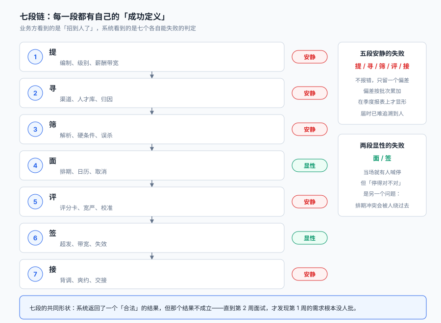
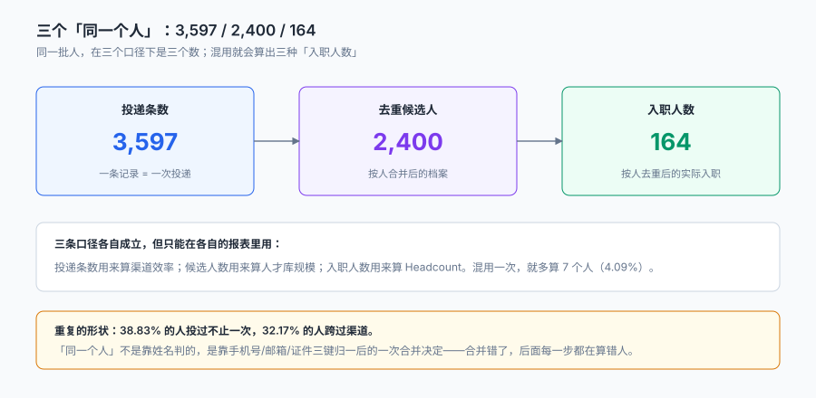
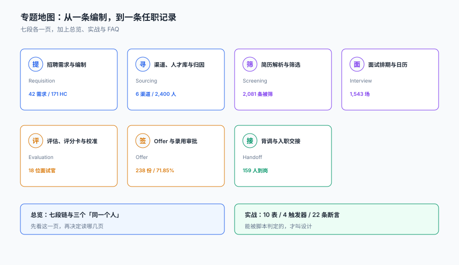

# 招聘与人才获取工程

<p style="text-align:center;"></p>

一个 171 人的招聘计划，走了 74 天：投递 3,597 条，面试 1,543 场，发出 238 份 Offer，171 人接受，159 人到岗。**每一个环节都有记录，漏斗图很漂亮，季度汇报上写着「招聘完成率 92.98%」。**

但如果有人问三个问题——**这 171 个人是同一批 171 个人吗、那 238 份 Offer 里有几份是发给同一个人的、从接 Offer 到有工号之间少了 12 个人是谁**——系统给不出答案。它存了三张表：投递表、面试表、Offer 表，每张表各自正确，但**三张表的「人」不是同一个「人」**。

::: tip 一句话理解
招聘系统的产物不是「一份 Offer」，而是**一条能追到人的链路**：这条投递属于哪个人、这个人被谁评过、评的时候用了哪把尺子、答应之后有没有真的来。四件事里任何一件没有落库，这次招聘就只是一次「有记录的发简历」。
:::

## 一、这个专题讲什么

从「这个岗位要不要招」到「这个人在系统里有工号」，一次招聘要走七段：

| 段 | 这一段在做什么 | 产物 | 失败是否安静 |
| --- | --- | --- | --- |
| ① 提 | 定编制、级别、薪酬带宽、JD | `requisition` | **安静**（编制没批也能先发 JD） |
| ② 寻 | 选渠道、捞人才库、算归因 | `application` + `channel` | **安静**（渠道重复计数没人报错） |
| ③ 筛 | 解析简历、硬条件、结构化匹配 | `screening` | **安静**（误杀的人不会来投诉） |
| ④ 面 | 排期、占日历、取消重排 | `interview_round` | 显性（面试官当场发现撞了） |
| ⑤ 评 | 评分卡、汇总、校准 | `score` | **安静**（换个加法就换人） |
| ⑥ 签 | 审批、报价、超发、失效 | `offer` | 显性（候选人会追问） |
| ⑦ 接 | 背调、入职日、主数据交接 | `onboarding` | **安静**（没来的人不会提交离职单） |



七段里**五段的失败是安静的**。它们的共同形状是：**系统返回了一个合法结果，但那个结果不成立**——编制没批但渠道已经把 JD 挂出去了，系统显示「需求已发布」；同一人被两个渠道各算一次入职，系统显示「内推入职 +1、平台入职 +1」，两个数都从自己的表里算得出来；16% 的简历被硬条件筛掉，系统显示「不符合要求」，而被筛掉的人里有 64 个（抽检 400 份）实际是符合的。

## 二、三个「同一个人」

「招了多少人」这句话在本册里有三个不同的答案，各自对，但不能互换：

| 口径 | 本机读数 | 它回答的问题 | 用错了会怎样 |
| --- | --- | --- | --- |
| 投递条数 | 3,597 | 渠道有多少人来投 | 当人数用，就多算 1.5 倍 |
| 去重候选人 | 2,400 | 人才库有多大 | 当入职数用，等于把「来过」当「来了」 |
| 按人入职 | 164 | 真正入职的人 | 与按投递归属相比差 7 条（4.09%） |



三个数不是「精度不同」，是**三个不同的定义**。它们之所以会混，是因为三张表各自用一个字段当人：投递表用 `application_id`，人才库用 `candidate_id`，员工表用 `employee_no`。而现实里，同一个人可能是「同一手机号、不同邮箱、两个渠道」的三条投递——**归并发生在哪一步，决定了后面所有报表的分母**。

::: danger 三件事必须写进数据模型，不能留给「报表里合并去重」
1. **人的主键必须早于投递产生**：先有三键归一（手机 / 邮箱 / 证件）得到 `candidate_id`，再有 `application` 挂在它下面。反过来做，等于每条投递都是新人。
2. **渠道归因必须声明「按首次触点还是末次触点」**：本机 1.58% 的入职会被两个渠道各记一次，两种口径都能自圆其说，混用就会出现「内推占比 31.58%」和「内推占比 30%」两张都对不上的报表。
3. **入职人数要按 `employee_no` 数，不按 `offer_id` 数**：一个人接了两次（先拒后接、或两家公司同集团）就会多出一条，本机 7 条 4.09% 的重复计数全部来自这里。
:::

## 三、四个「必失点」

这四种失败在本库反复出现，每一种都能通过「流程完整」的检查：

| 失败 | 看起来对在哪 | 实际错在哪 | 本机读数 |
| --- | --- | --- | --- |
| 编制外招聘 | 岗位已发布、有人投递 | HC 冻结或已满，JD 还挂在渠道上 | 5 个冻结需求仍收 422 条投递（11.73%） |
| 硬条件误杀 | 「不符合要求」 | 同义词/格式差异导致假阴性 | 抽检 400 份误杀 16.00%，外推 333 条 |
| 评分者宽严 | 每个人都被打了分 | 谁评的决定了分数 | 偏移 SD 3.14 分 → 排序 98.66% 变 |
| 账面到岗 | 「已接受 Offer」 | 接了没来、背调没过 | 账面 100% vs 实际 92.98% |

四个必失点里，**「评分者宽严」最反直觉**：它不需要任何人做错事，只要 18 位面试官各自有 3 分左右的宽严差异，745 个人里有 735 个的名次会变，及格名单会换掉 82 人（45.05%）。**这不是「打分不认真」，这是「没有可比尺子」。**

## 四、专题地图



| 阶段 | 页面 | 一句话 |
| --- | --- | --- |
| 提 | [招聘需求与编制](Requisition/index.md) | 编制是一个会被冻结的数字，不是一个状态 |
| 寻 | [渠道、人才库与归因](Sourcing/index.md) | 量的冠军不是质的冠军，成本也不在同一个分母上 |
| 筛 | [简历解析与筛选](Screening/index.md) | 筛掉的 2,081 条里，有 333 条本不该被筛掉 |
| 面 | [面试排期与日历](Interview/index.md) | 排一场要 23 次尝试，因为要 3 个人同时有空 |
| 评 | [评估、评分卡与校准](Evaluation/index.md) | 3 分的宽严差，足以换掉一半及格名单 |
| 签 | [Offer 与录用审批](Offer/index.md) | 超发倍数只由接受率决定，代价是人不是钱 |
| 接 | [背调与入职交接](Handoff/index.md) | 「接了」与「有工号」之间还有 12 个人 |
| 查 | [常见问题与自查清单](FAQ/index.md) | 十二个每天都会被问的问题 |
| 落地 | [实战：10 表 / 4 触发器 / 22 断言](Practice/index.md) | 能被脚本判定的，才叫设计 |

## 五、和相邻专题的分工

本册只讲「一个候选人怎么从投递走到工号」。相邻主题已经讲透的部分，这里不重复：

| 相邻专题 | 它讲什么 | 本专题不重复讲 |
| --- | --- | --- |
| [组织与任职](../OrgPeople/Overview/index.md) | 组织树、任职异动、双时态 | 入职后的**转正、调岗、离职** |
| [薪酬核算](../Payroll/Overview/index.md) | 应发/实发/公司成本 | 入职后的**算薪与个税** |
| [考勤排班](../TimeAttendance/Overview/index.md) | 排班、工时、加班 | 入职后的**出勤** |
| [培训与资格](../TrainingQualification/Overview/index.md) | 课程、学分、资格证 | 入职后的**培养** |
| [客户身份归并](../CustomerIdentity/Overview/index.md) | 实体解析、金记录、合并撤回 | 候选人去重只讲**三键与归并时点** |
| [审批流引擎](../WorkflowEngine/ApprovalFlow/index.md) | 流程定义、会签、加签 | Offer 审批只讲**带宽与超时** |
| [权限与授权](../Auth/Authorization/index.md) | 角色、数据权限 | 候选人数据的**可见范围**只提一句 |
| [通知与触达](../NotificationDelivery/Delivery/index.md) | 模板、通道、重投 | 面试邀约只讲**时点与确认** |
| [隐私与删除](../../Others/PrivacyEngineering/Deletion/index.md) | 删除请求、留存期 | 落选简历的**留存**只讲与删除的关系 |
| [合同版本演进](../ContractEvolution/index.md) | 条款版本、兼容 | 劳动合同**不在本册**，本册到入职单为止 |

## 六、版本组织：为什么不建版本目录

招聘领域最常见的疑问是「校招和社招、国内和海外，文档是不是要分两套」。本册**不建 `Recruiting/V1` 这类目录**，三条理由：

1. **换代的是渠道与法规文本，判据一字没变。** 从报纸广告到招聘平台到内推小程序，变的只是 `channel.code` 的枚举值；「编制要批、条件要一致、评分要可比、答应要来」这四条从有招聘那天起就成立。
2. **并存差异是雇主品牌与辖区，不是代际。** 校招、社招、蓝领、外包的差别在**流程长度与批次**，不在链路本身。用版本目录去装「校招」，会把适用范围问题伪装成代码分支问题。
3. **真正需要版本目录的是「同一份代码两套写法」。** 本库已有先例：[Spring5](../Java/Frame/Spring/Spring5/index.md) / [Spring6](../Java/Frame/Spring/Spring6/index.md)、[Vue2](../../Frontend/Frame/Vue/Vue2/index.md) / [Vue3](../../Frontend/Frame/Vue/Vue3/index.md)——同一框架两代 API 并存，旧版必须原样保留并标注维护状态。招聘不是这种情形：一套写法要接不同批次，差异落在批次日历与渠道表上。

::: info 旧规则版本的处置口径
遇到仍在执行旧版「结构化面试表单」或旧版背调项目的批次，**不新建章节**，在[评估、评分卡与校准](Evaluation/index.md)的维度对照表里加一行，标注「仅存量批次适用，新批次不再采用」。这条口径与 Spring5 / Vue2 的处理一致：旧内容保留、标注状态、不覆盖。
:::

## 七、建议阅读顺序

1. 先读[总览：七段链与三个「同一个人」](Overview/index.md)——把「可追到人的链路」这个概念立起来。
2. 再读[招聘需求与编制](Requisition/index.md)与[渠道、人才库与归因](Sourcing/index.md)——这两页决定「有多少人、从哪来」。
3. 然后是两段「判断人」的：[简历解析与筛选](Screening/index.md)、[评估、评分卡与校准](Evaluation/index.md)。
4. 接着是两段「安排人」的：[面试排期与日历](Interview/index.md)、[Offer 与录用审批](Offer/index.md)。
5. 最后读[背调与入职交接](Handoff/index.md)，按[实战](Practice/index.md)把 10 张表建出来，跑一遍 22 条断言。

## 八、本册的读数从哪来

所有数字来自一台 16 GB 笔记本上的 SQLite 3.50.4 / Python 3.13，种子 `20261105`，规模是 42 条招聘需求、2,400 名候选人、3,597 条投递、1,543 场面试、238 份 Offer，**不是生产数据，也不是压测结论**。

| 读数 | 值 | 出现在 |
| --- | --- | --- |
| HC / 实际到岗 | 171 / 159（92.98%） | [需求](Requisition/index.md) |
| 冻结需求仍收投递 | 422 条（11.73%） | [需求](Requisition/index.md) |
| 人岗比 | 1.50（3,597 / 2,400） | [渠道](Sourcing/index.md) |
| 内推转化 vs 平台转化 | 9.14% vs 1.28%（7.1×） | [渠道](Sourcing/index.md) |
| 猎头：入职占比 / 成本占比 | 19.30% / 73.83% | [渠道](Sourcing/index.md) |
| 硬条件误杀 | 16.00%（抽检 400） | [筛选](Screening/index.md) |
| 面试官时段冲突 | 43 / 1,543（2.79%） | [面试](Interview/index.md) |
| 评分者宽严 SD | 3.14 分（极差 12.23） | [评估](Evaluation/index.md) |
| 校正后名次变化 | 735 / 745（98.66%） | [评估](Evaluation/index.md) |
| Offer 超发 | +39.18%（接受率 71.85%） | [Offer](Offer/index.md) |
| 报价落在带宽外 | 27 / 238（11.34%） | [Offer](Offer/index.md) |
| 主数据缺字段 | 15 / 171（8.77%） | [交接](Handoff/index.md) |
| 断言通过 | 22 / 22，退出码 0 | [实战](Practice/index.md) |

::: warning 这些数字不能直接当业务基线
单机 SQLite 与真实 ATS（Applicant Tracking System，简历追踪系统）的并发、简历量级都不是一回事。本文用它们判断**方向和量级**（例如「超发倍数只由接受率决定」「3 分宽严能换掉半个及格名单」），不用它们承诺到岗率或招聘周期。凡涉及法规的结论，都以条文原文为准并在页内标注条号。
:::

## 验证方式

```shell
# 1. 目录与配图齐全（11 页 + 13 个资源）
find docs/Backend/Recruiting -name "index.md" | wc -l   # 期望 11
ls docs/Backend/Recruiting/assets | wc -l               # 期望 13

# 2. 判据族不撞号（应只输出本册 10 个前缀）
grep -rho "TA[A-Z]-[A-H]" docs/Backend/Recruiting | cut -c1-3 | sort -u

# 3. 链接与配图全部可解析（在仓库根目录）
pnpm docs:build
```

第 2 步的输出应当是 `TAE TAF TAH TAI TAO TAQ TAR TAS TAP TAX` 十个前缀；少一个说明有页面漏写判据，多一个说明撞了别人的族名。

## 参考资料

- 《中华人民共和国劳动合同法》第八条：用人单位招用劳动者时，应当如实告知工作内容、工作条件、工作地点、职业危害、安全生产状况、劳动报酬，以及劳动者要求了解的其他情况；用人单位有权了解劳动者与劳动合同直接相关的基本情况，劳动者应当如实说明。
- 《中华人民共和国劳动合同法》第十九条至第二十一条：试用期期限与试用期解除的条件，是本册「入职日」字段必须精确到日的原因。
- 《中华人民共和国个人信息保护法》第十三条、第十七条：处理个人信息应取得同意并告知处理目的、方式、种类与保存期限；对应本册[简历解析与筛选](Screening/index.md)里「落选简历的留存期」。
- 《中华人民共和国就业促进法》第三条、第二十七条：劳动者依法享有平等就业和自主择业的权利，禁止性别歧视等；对应本册「敏感字段不得进入筛选规则」的硬约束。
- GB/T 7408—2005《数据元和交换格式 信息交换 日期和时间表示法》：入职日、面试时段、Offer 有效期的表示格式。
- 与本册相邻：[组织与任职](../OrgPeople/Overview/index.md)、[薪酬核算](../Payroll/Overview/index.md)、[培训与资格](../TrainingQualification/Overview/index.md)。
