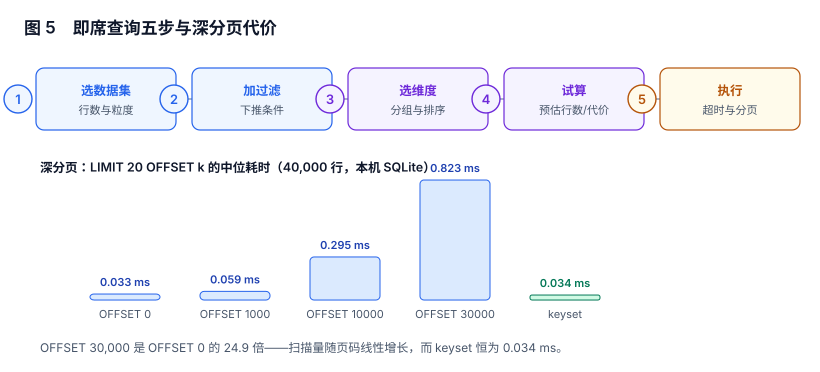

# 即席查询：预估、超时与分页

「自助分析」这四个字很容易被做成一件事：把查询框交给业务同事。上线一周后通常会出现两个现象：**同一个查询被不同的人用同样的参数跑了 40 次，而每次都没人知道它要跑多久**；以及**有人点了「下一页」之后浏览器转了三分钟**。

本页只回答一个问题：**在什么条件下，可以把查询权交出去**。答案不是「有权限」，而是「代价可预估、超时可截断、分页不随页码变慢」。

本页判据族 `RPA-A` ~ `RPA-H`，共 8 条。



## 一、五步构建：每一步都要有结构化产物

| 步骤 | 用户做什么 | 系统产出（结构化） | 失败表现 |
| --- | --- | --- | --- |
| 1 选数据集 | 选一张表 | `dataset_id` + 粒度 | 选错粒度，后面全错 |
| 2 加过滤 | 选区间、机构、状态 | `filters[]`（字段、操作符、值） | 条件拼进字符串 → 注入与不命中索引 |
| 3 选维度 | 拖分组字段 | `group_by[]` + 排序 | 分组字段高基数 → 卡死 |
| 4 试算 | 点「预估」 | 预估行数 / 预估代价 | 没有预估 → 直接跑全表 |
| 5 执行 | 点「运行」 | 结果 + 实际行数 + 耗时 | 无上限 → 一次查询打满连接池 |

关键在第 4 步。**没有预估的查询界面，本质上是「盲跑」**：用户不知道自己要等 0.2 秒还是 200 秒，于是他会重复点，而重复点会放大负载。

## 二、行数预估：三种做法与它们的盲区

| 做法 | 成本 | 准确性 | 盲区 |
| --- | --- | --- | --- |
| `COUNT(*)` 精确计数 | 与全表扫描同价 | 100% | 慢查询本身就要等很久，等于预估比执行还贵 |
| `EXPLAIN` 的估算行数 | 极低 | 中（依赖统计信息） | 统计信息过期时偏差可达数量级 |
| 采样 `TABLESAMPLE` + 外推 | 低 | 中高 | 高选择性过滤（<0.1%）时样本里可能一条都不命中 |

推荐组合：**默认用 `EXPLAIN` 估算，超过阈值（如 10 万行）时降级为「采样 + 提示可能不准」**，并且永远显示「预估」与「实际」两个数——两者的比值就是统计信息是否需要更新的信号。

```sql
-- PostgreSQL：拿估算行数，不执行
EXPLAIN (FORMAT JSON) SELECT region, SUM(amount_cents)
FROM orders WHERE biz_date BETWEEN '2026-10-01' AND '2026-10-31'
GROUP BY region;
-- 预期输出中 Plan Rows 即估算行数；与实际返回行数对比，偏差 > 10 倍说明统计信息过期
```

```sql
-- 采样外推：1% 采样，误差随行数下降
SELECT COUNT(*) * 100 AS est_rows
FROM orders TABLESAMPLE SYSTEM (1)
WHERE biz_date BETWEEN '2026-10-01' AND '2026-10-31';
-- 预期：与精确 COUNT 相比误差通常在 ±15% 以内；过滤后剩 0 行时不可用
```

## 三、超时：必须在数据库层，不在应用层

应用层的 `setTimeout` 只能「不再等」，不能「让数据库停下来」。查询还在跑，连接还占着，连接池照样被耗尽。

| 层次 | 手段 | 效果 |
| --- | --- | --- |
| 连接级 | `SET statement_timeout = '10s'` | 数据库主动取消，释放连接 |
| 事务级 | `SET LOCAL statement_timeout` | 只影响当前事务，适合多语句请求 |
| 资源组 | 独立连接池 / 只读副本 | 慢查询不挤占在线业务 |
| 应用层 | 取消 + 熔断 | 兜底，不作为唯一手段 |

```sql
-- 每次即席查询都在自己的事务里设定上限，结束自动失效
BEGIN;
SET LOCAL statement_timeout = '8000ms';
SET LOCAL idle_in_transaction_session_timeout = '5s';
SELECT region, COUNT(*) FROM orders WHERE biz_date = CURRENT_DATE GROUP BY region;
COMMIT;
-- 预期：超过 8 秒时返回 ERROR: canceling statement due to statement timeout
```

三层要一起上。只有应用层超时，慢查询会继续占用数据库 CPU；只有数据库超时，用户在超时前后的等待里没有任何提示。

## 四、LIMIT 的语义：没有 ORDER BY 的 LIMIT 是随机的

```sql
SELECT * FROM orders LIMIT 20;
-- 这 20 行是哪 20 行？取决于存储顺序、并行度、甚至当天的 VACUUM
```

三条必须写进查询构建器的约束：

1. **`LIMIT` 必须伴随 `ORDER BY`**，否则「第一页」每次可能不同，用户会认为数据在变。
2. **`ORDER BY` 的字段必须有索引或低基数**，否则排序本身成为代价瓶颈。
3. **超过结果上限要显式告知**：`LIMIT 10001` 拿到 10001 行时，界面应提示「已截断，请缩小范围或导出」，而不是安静地少显示。

## 五、深分页：`OFFSET` 的代价随页码线性增长

本节读数（40,000 行、有 `created_at` 索引、每页 20 行、中位数 20 次）：

| 分页方式 | 中位耗时 | 相对首页 |
| --- | --- | --- |
| `OFFSET 0` | 0.033 ms | 1.0× |
| `OFFSET 1,000` | 0.059 ms | 1.8× |
| `OFFSET 10,000` | 0.295 ms | 8.9× |
| `OFFSET 30,000` | 0.823 ms | **24.9×** |
| keyset（`WHERE created_at > ?`） | 0.034 ms | 1.0× |

数据量只有 4 万行时，绝对差值看起来无所谓；换成 400 万行，`OFFSET 3,000,000` 就是几秒。而**用户点到第 500 页的场景，几乎总是「想看完所有数据」——那他要的其实是导出，不是翻页**。

```sql
-- 反例：第 1501 页（偏移 30,000）
SELECT * FROM orders ORDER BY created_at LIMIT 20 OFFSET 30000;

-- 正例：keyset 分页，把上一页最后一行的排序键带回来
SELECT * FROM orders
WHERE created_at > $1                 -- 上一页最后一行的 created_at
ORDER BY created_at
LIMIT 20;
-- 预期：耗时不随页码变化；代价是「不能跳到任意页」，只能上一页/下一页
```

`ORDER BY` 若不是唯一键（同一秒有多笔订单），keyset 会漏行。正确写法是把排序列补成 `(created_at, order_id)` 复合键，并用行值比较：`WHERE (created_at, order_id) > ($1, $2)`。

## 六、危险查询：拦截要在生成阶段，不在执行阶段

| 形态 | 为什么危险 | 拦截方式 |
| --- | --- | --- |
| 无过滤条件的全表聚合 | 一次查询扫全表 | 未选时间/机构时禁用「运行」 |
| 笛卡尔积（缺关联条件） | 行数 = 两表乘积 | 解析查询结构，缺 `ON` 直接拒绝 |
| `LIKE '%关键词%'` | 索引失效 | 提示「前缀匹配可走索引」，附耗时预估 |
| 高基数分组（如按 `user_id`） | 返回百万行 | 分组字段基数 > 阈值时要求二次确认 |
| 对明细表排序后导出 | 排序 + 全量传输 | 引导到「导出」通路（异步 + 限额） |

拦截的位置很关键：在 SQL 字符串上做正则匹配既漏又误，**正确位置是查询的结构化表示**（`filters[]`、`group_by[]`、`joins[]`），因为它已经知道「有没有过滤」「关联条件在哪」。

## 七、可复现：把查询本身存下来

自助查询最大的隐性成本是「无法复现」：用户说「上周我查出来是 980 万」，而你只有一张截图。

| 存什么 | 用途 |
| --- | --- |
| 数据集 ID 与版本 | 当时读的是哪张表 |
| `filters` / `group_by` / `order_by` 的 JSON | 逐字复现查询 |
| 实际参数（含默认值） | 区分「用户选的」与「系统补的」 |
| 结果行数与耗时 | 判断是否被截断 |
| 执行时刻与时区 | 复现「那一该」的数据 |

有了这五项，「复现」就变成一次重放，而不是一次考古。

## 八、本页判据

| 编号 | 判据 | 为什么要它 | 怎么验证 |
| --- | --- | --- | --- |
| `RPA-A` | 查询由结构化部件（数据集/过滤/分组/排序）组成，不拼接字符串 | 拼接无法拦截、无法预估、无法复现 | 请求体是 JSON 结构而非 SQL 文本 |
| `RPA-B` | 执行前必须给出预估行数或预估代价 | 盲跑会引发重复点击与连接池耗尽 | 界面上同时显示「预估」与「实际」 |
| `RPA-C` | 超时在数据库会话层设置（`statement_timeout`），应用层只做兜底 | 应用层超时不会停止数据库 | 慢查询日志里出现 `canceling statement due to statement timeout` |
| `RPA-D` | 任何 `LIMIT` 必须与确定性 `ORDER BY` 同时出现 | 无排序的 `LIMIT` 结果随机 | 生成器拒绝「有 LIMIT 无 ORDER BY」 |
| `RPA-E` | 列表分页用 keyset（或游标），不用大偏移 `OFFSET` | `OFFSET` 代价随页码线性增长 | 第 500 页耗时 ≈ 第 1 页 |
| `RPA-F` | 危险形态（无过滤全表、笛卡尔积、高基数分组）在执行前拦截 | 事后限流只是把事故变小 | 构造三种查询，均在生成阶段被拒 |
| `RPA-G` | 结果超过上限时显式提示「已截断」 | 静默截断会被当成「数据缺失」 | 返回行数等于上限时界面有提示 |
| `RPA-H` | 每次执行留存查询结构、参数、行数、耗时、时区 | 没有它就无法复现争议 | 任取一条历史查询可一键重放 |

## 九、验证方式

```sql
-- 1) 深分页代价是否随页码增长（在你的库上跑，替换表名）
EXPLAIN (ANALYZE, BUFFERS) SELECT * FROM orders ORDER BY created_at LIMIT 20 OFFSET 30000;
-- 预期：Buffers 中的 shared read 明显大于 OFFSET 0 的同一查询
```

```sql
-- 2) 是否存在「有 LIMIT 没 ORDER BY」的查询（应用日志里搜）
-- 应用侧检查：SELECT query_json FROM query_log
--   WHERE query_json->>'sql' ILIKE '%limit%' AND query_json->>'sql' NOT ILIKE '%order by%';
-- 预期：0 行
```

```sql
-- 3) 语句超时是否真的生效
SET statement_timeout = '500ms';
SELECT pg_sleep(2);
-- 预期：ERROR: canceling statement due to statement timeout（而不是等 2 秒后返回）
```

## 十、参考资料

- [PostgreSQL: LIMIT and OFFSET](https://www.postgresql.org/docs/current/queries-limit.html)：`OFFSET` 需要先跳过行的语义，本页代价曲线的依据（2026-11 核对）
- [PostgreSQL: Client Connection Defaults](https://www.postgresql.org/docs/current/runtime-config-client.html)：`statement_timeout` 与 `idle_in_transaction_session_timeout` 的定义
- [PostgreSQL: EXPLAIN](https://www.postgresql.org/docs/current/sql-explain.html)：`Plan Rows` 与实际行数的偏差含义
- [PostgreSQL: TABLESAMPLE](https://www.postgresql.org/docs/current/sql-select.html#SQL-FROM)：采样语法与 `SYSTEM` / `BERNOULLI` 的区别
- [Apache Superset: 查询与超时配置](https://superset.apache.org/docs/configuration/configuring-superset)：`SQLLAB_TIMEOUT` 一类的落地配置项
