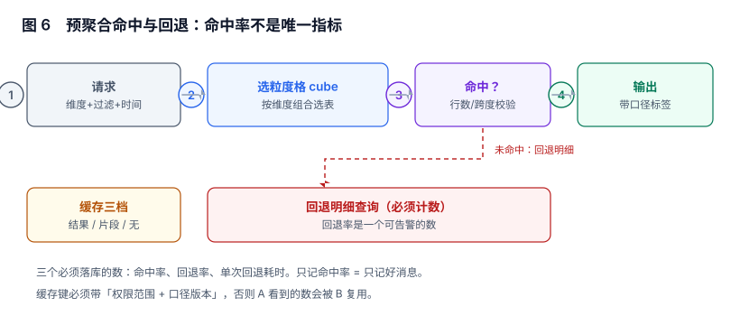

# 预聚合命中与缓存：只记命中率等于只记好消息

报表慢了，第一反应是「加缓存」或「加预聚合」。三个月后通常会出现一个奇怪的状态：**监控上命中率 90%+，而用户仍然抱怨慢**。原因很朴素——慢的都发生在剩下那 10% 上，而那 10% 恰好是最贵的查询。

本页判据族 `RPG-A` ~ `RPG-H`，共 8 条。



## 一、粒度格：预聚合不是「多建几张表」

粒度格（cube）是「维度的组合」：按「机构 × 品类 × 日」一张、按「机构 × 日」一张、按「品类 × 月」一张。每张表服务一类查询，查询来时按「需要哪些维度、跨度多长」选表。

| 组合 | 表 | 行数量级 | 服务的问题 |
| --- | --- | --- | --- |
| 机构 × 品类 × 日 | `agg_org_cat_day` | 千万 | 明细看板、按品类下钻 |
| 机构 × 日 | `agg_org_day` | 百万 | 日报、月度汇总 |
| 品类 × 月 | `agg_cat_month` | 十万 | 品类趋势 |
| 全站 × 日 | `agg_all_day` | 万 | 首页大数字 |

选表不是「越细越好」：细格子的行数按维度基数乘积增长，而查询命中率并不会同比提升。口径与物化的完整讨论在[指标平台的预聚合](../../MetricPlatform/Aggregate/index.md)，本册只处理「怎么选、怎么记、怎么退」。

## 二、命中率的分母决定它有没有意义

本节读数（64 个维度组合、覆盖 12 个、20,000 次请求、固定种子仿真）：

| 流量分布 | 覆盖 12 个组合 | 覆盖 24 个组合 |
| --- | --- | --- |
| 均匀分布 | 18.8% | 37.8% |
| 齐夫分布（真实世界更像这个） | **70.6%** | 83.2% |

同一套预聚合，两种流量分布下命中率差 **3.8 倍**。这说明两件事：

1. **命中率必须带「流量分布」这个前提**，否则它只是一个描述「用户最近爱点什么」的数。
2. **不要用命中率做验收指标**，因为它可以被「只统计热门查询」轻易做到 99%。

再补一个更能说明问题的读数：在同样的 64 组合下叠加一层结果缓存（TTL 内 35% 复用），命中率会升到 **99.4%**——因为组合空间太小，缓存最终把所有组合都收进去了。**一个只有 64 种可能查询的系统，命中率本来就没有信息量**。

## 三、命中校验：命中不等于可用

「有这张表」和「这张表能回答这个问题」是两件事。四个必须校验的维度：

| 校验项 | 不校验会怎样 | 怎么校验 |
| --- | --- | --- |
| 维度子集 | 用「机构 × 日」的表回答「按品类」的问题 → 数据不存在 | 请求维度 ⊆ 表维度 |
| 时间跨度 | 表只保留 400 天，查两年前 → 空结果被当成 0 | 请求区间 ⊆ 表区间 |
| 过滤兼容 | 表里没有 `channel` 列，过滤被忽略 → 数偏大 | 过滤字段 ⊆ 表维度或表带该列 |
| 口径版本 | 表按旧口径物化，请求要新口径 → 差一个口径 | `metric_version` 必须相等 |

第三条最容易出事：**过滤条件被静默忽略，报表上的数不会变 0，而是变大**。用户看到「App 渠道销售额」等于全渠道销售额，只会怀疑数据源，不会怀疑预聚合。

```sql
-- 选表函数：返回命中的表名，或 NULL 表示回退
CREATE OR REPLACE FUNCTION pick_cube(p_dims text[], p_from date, p_to date, p_metric_ver int)
RETURNS text AS $$
  SELECT table_name FROM cube_catalog
  WHERE p_dims <@ dims                       -- 维度子集
    AND p_from >= min_date AND p_to <= max_date
    AND metric_version = p_metric_ver
  ORDER BY array_length(dims, 1) ASC         -- 选最粗的可用表
  LIMIT 1;
$$ LANGUAGE sql STABLE;
-- 预期：请求维度不在任何表的 dims 里时返回 NULL，调用方必须走回退
```

`ORDER BY array_length(dims,1) ASC` 是有意的：**能用粗表就用粗表**。粗表行数少一个量级，代价低得多；细表只在需要下钻时用。

## 四、回退必须计数，而且要单独告警

回退（fallback）指「没有可用的预聚合表，直接查明细」。它是系统正常的一部分，但**回退率上升是最早的劣化信号**：新加了一个维度、口径升了版本、某张表忘了刷新——表现都是「页面变慢」，而命中率指标可能只是从 92% 掉到 88%，看起来无感。

三个必须落库的数：

| 指标 | 含义 | 阈值示例 |
| --- | --- | --- |
| `hit_rate` | 命中预聚合的请求占比 | 观察项，不作验收 |
| `fallback_rate` | 回退明细的请求占比 | 环比上升 50% 触发告警 |
| `fallback_p95_ms` | 回退路径的耗时 | 超过页面 SLA 的 80% 触发告警 |

```sql
-- 每日回退画像：按报表与原因拆开
SELECT report_code, fallback_reason, COUNT(*) AS n,
       percentile_cont(0.95) WITHIN GROUP (ORDER BY duration_ms) AS p95_ms
FROM query_log
WHERE created_at >= CURRENT_DATE - 1 AND fallback = true
GROUP BY 1, 2 ORDER BY n DESC;
-- 预期：fallback_reason 应有明确枚举（NO_CUBE / OUT_OF_RANGE / FILTER_MISS / VERSION_MISMATCH）
```

`fallback_reason` 是这一页最有价值的字段。没有它，你只能知道「变慢了」，不能知道「为什么」。

## 五、缓存三档与缓存键

| 档 | 缓存什么 | 命中条件 | 失效方式 |
| --- | --- | --- | --- |
| 结果缓存 | 整个结果集（含合计行） | 参数 + 权限范围 + 口径版本全等 | TTL + 主动失效 |
| 片段缓存 | 单条 SQL 的结果（数据集粒度） | 数据集 + 过滤 + 分组全等 | TTL |
| 无缓存 | —— | —— | —— |

缓存键必须包含**四类信息**，缺一类就会出现「串数据」或「陈旧数据」：

```text
cache_key = sha256(
    report_code + version_id +
    canonical(param_values) +        -- 键序归一、时间统一到 UTC
    permission_scope +               -- 机构/本人/全部，绝不能省
    metric_versions +                -- 每个指标的口径版本
    data_watermark                   -- 数据到达水位（可选，见下）
)
```

`permission_scope` 是最容易漏的一项，也是后果最严重的一项：漏了它，A 机构的缓存会被 B 机构命中，**页面上会出现别人的数，而且看起来完全正常**。

`data_watermark` 是「数据到达水位」：如果 ETL 每小时落地一次，同一小时内重复查询可以安全复用；跨过水位就必须失效，否则用户会看到「昨天的数」而不知道。

## 六、TTL 与「什么时候能看见新数据」

| 数据形态 | 合理 TTL | 说明 |
| --- | --- | --- |
| 日批（T+1） | 到下一个批次落地 | 批内不变，缓存可以很长 |
| 小时批 | 10~30 分钟 | 要小于批次间隔 |
| 实时流 | 1~5 分钟 | TTL 越长，用户越觉得「数不准」 |
| 手工补录 | 事件驱动失效 | 补录后必须主动清，不能等 TTL |

最后一行是实践中最常被忽略的：**补录是「历史数据变了」，而 TTL 只能处理「新数据来了」**。补录完成后要按 `(机构, 日期区间)` 精确失效，而不是全清——全清会造成一次缓存雪崩，而用户在那几分钟里看到的慢，会被记成「系统不稳定」。

## 七、静默降级：命中率没变，p99 变了两倍

三种「指标正常但体验变差」的形态：

1. **粗表被删了**：请求全部落到中等表，命中率仍是 100%，但每次多扫 20 倍行。
2. **回退路径变慢**：明细表加了列（宽表化），回退查询的 IO 翻倍，而回退率没变。
3. **缓存命中但结果变大**：同一查询返回行数从 200 涨到 20,000，缓存命中率 100%，传输与渲染时间翻倍。

所以验收要看**「命中路径的耗时」与「回退路径的耗时」两条曲线**，而不是一条总的 p95。

## 八、本页判据

| 编号 | 判据 | 为什么要它 | 怎么验证 |
| --- | --- | --- | --- |
| `RPG-A` | 每张预聚合表声明维度集合、时间区间与口径版本 | 缺一项就无法判断「能不能用」 | `cube_catalog` 三列齐全且非空 |
| `RPG-B` | 选表前校验维度子集、时间区间、过滤字段、口径版本四项 | 过滤被忽略会让数变大而不报错 | 构造四种不匹配请求，均应回退 |
| `RPG-C` | 回退次数与回退原因必须落库 | 只记命中率看不到劣化 | `query_log` 有 `fallback` 与 `fallback_reason` |
| `RPG-D` | 缓存键包含参数、权限范围、口径版本三要素 | 缺权限范围会串数据 | 两个不同权限的用户请求同参数，缓存键不同 |
| `RPG-E` | TTL 小于数据批次间隔，补录走主动失效 | TTL 无法处理历史数据变更 | 补录后 1 分钟内查询返回新值 |
| `RPG-F` | 命中路径与回退路径的耗时分别监控 | 总 p95 会掩盖单路径劣化 | 两条曲线独立存在且有阈值 |
| `RPG-G` | 降级必须可见（页面标注「明细实时计算」） | 静默降级会被当成性能问题而非设计 | 回退时界面有明确标识 |
| `RPG-H` | 命中率不得作为唯一验收指标 | 它可被「只统计热门查询」操纵 | 验收文档里同时列回退率与两条耗时 |

## 九、验证方式

```sql
-- 1) 预聚合表是否覆盖了声明的区间（有空洞就是「假命中」）
SELECT c.table_name, d.day
FROM cube_catalog c
CROSS JOIN LATERAL generate_series(c.min_date, c.max_date, '1 day') AS d(day)
LEFT JOIN agg_org_day a ON a.biz_date = d.day
WHERE a.biz_date IS NULL LIMIT 20;
-- 预期：0 行。有行 = 表声明了区间但没数据，命中的是空结果
```

```sql
-- 2) 缓存键是否真的带了权限范围
SELECT cache_key, permission_scope, hit_count
FROM result_cache ORDER BY hit_count DESC LIMIT 10;
-- 预期：permission_scope 不同的行 cache_key 必须不同
```

```sql
-- 3) 回退率日趋势（连续三天上升要能看出来）
SELECT date_trunc('day', created_at) d,
       COUNT(*) FILTER (WHERE fallback) * 100.0 / COUNT(*) AS fallback_pct
FROM query_log WHERE created_at >= CURRENT_DATE - 7
GROUP BY 1 ORDER BY 1;
-- 预期：pct 稳定或下降；突增时配合 fallback_reason 定位
```

## 十、参考资料

- [PostgreSQL: Materialized Views](https://www.postgresql.org/docs/current/rules-materializedviews.html)：物化视图的刷新语义与并发刷新限制（2026-11 核对）
- [PostgreSQL: Window Functions 与 percentile_cont](https://www.postgresql.org/docs/current/functions-aggregate.html)：分位数计算，本页 p95 指标的写法
- [Apache Superset: 缓存配置](https://superset.apache.org/docs/configuration/caching)：结果缓存与数据集缓存的层次划分
- [ClickHouse: Projections](https://clickhouse.com/docs/en/sql-reference/statements/alter/projection)：另一种「预聚合自动命中」的实现思路，可与本页的选表函数对照
- [dbt: 增量模型](https://docs.getdbt.com/docs/build/incremental-models)：预聚合表的增量刷新与幂等重算
