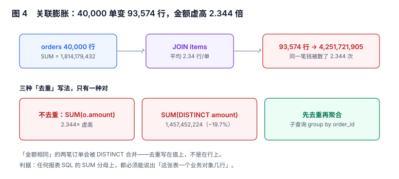

# 数据集、关联与粒度：一张报表的「分母」

报表里所有「数不对」的投诉，八成可以归到同一句话：**没有人能说清这张表里一行是什么**。一行是订单还是一行是订单明细？一行是「商品」还是「商品在某仓的库存」？说不清，`SUM` 就永远有两种答案，而两种都不报错。

本页判据族 `RDN-A` ~ `RDN-H`，共 8 条。



## 一、粒度声明：一行是什么、由谁决定

粒度（grain）不是注释，是**数据集的契约字段**，必须落库并且能被校验。

| 数据集 | 粒度（一行是什么） | 主键 | 可加指标 | 不可加指标 |
| --- | --- | --- | --- | --- |
| `ds_orders` | 一笔订单 | `order_id` | 订单金额、订单数 | —— |
| `ds_order_items` | 一张订单里的一行商品 | `(order_id, sku)` | 明细金额、件数 | 订单数（要 `DISTINCT`） |
| `ds_sessions` | 一次访问 | `session_id` | 访问次数 | 订单数（跨会话要归并） |
| `ds_inventory_daily` | 一个 SKU 一天 | `(sku, biz_date)` | 库存件数（日均） | 库存金额（会重复计） |

粒度错位的两种形态：

1. **粒度太细**：用明细表做「订单数」，`COUNT(*)` 得到 93,574 而不是 40,000（本机实测的行膨胀比 2.339）。修法是 `COUNT(DISTINCT order_id)`，但那是救命，不是设计。
2. **粒度太粗**：用日汇总表做「按小时的下钻」，只能得到「无法下钻」，用户以为系统坏了。

::: tip 一句话理解
粒度决定「哪些问题这张表能回答」。**上卷（roll-up）永远可行，下钻（drill-down）永远不可行**——所以粒度要按「最细的那个问题」定，而不是按「最常见的那个问题」定。
:::

## 二、关联膨胀：金额悄悄变 2.344 倍

40,000 笔订单，平均每单 2.34 行明细。把明细表 `JOIN` 进来之后：

```sql
-- 写法 A：直接 JOIN 后聚合（错）
SELECT SUM(o.amount_cents)
FROM orders o JOIN order_items i ON i.order_id = o.order_id;
-- 本机实测：4,251,721,905（正确值 1,814,179,432 的 2.344 倍）

-- 写法 B：先去重再聚合（对）
SELECT SUM(amount_cents) FROM orders;
-- 1,814,179,432
```

本节读数（40,000 单 / 93,574 明细行）：

| 指标 | 值 | 说明 |
| --- | --- | --- |
| 订单数 | 40,000 | 业务对象数 |
| JOIN 后行数 | 93,574 | 行膨胀 **2.339×** |
| 正确金额 | 1,814,179,432 | 按订单 |
| JOIN 后金额 | 4,251,721,905 | 膨胀 **2.344×** |
| `SUM(DISTINCT amount)` | 1,457,452,224 | 比正确值低 **19.7%** |

最后一行是重点：**很多人第一反应是加 `DISTINCT`，于是从「偏高 2.3 倍」变成「偏低 19.7%」**。原因很直白——`DISTINCT` 去的是「值」，不是「行」。两笔订单金额恰好相同（在这个数据里很常见：整数分、区间小），它们会被合并成一笔。

## 三、三种「去重」写法，只有一种对

| 写法 | SQL | 结果 | 什么时候能用 |
| --- | --- | --- | --- |
| 不去重 | `SUM(o.amount) JOIN items` | 2.344× | 永远不能 |
| 值去重 | `SUM(DISTINCT o.amount)` | −19.7% | 永远不能 |
| 行去重（子查询 / 派生表） | `SUM(x.amount) FROM (SELECT DISTINCT order_id, amount FROM ...) x` | 正确 | 需要明细字段时 |
| 预聚合（推荐） | 先在订单粒度聚合，再 JOIN | 正确且快 | 明细只用于过滤/展示 |

```sql
-- 推荐写法：先在订单粒度聚合，再关联明细做展示
WITH o AS (
  SELECT order_id, region, SUM(amount_cents) AS amt
  FROM orders WHERE biz_date BETWEEN $1 AND $2 GROUP BY order_id, region
), it AS (
  SELECT order_id, COUNT(*) AS item_cnt FROM order_items GROUP BY order_id
)
SELECT o.region, SUM(o.amt) AS amount, SUM(COALESCE(it.item_cnt, 0)) AS items
FROM o LEFT JOIN it USING (order_id)
GROUP BY o.region;
-- 预期：amount 合计 = 1,814,179,432；items 合计 = 93,574
```

两个数一个来自订单粒度、一个来自明细粒度，放在同一行是合法的——因为它们都是「按各自的业务对象计数」，而不是「把明细行数当订单数」。

## 四、金额量纲：用整数分，不用浮点

| 写法 | 类型 | 问题 |
| --- | --- | --- |
| `amount float8` | 二进制浮点 | `0.1 + 0.2 <> 0.3`；累加 40,000 行后误差可见 |
| `amount numeric(12,2)` | 定点 | 正确，但聚合慢，且 `SUM` 结果标度会变 |
| `amount_cents bigint` | 整数分 | **推荐**：聚合快、无误差、跨库一致 |

`numeric` 也可以，但要注意两件事：`SUM(numeric)` 的结果标度由输入决定，报表展示层四舍五入时容易与「合计行」不一致（见下节）。整数分把「四舍五入」推迟到唯一一次展示，是最省心的做法。

## 五、空值：`<>` 会把整行吞掉

本节读数（40,000 行，`channel` 列有 5,714 行为 NULL）：

| 查询 | 结果 | 说明 |
| --- | --- | --- |
| `COUNT(*)` | 40,000 | 行数 |
| `COUNT(channel)` | 34,286 | 空值占 **14.29%** |
| `WHERE channel <> 'app'` | **0 行** | NULL 与任何值比较都是 `unknown` |
| `WHERE channel IS DISTINCT FROM 'app'` | 5,714 行 | 正确写法 |

这不是 SQL 的怪癖，是 SQL 的三值逻辑。后果是**报表上「非 App 渠道」的分组整块消失，而且合计不会报警**——因为合计走的是另一条不带该条件的 SQL。

```sql
-- 报表口径里，分组维度的空值必须显式命名
SELECT COALESCE(channel, '(未知)') AS channel, COUNT(*) AS n, SUM(amount_cents) AS amt
FROM orders GROUP BY 1 ORDER BY n DESC;
-- 预期：多出一行 channel = '(未知)'，n = 5,714；五行 n 之和 = 40,000
```

`GROUP BY` 本身不吞 NULL（NULL 自成一组的），真正吞掉它的是 `WHERE` 里的比较。所以判据要落在「过滤条件」上，而不是「分组」上。

## 六、类型漂移：同一列在两个页面上是两种类型

| 字段 | 建模页写的 | 数据集里实际的 | 后果 |
| --- | --- | --- | --- |
| `biz_date` | `date` | `text`（`'2026-10-01'`） | 区间过滤变成字符串比较，`BETWEEN '2026-10-1' AND ...` 少一天 |
| `created_at` | `timestamptz` | `timestamp`（无时区） | 跨时区切日差一天，见[总览](../Overview/index.md) |
| `amount` | `numeric(12,2)` | `float8` | 合计与明细差几分钱 |
| `is_paid` | `boolean` | `smallint`（0/1） | `WHERE is_paid` 在 MySQL 语义下恒真 |

类型漂移是**最容易被机器发现、最容易被人工忽略**的一类：SQL 都能跑，只是结果不对。落地的做法是给每个数据集存一份「字段指纹」（列名 + 类型 + 可空），数据集变更时比对指纹，不一致就阻断发布。

```sql
-- 字段指纹：发布前必须与数据集当前 schema 一致
SELECT column_name, data_type, is_nullable
FROM information_schema.columns
WHERE table_name = 'orders' ORDER BY ordinal_position;
-- 预期：与 dataset_def.schema_fingerprint 中记录的 sha256 一致
```

## 七、预聚合的前提：可加性

数据集能不能被预聚合，取决于指标的可加性，而不是数据量大小。

| 指标类型 | 例子 | 能否按时段预聚合后再相加 |
| --- | --- | --- |
| 可加（additive） | 订单金额、件数 | 能 |
| 半可加（semi-additive） | 库存件数、账户余额 | 不能跨时间相加，只能取期末/期初 |
| 不可加（non-additive） | 转化率、客单价、去重人数 | 不能，必须回到明细重算 |

把「客单价」预聚合成「日均客单价」再求平均，是报表里最常见的错——数学上它等于「各日均值的平均」，而不是「总金额 / 总订单数」。口径与编译的细节在[指标平台](../../MetricPlatform/Aggregate/index.md)，本册只负责「不要把它放进预聚合表」。

## 八、本页判据

| 编号 | 判据 | 为什么要它 | 怎么验证 |
| --- | --- | --- | --- |
| `RDN-A` | 每个数据集声明粒度（一行是什么）与业务主键 | 粒度不清则 `SUM` 永远有第二种答案 | `dataset_def` 有 `grain` 与 `pk_cols` 字段 |
| `RDN-B` | 含一对多关联的指标，必须先聚合到业务对象粒度再 JOIN | 行膨胀是静默的 | 去掉 `JOIN` 后行数 = 业务对象数 |
| `RDN-C` | 禁止用 `SUM(DISTINCT col)` 修膨胀 | 值去重会误合并同额记录 | 全库搜 `SUM(DISTINCT` 为 0 处 |
| `RDN-D` | 金额用整数分或 `numeric`，禁止浮点 | 浮点误差在合计处放大 | 列类型不为 `float4/float8` |
| `RDN-E` | 分组维度的空值显式命名，过滤条件用 `IS DISTINCT FROM` 或 `COALESCE` | NULL 在 `WHERE` 里被静默丢弃 | 「未知」组存在且各组之和 = 总行数 |
| `RDN-F` | 时间字段统一为带时区类型，业务日单独一列 | 类型漂移导致切日错位 | 无 `timestamp without time zone` 的业务时间列 |
| `RDN-G` | 数据集存字段指纹，变更时比对并阻断发布 | 类型漂移只在结果上体现 | 指纹不一致时发布失败 |
| `RDN-H` | 不可加 / 半可加指标不得进入预聚合表 | 预聚合会把错误固化 | 预聚合表列清单与该指标清单无交集 |

## 九、验证方式

```sql
-- 1) 行膨胀体检：任意 JOIN 后行数是否等于业务对象数
SELECT (SELECT COUNT(*) FROM orders) AS orders,
       (SELECT COUNT(*) FROM orders o JOIN order_items i USING (order_id)) AS joined;
-- 预期：joined 远大于 orders 时，说明该指标不能直接 JOIN 后 SUM
```

```sql
-- 2) 金额自洽：明细合计 = 按订单合计
SELECT (SELECT SUM(amount_cents) FROM orders) AS by_order,
       (SELECT SUM(amount_cents) FROM (SELECT DISTINCT order_id, amount_cents FROM orders) t) AS by_distinct_row;
-- 预期：两列相等（同一张表上去重行不改变结果，说明主键唯一）
```

```sql
-- 3) 空值是否被吞：分组行数之和 vs 总行数
SELECT SUM(n) AS grouped, (SELECT COUNT(*) FROM orders) AS total FROM (
  SELECT COALESCE(channel,'(未知)') c, COUNT(*) n FROM orders GROUP BY 1) t;
-- 预期：grouped = total
```

## 十、参考资料

- [PostgreSQL: Aggregate Functions](https://www.postgresql.org/docs/current/functions-aggregate.html)：`COUNT(DISTINCT)` 与 `SUM` 的精确语义（2026-11 核对）
- [PostgreSQL: Comparison Operators](https://www.postgresql.org/docs/current/functions-comparison.html)：`IS DISTINCT FROM` 与 NULL 的三值逻辑
- [Kimball: The Data Warehouse Toolkit](https://www.kimballgroup.com/data-warehouse-business-intelligence-resources/books/)：粒度声明与事实表设计，本页「粒度即契约」的出处
- [PostgreSQL: Numeric Types](https://www.postgresql.org/docs/current/datatype-numeric.html)：`numeric` 与浮点的精度差异
- [dbt: 测试与契约](https://docs.getdbt.com/docs/build/tests)：把「行数守恒」「唯一性」做成可执行断言的做法
