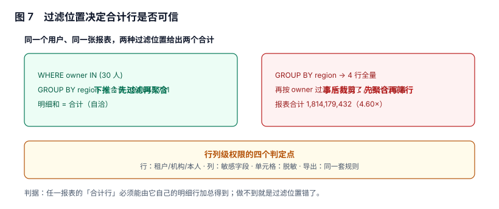

# 下钻与行列级权限：过滤发生在哪一步

报表权限做错的方式只有两种，但两种都很难被发现：**该看的看不到**（用户投诉「数据不全」），和**不该看的看到了**（没人投诉，直到审计）。第一种会被工单推动着修，第二种只会被审计发现——所以本页的重点是把权限做成**结构上不可能越界**，而不是「测试过没问题」。

本页判据族 `RPP-A` ~ `RPP-H`，共 8 条。



## 一、过滤位置：下推还是事后裁剪

同一个用户（只能看 30 位负责人）、同一张报表，两种实现给出两个合计：

| 实现 | 过程 | 合计 | 明细和 | 自洽吗 |
| --- | --- | --- | --- | --- |
| 下推（先过滤后聚合） | `WHERE owner IN (...)` → `GROUP BY region` | 394,643,731 | 394,643,731 | 是 |
| 事后裁剪（先聚合后筛行） | `GROUP BY region` → 按 owner 过滤行 | 1,814,179,432 | 394,643,731 | **否（4.60 倍）** |

本节读数（40,000 单、4 个大区、权限范围 30 位负责人）：可见范围占全量 **21.75%**，而事后裁剪的合计行仍是全量的 **1,814,179,432**。

这个错的形态很隐蔽：**表格里的每一行都是对的**（四个大区的数各自没错），只有最底下那个「合计」是错的。而用户看报表的第一眼看的恰恰是合计。

::: tip 一句话理解
权限不是「过滤结果」，是「过滤输入」。一旦聚合先发生，任何后续裁剪都只能裁剪「已经混过的数」。
:::

## 二、三条权限轴：行、列、单元格

| 轴 | 判什么 | 典型实现 | 失效形态 |
| --- | --- | --- | --- |
| 行（row） | 能看到哪些业务对象 | RLS 策略 / 强制 `WHERE` 注入 | 合计行漏过滤；关联表没带条件 |
| 列（column） | 能看到哪些字段 | 视图裁剪 / 查询期剔除 | 前端隐藏但接口仍返回 |
| 单元格（cell） | 同一个字段对不同人显示不同值 | 掩码函数（`***`、区间化） | 掩码只在前端做，导出是原文 |

三条轴必须**同源**：一份「权限策略」编译出行条件、列清单与掩码规则，而不是三处各写一遍。三处各写的结果是三条轴各自「看起来对」，组合起来漏。

## 三、行级：把条件交给数据库，不要交给应用

```sql [migrations/013_rls.sql]
ALTER TABLE orders ENABLE ROW LEVEL SECURITY;
ALTER TABLE orders FORCE ROW LEVEL SECURITY;   -- 表owner也受约束，别省

CREATE POLICY p_orders_scope ON orders
USING (
  current_setting('app.role', true) = 'admin'
  OR owner_id = ANY (string_to_array(current_setting('app.owner_ids', true), ',')::text[])
);
-- 预期：SET app.owner_ids = 'u001,u002' 后，SELECT COUNT(*) 只返回这两位的数据
```

两个细节决定成败：

1. **`FORCE ROW LEVEL SECURITY` 不能省**。不加它，表的所有者（通常是应用连接用户）绕过策略，于是「本地测试全对、生产全开」。
2. **`current_setting(..., true)` 的 `true` 不能省**。少了它，未设置变量时直接抛错，报表页会 500；有了它，未设置时返回 NULL，策略判为不匹配（更安全）。

## 四、列级与单元格：掩码必须在服务端

| 做法 | 安全吗 | 说明 |
| --- | --- | --- |
| 前端根据角色隐藏列 | 否 | 接口仍返回，抓包即得 |
| 查询时剔除列（`SELECT` 白名单） | 是 | 推荐，SQL 里就没有这一列 |
| 掩码函数（服务端） | 是 | `mask_phone()` 一类，展示与导出共用 |
| 掩码函数（前端） | 否 | 导出文件会泄露原文 |

```sql
-- 服务端掩码：展示与导出共用同一个函数
CREATE OR REPLACE FUNCTION mask_phone(p text, p_scope text)
RETURNS text AS $$
  SELECT CASE p_scope
    WHEN 'full'  THEN p
    WHEN 'part'  THEN left(p, 3) || '****' || right(p, 4)
    ELSE '***'
  END;
$$ LANGUAGE sql IMMUTABLE;
-- 预期：mask_phone('13800001234','part') = '138****1234'
```

## 五、合计行必须能由明细行加总得到

这是本页唯一一条「一条 SQL 就能验」的判据，也是最能抓住「过滤位置错」的判据：

```sql
-- 同一权限视图下，两条路径必须相等
WITH d AS (SELECT region, SUM(amount_cents) amt FROM v_orders_secure GROUP BY region)
SELECT (SELECT SUM(amt) FROM d) AS detail_sum,
       (SELECT SUM(amount_cents) FROM v_orders_secure) AS total_row;
-- 预期：两列相等。不等 = 合计行走的是另一条 SQL，或权限条件没带上
```

推论：**合计行不能用「缓存里的全量合计」**。很多系统为了快，把合计做成一个独立缓存（不带权限维度），于是所有用户看到同一个合计——这正是 4.60 倍的来源。

## 六、下钻：方向与粒度必须匹配

下钻（drill-down）在数据上是「换一张更细的表」，在权限上是「换一套更细的条件」。两件事必须同时成立：

| 下钻动作 | 数据侧 | 权限侧 |
| --- | --- | --- |
| 大区 → 机构 | 换粒度更细的 cube 或明细 | 机构级条件与用户范围求交 |
| 机构 → 订单 | 查明细表 | **逐单校验归属**，不能只查机构 |
| 订单 → 明细行 | 查明细子表 | 继承订单的归属，不新增条件 |

第二行最容易漏：机构可见不等于机构下每一单都可见（共享订单、代运营订单）。判据是「下钻结果集的 `owner_id` 全部落在权限集合内」，而不是「结果集非空」。

粒度本身的设计见[数仓的粒度与下钻](../../../DB/DataWarehouse/Grain/index.md)：那边回答「能不能下钻」，本页回答「下钻后还能不能看」。

## 七、权限变更必须让缓存失效

权限是缓存键的一部分（见[预聚合与缓存](../AggregateHit/index.md)的 `permission_scope`），但「用户被调岗」这件事**不会改变请求参数**，只会改变 `permission_scope` 的取值。于是：

| 事件 | 必须发生什么 | 不做会怎样 |
| --- | --- | --- |
| 用户调岗（机构变更） | 该用户的缓存键变化，旧键自然不再命中 | 用户继续看到原机构数据（最长 TTL） |
| 角色降级 | 主动失效该用户全部缓存 | 降级后仍能看敏感列，直到 TTL 到期 |
| 离职 | 账号禁用 + 失效 + 导出链接撤销 | 已发出的导出链接仍可下载 |

第三条与[导出](../ExportQuota/index.md)的分工：本页管「他还能不能查」，导出页管「他已经导走的东西怎么收回」。

## 八、越权验证：用另一个账号跑，不要用同一个

自查最常见的方法是「用管理员账号打开页面看看」——这什么也证明不了。可执行的越权验证要三条：

```sql
-- 1) 以受限身份执行，断言可见行数 = 预期（不是「不报错」）
SET ROLE report_reader;
SET app.owner_ids = 'u001';
SELECT COUNT(*) FROM orders;                       -- 预期：只有 u001 的行
SELECT COUNT(*) FROM orders WHERE owner_id <> 'u001';  -- 预期：0
RESET ROLE;
```

```sql
-- 2) 断言合计行自洽（见第五节）
-- 3) 断言导出文件行数 = 页面可见行数（跨入口一致性）
```

第二条与第三条是「结构验证」，第一条是「身份验证」。只有第一条的系统，会在「合计」和「导出」两个入口持续漏数。

## 九、本页判据

| 编号 | 判据 | 为什么要它 | 怎么验证 |
| --- | --- | --- | --- |
| `RPP-A` | 权限条件在聚合之前下推，合计行由同一条件产生 | 事后裁剪会让合计放大到全量 | 合计行 = 明细行之和 |
| `RPP-B` | 行级策略在数据库层（`ENABLE` + `FORCE ROW LEVEL SECURITY`） | 应用层过滤在直连与导出时失效 | 表 owner 连接也受策略约束 |
| `RPP-C` | 列级权限用 `SELECT` 白名单，不靠前端隐藏 | 前端隐藏的数据仍在响应体里 | 接口响应中不含越权列 |
| `RPP-D` | 掩码在服务端函数中实现，展示与导出共用 | 前端掩码在导出时泄露原文 | 导出文件中的敏感列已掩码 |
| `RPP-E` | 下钻结果逐条校验归属，而不是只校验机构 | 共享/代运营订单会越界 | 下钻结果 `owner_id` 全部在权限集合内 |
| `RPP-F` | 权限范围是缓存键的一部分 | 漏了会串数据且看起来正常 | 不同权限同参数 → 缓存键不同 |
| `RPP-G` | 角色/机构变更触发缓存失效，离职撤销导出链接 | TTL 期间仍可越权 | 变更后立即查询返回新范围 |
| `RPP-H` | 越权验证用受限身份执行，断言「0 行」而非「不报错」 | 不报错不等于没越权 | 断言 `WHERE owner_id <> me` 返回 0 |

## 十、验证方式

```sql
-- 1) 是否有表「开了 RLS 但没 FORCE」
SELECT relname FROM pg_class
WHERE relrowsecurity = true AND relforcerowsecurity = false;
-- 预期：0 行（有行 = 表所有者可绕过策略）
```

```sql
-- 2) 合计与明细自洽（每张对外报表跑一次）
WITH d AS (SELECT org_id, SUM(amount_cents) amt FROM v_orders_secure GROUP BY org_id)
SELECT (SELECT SUM(amt) FROM d) - (SELECT SUM(amount_cents) FROM v_orders_secure) AS diff;
-- 预期：0
```

```sql
-- 3) 缓存里是否有「同一键不同权限」的复用
SELECT cache_key, COUNT(DISTINCT permission_scope) AS scopes
FROM result_cache GROUP BY 1 HAVING COUNT(DISTINCT permission_scope) > 1;
-- 预期：0 行
```

## 十一、参考资料

- [PostgreSQL: Row Security Policies](https://www.postgresql.org/docs/current/ddl-rowsecurity.html)：`ENABLE` / `FORCE` 与 `USING` / `WITH CHECK` 的语义（2026-11 核对）
- [PostgreSQL: CREATE POLICY](https://www.postgresql.org/docs/current/sql-createpolicy.html)：策略的四种命令类型与默认拒绝行为
- [Apache Superset: 行级安全](https://superset.apache.org/docs/security)：产品化的 RLS 过滤器设计，可与本页的数据库层实现对照
- [OWASP: Broken Access Control](https://owasp.org/Top10/A01_2021-Broken_Access_Control/)：越权类缺陷的常见形态，本页「结构验证 + 身份验证」两条对应其防护建议
- [NIST SP 800-162: ABAC 指南](https://csrc.nist.gov/pubs/sp/800/162/upd2/final)：属性基访问控制的策略模型，用于解释「三条轴同源」的必要性
