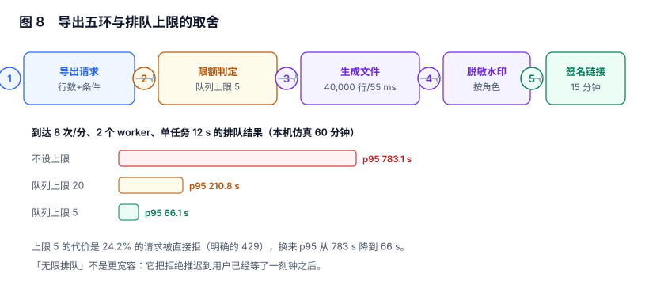

# 导出、限额与脱敏：文件是最容易失控的副本

报表页面上的数据是「可追的」：谁看的、看了哪一版，日志里都有。**导出的文件不是**——它一旦落到某个人的下载目录，就脱离了所有权限体系。

本页判据族 `RPE-A` ~ `RPE-H`，共 8 条。



## 一、五环：从请求到审计

| 环 | 做什么 | 关键约束 | 失败表现 |
| --- | --- | --- | --- |
| 1 请求 | 收参数、算行数 | 必须先算「要导多少行」 | 用户等 10 分钟才知道太大 |
| 2 限额 | 判并发、判配额、判频率 | 队列有上限，超限直接拒绝 | 无限排队，p95 从秒级变分钟级 |
| 3 生成 | 流式写文件 | 不把结果集一次性读进内存 | OOM，或把数据库连接占满 |
| 4 脱敏水印 | 按角色打码、加溯源水印 | 与页面同一套掩码函数 | 导出是原文，页面是打码 |
| 5 链接 | 私有桶 + 短期签名 | 有过期时间，可吊销 | 链接永久有效、可被转发 |

第六环「审计」不是一步动作，是贯穿五环的一条记录：谁、何时、什么参数、多少行、文件指纹、下载了几次。

## 二、先算行数，再决定同步还是异步

本节读数（本机 SQLite + CSV 写出，含表头）：

| 行数 | 生成耗时 | 文件大小 | 结论 |
| --- | --- | --- | --- |
| 10,000 | 15 ms | 0.18 MB | 同步可接受 |
| 40,000 | 55 ms | 0.75 MB | 仍可同步，但已接近「用户开始等」 |
| 400,000（外推） | ≈ 550 ms | ≈ 7.5 MB | 必须异步 |
| 4,000,000（外推） | ≈ 5.5 s | ≈ 75 MB | 必须异步 + 限并发 + 断点 |

耗时与体积都随行数线性增长（15 ms/万行、0.18 MB/万行）。这条线性的意义在于：**「多少行必须异步」是可以算出来的，不需要拍**。按「用户愿意等 3 秒」定阈值，约 20 万行。

```text
同步导出：行数 ≤ 20 万 且 预估耗时 ≤ 3 s      → 直接在请求里流式返回
异步导出：超出阈值                              → 落 export_task，返回 task_id，前端轮询
拒绝：    行数 > 单次上限（如 200 万）           → 提示缩小范围或联系数据团队
```

## 三、限额：无限排队不是宽容

本节读数（到达 8 次/分、2 个 worker、单任务 12 s、60 分钟、固定种子仿真）：

| 策略 | 完成 | 拒绝 | 拒绝率 | p50 等待 | p95 等待 |
| --- | --- | --- | --- | --- | --- |
| 不设上限 | 386 | 0 | 0% | 492.7 s | **783.1 s** |
| 队列上限 20 | 386 | 108 | 21.9% | 176.8 s | 210.8 s |
| 队列上限 5 | 386 | 123 | **24.2%** | 37.9 s | **66.1 s** |

三件事值得记下来：

1. **不设上限的系统，p95 是 13 分钟**。用户不是被拒绝，是被「静默地排在后面」——体验上两者一样糟，但前者还会拖垮所有其他请求。
2. **上限 5 与上限 20 的拒绝率几乎相同（24.2% vs 21.9%），p95 差 3.2 倍**。这说明「把上限调大」并没有减少拒绝，只是把拒绝推迟到用户已经等了 3 分钟之后。
3. **拒绝必须是明确的 429**，并告诉用户「当前排队 37 人，预计 6 分钟，是否改为订阅日报」。含糊的「系统繁忙，请稍后再试」会让用户反复点，把负载再放大一轮。

::: danger 三个把导出做成事故的写法
1. **把导出塞进页面请求线程**：一次 200 万行的导出会占住一个应用线程几分钟，并发几个就把服务打满——而监控上只看到「接口变慢」。
2. **`SELECT *` 全量读进内存再写文件**：40 万行 × 40 列的对象开销足以让 2 GB 堆的 Pod OOM。必须用游标/流式结果集。
3. **生成后放进公开可读的桶**：链接一旦被转发，任何拿到 URL 的人都能下载，且不受报表权限约束。文件必须私有，下载走短期签名。
:::

## 四、文件必须是私有的，链接必须有时效

| 方案 | 安全性 | 说明 |
| --- | --- | --- |
| 公开桶 + 随机文件名 | 低 | 文件名泄露即数据泄露；且无法吊销 |
| 私有桶 + 应用代理下载 | 中高 | 每次下载都过鉴权，代价是带宽走应用 |
| 私有桶 + 预签名 URL（15 分钟） | 高 | 兼顾带宽与安全；需注意签名不认业务状态 |

第三种是主流做法，但有一个必须写进判据的坑：**预签名 URL 在有效期内不再询问服务端**。用户被禁用、报表被下线、数据被要求删除，已签发的链接照样能下载。所以吊销必须做两件事：缩短有效期（15 分钟足够一次下载），以及在删除数据时**同时删除对象**（而不是只改数据库标记）。

## 五、水印与溯源：让「谁导的」跟着文件走

水印不是防截图（防不住），是**事后归因**。三个层次按成本递增：

| 层次 | 内容 | 成本 | 能回答什么 |
| --- | --- | --- | --- |
| 文件头注释 | `exported_by`、`snapshot_id`、时间 | 极低 | 这份文件从哪来 |
| 表格内隐藏列 | 同上，放在最右一列并设为隐藏 | 低 | 转发后仍可追溯（Excel 里能看到） |
| 可见水印 | 页眉/页脚印「张三 · 2026-11-07 · 内部」 | 中 | 截图外传时可识别 |

三层全做也不贵。**关键是 `snapshot_id` 必须写进去**——它是把文件与「当时那一版定义 + 那一刻的数据」连起来的唯一线索。

## 六、脱敏：与页面共用同一套函数

导出的脱敏规则必须与页面**完全同源**，否则会出现「页面上是 138\*\*\*\*1234，导出是 13800001234」这种最坏的情况——**用户以为导出的是同一份数据，于是把原文转发出去**。

| 检查点 | 正确做法 | 反例 |
| --- | --- | --- |
| 掩码函数 | 服务端统一函数，页面与导出都调用 | 页面用 SQL 掩码、导出用 Python 掩码，规则不一致 |
| 列裁剪 | 导出用与页面相同的列白名单 | 导出走 `SELECT *`，多带出 5 个敏感列 |
| 行范围 | 导出用与页面相同的权限视图 | 导出直连明细表，绕过 RLS |

第三条最危险：**页面走 `v_orders_secure`（带 RLS），导出走 `orders`（不带）**。两处代码相隔很远，测试时都「正常」，只有审计能发现。

## 七、审计：一条记录要能回答五个问题

```json
{
  "export_id": "exp_20261107_000173",
  "actor": "zhangsan",
  "report_code": "SALES_DETAIL",
  "version_id": 10231,
  "snapshot_id": "snap_9f31c2",
  "params": {"from": "2026-10-01", "to": "2026-10-31", "org_scope": "own"},
  "row_count": 41230,
  "file_sha256": "b1c9…",
  "file_expires_at": "2026-11-07T10:27:00+08:00",
  "download_count": 2,
  "created_at": "2026-11-07T10:12:00+08:00"
}
```

五个问题：谁导的（`actor`）、导了什么（`report_code` + `version_id` + `params`）、导了多少（`row_count`）、文件还在不在（`file_expires_at` + 对象是否存在）、有没有扩散（`download_count`）。

`file_sha256` 的作用是「文件比对」：当外部出现一份泄露文件时，能证明它是不是从你这里导出的那一份。

## 八、与数据删除的分工

导出文件是「数据副本」里最容易被漏掉的一类，因为它不在业务库里。处置口径：

| 对象 | 谁来管 | 什么时候消失 |
| --- | --- | --- |
| 业务库中的个人数据 | [数据删除](../../../Others/PrivacyEngineering/Deletion/index.md) | 按留存策略 |
| 导出任务记录 | 本页 | 按审计留存（通常长于业务数据） |
| 导出文件本体 | 本页 | **短期**（小时~天级），到期即删 |
| 已发出的下载副本 | 无法回收 | 只能靠水印归因 |

第三行是关键设计：**文件不长期保存**。用户要的是「拿到文件」，不是「在服务器上留一份」。文件 24 小时后自动删除，重导一次即可——这样「删除请求」只需要处理少量仍在有效期内的对象。

## 九、本页判据

| 编号 | 判据 | 为什么要它 | 怎么验证 |
| --- | --- | --- | --- |
| `RPE-A` | 导出前必须先算行数，并按阈值决定同步/异步/拒绝 | 不预估就只能让用户等 | 请求返回前有 `row_count` 与 `mode` |
| `RPE-B` | 大结果用流式/游标写出，不整表读入内存 | 整表读入必然 OOM | 40 万行导出时进程 RSS 平稳 |
| `RPE-C` | 队列有上限，超限返回 429 并给出排队信息 | 无限排队把拒绝推迟到 13 分钟后 | 压测下 p95 有明确上界 |
| `RPE-D` | 文件存私有桶，下载用短期签名 URL | 公开链接无法吊销 | 直接访问对象 URL 返回 403 |
| `RPE-E` | 脱敏与列裁剪与页面同源（同一函数/白名单） | 两套规则必然分叉 | 页面与导出的敏感列值完全一致 |
| `RPE-F` | 导出走与页面相同的权限视图 | 直连明细表会绕过 RLS | 导出行数 = 页面可见行数 |
| `RPE-G` | 文件内含 `snapshot_id` 与导出人水印 | 转发后无法归因 | 打开文件能读到三个溯源字段 |
| `RPE-H` | 导出记录留存、文件本体短期保存 | 文件长期留存会变成删除请求的盲区 | 24 小时后对象不存在，记录仍在 |

## 十、验证方式

```sql
-- 1) 导出与页面是否同源（行数必须相等）
SELECT (SELECT COUNT(*) FROM v_orders_secure) AS page_rows,
       (SELECT row_count FROM export_task WHERE export_id = 'exp_20261107_000173') AS export_rows;
-- 预期：相等。导出多 = 走了不带权限的表
```

```sql
-- 2) 是否有「永不过期」的导出文件
SELECT export_id, file_expires_at FROM export_task
WHERE file_expires_at IS NULL OR file_expires_at > now() + INTERVAL '7 days';
-- 预期：0 行
```

```sql
-- 3) 队列是否被塞满（等待时长 p95）
SELECT percentile_cont(0.95) WITHIN GROUP (ORDER BY extract(epoch FROM started_at - created_at)) AS wait_p95_s
FROM export_task WHERE created_at >= now() - INTERVAL '1 hour';
-- 预期：< 120 s。持续更高说明 worker 不足或上限过大
```

## 十一、参考资料

- [RFC 4180: CSV 格式](https://datatracker.ietf.org/doc/html/rfc4180)：分隔符、引号与换行的规范，避免「Excel 打开错列」（2026-11 核对）
- [PostgreSQL: DECLARE（游标）](https://www.postgresql.org/docs/current/sql-declare.html)：流式取数的服务端基础
- [Amazon S3: 预签名 URL](https://docs.aws.amazon.com/AmazonS3/latest/userguide/using-presigned-url.html)：签名有效期与「签名后不再校验业务状态」的官方说明
- [OWASP: Sensitive Data Exposure](https://owasp.org/www-project-top-ten/)：导出类数据泄露的常见形态
- [Apache Superset: 异步导出与结果限制](https://superset.apache.org/docs/configuration/configuring-superset)：`RESULTS_BACKEND` 与行数上限的产品化配置
