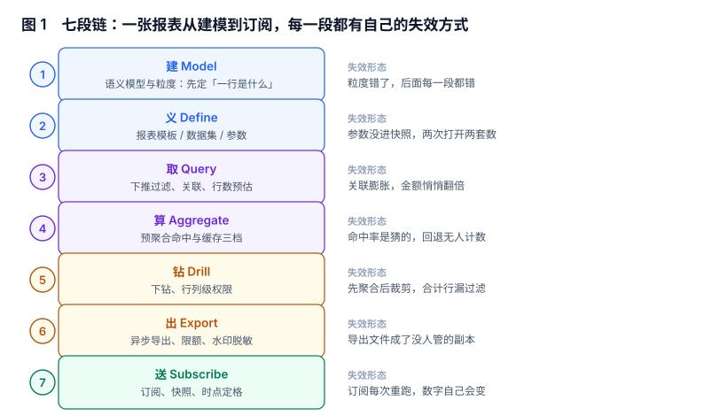

# 总览：三个「这张报表」与五个安静的失败

报表系统上线半年后，团队通常会发现两个现象同时存在：**每周都有人在群里问「到底哪个数是对的」，而每次追查的结果都是「三个都对」**。这两件事不矛盾，它们是同一个原因的两面——系统把「一页展示」当成了「一个对象」，又把「重新查一次」当成了「重发同一份报告」。

本页先把对象拆开，再把失败形态摆出来，最后给一条不换 BI 工具也能走的三步起点。

本页判据族 `RPO-A` ~ `RPO-H`，共 8 条。



## 一、三个「这张报表」不是同一个东西

同一句话在三个地方指三个不同的对象，混用是大部分设计错误的源头：

| 视角 | 对象 | 身份由什么决定 | 会变吗 | 谁在用它 |
| --- | --- | --- | --- | --- |
| 作者 | 报表定义（report definition） | `report_code` + 模板 + 数据集 + 参数 | 改一次产生新版本 | 编辑器、评审、发布 |
| 读者 | 报表版本（report version） | `version_id`（发布即冻结） | 永不改变 | 订阅、定时任务、历史对照 |
| 数据 | 报表快照（run snapshot） | `snapshot_id`（生成时刻 + 口径版本） | 永不重算 | 邮件正文、导出文件、工单举证 |

把三者混起来的典型后果：

1. **用定义当身份**：订阅里存 `report_id`、每次发送前「查最新」，作者改一次口径，过去 12 期已发出的月报在收件箱里同时「变了」。
2. **用版本当快照**：同一版本、同一参数，08:00 发一次、12:00 发一次，两个数（本机实测差 **14.66%**），因为中间有补录和退款。
3. **用快照当定义**：把某一期快照的 SQL 抄进代码当「报表逻辑」，三个月后没人能解释这版 SQL 对应哪条口径。

::: tip 一句话理解
定义回答「这一页怎么算」，版本回答「当时按什么算」，快照回答「那一刻算出来是多少」。三者可以一对一，但不该被同一个字段承载。
:::

## 二、七段链：每段的输入、输出与失败方式

| 段 | 输入 | 输出 | 失败时表现为什么 | 本册页面 |
| --- | --- | --- | --- | --- |
| 建 Model | 业务问题 | 语义模型与粒度 | 粒度错了，后面每一段都错 | [数据集](../DataSet/index.md) |
| 义 Define | 模板 + 数据集 + 参数 | 一个可发布的版本 | 参数没进快照，两次打开两套数 | [报表定义](../ReportDefinition/index.md) |
| 取 Query | 版本 + 参数 + 权限 | 结果集 | 关联膨胀、过滤没下推 | [数据集](../DataSet/index.md) / [即席查询](../AdHocQuery/index.md) |
| 算 Aggregate | 结果集 / 预聚合 | 聚合值 | 命中率是猜的，回退无人计数 | [预聚合](../AggregateHit/index.md) |
| 钻 Drill | 聚合值 + 维度层级 | 下一层明细 | 合计行与明细和不等 | [权限](../DrillPermission/index.md) |
| 出 Export | 结果集 + 角色 | 文件 + 链接 | 文件成了没人管的副本 | [导出](../ExportQuota/index.md) |
| 送 Subscribe | 快照 + 收件人 | 一封邮件 | 每次重跑，数字自己会变 | [订阅](../ScheduleSnapshot/index.md) |

七段里，**第 1、2、3、4、7 段的失败是安静的**：页面照样出数、导出照样成功、邮件照样送达，监控上看不出任何异常。只有第 5、6 段（权限越界、导出失败）有机会被指标发现。

## 三、五个安静的失败

这五条是本册各章的主线，每条后面挂着一个本机实测读数：

| 失败 | 为什么安静 | 本册读数（本机可复跑） |
| --- | --- | --- |
| 关联膨胀 | SQL 合法、结果非空、没人对过总数 | 40,000 单 JOIN 明细变 93,574 行，金额 **2.344 倍** |
| 时区切日 | 都叫「10 月 1 日」 | UTC 切出 30 天、+08:00 切出 31 天，首日 1,314 → **871（−33.7%）** |
| 空值被比较吞掉 | `<>` 对 NULL 返回 unknown，不报错 | `COUNT(*)` 40,000 vs `COUNT(channel)` **34,286**；`channel <> 'app'` 返回 **0 行** |
| 过滤位置错 | 两处都能出数 | 合计行 1,814,179,432 vs 明细 394,643,731（**4.60 倍**） |
| 订阅重跑 | 每封邮件都是「最新数据」 | 08:00 与 12:00 同一区间：842,321,635 → **965,802,432（+14.66%）** |

五条分别对应：[数据集](../DataSet/index.md)、[数据集](../DataSet/index.md)、[数据集](../DataSet/index.md)、[权限](../DrillPermission/index.md)、[订阅](../ScheduleSnapshot/index.md)。三条扎堆在「取」这一段不是巧合——**报表的绝大部分错误发生在 SQL 里，而不是在图表里**。

::: danger 不要把「页面能打开」当成「报表是对的」
报表的错误几乎都不会抛异常：`JOIN` 多出几倍行不会报错、`NULL` 不参与比较不会报错、`OFFSET` 翻到第 500 页只是慢一点、订阅重跑只是数字变了。**唯一能拦住它们的是一条能自己算的校验**——比如「合计行必须等于明细行之和」「COUNT(\*) 必须等于导出条数」。本册每一页的「验证方式」都是这种可执行校验，不是「看一眼对不对」。
:::

## 四、三个反模式

这三个写法在评审时都很合理，上线半年后都会变成「不敢动」：

1. **把报表当 SQL 的别名**：一个页面一个 `SELECT`，参数拼字符串。改一次口径要发布一次应用，且没有版本、没有快照、没有权限下推——四个必要能力一个都没有。正确做法是「定义（声明式）+ 参数（结构化）+ 渲染（通用）」，见[报表定义](../ReportDefinition/index.md)。
2. **把导出当「复制粘贴」**：前端把表格里那 20 行 `innerHTML` 存成 CSV，于是「导出 = 当前页」。用户要的是全量、要能被 Excel 打开、要能追到谁导的，这三件事一件都做不到，见[导出](../ExportQuota/index.md)。
3. **用一张大宽表服务所有报表**：为了「什么都能查」，把 40 张表拼成一张 300 列的宽表。结果是粒度被最细的那张表绑死（一行是「订单明细」而不是「订单」），任何按订单聚合都要先 `DISTINCT`，而这正是 2.344 倍膨胀的来源。

## 五、什么时候不需要报表平台

报表是有成本的：定义维护、口径对齐、权限矩阵、导出审计。下面四条同时成立时，**先别建平台**：

- 看数的人不超过 3 个，且他们能直接连库跑 SQL。
- 需求是「一次性拉个数」，不会每周重复。
- 数据量小到 `SELECT` 秒回，不需要预聚合与缓存。
- 没有对外承诺（监管报送、财务结账、SLA 报表），错了没人追责。

四条里只要有一条不成立，就需要至少一个最小形态：**一张存「谁在什么时候看了哪一版、导出了什么」的表**。这张表不需要 BI 工具，一个定时脚本加一张表就能起步。

## 六、最小起步三步

1. **先有版本**：把「报表定义」从代码里搬到数据里（模板 + 数据集 + 参数），发布即冻结。这一步能立刻消灭「上周的数怎么变了」这类工单，且不需要改任何查询。
2. **再有快照**：定时任务跑完不要只发邮件，把结果按 `snapshot_id` 落一张表。**快照比定义更重要**——没有快照，你永远无法回答「三个月前那封邮件里的数是怎么算的」。
3. **最后做自助**：在前两步的数据上统计「哪些报表被反复改参数」「哪些查询总是超时」，只放开最常被问的那三张。没有这个分母就开放自助查询，等于把数据库直接暴露给 200 个人。

顺序不能反。先做自助分析的人，通常会在第二周遇到「数据库被打挂，而 80% 的查询是同一条」的死结——因为他放开的是最贵的入口，而不是最常被问的问题。

## 七、本页判据

| 编号 | 判据 | 为什么要它 | 怎么验证 |
| --- | --- | --- | --- |
| `RPO-A` | 「报表定义 / 版本 / 快照」三者分别有独立标识，不共用一个 ID | 三者生命周期不同，混用会让历史报表与订阅同时失真 | 库里能分别查到 `report_def`、`report_version`、`run_snapshot` 三张表 |
| `RPO-B` | 每次发布产生新的 `version_id`，旧版本内容不可改 | 订阅与审计引用的是版本，不是「最新」 | 对已发布版本执行 `UPDATE` 必须被触发器拒绝 |
| `RPO-C` | 任何对外交付（邮件、导出、工单附件）都能追到 `snapshot_id` | 不可追溯的报表在争议时无法举证 | 任取一封订阅邮件，能在库里查到对应快照行 |
| `RPO-D` | 报表 SQL 的每个 `SUM` 都能说出「分母表一个业务对象几行」 | 关联膨胀是静默的 | 对含 JOIN 的指标，去掉聚合后行数与业务对象数一致 |
| `RPO-E` | 时间归属写明时区，且与业务日定义一致 | 跨时区切日会整体挪动一天的数 | 同一批数据按两套时区切日，日计数差异可解释 |
| `RPO-F` | 权限过滤发生在聚合之前（或聚合结果按同一条件过滤） | 合计行漏过滤会放大到全量 | 报表合计行 = 其明细行之和 |
| `RPO-G` | 导出与订阅的数字与页面同源（同一快照或同一查询） | 三个入口三套 SQL 是「三个答案」的根源 | 同参数下三处数字完全相等 |
| `RPO-H` | 每张对外报表至少一条可自动执行的校验（合计/条数/对账） | 人工目视无法覆盖 200 张报表 | 校验失败会阻断发送或标红页面 |

## 八、验证方式

三步都能在读完本册后对着自己的库跑，不需要改代码：

```sql
-- 1) 是否存在「两个入口两个数」：同一报表同一参数，快照与页面是否同源
SELECT r.report_code, s.snapshot_id, s.total_amount, s.row_count
FROM run_snapshot s JOIN report_version v ON v.version_id = s.version_id
JOIN report_def r ON r.report_code = v.report_code
WHERE s.created_at >= CURRENT_DATE - INTERVAL '7 days'
ORDER BY s.created_at DESC LIMIT 20;
-- 预期：同一 report_code 的参数与口径版本能在行内读到；读不到 = 快照只存了数字
```

```sql
-- 2) 是否还有「改过的历史版本」
SELECT version_id, published_at, updated_at
FROM report_version
WHERE updated_at > published_at;
-- 预期：0 行。有行 = 发布后仍可改，历史报表已经不可信
```

```sql
-- 3) 合计行与明细行是否自洽（以权限过滤后的视图为准）
WITH detail AS (
  SELECT region, SUM(amount_cents) AS amt FROM v_orders_secure GROUP BY region
)
SELECT (SELECT SUM(amt) FROM detail) AS detail_sum,
       (SELECT SUM(amount_cents) FROM v_orders_secure) AS direct_sum;
-- 预期：两列相等。不等 = 过滤位置在聚合之后，或合计行走的是另一条 SQL
```

第三条最容易被忽略：它不需要你知道「正确的数是多少」，只要看**同一份权限视图下两条路径能不能对上**。对不上，就不用再争论谁对谁错了。

## 九、参考资料

- [Apache Superset 文档](https://superset.apache.org/docs/introduction)：数据集、指标与权限模型，用于确认「语义层」与「报表层」的分界（2026-11 核对）
- [Metabase 文档](https://www.metabase.com/docs/latest/)：查询处理器与「模型 / 问题 / 仪表盘」三层对象，与本册「定义 / 版本 / 快照」对照
- [PostgreSQL: LIMIT and OFFSET](https://www.postgresql.org/docs/current/queries-limit.html)：`OFFSET` 的扫描语义，本册[即席查询](../AdHocQuery/index.md)的代价曲线据此推导
- [PostgreSQL: Row Security Policies](https://www.postgresql.org/docs/current/ddl-rowsecurity.html)：行级安全策略与下推，本册[权限](../DrillPermission/index.md)的落地方式
- [RFC 4180: CSV 格式](https://datatracker.ietf.org/doc/html/rfc4180)：导出的分隔、引号与编码约定，避免「Excel 打开乱码」这类交付事故
