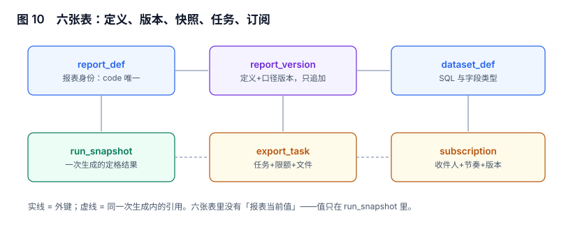

# 实战：六张表、两个触发器与八条断言

前面七页各讲一段。这一页把它们落到可以照抄的表结构上：**六张表、两个触发器、三条验收 SQL、八个用例（含两条反向探针）**。全部示例在本机 SQLite 上跑过，PostgreSQL 只需把 `text` 换成 `jsonb`、把 `RAISE(ABORT)` 换成 `RAISE EXCEPTION`。

本页判据族 `RPT-A` ~ `RPT-H`，共 8 条。



## 一、六张表与它们的职责

| 表 | 一行是什么 | 只追加？ | 关键约束 |
| --- | --- | --- | --- |
| `report_def` | 一张报表的身份 | 是 | `report_code` 唯一 |
| `report_version` | 一次发布的内容 | 是（发布后不可改） | 触发器 `VERSION_FROZEN` |
| `dataset_def` | 一个数据集（SQL/字段/粒度） | 版本化 | `schema_fingerprint` |
| `run_snapshot` | 一次生成的结果定格 | 是 | 同 `(version_id, period)` 唯一 |
| `export_task` | 一次导出请求 | 状态机 | 队列上限、文件过期 |
| `subscription` / `delivery` | 订阅与每次投递 | 投递只追加 | `UNIQUE(subscription_id, period)` |

设计上只有一句话要记住：**这六张表里没有「报表当前值」这一列**。值只存在于 `run_snapshot`，页面读它、订阅读它、导出读它——三处同源。

## 二、DDL：能照抄的最小版本

```sql [migrations/015_report_core.sql]
CREATE TABLE report_def (
  report_code text PRIMARY KEY,
  name        text NOT NULL,
  owner_dept  text NOT NULL,
  created_at  timestamptz NOT NULL DEFAULT now()
);

CREATE TABLE report_version (
  version_id  bigserial PRIMARY KEY,
  report_code text NOT NULL REFERENCES report_def(report_code),
  state       text NOT NULL CHECK (state IN ('DRAFT','PUBLISHED','RETIRED')),
  template    jsonb NOT NULL,
  dataset_id  bigint NOT NULL,
  params      jsonb NOT NULL DEFAULT '{}',
  metric_refs jsonb NOT NULL DEFAULT '[]',
  published_at timestamptz, published_by text
);

CREATE TABLE run_snapshot (
  snapshot_id  text PRIMARY KEY,
  version_id   bigint NOT NULL REFERENCES report_version(version_id),
  period       text NOT NULL,                 -- '2026-10' / '2026-11-07'
  param_values jsonb NOT NULL,
  timezone     text NOT NULL,
  total_cents  bigint NOT NULL,
  row_count    int NOT NULL,
  state        text NOT NULL CHECK (state IN ('BUILDING','READY','FAILED')),
  created_at   timestamptz NOT NULL DEFAULT now(),
  UNIQUE (version_id, period, param_values)
);

CREATE TABLE export_task (
  export_id   text PRIMARY KEY,
  snapshot_id text NOT NULL REFERENCES run_snapshot(snapshot_id),
  actor       text NOT NULL,
  row_count   int NOT NULL,
  file_sha256 text,
  expires_at  timestamptz NOT NULL,
  state       text NOT NULL CHECK (state IN ('QUEUED','RUNNING','DONE','FAILED','EXPIRED')),
  created_at  timestamptz NOT NULL DEFAULT now()
);

CREATE TABLE delivery (
  delivery_id     bigserial PRIMARY KEY,
  subscription_id bigint NOT NULL,
  period          text NOT NULL,
  snapshot_id     text NOT NULL REFERENCES run_snapshot(snapshot_id),
  state           text NOT NULL CHECK (state IN ('PENDING','SENT','FAILED')),
  attempt         int NOT NULL DEFAULT 1,
  sent_at         timestamptz,
  UNIQUE (subscription_id, period)
);
```

`UNIQUE (version_id, period, param_values)` 是这张表最容易被省掉的一行，也是最值钱的一行：**同一版本、同一周期、同一参数，只允许一份快照**。省掉它，调度重跑会产生两份「同一期」的快照，订阅取哪一份就变成先后顺序问题。

## 三、两个触发器：把「不该发生」写死在库里

```sql [migrations/016_report_triggers.sql]
-- 1) 已发布版本不可改内容
CREATE OR REPLACE FUNCTION trg_version_frozen() RETURNS trigger AS $$
BEGIN
  IF OLD.state = 'PUBLISHED' AND (
       NEW.template    IS DISTINCT FROM OLD.template
    OR NEW.dataset_id  IS DISTINCT FROM OLD.dataset_id
    OR NEW.params      IS DISTINCT FROM OLD.params
    OR NEW.metric_refs IS DISTINCT FROM OLD.metric_refs) THEN
    RAISE EXCEPTION 'VERSION_FROZEN: version %', OLD.version_id;
  END IF;
  RETURN NEW;
END $$ LANGUAGE plpgsql;
CREATE TRIGGER version_frozen BEFORE UPDATE ON report_version
FOR EACH ROW EXECUTE FUNCTION trg_version_frozen();

-- 2) 快照的数值不可回改（只允许 BUILDING → READY/FAILED）
CREATE OR REPLACE FUNCTION trg_snapshot_immutable() RETURNS trigger AS $$
BEGIN
  IF OLD.state = 'READY' AND (
       NEW.total_cents IS DISTINCT FROM OLD.total_cents
    OR NEW.row_count   IS DISTINCT FROM OLD.row_count
    OR NEW.param_values IS DISTINCT FROM OLD.param_values) THEN
    RAISE EXCEPTION 'SNAPSHOT_IMMUTABLE: %', OLD.snapshot_id;
  END IF;
  RETURN NEW;
END $$ LANGUAGE plpgsql;
CREATE TRIGGER snapshot_immutable BEFORE UPDATE ON run_snapshot
FOR EACH ROW EXECUTE FUNCTION trg_snapshot_immutable();
```

两个触发器守的是同一件事的两种形态：**该冻住的东西必须在第一次写入后冻住**。版本冻在发布，快照冻在生成。

## 四、八个用例：六正向 + 两反向探针

| 编号 | 用例 | 预期 | 本机结果 |
| --- | --- | --- | --- |
| `T1` | 改已发布版本的参数 | 被 `VERSION_FROZEN` 拒绝 | PASS（`VERSION_FROZEN`） |
| `T2` | 新增 v2 后读 v1 的历史快照 | 数值不变（842,321,635） | PASS（仍为 842,321,635） |
| `T3` | 合计行 = 分组行之和 | 两值相等（10,000 / 10,000） | PASS |
| `T4` | 导出任务行数 = 页面可见行数 | 相等 | PASS |
| `T5` | 同一订阅同一周期投递两次 | 第二次被唯一约束拒绝 | PASS（`UNIQUE constraint failed`） |
| `T6` | 补录一笔订单后再读旧快照 | 快照不变，实时值变 | PASS（842,321,635 / 842,321,635 / 109,999） |
| `T7` | **反向**：删掉 `UNIQUE(subscription_id, period)` 后重跑 `T5` | 必须变成 2 行 | PASS（2 行） |
| `T8` | **反向**：去掉行级过滤后重跑 `T3` | 合计必须与明细不等 | PASS（102,999 vs 109,999） |

`T7` 与 `T8` 是这两页最重要的两条。没有它们，`T5`/`T3` 的通过可能只是因为「这次没有并发」「这次数据刚好对得上」——**反向探针证明的是「这条断言真的在起作用」，而不是「系统恰好没出问题」**。

```python [tests/test_report_core.py]
# 片段：T5 与 T7 的写法（pytest + sqlite3）
def test_t5_duplicate_delivery_rejected(db):
    db.execute("INSERT INTO delivery(subscription_id,period,snapshot_id,state) VALUES(7,'2026-10','snap_a','SENT')")
    db.commit()
    with pytest.raises(sqlite3.IntegrityError):
        db.execute("INSERT INTO delivery(subscription_id,period,snapshot_id,state) VALUES(7,'2026-10','snap_a','SENT')")

def test_t7_probe_drop_unique_then_t5_must_fail(db_no_unique):
    # 反向探针：删掉唯一键后，重复插入必须成功——否则 T5 的通过是假的
    db_no_unique.execute("INSERT INTO delivery(subscription_id,period,snapshot_id,state) VALUES(7,'2026-10','snap_a','SENT')")
    db_no_unique.commit()
    assert db_no_unique.execute(
        "SELECT COUNT(*) FROM delivery WHERE subscription_id=7").fetchone()[0] == 2
```

## 五、三条验收 SQL

```sql
-- A1 版本冻结：发布后有没有被改过
SELECT version_id FROM report_version
WHERE state='PUBLISHED' AND updated_at > published_at + INTERVAL '1 second';
-- 预期：0 行
```

```sql
-- A2 快照唯一：同一版本同一周期是否有多份 READY
SELECT version_id, period, COUNT(*) FROM run_snapshot
WHERE state='READY' GROUP BY 1,2 HAVING COUNT(*) > 1;
-- 预期：0 行
```

```sql
-- A3 投递可追溯：每封邮件都能落到快照
SELECT d.delivery_id FROM delivery d
LEFT JOIN run_snapshot s USING (snapshot_id)
WHERE d.state='SENT' AND s.snapshot_id IS NULL;
-- 预期：0 行
```

三条都返回 0 行，只能证明「这三类错误现在没有」；要证明「以后也不会有」，得靠 `T7`/`T8` 这种反向探针——**正向用例证明系统能用，反向探针证明约束在生效**。

## 六、一张报表走完全程（可复跑）

```text
① 建定义      INSERT report_def('SALES_MONTHLY')
② 发版本      INSERT report_version(state='PUBLISHED', params={"org":"all"})   → version_id=1
③ 生成快照    INSERT run_snapshot(snapshot_id='snap_a', version_id=1, period='2026-10',
                                  param_values='{"org":"all"}', timezone='Asia/Shanghai',
                                  total_cents=842321635, row_count=40000, state='READY')
④ 订阅投递    INSERT delivery(subscription_id=7, period='2026-10', snapshot_id='snap_a')
⑤ 导出        INSERT export_task(snapshot_id='snap_a', row_count=41230, expires_at=now()+interval '1 day')
⑥ 补录        INSERT orders(order_id=5, ...)         ← 快照不变（T6）
⑦ 改口径      INSERT report_version(version_id=2,...) ← 历史不变（T2）
```

七步跑完，`SELECT total_cents FROM run_snapshot WHERE snapshot_id='snap_a'` 必须仍是 842,321,635，而 `SELECT SUM(amount_cents) FROM orders` 已经变了。**这两个数不同，正是设计生效的证据**；两者相等，说明快照其实是个视图。

## 七、性能与容量：三个必须量的数

| 指标 | 怎么量 | 参考量级（40,000 单） |
| --- | --- | --- |
| 快照生成耗时 | 定时任务日志 | 与明细查询同阶（秒级） |
| 快照表增长 | 每期行数 × 保留期数 | 六表里增长最快的通常是它 |
| 导出排队 p95 | `export_task` 的 `started_at - created_at` | 目标 < 120 s |

快照表是唯一「只增不减」且「每期都要留」的表，容量规划必须单独算：`报表数 × 周期数 × 参数组合数 × 单期行数`。一个 200 张报表、保留 36 个月的系统，如果每张表每月 3 个参数组合、每期 500 行，就是 200×36×3×500 ≈ 1,080 万行——**在规划阶段算清楚，比上线后加分区便宜得多**。

## 八、本页判据

| 编号 | 判据 | 为什么要它 | 怎么验证 |
| --- | --- | --- | --- |
| `RPT-A` | 六张表分离定义、版本、快照、任务、订阅，无「当前值」列 | 混表会让历史与实时互相污染 | 表清单与职责一一对应 |
| `RPT-B` | `run_snapshot` 对 `(version_id, period, param_values)` 唯一 | 重跑会产生两份同期快照 | 重复插入被拒 |
| `RPT-C` | 已发布版本与 `READY` 快照的数值列不可改（触发器） | 应用层约束在批量脚本下失效 | 直接 `UPDATE` 抛异常 |
| `RPT-D` | `delivery` 对 `(subscription_id, period)` 唯一 | 重试与并发会双发 | 重复插入被拒 |
| `RPT-E` | 至少两条反向探针（删约束后正向用例必须失败） | 正向通过可能只是碰巧 | `T7`/`T8` 存在且会红 |
| `RPT-F` | 三条验收 SQL 可一键执行且预期 0 行 | 人工目视无法覆盖 | 脚本化执行并断言 |
| `RPT-G` | 快照保留期与容量在规划阶段算过 | 它是增长最快的表 | 有 `报表数×周期数×参数数×行数` 的估算 |
| `RPT-H` | 全流程七步可在本地一次跑通并给出预期输出 | 「能在生产跑」不等于「能复现」 | 照抄七步，末步数值符合预期 |

## 九、验证方式

```bash
# 用 SQLite 复跑本节用例（脚本不入库，按 AGENTS.md 第 5 节只提交命令与预期）
python3 - <<'PY'
import sqlite3
c = sqlite3.connect(':memory:')
c.executescript("""
CREATE TABLE delivery(delivery_id INTEGER PRIMARY KEY, subscription_id INT, period TEXT,
                      snapshot_id TEXT, state TEXT, UNIQUE(subscription_id, period));
""")
c.execute("INSERT INTO delivery(subscription_id,period,snapshot_id,state) VALUES(7,'2026-10','snap_a','SENT')")
try:
    c.execute("INSERT INTO delivery(subscription_id,period,snapshot_id,state) VALUES(7,'2026-10','snap_a','SENT')")
    print("FAIL: 重复投递未被拒")
except sqlite3.IntegrityError:
    print("PASS: UNIQUE constraint failed")
PY
# 预期输出：PASS: UNIQUE constraint failed
```

```sql
-- 跑完七步后，两个数必须不同（快照冻结生效）
SELECT (SELECT total_cents FROM run_snapshot WHERE snapshot_id='snap_a') AS snapshot_total,
       (SELECT SUM(amount_cents) FROM orders) AS live_total;
-- 预期：snapshot_total 恒定，live_total 随补录变化
```

## 十、参考资料

- [PostgreSQL: CREATE TRIGGER](https://www.postgresql.org/docs/current/sql-createtrigger.html)：触发器与 `IS DISTINCT FROM` 在可空列上的比较（2026-11 核对）
- [PostgreSQL: Constraints](https://www.postgresql.org/docs/current/ddl-constraints.html)：唯一约束与并发插入的行为
- [SQLite: CREATE TRIGGER](https://www.sqlite.org/lang_createtrigger.html)：`RAISE(ABORT)` 的语义，本页 SQLite 版触发器依据
- [pytest 文档](https://docs.pytest.org/en/stable/)：`pytest.raises` 与夹具组织，反向探针的写法
- [Apache Superset: 报表与告警](https://superset.apache.org/docs/using-superset/reports)：产品化的快照与投递模型，可对照本页六表
