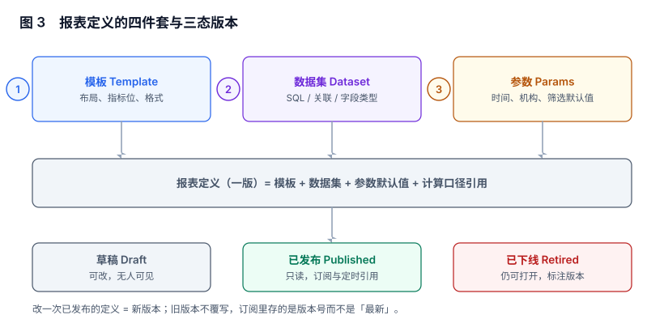

# 报表定义与版本：发布即冻结

一张报表在代码里通常长这样：`report_sales_daily()` 函数返回一段拼好的 SQL。它能跑，也能改，但它没有「当时那一版」——改完之后，所有引用它的页面、订阅、导出**同时变成新口径**，而没有人收到通知。

报表定义这一段的全部工作，就是把「一页报表」从函数变成一个**有版本的对象**：改一次是新版本，旧版本原样留着。

本页判据族 `RPD-A` ~ `RPD-H`，共 8 条。



## 一、四件套：模板、数据集、参数、口径引用

| 部件 | 回答什么 | 变更频率 | 谁维护 |
| --- | --- | --- | --- |
| 模板 Template | 这一页长什么样：几列、什么图、怎么排序 | 低 | 报表作者 |
| 数据集 Dataset | 数据从哪来：表、关联、字段类型、粒度 | 中 | 数据工程 |
| 参数 Params | 这一页看哪一段：时间、机构、筛选默认值 | 高（每次看都可能变） | 读者 |
| 口径引用 Metric ref | 每个数字按哪条口径算：`metric_code` + `metric_version` | 低 | 指标平台 |

四件套里最容易漏的是**第四件**：很多报表把口径直接写在数据集的 SQL 里（`SUM(amount) WHERE status='PAID'`），于是「口径」这件事在报表层有一份、在指标平台有一份，两份迟早分叉。

正确做法是报表只引用口径编号，SQL 由语义层编译。分工见[指标平台与语义层](../../MetricPlatform/Compile/index.md)：那边回答「这个数怎么算」，本册回答「这一页怎么组装」。

::: tip 一句话理解
模板决定「看见什么」，数据集决定「从哪来」，参数决定「看哪一段」，口径引用决定「信谁」。四件缺一件，这页报表就不可复现。
:::

## 二、三态版本：草稿、已发布、已下线

| 状态 | 可改吗 | 谁能看 | 订阅/定时能引用吗 |
| --- | --- | --- | --- |
| 草稿 Draft | 可以，随便改 | 作者与协作者 | 不能 |
| 已发布 Published | **不可以**，改 = 新版本 | 有权限的读者 | 能，且只能引已发布 |
| 已下线 Retired | 不可以，但可查 | 有权限的读者（带「已下线」标记） | 不能新建，历史快照仍可读 |

三态的关键约束只有一条：**已发布版本的任何字段都不可变**。这不是靠流程约束，而是靠数据库触发器，因为「小心一点」在半年后必然失效。

```sql [migrations/012_report_version.sql]
CREATE TABLE report_def (
  report_code   text PRIMARY KEY,              -- 稳定标识，跨版本不变
  name          text NOT NULL,
  owner_dept    text NOT NULL,
  created_at    timestamptz NOT NULL DEFAULT now()
);

CREATE TABLE report_version (
  version_id    bigserial PRIMARY KEY,
  report_code   text NOT NULL REFERENCES report_def(report_code),
  state         text NOT NULL CHECK (state IN ('DRAFT','PUBLISHED','RETIRED')),
  template      jsonb NOT NULL,                 -- 列、图表、排序
  dataset_id    bigint NOT NULL,                -- 指向 dataset_def
  params        jsonb NOT NULL DEFAULT '{}',    -- 默认值 + 允许范围
  metric_refs   jsonb NOT NULL DEFAULT '[]',    -- [{metric_code, metric_version}]
  published_at  timestamptz,
  published_by  text,
  UNIQUE (report_code, version_id)
);

-- 发布之后，内容列一律不可改
CREATE OR REPLACE FUNCTION trg_version_frozen() RETURNS trigger AS $$
BEGIN
  IF OLD.state = 'PUBLISHED' AND (
       NEW.template    IS DISTINCT FROM OLD.template
    OR NEW.dataset_id  IS DISTINCT FROM OLD.dataset_id
    OR NEW.params      IS DISTINCT FROM OLD.params
    OR NEW.metric_refs IS DISTINCT FROM OLD.metric_refs) THEN
    RAISE EXCEPTION 'VERSION_FROZEN: version % 已发布，改动请新建版本', OLD.version_id;
  END IF;
  RETURN NEW;
END $$ LANGUAGE plpgsql;

CREATE TRIGGER version_frozen BEFORE UPDATE ON report_version
FOR EACH ROW EXECUTE FUNCTION trg_version_frozen();
```

`state` 允许 `PUBLISHED → RETIRED`（下线），这是唯一允许的「原地变更」——因为它不改内容，只改可见性与可引用性。

## 三、订阅与定时任务存的是版本，不是「最新」

这是本册最贵的一条判据。写法上的差别只有一列，后果是「历史十二期报表会不会一起变」。

```sql
-- 反例：订阅只存 report_code
SELECT * FROM subscription WHERE report_code = 'SALES_MONTHLY';
-- 发送时：SELECT ... FROM report_version WHERE report_code=? ORDER BY published_at DESC LIMIT 1
-- → 作者改一次口径，过去 12 期已发出的月报全部「变了」

-- 正例：订阅存 version_id
SELECT * FROM subscription WHERE version_id = 10231;
-- → 想升级到新口径，必须显式改订阅，且能列出「受影响的 7 个订阅」
```

代价是升级时要人工确认。这个代价必须付：**订阅是一份对外的承诺，改承诺应该有一次明确的动作，而不是一次静默的漂移**。

::: danger 三个「看起来更聪明」的写法
1. **订阅存 `report_code` + 「发送时取最新」**：省掉了升级动作，代价是历史报表不可复现。审计问「上个月的月报为什么和现在点开的不一样」，你答不出。
2. **发布时「就地更新最新版本」**：把 `version_id` 当成可覆盖的槽位。表结构上省了一行，等于把「版本」这个概念删掉了。
3. **用「发布时间」当版本号**：同一天发布两次（上午修错字、下午改口径）就会出现两个 `2026-11-07`，排序不稳定。版本号必须是单调递增的代理键。
:::

## 四、参数默认值必须进快照

参数是唯一「每次打开都可能不同」的部件，也是最容易在快照里丢失的东西。

| 字段 | 存什么 | 丢了会怎样 |
| --- | --- | --- |
| `param_values` | 本次实际生效的参数（合并默认值后） | 复现时用今天的默认值，得到另一套数 |
| `param_defaults` | 当时版本声明的默认值 | 分不清「用户选的」和「默认给的」 |
| `timezone` | 业务日时区 | 跨时区读者看到的日报差一天 |
| `metric_versions` | 每个指标当时用的口径版本 | 口径升级后旧快照无法解释 |

一个真实的分叉：报表默认「近 30 天」。用户在 10 月 1 日打开并导出，快照只存了结果、没存参数。11 月复现这次导出时，默认区间已经变成「近 30 天（截至今天）」，于是同一份「导出复现」得到完全不同的数——**而两边的 SQL 一个字都没变**。

## 五、版本并存对照：口径切换的唯一安全方式

改口径不要「直接改」，要「并存一段时间」：

1. 新建版本 v2，`metric_refs` 指向新口径，状态 `PUBLISHED`。
2. 页面上提供「新旧对照」视图：同一参数、两个版本、两列数字并排。
3. 订阅**逐个**切到 v2，切换记录写进审计。
4. 观察窗口结束（通常一个结账周期）后，v1 置 `RETIRED`。

对照视图的价值不在「看差异」，而在**把差异变成可解释的行**：差额必须能被归因（口径变更 / 迟到数据 / 权限差异），否则切换就是一次赌博。

```sql
-- 版本对照：同一参数下 v1 与 v2 的差异，按机构拆开
WITH v1 AS (SELECT org_id, SUM(amount_cents) a FROM rpt_sales(10231, '{"from":"2026-10-01","to":"2026-10-31"}') GROUP BY org_id),
     v2 AS (SELECT org_id, SUM(amount_cents) a FROM rpt_sales(10232, '{"from":"2026-10-01","to":"2026-10-31"}') GROUP BY org_id)
SELECT COALESCE(v1.org_id, v2.org_id) AS org_id,
       v1.a AS v1_amount, v2.a AS v2_amount, COALESCE(v2.a,0) - COALESCE(v1.a,0) AS diff
FROM v1 FULL JOIN v2 USING (org_id)
ORDER BY ABS(COALESCE(v2.a,0) - COALESCE(v1.a,0)) DESC;
-- 预期：diff 的绝对值之和 = 两版总额之差；有 org 只在一边出现 = 口径的过滤条件变了
```

## 六、下线不等于删除

`RETIRED` 的版本仍然要满足三件事，缺一件就会在半年后变成事故：

| 要求 | 原因 |
| --- | --- |
| 仍可按 `version_id` 打开（只读） | 历史快照要能解释「当时这页长什么样」 |
| 仍可被导出引用 | 已发出的文件里有 `version_id`，复现时要能对上 |
| 模板与数据集至少保留一个结账周期 | 数据集改过之后，旧版本将永久无法重跑 |

真正删除只发生在「快照也过期」之后。留存策略与[数据删除](../../../Others/PrivacyEngineering/Deletion/index.md)的分工是：那边管「个人信息什么时候必须消失」，这边管「报表定义什么时候可以消失」，两者取**更严格**的那个。

## 七、定义审计：改了什么，谁改的，影响了谁

一条可用的审计记录至少包含五个字段：

```json
{
  "version_id": 10232,
  "report_code": "SALES_MONTHLY",
  "action": "PUBLISH",
  "actor": "zhangsan",
  "diff": {"metric_refs": ["GMV@3 -> GMV@4"], "params": {"org_scope": "all -> own"}},
  "impacted_subscriptions": 7,
  "at": "2026-11-07T10:12:31+08:00"
}
```

`impacted_subscriptions` 不是装饰：它是「发布前必须看的那个数」。发布动作如果不能在提交前告诉作者「这会改变 7 个订阅的数字」，作者就只能靠记忆。

## 八、本页判据

| 编号 | 判据 | 为什么要它 | 怎么验证 |
| --- | --- | --- | --- |
| `RPD-A` | 报表定义由模板 / 数据集 / 参数 / 口径引用四部分组成，四者分离存储 | 混在一起就无法单独评审与复用 | 表结构里四部分都有独立字段或外键 |
| `RPD-B` | 已发布版本的模板、数据集、参数、口径引用全部不可变（数据库层） | 流程约束在半年后必然失效 | 对 `PUBLISHED` 行执行 `UPDATE` 必须抛异常 |
| `RPD-C` | 订阅与定时任务存 `version_id`，不存 `report_code` + 「最新」 | 否则历史报表会被静默改写 | 订阅表有 `version_id` 外键，且能列出受影响订阅 |
| `RPD-D` | 快照存「合并默认值后」的实际参数，以及业务日时区 | 复现时不能用今天的默认值 | 任取一条快照，能读出 `param_values` 与 `timezone` |
| `RPD-E` | 口径变更走「新版本 + 并存对照」，不允许原地改引用 | 直接改无法归因差异 | 存在两个同时 `PUBLISHED` 的版本且能同屏对照 |
| `RPD-F` | 下线（`RETIRED`）只改可见性，不删模板与数据集 | 历史快照要能解释 | `RETIRED` 版本仍可按 ID 打开 |
| `RPD-G` | 发布动作记录 diff、操作者与受影响订阅数 | 没有影响面就无法做发布决策 | 审计表能查到 `diff` 与 `impacted_subscriptions` |
| `RPD-H` | 同一 `report_code` 下版本号单调递增且唯一 | 用日期当版本号会出现同号 | `version_id` 为代理键且有唯一约束 |

## 九、验证方式

```sql
-- 1) 有没有「发布之后还被改过」的版本
SELECT version_id, published_at, updated_at FROM report_version
WHERE state = 'PUBLISHED' AND updated_at > published_at + INTERVAL '1 second';
-- 预期：0 行
```

```sql
-- 2) 有没有订阅引用了「非发布态」的版本
SELECT s.subscription_id, v.version_id, v.state
FROM subscription s JOIN report_version v USING (version_id)
WHERE v.state <> 'PUBLISHED';
-- 预期：0 行（历史订阅在版本下线后应自动暂停，而不是继续发）
```

```sql
-- 3) 快照能不能自证「用哪一版算的」
SELECT snapshot_id, version_id, param_values->>'from' AS from_date,
       param_values->>'to' AS to_date, timezone, created_at
FROM run_snapshot ORDER BY created_at DESC LIMIT 5;
-- 预期：五行都有 version_id、区间与 timezone；出现 NULL = 快照不可复现
```

## 十、参考资料

- [Apache Superset: 数据集与图表](https://superset.apache.org/docs/using-superset/creating-your-first-dashboard)：数据集与图表分离的产品化范式，与本册「四件套」对应（2026-11 核对）
- [Metabase: Models 与版本](https://www.metabase.com/docs/latest/data-modeling/models)：把「模型」作为可复用对象的产品设计
- [PostgreSQL: CREATE TRIGGER](https://www.postgresql.org/docs/current/sql-createtrigger.html)：本页不可变触发器的语法依据
- [PostgreSQL: JSON Types](https://www.postgresql.org/docs/current/datatype-json.html)：`jsonb` 存模板与参数的比较语义（`IS DISTINCT FROM` 在 jsonb 上可用）
- [dbt: 模型与版本管理](https://docs.getdbt.com/docs/build/models)：声明式定义的版本化思路，可与本册的 `report_version` 对照
