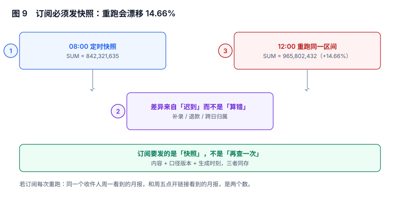

# 订阅、快照与重发：发给谁、发哪一刻的数

订阅是把报表变成「推送物」的那一步。它比页面多两个约束：**收件人不会回来点刷新**，所以发出去的就是全部；**邮件无法「重新加载」**，所以发错了只能用第二封去纠正。

本页判据族 `RPS-A` ~ `RPS-H`，共 8 条。



## 一、订阅发的必须是快照，不是「再查一次」

本节读数（同一区间、同一 `version_id`、同一参数，两次执行）：

| 时刻 | 合计（分） | 说明 |
| --- | --- | --- |
| 08:00 首次生成 | 842,321,635 | 落为 `snapshot_id = snap_9f31c2` |
| 12:00 重跑同一区间 | 965,802,432 | 中间落了迟到数据与退款 |
| 漂移 | **+14.66%** | 两个数都「正确」 |

这就是「订阅每次重跑」的后果：**同一个收件人周一收到的月报，和周五点开链接看到的月报，是两个数**。而两封邮件都写着「2026 年 10 月销售月报」，没有任何字段能区分。

正确做法只有一条：**发送动作读快照，读不到就不发**。

```sql
-- 发送前：只能取已生成的快照，不能现场查
SELECT snapshot_id, total_amount, row_count, metric_versions, created_at
FROM run_snapshot
WHERE subscription_id = $1 AND period = $2      -- period 例：'2026-10'
  AND state = 'READY'
LIMIT 1;
-- 预期：要么一行，要么 0 行。0 行表示本次发送应失败并告警，而不是「补查一次」
```

## 二、快照要冻住四样东西

| 冻结项 | 为什么 | 丢了会怎样 |
| --- | --- | --- |
| 结果集（或可重放的中间结果） | 邮件正文、附件、链接都指向它 | 附件与正文不一致 |
| 口径版本 | 解释「这个数按哪条口径算」 | 口径升级后旧邮件无法解释 |
| 参数与业务日时区 | 复现「看的是哪一段」 | 跨时区读者看到差一天 |
| 生成时刻 | 判断数据新鲜度 | 用户以为是最新的 |

第三项在跨国团队里最容易出事：业务日按 `Asia/Shanghai` 切，收件人在 `America/Los_Angeles`。**如果发送时刻按收件人时区算「昨天」，业务日按东八区算，两边会差一天**，而邮件标题只写「日报」，谁都看不出差在哪。

## 三、重发幂等：键是「订阅 + 周期」，不是「订阅」

发送失败重试是必须的（SMTP 抖动、附件生成失败、网关限流），但重试很容易变成「发两封」。

```sql [migrations/014_subscription.sql]
CREATE TABLE subscription (
  subscription_id bigserial PRIMARY KEY,
  report_code     text NOT NULL,
  version_id      bigint NOT NULL REFERENCES report_version(version_id),
  cron            text NOT NULL,
  timezone        text NOT NULL DEFAULT 'Asia/Shanghai',
  recipients      jsonb NOT NULL,
  state           text NOT NULL DEFAULT 'ACTIVE' CHECK (state IN ('ACTIVE','PAUSED','RETIRED')),
  created_by      text NOT NULL
);

CREATE TABLE delivery (
  delivery_id     bigserial PRIMARY KEY,
  subscription_id bigint NOT NULL REFERENCES subscription(subscription_id),
  period          text NOT NULL,              -- '2026-10' / '2026-11-07'
  snapshot_id     text NOT NULL,
  state           text NOT NULL CHECK (state IN ('PENDING','SENT','FAILED')),
  attempt         int  NOT NULL DEFAULT 1,
  sent_at         timestamptz,
  UNIQUE (subscription_id, period)            -- 一个周期只允许一条投递记录
);
-- 预期：重复插入同 (subscription_id, period) 会被唯一约束拒绝；重试走 UPDATE attempt
```

唯一键放在 `delivery` 上，而不是「发送前先查有没有发过」——**先查再发在并发下必然双发**（调度器多实例、手工重发与定时撞车）。

## 四、四种失败，四种处置

| 失败 | 表现 | 处置 |
| --- | --- | --- |
| 快照未就绪 | 到点没有 `READY` 快照 | 不发送，标记 `FAILED(SNAPSHOT_MISSING)`，告警到数据团队 |
| 附件生成失败 | 正文有、附件 0 字节 | 重试 3 次（指数退避），仍失败则只发正文 + 链接 |
| 部分收件人失败 | 10 人中 2 人退信 | 逐收件人记录，不整体重发（否则 8 人收两封） |
| 全部失败 | SMTP 拒绝 | 重试 3 次后 `FAILED`，进入人工队列 |

第三种是最容易被做错的：**把「发送」当成一个整体事务**。10 个收件人里 2 个失败，整体回滚重发，另外 8 个人就会收到两封内容相同、`delivery` 却只有一条的邮件。

## 五、收件人：三个必须校验的状态

| 状态 | 校验什么 | 不校验的后果 |
| --- | --- | --- |
| 在职 | 账号/邮箱仍有效 | 离职员工继续收业务数据（合规风险） |
| 有权限 | 收件人对该报表仍有查看权限 | 越权投递：权限收回后邮件仍照发 |
| 已订阅 | 收件人没退订 | 违反退订意愿，被判垃圾邮件 |

第二条是订阅系统最典型的越权路径：**页面权限收得很严，邮件却按「创建时填的收件人列表」一直发**。判据是「发送前对每个收件人重新鉴权一次」，而不是「订阅创建时校验过」。

## 六、时区与周期：三个时间不是同一个

| 时间 | 例子 | 用途 |
| --- | --- | --- |
| 业务日（biz_date） | `2026-11-06`（东八区自然日） | 数据归属 |
| 调度时刻（cron） | 每天 08:00（订阅时区） | 什么时候跑 |
| 生成时刻（created_at） | `2026-11-07T00:00:03Z` | 数据新鲜度 |

三者混用会产出「昨天的日报里有今天的数据」这类问题。落地口径：**cron 按订阅时区解释，业务日按数据时区切分，两者都在订阅记录里显式存储**。

```text
cron:     0 8 * * *          （订阅时区 Asia/Shanghai → 每天 08:00 北京时间）
biz_tz:   Asia/Shanghai      （业务日切分）
period:   前一个完整业务日     （08:00 跑，出昨天）
```

## 七、失败必须可见，而且要「可见到人」

订阅失败最坏的形态是「静默」：邮件没发出去，没有任何人知道，直到月中有人问「为什么这个月没收到月报」。

三个必须有的可见性：

1. **看板**：每个订阅最近一次 `SENT` 时间、连续失败次数。
2. **告警**：连续 2 个周期 `FAILED` 触发通知（发给人，不是发到群里）。
3. **页面标记**：订阅详情页显示「上次发送失败：快照未就绪」。

第三条常被忽略，但它是唯一能让订阅所有者自助排查的入口。

## 八、历史留存：能重放，才叫可解释

| 存什么 | 期限 | 用途 |
| --- | --- | --- |
| `delivery` 记录（谁、何时、哪个快照） | 长期 | 举证「我们确实发过」 |
| 快照结果（或可重放参数） | 一个结账周期以上 | 复现「当时那个数」 |
| 邮件正文 HTML / PDF | 短期（如 90 天） | 处理「我没收到 / 内容不对」的争议 |
| 附件文件 | 短期（与导出同策略） | 与[导出](../ExportQuota/index.md)一致，到期即删 |

「短期」与「长期」的分界不是拍脑袋：**争议通常发生在 1~2 个月内**，而合规举证要覆盖更长周期。所以记录长留、内容短留。

## 九、本页判据

| 编号 | 判据 | 为什么要它 | 怎么验证 |
| --- | --- | --- | --- |
| `RPS-A` | 订阅发送读快照，快照缺失时失败而非现场重查 | 重查会让同一期报表出现两个数 | 无快照时 `delivery.state = FAILED` |
| `RPS-B` | 快照冻结结果、口径版本、参数与时区、生成时刻 | 少一样就不可复现 | 任取快照能读出四项 |
| `RPS-C` | `delivery` 以 `(subscription_id, period)` 唯一 | 先查再发在并发下双发 | 重复插入被拒 |
| `RPS-D` | 多收件人逐人记录成败，不做整体重发 | 整体重发会让成功者收两封 | 部分失败时成功的收件人不重复收 |
| `RPS-E` | 发送前逐收件人重新鉴权 | 权限收回后邮件仍在发 | 撤销权限后下一次发送不含该人 |
| `RPS-F` | cron 时区、业务日时区、生成时刻三者分别存储 | 混用会产出「日报有今天数据」 | 订阅记录有三个时间字段 |
| `RPS-G` | 连续失败触发告警且有页面标记 | 静默失败到月中才发现 | 断网演练后 2 个周期内告警 |
| `RPS-H` | 投递记录长期留存、正文与附件短期留存 | 争议在 1~2 个月内，举证要更久 | 90 天后正文已清、`delivery` 仍在 |

## 十、验证方式

```sql
-- 1) 同一个订阅同一周期是否发过两次
SELECT subscription_id, period, COUNT(*) FROM delivery
GROUP BY 1, 2 HAVING COUNT(*) > 1;
-- 预期：0 行
```

```sql
-- 2) 发送失败但没人知道（连续失败 ≥ 2 且无告警记录）
SELECT s.subscription_id, COUNT(*) AS fails
FROM delivery d JOIN subscription s USING (subscription_id)
WHERE d.state = 'FAILED' AND d.sent_at IS NULL
GROUP BY 1 HAVING COUNT(*) >= 2;
-- 预期：每一行都应能在告警表里找到对应事件
```

```sql
-- 3) 快照与投递是否一致（邮件里的数 = 快照里的数）
SELECT d.delivery_id, d.snapshot_id, s.total_amount
FROM delivery d JOIN run_snapshot s USING (snapshot_id)
WHERE d.sent_at >= CURRENT_DATE - 7;
-- 预期：每行都能对上；`snapshot_id` 为 NULL = 发送时现场查的，不可复现
```

## 十一、参考资料

- [cron 表达式与时区（crontab(5)）](https://man7.org/linux/man-pages/man5/crontab.5.html)：`CRON_TZ` 与调度语义（2026-11 核对）
- [RFC 5321: SMTP](https://datatracker.ietf.org/doc/html/rfc5321)：投递失败码与重试语义
- [RFC 8058: 一键退订](https://datatracker.ietf.org/doc/html/rfc8058)：`List-Unsubscribe-Post` 的合规要求
- [IANA Time Zone Database](https://www.iana.org/time-zones)：业务日切分依赖的时区数据来源
- [Apache Superset: 告警与报表（Alerts & Reports）](https://superset.apache.org/docs/using-superset/reports)：订阅调度的产品化实现，可与本页的 `delivery` 模型对照
