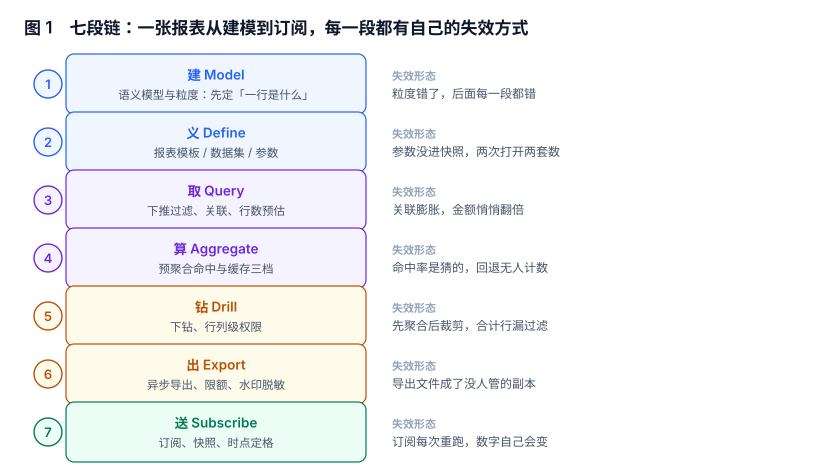

# 报表与自助分析工程

报表系统最常见的失败不是「数算错了」，而是**同一个问题在不同入口得到三个不同的答案，而且每个答案都能自证**：看板上是 1,814 万，导出的 Excel 里是 1,814.21 万，订阅邮件里是 842 万（因为那封邮件发的是三天前的快照）。三处都没有报错，三处都能说出自己的 SQL。

本专题只回答一个问题：**从「口径已经算好」到「一个人看到一页、导出一份、收到一封」之间，那七段各自由谁来做、做错了会怎样**。

::: tip 一句话理解
报表不是一条 SQL 的别名，是**一份有版本、有权限、有快照的交付物**：定义要冻在发布那一刻，数字要冻在生成那一刻，权限要冻在过滤那一刻。
:::

## 本专题回答什么、不回答什么

「BI」「报表」「看板」「自助分析」在招聘 JD 里是一个词，在工程上是四套交付物。下面这张表是本册与库内相邻专题的分工，写死在这里，避免同一个问题被两册各答一遍。

| 问题的主语 | 由谁回答 | 具体页面 |
| --- | --- | --- |
| 这个指标怎么定义、口径改了怎么回溯 | 语义层视角 | [指标平台与语义层](../MetricPlatform/index.md) |
| 事实表与维表怎么建、粒度怎么选 | 数仓建模视角 | [数仓建模](../../DB/DataWarehouse/index.md) |
| 图表怎么画、大屏怎么排版、渲染性能 | 前端可视化视角 | [数据可视化](../../Frontend/DataVisualization/index.md) |
| 一条 SQL 为什么慢、索引怎么加 | 数据库视角 | [SQL 优化](../../DB/Relational/SQLOptimization/index.md) |
| 即席查询引擎怎么选（Trino / ClickHouse） | 引擎选型视角 | [大数据选型](../../DB/BigData/Selection/index.md) |
| 导出的文件怎么被删干净 | 隐私工程视角 | [数据删除](../../Others/PrivacyEngineering/Deletion/index.md) |
| **一页报表长什么样、谁能看多少行、导出的文件在哪、订阅发的是哪一刻的数** | **本册** | 就是你现在看的这一册 |

分界线用一句话概括：**主语是「这个数怎么算出来的」，看别的册子；主语是「这一页为什么长这样、谁能看、怎么导、什么时候发」，看本册。**

## 目录

| 章节 | 它管的那一段 | 一句话 |
| --- | --- | --- |
| [总览：三个「这张报表」与五个安静的失败](Overview/index.md) | 全景 | 先把「定义 / 版本 / 快照」拆开 |
| [报表定义与版本](ReportDefinition/index.md) | 义 | 发布即冻结，改一次就是一个新版本 |
| [数据集、关联与粒度](DataSet/index.md) | 取 | 关联膨胀让金额悄悄变 2.344 倍 |
| [即席查询：预估、超时与分页](AdHocQuery/index.md) | 取 | 自助分析的边界是「代价可预估」 |
| [预聚合命中与缓存](AggregateHit/index.md) | 算 | 只记命中率，等于只记好消息 |
| [下钻与行列级权限](DrillPermission/index.md) | 钻 | 过滤位置决定合计行可不可信 |
| [导出、限额与脱敏](ExportQuota/index.md) | 出 | 无限排队不是宽容，是把拒绝推迟 |
| [订阅、快照与重发](ScheduleSnapshot/index.md) | 送 | 订阅要发快照，不是「再查一次」 |
| [实战：六张表、两个触发器与八条断言](Practice/index.md) | 全链 | 定义、快照、任务、订阅各自落到表上 |
| [常见问题与分诊](FAQ/index.md) | — | 十二个被反复问到的判断题 |

## 本专题的判据族

本专题共 **10 族 80 条判据**，每页 8 条，逐条可判定。

| 族 | 覆盖 | 页 |
| --- | --- | --- |
| `RPO-A ~ RPO-H` | 三个「这张报表」、七段链、五个安静的失败、三个反模式、起步顺序、边界、版本组织、验收入口 | [总览](Overview/index.md) |
| `RPD-A ~ RPD-H` | 四件套、三态版本、发布冻结、订阅存版本、参数进快照、并存对照、下线不删、定义审计 | [报表定义](ReportDefinition/index.md) |
| `RDN-A ~ RDN-H` | 粒度声明、关联膨胀、去重位置、金额量纲、空值、类型漂移、字段契约、预聚合前提 | [数据集](DataSet/index.md) |
| `RPA-A ~ RPA-H` | 五步构建、行数预估、超时、LIMIT 语义、深分页、危险查询、结果上限、可复现 | [即席查询](AdHocQuery/index.md) |
| `RPG-A ~ RPG-H` | 粒度格、命中校验、回退计数、缓存键、TTL、回退耗时、静默降级、命中率口径 | [预聚合](AggregateHit/index.md) |
| `RPP-A ~ RPP-H` | 过滤下推、合计行、列级、单元格脱敏、导出同规则、下钻方向、权限变更失效、越权验证 | [权限](DrillPermission/index.md) |
| `RPE-A ~ RPE-H` | 五环、异步、限额、排队、文件权限、水印、链接时效、审计留痕 | [导出](ExportQuota/index.md) |
| `RPS-A ~ RPS-H` | 快照、冻结时刻、重发幂等、收件人、退订、时区、失败可见、历史留存 | [订阅](ScheduleSnapshot/index.md) |
| `RPT-A ~ RPT-H` | 六表、两触发器、三验收 SQL、八用例、两反向探针、复跑、性能、交付 | [实战](Practice/index.md) |
| `RPQ-A ~ RPQ-H` | 十二问、三步分诊、反例、口径问、粒度问、权限问、导出问、升级路径 | [FAQ](FAQ/index.md) |

## 版本组织：本专题不建版本目录

本册面向的「换代」发生在**产品与 SQL 方言**上（Superset 4.x 的语义层、Metabase 的 query processor、各家云的 BI 套件），而不在判据上：**「发布即冻结」「过滤必须下推」「订阅发快照」这三条，在 2013 年的手写 JSP 报表和 2026 年的语义层上是同一句话**。

所以本册按「链上的一段」分族（`RPO` `RPD` `RDN` `RPA` `RPG` `RPP` `RPE` `RPS` `RPT` `RPQ`），不按产品版本分目录。需要按大版本建目录的是「同一份代码两套写法」那类主题，库内已有范式可对照：

- [Spring 5](../Java/Frame/Spring/Spring5/index.md) 与 [Spring 6](../Java/Frame/Spring/Spring6/index.md)：两代 API 不兼容，旧版保留并标注状态。
- [Vue 2](../../Frontend/Frame/Vue/Vue2/index.md) 与 [Vue 3](../../Frontend/Frame/Vue/Vue3/index.md)：同一框架两套响应式写法。

本册没有这种分裂：BI 工具的菜单换了位置，判据没变。

## 阅读顺序

- **只要结论**：读[总览](Overview/index.md)的「五个安静的失败」一节，五分钟能对上自己的系统。
- **正在被「两个数不一样」折磨**：按 [数据集](DataSet/index.md) → [权限](DrillPermission/index.md) → [订阅](ScheduleSnapshot/index.md) 的顺序读，三页覆盖 80% 的「数字对不上」工单。
- **要落地**：直接看[实战](Practice/index.md)的六张表，倒推前面几页的设计意图。
- **老板问「为什么自助分析没人用」**：读[即席查询](AdHocQuery/index.md)，那页把「预估」和「超时」写成了可复算的数。

::: warning 本册所有读数都是本机可复跑的
各页「本节读数」小段里的数字来自固定种子的本地仿真与 SQLite 实测（脚本不入库，按 `AGENTS.md` 第 5 节要求只提交结论与可复跑的命令）。数据规模为 40,000 笔订单、93,574 条明细行。这些数字用来**比较两种口径的差距**，不是行业基准——你自己的系统里，量级会不同，方向不会。
:::
