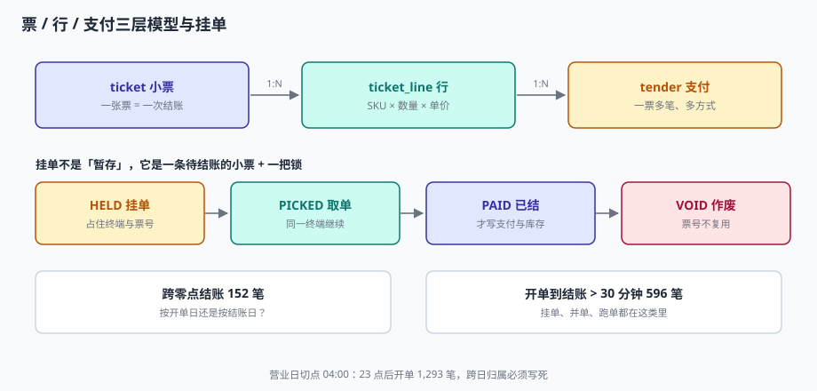

# 点单与挂单：票、行、锁

顾客把六件商品放到台上，收银员扫了五件，第六件是散装称重的——要输条码、放秤、按重量算钱。这时顾客想起「还有一箱牛奶在车里」，说我先去拿。收银员按下「挂单」，把已经扫的五件存起来，去招呼下一位。

三分钟后顾客回来，收银员按「取单」，接着扫牛奶。这中间发生了什么？在系统里，**一张已经存在的小票被挂起了，它占着一个票号，占着这台终端的一个槽位，而且它的价格快照已经固定**。

::: tip 一句话理解
挂单不是「暂存草稿」，它是一条**已经占用了票号、锁住了终端、冻结了价目的待结账小票**——所以挂单必须有状态、有主人、有超时。
:::

## 一、三层模型：票、行、支付

POS 的数据模型只有三层，但每一层的「一」含义不同：

| 层 | 表 | 一是什么 | 关键约束 |
| --- | --- | --- | --- |
| 票 | `ticket` | 一次结账 | 票号唯一、状态机、应收 = 实收 |
| 行 | `ticket_line` | 一个 SKU 的一次计价 | 数量 > 0、行额 = 单价 × 数量 |
| 支付 | `tender` | 一种支付方式的一次收款 | 累计 ≤ 应收（超收走找零） |



三层之间有两个「1:N」，都不能省：

- **票 : 行** 是 1:N，因为一张票可以有多件商品。本机实测 30,000 单 / 69,462 行，平均 **2.32 行/单**。
- **票 : 支付** 是 1:N，因为一张票可以多种方式付款。本机实测组合支付 1,181 笔（3.94%）。

把支付拍平进票（`ticket.pay_method` + `ticket.pay_amount`），组合支付就无处安放——只能拆成两张票，然后两张票的应收都对不上。

## 二、行模型的四种数量

「数量」在零售里有四种形态，混在一个 `qty` 字段里必然出错：

| 形态 | 例子 | 存储建议 | 易错点 |
| --- | --- | --- | --- |
| 整数件 | 2 瓶水 | `qty = 2`，`unit = PIECE` | 无 |
| 称重 | 0.386 kg 苹果 | `qty = 0.386`，`unit = KG`，`qty` 保留 3 位 | 保留 2 位会少算钱 |
| 拆零 | 半盒药 | `qty = 0.5`，`unit = BOX` | 与称重混用同一精度 |
| 套餐 | 一个套餐含 2 件 | 父行 + 子行，或 `bundle_id` | 套餐内商品退货按什么价退 |

::: danger 称重商品的三个坑
1. **精度**：`qty` 用 2 位小数会丢钱。0.386 kg × 12.8 元/kg = 4.94 元，按 0.39 算是 4.99 元，一天卖 300 单差 15 元。**称重数量至少保留 3 位**。
2. **重复称重**：电子秤与收银机是两台设备，中间靠串口。秤回传了两次重量，收银端会加成两行。要按「同一秤、同一时间窗 2 秒内」去重。
3. **去皮**：散装商品的包装重量必须扣。不扣皮的系统，每单多收几毛，一年后会被职业打假人盯上。
:::

### 行金额的三个字段

```sql
CREATE TABLE ticket_line (
  ticket_id      TEXT NOT NULL,
  line_no        INTEGER NOT NULL,
  sku            TEXT NOT NULL,
  qty            REAL NOT NULL,
  unit_price     REAL NOT NULL,     -- 成交单价（已含单品特价）
  line_amt       REAL NOT NULL,     -- qty × unit_price，四舍五入到分
  discount_share REAL NOT NULL DEFAULT 0,  -- 整单优惠分摊到这一行的金额
  PRIMARY KEY (ticket_id, line_no),
  CONSTRAINT ck_qty CHECK (qty > 0),
  CONSTRAINT ck_amt CHECK (line_amt >= 0)
);
```

三个字段各自的作用：

- `unit_price` 是「这一件多少钱」，退货按它算单价；
- `line_amt` 是「这一行原价多少」，整单原价由它求和；
- `discount_share` 是「这一行被优惠了多少」，退货按 `line_amt - discount_share` 算实付。

**没有 `discount_share` 就一定退错钱**：整单满 200 减 30，退其中一件 80 元的商品，该退 80 还是 80 × (170/200) = 68？没有分摊额，只能靠猜。

## 三、挂单：一条占着资源的小票

挂单（HELD）的本质是**状态**，不是「另存一份」：

| 状态 | 含义 | 占票号 | 占终端 | 可改价目 |
| --- | --- | --- | --- | --- |
| `HELD` | 已挂起，等顾客回来 | 是 | 是（同终端可继续其他单） | 否（价已冻结） |
| `PICKED` | 被取回，继续点单 | 是 | 是 | 否 |
| `PAID` | 已结账 | 是（永久占用） | 否 | 否 |
| `VOID` | 作废 | 是（票号不复用） | 否 | — |

```text
HELD --取单--> PICKED --结账--> PAID
  |                |
  +---超时作废----> VOID
```

### 挂单的三条硬规则

1. **票号在挂单时就要分配，且作废后不复用。** 事后补号会让「同一天的票号」出现空洞，而这个空洞正是审计要看的。
2. **挂单必须绑定终端。** 允许跨终端取单（A 台挂的到 B 台取），就需要分布式锁；不允许，就要在顾客回来时「换台重扫」。零售现场 99% 选后者——因为跨台取单的复杂度远超收益。
3. **挂单必须超时。** 本机实测开单到结账超过 30 分钟的有 596 笔（2%），其中真正的挂单只是一部分，更多是「开着单去理货」。超时策略：30 分钟提醒、2 小时自动作废（`VOID`），作废前打印小票留档。

::: warning 挂单不等于「占库存」
挂单期间库存**不预占**。原因：顾客可能一去不回，预占会让可售数虚低。代价是「顾客回来发现最后一件被买走了」——这个体验问题要用「挂单时提示库存」解决，不能用预占解决。
:::

## 四、跨零点：一张票属于哪一天

本机实测：30,000 笔里跨零点结账 **152 笔**，23 点后开单 **1,293 笔（4.31%）**。跨零点的单，按开单日与按结账日归属，**100% 不同**。

| 口径 | 23:58 开单、00:03 结账 | 适用 |
| --- | --- | --- |
| 按开单日 | 算前一天 | 与「顾客什么时候进店」一致 |
| 按结账日 | 算后一天 | 与「钱什么时候到账」一致 |
| 按营业日（切点 04:00） | 算前一天 | **与店长对账一致** |

正确的做法是**只存 `biz_date`，不存推导**：

```sql
-- 开单时就算好，之后永不重算
UPDATE ticket
SET biz_date = date(datetime(opened_at, '-' || (SELECT biz_cut_hour FROM store WHERE store_id = ticket.store_id) || ' hours'))
WHERE biz_date IS NULL;
```

这样做的副作用是：`biz_date` 一旦写入就固定，**终端时钟错了也不会改归属**。这恰恰是我们要的——时钟问题应该在开单时被拦住（见[离线补传](../OfflineSync/index.md)），而不是让历史数据跟着漂。

## 五、票号设计：一行唯一键省掉一套校验

票号有三个候选方案，实测差别很大：

| 方案 | 形式 | 重号风险 | 可读性 |
| --- | --- | --- | --- |
| 全局自增 | `00000123` | 无（中心发号） | 差（看不出店） |
| 门店 + 日 + 4 位序号 | `S01-20261103-0123` | **高**（多终端各自从 1 开始） | 好 |
| 门店 + 终端 + 4 位序号 | `S01-T03-0123` | 无（终端号隔离） | 好 |

本机实测：两台终端各自从 1 发号，32,400 张单里**重号 3,764 个（11.62%）**。而用「门店 + 日 + 4 位」的实际数据集里，**2,775 组重号**。

```sql
-- 唯一键必须包含终端维度
CONSTRAINT uq_ticket_no UNIQUE (store_id, biz_date, ticket_no)
```

注意唯一键里**没有** `terminal_id`——因为终端号已经编进 `ticket_no` 了。如果把 `terminal_id` 也放进唯一键，就变成「同店同日同终端同票号才冲突」，等于放弃了跨终端去重。

## 六、判据

本页判据族 `RSB-A` ~ `RSB-H`，共 8 条。

| 判据 | 断言 | 验证方式 |
| --- | --- | --- |
| `RSB-A` | 票、行、支付三表分离，支付不拍平进票 | `tender` 表存在且有 `(ticket_id, seq)` 主键 |
| `RSB-B` | 行数量 > 0 且有精度约束 | 插 `qty = 0` 被 `CHECK` 拒绝 |
| `RSB-C` | 称重行 `qty` 至少 3 位小数 | 插入 0.386 后读回仍为 0.386 |
| `RSB-D` | 行有 `discount_share` 字段 | 整单优惠单的 `SUM(discount_share)` = 整单优惠 |
| `RSB-E` | 挂单状态机四态齐全且可迁移 | 按图构造迁移，非法迁移被拒 |
| `RSB-F` | 票号唯一且含终端号 | 唯一键存在；两台终端同序号插入，第二笔被拒 |
| `RSB-G` | `biz_date` 落库不推导 | 更新 `opened_at` 后 `biz_date` 不变 |
| `RSB-H` | 作废票的票号不复用 | 插同号新票被唯一键拒绝 |

## 七、验证方式

```shell
# 1. 建三层最小模型
sqlite3 /tmp/basket.db <<'SQL'
CREATE TABLE ticket(ticket_id TEXT PRIMARY KEY, store_id TEXT, biz_date TEXT,
                    ticket_no TEXT, opened_at TEXT, status TEXT, payable REAL,
                    UNIQUE(store_id, biz_date, ticket_no));
CREATE TABLE ticket_line(ticket_id TEXT, line_no INT, sku TEXT, qty REAL,
                         unit_price REAL, line_amt REAL, discount_share REAL DEFAULT 0,
                         PRIMARY KEY(ticket_id, line_no), CHECK(qty > 0));
CREATE TABLE tender(ticket_id TEXT, seq INT, method TEXT, amount REAL,
                    PRIMARY KEY(ticket_id, seq));
INSERT INTO ticket VALUES('T1','S01','2026-11-02','S01-T01-0001','2026-11-02T10:00:00','PAID',28.9);
INSERT INTO ticket_line VALUES('T1',1,'K0001',2,9.9,19.8,0);
INSERT INTO ticket_line VALUES('T1',2,'K0002',0.386,23.6,9.11,0);
INSERT INTO tender VALUES('T1',1,'CASH',28.9);
SQL

# 2. 行额与整单原价的勾稽（期望 0）
sqlite3 /tmp/basket.db "
select count(*) from ticket t where abs(t.payable - (select sum(line_amt) from ticket_line where ticket_id=t.ticket_id)) > 0.001;"

# 3. 称重精度（期望 0.386）
sqlite3 /tmp/basket.db "select qty from ticket_line where line_no=2;"

# 4. 同店同日同票号再插一次（期望被拒）
sqlite3 /tmp/basket.db "INSERT INTO ticket VALUES('T2','S01','2026-11-02','S01-T01-0001','2026-11-02T11:00:00','PAID',1.0);" \
  || echo "已按预期拒绝"
```

第 2 步用「应收 = 明细合计」而不是「应收 = 支付合计」——因为优惠还没进来。完整勾稽是三步：`gross = Σ line_amt` → `payable = gross − discount + rounding` → `payable = Σ tender`。

## 参考资料

- GB/T 18184—2025《商业自动化术语》（2025-10-05 发布、2026-02-01 实施，代替 GB/T 18184—2008）：商品行（line item）、挂单（hold）、作废（void）的术语定义。
- 《零售商品称重计量监督管理办法》（国家质检总局令第 66 号）：称重商品应明示计量单位与单价，结算重量应与实际相符。
- 与本页相邻：[总览](../Overview/index.md)、[优惠与凑整](../PromotionStack/index.md)、[离线补传](../OfflineSync/index.md)。
