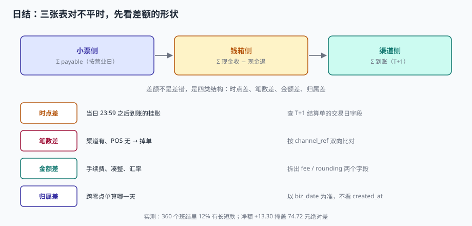

# 班结与日结：三口径对账与差异归因

晚上十点，店长打开对账页面，看到三个数：小票 8,432.50、钱箱 6,910.00、渠道 1,497.30。三个数加起来是 8,407.30，比小票少 25.20 元。她皱了下眉，点了「差异说明」，填「待查」，然后下班。

第二天这 25.20 元还在，第三天也在。一周后它变成「历史遗留差异」，一个月后没人记得。

::: tip 一句话理解
对不平时最该做的不是找人，是**看差额的形状**——时点差、笔数差、金额差、归属差，四种形状对应四种完全不同的处置。
:::

## 一、三个结账层级

| 层级 | 触发 | 范围 | 谁做 | 产物 |
| --- | --- | --- | --- | --- |
| 班结（shift close） | 收银员下班 / 换班 | 一个钱箱 | 收银员 + 店长 | 长短款、缴款单 |
| 日结（day close） | 营业日结束 | 一家店 | 店长 | 日营业报表、三口径对账 |
| 月结（month close） | 自然月结束 | 全部门店 | 财务 | 收入确认、渠道结算汇总 |

三层的**冻结范围**不同，这一点经常被搞混：

- 班结冻结的是**钱箱**：这个班次的现金流水不能再改；
- 日结冻结的是**营业日**：这一天的所有小票不能再冲正；
- 月结冻结的是**会计期间**：这一月的凭证不能再调整（只能红冲）。

::: danger 三个层级的常见错误
1. **只做日结不做班结**：长短款的责任落不到人，只能全店摊。
2. **日结后还能冲正**：账面已经出了报表，冲正会让报表与明细不一致。
3. **月结前不锁日结**：财务结账时数据还在变，永远结不完。
:::

## 二、三口径与它们的恒等式

| 口径 | 求和对象 | 时点 | 差在哪 |
| --- | --- | --- | --- |
| 小票侧 | `Σ ticket.payable`（按 `biz_date`） | 结账瞬间 | 与实收差 = 凑整 + 找零 |
| 钱箱侧 | `Σ cash_in − Σ cash_refund`（按班次） | 班结时 | 与现金应收差 = 长短款 |
| 渠道侧 | `Σ settled`（按渠道结算日） | T+1 | 与电子实收差 = 手续费 + 掉单 |

三者的恒等式：

```text
Σ payable
  = Σ tender
  = (钱箱点钞 − 期初 − 长短款) + (渠道到账 + 手续费)
```

本机实测（30,000 单）：

| 项 | 金额 |
| --- | --- |
| 小票应收 | 2,723,479.75 |
| 现金实收 | 761,018.50（27.94%） |
| 电子实收 | 1,962,461.25 |
| 手续费（38 bp） | 7,462.63 |
| 渠道到账 | 1,954,998.62 |
| 现金 + 到账 | 2,716,017.12 |
| **与小票差** | **7,462.63（= 手续费）** |

差额恰好等于手续费——这说明三口径在这个数据集上是**闭合的**。如果差额不等于手续费，差额本身就是线索。

## 三、差额的四种形状



| 形状 | 特征 | 典型原因 | 处置 |
| --- | --- | --- | --- |
| 时点差 | 差额在次日自动消失 | T+1 结算，渠道按交易日归集 | 等一天，或按交易日重算 |
| 笔数差 | 笔数不等、金额差 = 缺失笔的金额 | 掉单、重复上传 | 按 `channel_ref` 双向比对 |
| 金额差 | 笔数相等、金额不等 | 手续费、凑整、汇率 | 拆出 `fee` / `rounding` 字段 |
| 归属差 | 总额相等、按日不等 | 跨零点单、补传归日 | 统一用 `biz_date` |

### 四种形状的判别顺序

```text
1. 先比笔数：笔数不等 → 笔数差（先解决缺失，再谈金额）
2. 再比总额：总额不等但笔数相等 → 金额差（拆 fee / rounding）
3. 再看按日分布：总额相等但按日不等 → 归属差
4. 最后看趋势：差额是否在次日消失 → 时点差
```

顺序不能反。先看总额会把「一多一少」看成「没问题」（见[价目下发](../PriceSync/index.md)的净额陷阱），先看按日会把时点差当成归属差。

## 四、长短款不是差异

这是两个必须分开的概念：

| 概念 | 定义 | 归属 | 处置 |
| --- | --- | --- | --- |
| 长短款 | 点钞数与应有现金的差 | 收银员 | 签字、考核、追责 |
| 对账差异 | 三个口径之间的差 | 系统 / 流程 | 归因、调平、改设计 |

本机实测：360 个班次里 317 个分毫不差（88.06%），长款合计 44.01 元、短款合计 30.71 元、**净 +13.30 元**，而双向绝对差是 **74.72 元**。

把长短款当成「对账差异」去调平，会有两个后果：

1. **人的问题被系统吞掉**：收银员少 3 元不再需要解释，因为「差异会自动调平」。
2. **系统的问题被人背锅**：退款没冲钱箱导致的短款，被记在收银员头上。

::: warning 「差异说明」字段是最容易被滥用的设计
如果「差异说明」可以填「待查」并且直接关账，那它一定会被填成「待查」。可用的设计是：
- 差异 ≤ 1 元：允许填说明后关账，但**必须选归因类型**（凑整 / 退款 / 缴款 / 未知）；
- 差异 > 1 元：必须店长审批；
- 「未知」类连续 3 天出现：自动升级到区域经理。
:::

## 五、对账 SQL：一次跑出四种形状

```sql
WITH t AS (   -- 小票侧：按营业日
  SELECT biz_date, store_id,
         SUM(payable) AS payable,
         SUM(CASE WHEN EXISTS (SELECT 1 FROM tender d WHERE d.ticket_id = ticket.ticket_id AND d.method='CASH')
                  THEN payable ELSE 0 END) AS cash_part
  FROM ticket GROUP BY biz_date, store_id
), s AS (     -- 渠道侧：按结算日（此处用 biz_date + 1 近似 T+1）
  SELECT date(biz_date, '+1 day') AS settle_date, store_id,
         SUM(amount) AS elec, SUM(ROUND(amount*0.0038,2)) AS fee, COUNT(*) AS cnt
  FROM tender WHERE method <> 'CASH' GROUP BY settle_date, store_id
)
SELECT t.biz_date, t.store_id,
       ROUND(t.payable, 2)                       AS ticket_amt,
       ROUND(COALESCE(s.elec,0) + t.cash_part, 2) AS collected,
       ROUND(t.payable - COALESCE(s.elec,0) - t.cash_part, 2) AS diff,
       COALESCE(s.fee, 0)                        AS fee
FROM t LEFT JOIN s ON s.settle_date = t.biz_date AND s.store_id = t.store_id
WHERE ABS(t.payable - COALESCE(s.elec,0) - t.cash_part) > 0.01
ORDER BY ABS(diff) DESC;
```

这条 SQL 的输出就是「差额的形状」：`diff ≈ fee` 是金额差，`diff` 大且集中在某几天是笔数差，`diff` 只在首尾日是时点差。

## 六、调平的纪律

对账最后一步一定是「调平」，但调平有三种做法，只有一种可以接受：

| 做法 | 手段 | 可接受 | 原因 |
| --- | --- | --- | --- |
| 改原单 | 直接 `UPDATE` 金额 | ❌ | 毁掉审计线索 |
| 补差额单 | 生成一笔「差异调整」 | ⚠️ | 可接受但必须带归因 |
| 挂账 + 归因 | 记入 `recon_diff`，标明类型与责任人 | ✅ | 差异可追溯、可统计 |

```sql
CREATE TABLE recon_diff (
  diff_id    TEXT PRIMARY KEY,
  biz_date   TEXT NOT NULL,
  store_id   TEXT NOT NULL,
  kind       TEXT NOT NULL,      -- TIMING / COUNT / AMOUNT / ATTRIBUTION / CASHIER
  amount     REAL NOT NULL,
  ref        TEXT,               -- 关联单号（可为空）
  owner      TEXT,               -- 责任人
  status     TEXT NOT NULL,      -- OPEN / EXPLAINED / WRITTEN_OFF
  created_at TEXT NOT NULL,
  CONSTRAINT ck_kind CHECK (kind IN ('TIMING','COUNT','AMOUNT','ATTRIBUTION','CASHIER'))
);
```

有了这张表，「本月差异」可以按 `kind` 分组统计——这比一个总差异率有用得多。**差异率告诉你有没有问题，`kind` 分布告诉你问题在哪。**

## 七、判据

本页判据族 `RSC-A` ~ `RSC-H`，共 8 条。

| 判据 | 断言 | 验证方式 |
| --- | --- | --- |
| `RSC-A` | 班结 / 日结 / 月结三级冻结范围明确 | 日结后冲正被拒；月结后凭证只能红冲 |
| `RSC-B` | 三口径可各自独立求和 | 三个 `SUM` 均能跑出数且口径字段不混 |
| `RSC-C` | 差额按四种形状可判别 | `recon_diff.kind` 枚举含四类 + 收银员 |
| `RSC-D` | 长短款与对账差异分表 | `shift` 存长短款，`recon_diff` 存对账差 |
| `RSC-E` | 手续费按逐笔取整入账 | 逐笔合计与总额合计差可复现（+5.28） |
| `RSC-F` | 跨零点单按 `biz_date` 归日 | 152 笔跨零点单的 `biz_date` 与开单日一致 |
| `RSC-G` | 调平不改原单 | 对账期间 `ticket` 无 `UPDATE`（触发器或审计日志证明） |
| `RSC-H` | 差异有归因与责任人 | `recon_diff.owner` 非空，`status` 可流转 |

## 八、验证方式

```shell
# 1. 三口径求和（在实战库上跑）
sqlite3 rp.db "
select 'payable', round(sum(payable),2) from ticket
union all
select 'cash', round(sum(amount),2) from tender where method='CASH'
union all
select 'elec', round(sum(amount),2) from tender where method<>'CASH'
union all
select 'fee',  round(sum(round(amount*0.0038,2)),2) from tender where method<>'CASH';"
# 本机期望：payable 2723479.75 / cash 761018.5 / elec 1962461.25 / fee 7462.63

# 2. 闭合校验：payable - cash - (elec - fee) 应为 0
sqlite3 rp.db "
select round((select sum(payable) from ticket)
           - (select sum(amount) from tender where method='CASH')
           - (select sum(amount) from tender where method<>'CASH')
           + (select sum(round(amount*0.0038,2)) from tender where method<>'CASH'), 2);"
# 期望：0.0

# 3. 分方向长短款（不要只看净额）
sqlite3 rp.db "
select round(sum(case when counted > float_open+cash_in-cash_refund+0.005
                      then counted-(float_open+cash_in-cash_refund) else 0 end),2) as over_amt,
       round(sum(case when counted < float_open+cash_in-cash_refund-0.005
                      then (float_open+cash_in-cash_refund)-counted else 0 end),2) as short_amt
from shift;"
# 本机期望：44.01|30.71
```

第 2 步的表达式看起来是把三个数硬凑，但它对应一个可以写进对账报表的恒等式：**小票 = 现金 + 电子 − 手续费**。写不成这条等式，说明某个字段的口径不对。

## 参考资料

- 《企业会计准则第 14 号——收入》应用指南：销售商品收入应按扣除商业折扣后的金额确定——这决定了「小票应收」而非「原价」才是收入口径。
- 中国人民银行《银行卡收单业务管理办法》第二十一条：特约商户应定期与收单机构核对交易明细，发现差错应在约定时限内提出。
- 与本页相邻：[班次与钱箱](../ShiftDrawer/index.md)、[支付与找零](../PaymentTender/index.md)、[账务与清结算](../../Ledger/Reconciliation/index.md)。
