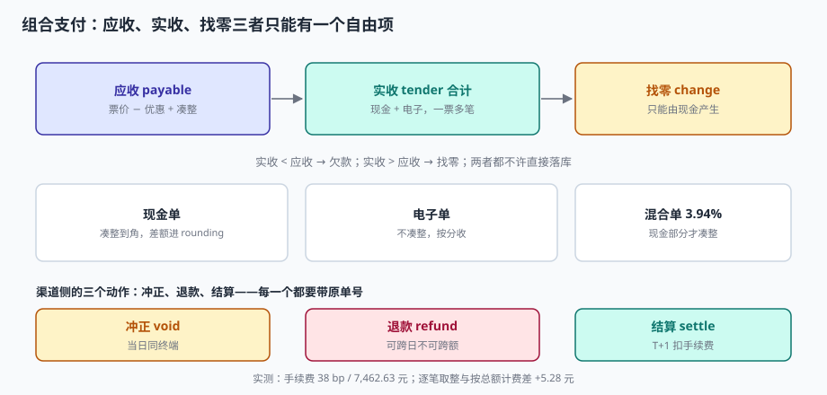

# 支付与找零：组合支付、冲正与结算

顾客买了一箱水，87.5 元。她掏出钱包，有一张 100 的，但想留着；于是扫码付 50，剩下 37.5 给现金。收银员输入「50 扫码 + 50 现金」，系统找零 12.5。

这一单在系统里产生了什么？一条 `payable = 87.5`，两条 `tender`（50 + 50），一条找零 12.5，一次现金凑整 0（87.5 已经是角），以及**三次与不同系统交互**：扫码走了渠道 A，现金进了钱箱，找零从钱箱出去。

::: tip 一句话理解
应收、实收、找零三者里只能有**一个自由项**——如果三个都能改，钱就一定会少。
:::

## 一、三个数，只能有一个自由项

| 数 | 定义 | 谁决定 | 能否事后改 |
| --- | --- | --- | --- |
| `payable` 应收 | 票价 − 优惠 + 凑整 | 系统算 | 否（改就走冲正） |
| `tender` 实收 | 各支付方式金额之和 | 顾客 | 否（多收走找零） |
| `change` 找零 | 实收 − 应收，仅现金产生 | 系统算 | 否 |

关系只有一条：

```text
Σ tender − change = payable
```

三个数里**只有一个可以浮动**。实践中浮动的应该是 `tender`（顾客给多少），`payable` 由系统算死，`change` 由前两者相减。如果让收银员能改 `payable`（「抹个零吧」），那 `rounding` 字段就白设了，而且改价记录不会留痕。



## 二、组合支付：一票多笔

本机实测：组合支付 1,181 笔（3.94%），其中现金部分合计 43,088.40 元，现金单均 83.78 元。

组合支付的三个技术点：

1. **顺序**：先扫码后现金，还是先现金后扫码？建议**先电子后现金**——电子支付可能失败（余额不足、超时），失败后可以用现金补；反过来现金已收再发现扫码失败，就要退现金，多一次操作。
2. **部分冲正**：扫码 50 成功、现金 37.5 收到，此时顾客说「不买了」。要冲正扫码的 50（渠道退款），退现金 37.5，整单作废。**两个动作必须原子**，不能只做一个。
3. **找零只从现金出**：找零不能「退回扫码」。如果顾客扫码 100 买 87.5，那是**多收 12.5**，必须原路退回 12.5，而不是给现金——否则就是套现通道。

```sql
CREATE TABLE tender (
  ticket_id   TEXT NOT NULL,
  seq         INTEGER NOT NULL,
  method      TEXT NOT NULL,          -- CASH / WECHAT / ALIPAY / CARD / GIFT
  amount      REAL NOT NULL,
  channel_ref TEXT,                   -- 渠道流水号（对账用，现金为空）
  state       TEXT NOT NULL,          -- SUCCESS / REFUNDED / VOID
  PRIMARY KEY (ticket_id, seq),
  CONSTRAINT ck_method CHECK (method IN ('CASH','WECHAT','ALIPAY','CARD','GIFT')),
  CONSTRAINT ck_amt CHECK (amount > 0)
);
```

::: danger 组合支付的四个坑
1. **`channel_ref` 不存**：渠道退款要凭原流水号，没有它就只能人工查单，一笔退款要 20 分钟。
2. **找零记为负数 `tender`**：`Σ tender` 会变小，`Σ tender − change` 就重复扣了。找零必须是独立字段。
3. **多收不退**：扫码 100 买 87.5，系统只记 87.5，剩 12.5 挂在渠道里变成「长款」，30 天后被渠道清算走。
4. **一票两笔现金**：现金 50 + 现金 50，第二笔会绕过「累计 ≤ 应收」的检查吗？不会，但会让「找零」算两次。
:::

## 三、冲正与退款：两个不同的动作

| 动作 | 时机 | 钱怎么走 | 凭证 |
| --- | --- | --- | --- |
| 冲正（VOID） | 当日、同终端、未日结 | 渠道撤销，现金退回 | 原单 + 冲正记录 |
| 退款（REFUND） | 任意时间（跨日也行） | 渠道退款，现金付出 | 原单 + 退款单 |
| 退货（RETURN） | 商品退回 | 同退款，且库存回补 | 原单 + 退货单 + 退款单 |

三者最容易混的是「冲正」与「退款」：冲正是**把一笔交易当作没发生**（当日、原路撤销），退款是**发生了一笔反向交易**（可跨日、有独立单号）。混用会导致两个后果：

- 用退款代替冲正：日结时「销售额」包含了一笔已撤销的交易，报表虚高；
- 用冲正代替退款：跨日冲正渠道不支持，钱卡在中间。

```text
收银员误操作（多扫一件）→ 未结账 → 直接删行（还没支付，无需冲正）
已支付，当日发现       → 冲正 VOID（原路撤销，票作废）
已支付，次日发现       → 退款 REFUND（新单，原票保留）
商品质量问题           → 退货 RETURN + 退款 REFUND（库存回补）
```

## 四、渠道侧：手续费与到账

电子支付的钱不是「实时到账」的，中间隔着手续费与结算周期：

| 项 | 本机实测 | 说明 |
| --- | --- | --- |
| 电子实收 | 1,962,461.25 元 | 22,097 笔 |
| 费率 | 38 bp（0.38%） | 微信 / 支付宝标准费率区间 0.38%~0.6% |
| 手续费 | 7,462.63 元 | 按逐笔 `ROUND(amount × 0.0038, 2)` |
| 到账 | 1,954,998.62 元 | 与账面差 7,462.63 元 |

逐笔取整与按总额计费的差：**+5.28 元**（30,000 笔规模）。这个差不是错，是**计费口径不同**：

| 口径 | 算法 | 结果 | 谁用 |
| --- | --- | --- | --- |
| 逐笔取整 | `Σ ROUND(amount × rate, 2)` | 7,462.63 | 渠道实际扣费 |
| 按总额 | `ROUND(Σ amount × rate, 2)` | 7,457.35 | 财务测算 |

差 5.28 元，在月度对账时会被当成「手续费差异」挂账，然后每月都有，永远挂不平。**正确做法是照渠道的口径（逐笔）算**，并在对账报表里把「逐笔−总额」的差单独列一行。

::: warning 手续费的三个不可见项
除了费率，还有三类费用经常被漏掉：
1. **最低收费**：部分渠道单笔最低 0.01 元，小额单按最低收。
2. **退款手续费**：退款通常不退手续费，甚至再收一次。
3. **跨行 / 外卡加价**：境外卡费率可达 2.5%~3%。

对账时只看「费率 × 金额」，会在这三项上长期差钱。
:::

## 五、离线支付：一条必须划线的地方

断网时能不能收款，取决于支付方式：

| 方式 | 断网可用 | 原理 | 风险 |
| --- | --- | --- | --- |
| 现金 | ✅ | 物理 | 假币、找零错 |
| 扫码（主扫） | ❌ | 需要渠道确认 | — |
| 扫码（被扫，M0 语音） | ⚠️ | 渠道侧先扣款，终端后补单 | **补单失败 = 钱收了但系统没有** |
| 刷卡（脱机） | ⚠️ | 离线授权额度 | 拒付风险由商户承担 |
| 礼品卡 / 储值 | ✅（本地余额） | 本地扣减 | 多终端并发超扣 |

被扫 + M0 语音播报是门店断网时最常用的兜底：顾客扫的是**收银员出示的静态码**（或终端生成的动态码），渠道扣款成功后语音播报「微信到账 87.5 元」。这时终端本地没有网络，只能先把这笔记成「待确认」，联网后补单。

```text
断网 → 顾客扫码 → 渠道扣款 → 语音播报 → 终端记 pending_tender
联网 → 补单 POST /pos/tenders/reconcile（带 channel_ref 或时间+金额指纹）
     → 渠道确认 → 状态 SUCCESS
     → 渠道查无此单 → 状态 UNKNOWN → 人工核（**不能自动标成功**）
```

**「UNKNOWN 不能自动标成功」是这条链上最重要的规则。** 自动标成功会让「钱没收到但账上有」变成静默损失；标失败会让顾客已付的钱变成投诉。正确做法是进人工队列，24 小时内处理完。

## 六、判据

本页判据族 `RST-A` ~ `RST-H`，共 8 条。

| 判据 | 断言 | 验证方式 |
| --- | --- | --- |
| `RST-A` | 支付方式可枚举，非法值被拒 | `method` 有 `CHECK IN (...)`，插 `BITCOIN` 被拒 |
| `RST-B` | `Σ tender − change = payable` | 违例 SQL 返回 0 行 |
| `RST-C` | 找零为独立字段，不记负数 `tender` | `tender.amount > 0` 的 `CHECK` 存在 |
| `RST-D` | 电子支付必存 `channel_ref` | `method <> 'CASH'` 时 `channel_ref` 非空 |
| `RST-E` | 冲正与退款分表或分状态 | `tender.state` 含 `VOID` / `REFUNDED`，且有独立退款单 |
| `RST-F` | 手续费按逐笔取整计算 | 逐笔合计与按总额合计的差可复现（本机 +5.28） |
| `RST-G` | 离线补单有 `UNKNOWN` 状态且不自动成功 | 状态机含 `UNKNOWN`，无自动转换到 `SUCCESS` 的路径 |
| `RST-H` | 组合支付的多笔支付属于同一票 | `tender` 主键为 `(ticket_id, seq)`，无跨票引用 |

## 七、验证方式

```shell
# 1. 建支付表并验证「累计 ≤ 应收」
sqlite3 /tmp/tender.db <<'SQL'
CREATE TABLE ticket(ticket_id TEXT PRIMARY KEY, payable REAL, change REAL DEFAULT 0);
CREATE TABLE tender(ticket_id TEXT, seq INT, method TEXT, amount REAL, channel_ref TEXT,
                    PRIMARY KEY(ticket_id, seq), CHECK(amount > 0));
CREATE TRIGGER trg_over BEFORE INSERT ON tender
WHEN NEW.amount + COALESCE((SELECT SUM(amount) FROM tender WHERE ticket_id=NEW.ticket_id),0)
     > (SELECT payable FROM ticket WHERE ticket_id=NEW.ticket_id) + 0.001
BEGIN SELECT RAISE(ABORT,'overpay'); END;
INSERT INTO ticket VALUES('T1', 87.5, 12.5);
INSERT INTO tender VALUES('T1',1,'WECHAT',50.0,'WX20261103001');
INSERT INTO tender VALUES('T1',2,'CASH',50.0,NULL);
SQL

# 2. 超收一笔（期望被拒）
sqlite3 /tmp/tender.db "INSERT INTO tender VALUES('T1',3,'CASH',1.0,NULL);" || echo "已按预期拒绝"

# 3. 勾稽：实收 − 找零 = 应收（期望 0）
sqlite3 /tmp/tender.db "
select t.payable - (select sum(amount) from tender where ticket_id=t.ticket_id) + t.change
from ticket t;"
# 期望：0.0

# 4. 手续费两种口径的差（本机实测 +5.28）
sqlite3 rp.db "
select round(sum(round(amount*0.0038,2)) ,2) as per_txn,
       round(sum(amount)*0.0038,2)            as on_total,
       round(sum(round(amount*0.0038,2)) - sum(amount)*0.0038, 2) as diff
from tender where method <> 'CASH';"
```

第 3 步的表达式看起来绕，但它说明了一件事：**找零是加回项，不是减项**。`Σ tender = payable + change`，所以 `payable − Σ tender + change = 0`。

## 参考资料

- 中国人民银行《银行卡收单业务管理办法》（中国人民银行公告〔2013〕第 9 号）：收单机构应当向特约商户提供交易明细，商户应核对交易金额与手续费。
- 《非银行支付机构监督管理条例》（国务院令第 768 号，2024 年 5 月 1 日施行）：支付机构应保障用户资金安全，提供交易查询与争议处理渠道。
- 与本页相邻：[电商支付](../../Ecommerce/Payment/index.md)、[退货与冲红](../ReturnRefund/index.md)、[班结与日结](../DayClose/index.md)。
