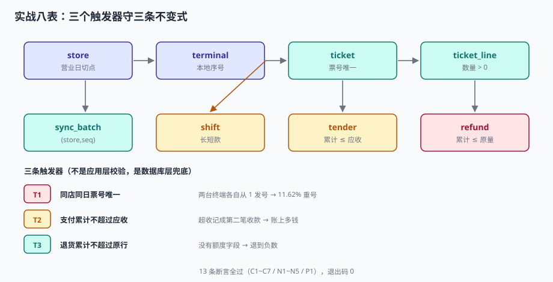

# 实战：八张表、三个触发器、十三条断言

前面八页讲了七段链上的每一个判断。这一页把它们收成一份**能跑起来的最小实现**：八张表、三个触发器、十三条断言。跑完之后，你会得到一组「全 PASS + 退出码 0」的输出——这份输出就是这套设计的验收单。

::: tip 一句话理解
能被脚本判定的，才叫设计；只能被口头描述的，叫愿望。
:::

## 一、八张表的关系



| 表 | 一句话 | 关键约束 |
| --- | --- | --- |
| `store` | 门店与营业日切点 | `biz_cut_hour` 0~12 |
| `terminal` | 终端与本地序号 | 归属门店 |
| `ticket` | 小票 | `UNIQUE(store_id, biz_date, ticket_no)` |
| `ticket_line` | 明细行 | `qty > 0`、`line_amt >= 0` |
| `tender` | 支付 | 累计 ≤ 应收（触发器） |
| `refund` | 退货 | 累计 ≤ 原行数量（触发器） |
| `shift` | 班次与钱箱 | 备用金、点钞数 |
| `sync_batch` | 补传批次 | `UNIQUE(store_id, seq)` |

八张表里，`ticket` / `ticket_line` / `tender` 是交易主链，`refund` 是逆向链，`shift` 是现金链，`sync_batch` 是传输链，`store` / `terminal` 是维度。**六条链各自独立，靠 `ticket_id` 串起来**——这是它比「一张大宽表」可靠的全部原因。

## 二、完整 DDL

```sql
CREATE TABLE store(
  store_id TEXT PRIMARY KEY,
  store_name TEXT NOT NULL,
  tz TEXT NOT NULL,
  biz_cut_hour INTEGER NOT NULL DEFAULT 4,     -- 营业日切点：04:00 前算前一日
  CONSTRAINT ck_cut CHECK (biz_cut_hour BETWEEN 0 AND 12)
);

CREATE TABLE terminal(
  terminal_id TEXT PRIMARY KEY,
  store_id TEXT NOT NULL REFERENCES store(store_id),
  last_seq INTEGER NOT NULL DEFAULT 0
);

CREATE TABLE ticket(
  ticket_id TEXT PRIMARY KEY,
  store_id TEXT NOT NULL REFERENCES store(store_id),
  terminal_id TEXT NOT NULL REFERENCES terminal(terminal_id),
  ticket_no TEXT NOT NULL,                      -- 终端本地票号，形如 S01-T03-000123
  biz_date TEXT NOT NULL,                        -- 营业日（不是自然日）
  opened_at TEXT NOT NULL,
  closed_at TEXT,
  price_ver INTEGER NOT NULL,
  gross REAL NOT NULL,
  discount REAL NOT NULL DEFAULT 0,
  rounding REAL NOT NULL DEFAULT 0,
  payable REAL NOT NULL,
  status TEXT NOT NULL DEFAULT 'PAID',
  CONSTRAINT uq_ticket_no UNIQUE (store_id, biz_date, ticket_no),
  CONSTRAINT ck_payable CHECK (payable >= 0),
  CONSTRAINT ck_gross CHECK (gross >= 0)
);

CREATE TABLE ticket_line(
  ticket_id TEXT NOT NULL REFERENCES ticket(ticket_id),
  line_no INTEGER NOT NULL,
  sku TEXT NOT NULL,
  qty REAL NOT NULL,
  unit_price REAL NOT NULL,
  line_amt REAL NOT NULL,
  discount_share REAL NOT NULL DEFAULT 0,
  PRIMARY KEY (ticket_id, line_no),
  CONSTRAINT ck_qty CHECK (qty > 0),
  CONSTRAINT ck_line_amt CHECK (line_amt >= 0)
);

CREATE TABLE tender(
  ticket_id TEXT NOT NULL REFERENCES ticket(ticket_id),
  seq INTEGER NOT NULL,
  method TEXT NOT NULL,
  amount REAL NOT NULL,
  channel_ref TEXT,
  PRIMARY KEY (ticket_id, seq),
  CONSTRAINT ck_tender_amt CHECK (amount > 0)
);

CREATE TABLE refund(
  refund_id TEXT PRIMARY KEY,
  ticket_id TEXT NOT NULL REFERENCES ticket(ticket_id),
  line_no INTEGER NOT NULL,
  qty REAL NOT NULL,
  amount REAL NOT NULL,
  store_id TEXT NOT NULL REFERENCES store(store_id),
  created_at TEXT NOT NULL,
  CONSTRAINT ck_refund_qty CHECK (qty > 0)
);

CREATE TABLE shift(
  shift_id TEXT PRIMARY KEY,
  store_id TEXT NOT NULL REFERENCES store(store_id),
  terminal_id TEXT NOT NULL REFERENCES terminal(terminal_id),
  biz_date TEXT NOT NULL,
  float_open REAL NOT NULL,                      -- 备用金
  cash_in REAL NOT NULL DEFAULT 0,
  cash_refund REAL NOT NULL DEFAULT 0,
  counted REAL,                                  -- 点钞实数
  status TEXT NOT NULL DEFAULT 'OPEN'
);

CREATE TABLE sync_batch(
  batch_id TEXT PRIMARY KEY,
  store_id TEXT NOT NULL REFERENCES store(store_id),
  seq INTEGER NOT NULL,
  ticket_id TEXT NOT NULL,
  payload TEXT NOT NULL,
  uploaded_at TEXT NOT NULL,
  CONSTRAINT uq_sync UNIQUE (store_id, seq)      -- 补传去重键
);
```

## 三、三个触发器

三条不变式，全部压在数据库层——因为它们必须拦住**所有入口**（收银端、店长后台、客服系统、批量导入、运维手工 SQL）。

```sql
-- T1 票号：同店同日不许重号（终端号进票号，才不会两台机器各自从 1 开始）
CREATE TRIGGER trg_ticket_no_guard
BEFORE INSERT ON ticket
WHEN EXISTS (SELECT 1 FROM ticket
             WHERE store_id = NEW.store_id AND biz_date = NEW.biz_date
               AND ticket_no = NEW.ticket_no)
BEGIN
  SELECT RAISE(ABORT, 'T1 ticket_no duplicated in store/biz_date');
END;

-- T2 支付：累计实收不得超过应收（超收必须走找零，不是记成第二笔收款）
CREATE TRIGGER trg_tender_overpay
BEFORE INSERT ON tender
WHEN NEW.amount + COALESCE((SELECT SUM(amount) FROM tender WHERE ticket_id = NEW.ticket_id), 0)
     > (SELECT payable FROM ticket WHERE ticket_id = NEW.ticket_id) + 0.001
BEGIN
  SELECT RAISE(ABORT, 'T2 tender exceeds payable');
END;

-- T3 退货：同一行累计退量不得超过原行数量
CREATE TRIGGER trg_refund_over
BEFORE INSERT ON refund
WHEN NEW.qty + COALESCE((SELECT SUM(qty) FROM refund
                         WHERE ticket_id = NEW.ticket_id AND line_no = NEW.line_no), 0)
     > (SELECT qty FROM ticket_line WHERE ticket_id = NEW.ticket_id AND line_no = NEW.line_no) + 1e-9
BEGIN
  SELECT RAISE(ABORT, 'T3 refund qty exceeds original line');
END;
```

::: danger 触发器的三个写法坑
1. **用 `AFTER` 而不是 `BEFORE`**：`AFTER` 时脏数据已经写入，`RAISE(ABORT)` 会回滚整条语句，但如果有外键级联，可能留下部分副作用。**能用 `BEFORE` 就用 `BEFORE`**。
2. **`+ 0.001` 容差写反**：写成 `- 0.001` 会让合法的浮点误差被拒。
3. **SQLite 的 `RAISE` 只能出现在触发器里**，不能放在普通 `CHECK` 中做跨行校验——跨行校验只能用触发器。
:::

## 四、造数与断言

```python
import sqlite3, sys
con = sqlite3.connect(":memory:")
con.execute("PRAGMA foreign_keys=ON")
cur = con.cursor()
cur.executescript(DDL)        # 上一节的 DDL

def add_ticket(tid, tno, term, lines, discount=0.0, rounding=0.0, biz="2026-11-02"):
    gross = round(sum(a for _, _, a in lines), 2)
    tot   = sum(a for _, _, a in lines)
    payable = round(gross - discount + rounding, 2)
    cur.execute("""INSERT INTO ticket(ticket_id,store_id,terminal_id,ticket_no,biz_date,
                   opened_at,closed_at,price_ver,gross,discount,rounding,payable,status)
                   VALUES(?,?,?,?,?,?,?,?,?,?,?,?,?)""",
                (tid, 'S01', term, tno, biz, f"{biz}T10:00:00", f"{biz}T10:03:00", 3,
                 gross, discount, rounding, payable, 'PAID'))
    for i, (sku, qty, amt) in enumerate(lines, 1):
        share = round(amt / tot * discount, 2) if discount else 0.0
        cur.execute("INSERT INTO ticket_line VALUES(?,?,?,?,?,?,?)",
                    (tid, i, sku, qty, round(amt / qty, 2), amt, share))
    return payable
```

三张票覆盖了三种典型形态：

| 票 | 行 | 优惠 | 凑整 | 支付 | 验证什么 |
| --- | --- | --- | --- | --- | --- |
| `T1` | 2 行（19.8 + 12.0） | −3.0 | −0.8 | 现金 18 + 微信 10 | 组合支付 + 凑整 + 分摊 |
| `T2` | 1 行（9.9） | 0 | 0 | 微信 9.9 | 纯电子，不凑整 |
| `T3` | 1 行（45.0，3 件） | 0 | 0 | 卡 45 | 部分退额度 |

## 五、十三条断言

| 编号 | 断言 | 类型 |
| --- | --- | --- |
| `C1` | `payable = gross − discount + rounding` | 勾稽 |
| `C2` | `gross = Σ line_amt` | 勾稽 |
| `C3` | `discount = Σ discount_share`（容差 1 分/行） | 勾稽 |
| `C4` | `payable = Σ tender` | 勾稽 |
| `C5` | 退货累计 ≤ 原行数量 | 勾稽 |
| `C6` | 班结应有现金可复算（518.10 vs 517.10，短款 1.00） | 勾稽 |
| `C7` | 补传重放只落一行 | 幂等 |
| `N1` | 同店同日重复票号被拒 | 负向 |
| `N2` | 支付超应收被拒 | 负向 |
| `N3` | 超额退货被拒 | 负向 |
| `N4` | 数量为 0 的明细被拒 | 负向 |
| `N5` | 退满后再退被拒 | 负向 |
| `P1` | 合法部分退可累加到原行数量 | 正向 |

```python
fails, TOTAL = [], []
def check(name, cond, detail=""):
    TOTAL.append(1)
    print(f"{'PASS' if cond else 'FAIL'}  {name}{('  ' + detail) if detail else ''}")
    if not cond: fails.append(name)

def must_fail(name, sql, args=()):
    try:
        cur.execute(sql, args); con.commit()
        check(name, False, "预期被拒绝，实际写入成功")
    except sqlite3.IntegrityError as e:
        check(name, True, f"-> {e}")

def q(sql, args=()):
    return cur.execute(sql, args).fetchall()
```

四条勾稽 SQL 是这套设计的骨架，值得逐条看：

```sql
-- C1 四个金额字段自洽
SELECT COUNT(*) FROM ticket
WHERE ABS(payable - (gross - discount + rounding)) > 0.001;

-- C2 整单原价 = 明细合计
SELECT COUNT(*) FROM ticket t
WHERE ABS(t.gross - (SELECT SUM(line_amt) FROM ticket_line l WHERE l.ticket_id=t.ticket_id)) > 0.001;

-- C3 整单优惠 = 行分摊合计（容差 1 分/行）
SELECT COUNT(*) FROM ticket t
WHERE ABS(t.discount - (SELECT SUM(discount_share) FROM ticket_line l WHERE l.ticket_id=t.ticket_id)) > 0.01;

-- C4 应收 = 支付合计
SELECT COUNT(*) FROM ticket t
WHERE ABS(t.payable - (SELECT COALESCE(SUM(amount),0) FROM tender d WHERE d.ticket_id=t.ticket_id)) > 0.001;
```

## 六、跑出来的结果

```text
PASS  C1 小票 payable = gross - discount + rounding  违例 0
PASS  C2 整单原价 = 明细行合计  违例 0
PASS  C3 整单优惠 = 行分摊合计（容差 1 分/行）  违例 0
PASS  C4 应收 = 支付合计  违例 0
PASS  C5 退货累计 ≤ 原行数量  违例 0
PASS  N1 同店同日重复票号被拒  -> T1 ticket_no duplicated in store/biz_date
PASS  N2 支付超应收被拒  -> T2 tender exceeds payable
PASS  N3 超额退货被拒  -> T3 refund qty exceeds original line
PASS  N4 数量为 0 的明细被拒  -> CHECK constraint failed: ck_qty
PASS  P1 合法部分退可累加到原行数量  累计 3.0 件 / 45.00 元
PASS  N5 再退 1 件超原行被拒  -> T3 refund qty exceeds original line
PASS  C6 班结应有现金可复算  应有 518.10 / 实数 517.10 / 差异 -1.00
PASS  C7 补传重放只落一行  入库 1 行

========================================================
断言 13 / 13 通过
```

退出码 `0`。这份输出比任何设计文档都更能说明「约束真的生效了」——因为它不是描述，是执行结果。

::: tip 为什么负向用例占了一半
五条 `N` 用例（N1~N5）比八条正向勾稽更重要。正向勾稽只能证明「合法的能进去」，负向用例才能证明「非法的进不去」。一个只有正向用例的测试套件，在删掉触发器之后依然会全绿。
:::

## 七、从断言反推设计

十三条断言里，有四条直接决定了表结构：

| 断言 | 反推出的设计决策 |
| --- | --- |
| `C1` | 必须有 `rounding` 独立字段（否则凑整只能塞进 `discount`） |
| `C3` | 必须有 `discount_share`（否则整单优惠无法落到行） |
| `C5` / `N3` / `N5` | 必须有 `refund` 独立表 + 触发器（不能在 `ticket` 上写负数） |
| `C7` | 必须有 `(store_id, seq)` 唯一键（不能靠应用层去重） |

反过来说：**如果一条断言写不出来，说明对应的设计还没想清楚**。写不出「应收 = 支付合计」的系统，往往是因为它把支付拍平进了票。

## 八、常见问题与分诊

| 症状 | 先看哪里 | 常见根因 |
| --- | --- | --- |
| 日结差几分钱 | `C3` 分摊闭合 | 独立四舍五入，未用最大余数法 |
| 钱箱总是短几十 | 退款是否冲钱箱 | `refund` 只写单据，不改 `cash_refund` |
| 退货退超了 | `C5` 断言 | 缺 `BEFORE INSERT` 触发器 |
| 同一单出现两次 | `C7` 断言 | 补传去重键只用自增 id |
| 票号重复 | `N1` 用例 | 票号没带终端号 |
| 跨零点单归错日 | `biz_date` 计算 | 用 `created_at` 推营业日 |
| 顾客说「标价 9.9 收 12.9」 | `ticket.price_ver` | 价目滞后，终端没同步 |
| 组合支付算不平 | `C4` 断言 | 找零记成负数 `tender` |

## 九、判据

本页判据族 `RSX-A` ~ `RSX-H`，共 8 条。

| 判据 | 断言 | 验证方式 |
| --- | --- | --- |
| `RSX-A` | 八张表可一次建出，无语法错误 | `executescript` 返回 0，`sqlite_master` 计数 8 表 + 3 触发器 |
| `RSX-B` | 四条金额勾稽违例为 0 | `C1`~`C4` 全 PASS |
| `RSX-C` | 三条触发器各自能拦一次非法写入 | `N1` / `N2` / `N3` 全 PASS 且报错信息含触发器名 |
| `RSX-D` | 合法部分退能累加到原行数量 | `P1` 累计 3.0 件 = 原行 3 件 |
| `RSX-E` | 退满后再退被拒 | `N5` 报 `T3 refund qty exceeds original line` |
| `RSX-F` | 补传重放三次只落一行 | `C7` 入库 1 行 |
| `RSX-G` | 班结现金可复算且差异可解释 | `C6` 应有 518.10 / 实数 517.10 / 差 −1.00 |
| `RSX-H` | 脚本退出码为 0 | `echo $?` 输出 0 |

## 十、验证方式

把本文第二节的 DDL、第三节的触发器、第四节的造数与第五节的断言拼成一个 `rp_practice.py`，然后：

```shell
python3 rp_practice.py; echo "EXIT=$?"
# 期望：13 行 PASS，最后一行 "EXIT=0"
```

只想验证表结构，不想写 Python，可以纯用命令行：

```shell
# 1. 建库（把 DDL 存成 schema.sql）
sqlite3 /tmp/rp.db < schema.sql
sqlite3 /tmp/rp.db "select type, name from sqlite_master where type in ('table','trigger') order by type, name;"
# 期望：8 张表 + 3 个触发器

# 2. 手工插入一张票，验证 C1
sqlite3 /tmp/rp.db "
insert into store values('S01','一号店','Asia/Shanghai',4);
insert into terminal values('S01-T01','S01',0);
insert into ticket values('T1','S01','S01-T01','S01-T01-000001','2026-11-02',
  '2026-11-02T10:00:00','2026-11-02T10:03:00',3,31.8,3.0,-0.8,28.0,'PAID');
select count(*) from ticket where abs(payable-(gross-discount+rounding))>0.001;"
# 期望：0

# 3. 触发 T1：同票号再插一次
sqlite3 /tmp/rp.db "insert into ticket values('T2','S01','S01-T01','S01-T01-000001',
  '2026-11-02','2026-11-02T11:00:00',null,3,1,0,0,1,'PAID');" || echo "T1 已生效"
```

第 3 步的 `|| echo` 是验收的关键：**拒绝成功时，脚本不会中断，而是打印一行提示**。把负向用例写成「必须报错」，才能真正证明约束在数据库层。

## 参考资料

- SQLite 官方文档：[CREATE TRIGGER](https://www.sqlite.org/lang_createtrigger.html) / [RAISE](https://www.sqlite.org/lang_createtrigger.html#raise)——`BEFORE` 触发器与 `RAISE(ABORT)` 的语义。
- GB/T 18184—2025《商业自动化术语》（2025-10-05 发布、2026-02-01 实施，代替 GB/T 18184—2008）：票号、行、挂单、班结的术语定义。
- 与本页相邻：[总览](../Overview/index.md)、[优惠与凑整](../PromotionStack/index.md)、[退货与冲红](../ReturnRefund/index.md)。
