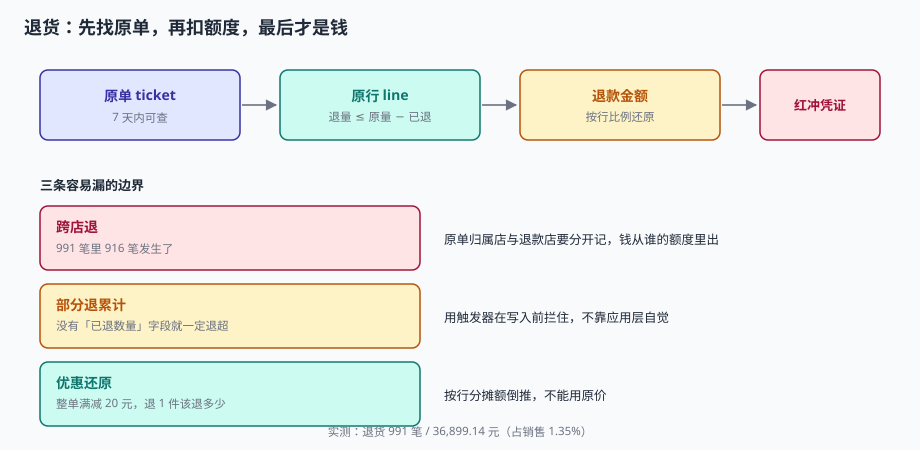

# 退货与冲红：原单匹配与部分退额度

「这瓶酱油我上周买的，没开封，退了。」收银员问：「有小票吗？」顾客翻手机，找出一张照片。收银员对着照片输票号，系统显示这单还在 7 天窗口内，于是刷退货码、退款 12.8 元、把这瓶酱油放回货架。

这单看起来简单，但系统要回答四个问题：**这是哪一单？这一单这件商品还能退多少？该退多少钱？钱从哪里出？** 四个问题里任何一个答错，都不会报错。

::: tip 一句话理解
退货的顺序必须是：**先找原单，再扣额度，最后才是钱**——顺序反了（先给钱再找单），就一定有对不上的账。
:::



## 一、四种退货，四种口径

| 类型 | 有原单 | 退钱 | 退库存 | 常见场景 |
| --- | --- | --- | --- | --- |
| 原单退货 | ✅ 必须 | 按原单实付 | ✅ | 90% 的退货 |
| 无单退货（凭会员/手机号） | ⚠️ 系统查最近单 | 按当前价或原价（政策定） | ✅ | 顾客丢票 |
| 换货 | ✅ | 不退钱，走差价 | ✅ 退 + ✅ 发 | 尺码 / 颜色 |
| 仅退款不退货 | ✅ | 按比例退 | ❌ | 生鲜、破损 |

本机实测：991 笔退货、36,899.14 元，占销售额 **1.35%**。其中**跨店退 916 笔（92.4%）**——这个比例不是数据生成的问题，而是现实：顾客在 A 店买、在 B 店退，是连锁零售的常态。

::: danger 跨店退是「默认会发生」，不是「异常」
把跨店退当异常拦掉，结果是一线收银员用「无单退货」绕过，反而丢了原单信息。正确做法是**允许跨店退，但把「原单归属店」与「退款发生店」分开记**：
- `ticket.store_id`：卖出的店（业绩归它）
- `refund.store_id`：退款的店（现金从它的钱箱出）
- 两店的退货率分别统计，否则「卖得多的店退货率低」永远是假象。
:::

## 二、原单匹配：四个键，优先级从高到低

| 键 | 命中率 | 风险 | 用法 |
| --- | --- | --- | --- |
| 票号（`ticket_no` + 店 + 日） | 最高 | 顾客丢票就没有 | 首选 |
| 会员 + 时间窗（±7 天） | 中 | 同会员多单要人工选 | 次选 |
| 支付流水号（`channel_ref`） | 高 | 现金单没有 | 电子支付时可用 |
| 金额 + 时间指纹 | 低 | 极易误配（同价商品多） | 兜底，需人工确认 |

**不要用「金额 + 时间」做主匹配。** 便利店里 9.9 元的商品一天卖几十件，金额指纹几乎必然误配——退错单的后果是「A 顾客的退款记到 B 顾客头上」，两个人都来投诉。

```sql
-- 原单查询：票号优先，其次会员 + 时间窗
SELECT t.ticket_id, t.biz_date, t.payable, t.store_id
FROM ticket t
WHERE t.status IN ('PAID','REFUNDED')
  AND (
        (t.store_id = :store AND t.ticket_no = :ticket_no AND t.biz_date >= date(:today, '-30 days'))
     OR (t.member_id = :member AND t.closed_at >= datetime(:today, '-7 days'))
      )
ORDER BY (t.ticket_no = :ticket_no) DESC, t.closed_at DESC
LIMIT 20;
```

`ORDER BY (条件) DESC` 是让「票号精确命中」排在前面，避免会员单把精确匹配挤下去。

## 三、额度：一个必须落库的数字

「这件商品还能退多少」不是算出来的，是**查出来的**：

```text
可退数量 = 原行数量 − 已退数量
可退金额 = (line_amt − discount_share) × (可退数量 / 原行数量)
```

### 一个必须自己算一遍的例子

原行：2 件 × 45 元 = 90 元，整单满 200 减 30，这行分摊到 `discount_share = 13.5`（90/200 × 30）。

| 退货情形 | 可退数量 | 可退金额 | 错算成 |
| --- | --- | --- | --- |
| 退 1 件 | 2 − 0 = 2 → 退 1 | (90 − 13.5) × 1/2 = **38.25** | 45（按原价退，多退 6.75） |
| 再退 1 件 | 2 − 1 = 1 → 退 1 | 38.25 | 38.25 |
| 第三次退 1 件 | 2 − 2 = 0 → **拒绝** | — | 又退 38.25（退超） |

按原价退，顾客用 76.5 元买的东西退了 90 元，**每笔多退 6.75 元**。这不是小钱：1,000 笔退货就是 6,750 元。

### 额度必须在数据库层守

```sql
CREATE TRIGGER trg_refund_over
BEFORE INSERT ON refund
WHEN NEW.qty + COALESCE((SELECT SUM(qty) FROM refund
                         WHERE ticket_id = NEW.ticket_id AND line_no = NEW.line_no), 0)
     > (SELECT qty FROM ticket_line WHERE ticket_id = NEW.ticket_id AND line_no = NEW.line_no) + 1e-9
BEGIN
  SELECT RAISE(ABORT, 'refund qty exceeds original line');
END;
```

为什么不写在应用层？因为**应用有多个入口**：收银端、店长后台、客服系统、批量导入。四个入口写四遍校验，一定会漏一个。数据库层写一遍，四个入口全兜住。

::: warning 本机数据集里「超退 0 组」不代表没问题
本文的 991 笔退货全部是「一票一退」，所以按 `GROUP BY ticket_id, line_no` 统计超退自然是 0。**超退风险是用负向用例证明的**（实战页 `N3` / `N5`）：去掉触发器后，同一行可以退三次，累计 2.5 件 > 原行 2 件。
:::

## 四、优惠还原：按分摊额倒推

整单优惠必须还原到行，否则退货一定退错。四种情形的正确算法：

| 情形 | 正确算法 | 错误算法 | 差额 |
| --- | --- | --- | --- |
| 整单满减 | 按 `discount_share` 比例 | 按原价 | 多退 6.75（上例） |
| 单品特价 | 按特价（已在 `unit_price`） | 按原价 | 多退差价 |
| 会员折扣 | 按折后价 | 按原价 | 多退 5% |
| 支付立减 | **不退**（渠道承担） | 按比例退 | 多退渠道的钱 |

第四种最容易被忽略：扫码支付立减 5 元，退货时顾客期望退全款，但门店只收到了 `payable`。如果按原价退，这 5 元要门店自己贴。

## 五、与发票红冲的衔接

退货涉及开票的，要走红冲。三个衔接点：

| 衔接点 | 规则 | 不做的后果 |
| --- | --- | --- |
| 原单是否开票 | `ticket.invoice_id` 非空才需红冲 | 未开票却红冲，票号浪费 |
| 红冲金额 | 等于退款金额，不等于原票价 | 红冲超额，税务比对异常 |
| 红冲时点 | 与原票同属一个纳税期优先 | 跨期红冲要走调整，流程更长 |

门店侧只需要保证一件事：**退款单上带 `invoice_id` 与 `refund_id` 的关联**。红冲的具体操作在[发票开具](../../TaxInvoice/Overview/index.md)里讲，这里不重复。

## 六、判据

本页判据族 `RSR-A` ~ `RSR-H`，共 8 条。

| 判据 | 断言 | 验证方式 |
| --- | --- | --- |
| `RSR-A` | 退货必须能关联到原单 | `refund.ticket_id` 外键非空，无单退货走独立类型 |
| `RSR-B` | 原单归属店与退款店分开记 | `refund.store_id` 与 `ticket.store_id` 可为不同值 |
| `RSR-C` | 累计退量 ≤ 原行数量（数据库层） | 触发器存在；连续退 3 次，第 3 次被拒 |
| `RSR-D` | 退款金额按分摊额倒推 | 半额退的金额 = `(line_amt − discount_share) / 2` |
| `RSR-E` | 支付立减不退 | 有立减的票退货，退款额不含立减 |
| `RSR-F` | 退款走独立单号，不改原票 | `refund` 表有独立主键，原 `ticket` 无 `UPDATE` |
| `RSR-G` | 退货回补库存且可追溯 | 退货写入库存流水，`ref` 指向 `refund_id` |
| `RSR-H` | 已开票退货有红冲关联 | `refund.invoice_id` 与原票一致 |

## 七、验证方式

```shell
# 1. 建退货额度模型
sqlite3 /tmp/refund.db <<'SQL'
CREATE TABLE ticket_line(ticket_id TEXT, line_no INT, qty REAL, line_amt REAL,
                         discount_share REAL DEFAULT 0, PRIMARY KEY(ticket_id, line_no));
CREATE TABLE refund(refund_id TEXT PRIMARY KEY, ticket_id TEXT, line_no INT, qty REAL,
                    amount REAL, store_id TEXT, created_at TEXT);
CREATE TRIGGER trg_refund_over BEFORE INSERT ON refund
WHEN NEW.qty + COALESCE((SELECT SUM(qty) FROM refund
                         WHERE ticket_id=NEW.ticket_id AND line_no=NEW.line_no),0)
     > (SELECT qty FROM ticket_line WHERE ticket_id=NEW.ticket_id AND line_no=NEW.line_no) + 1e-9
BEGIN SELECT RAISE(ABORT,'T3 refund qty exceeds original line'); END;
INSERT INTO ticket_line VALUES('T1',1,2,90.0,13.5);
INSERT INTO refund VALUES('R1','T1',1,1,38.25,'S01','2026-11-02T11:00:00');
SQL

# 2. 再退 1 件（合法，期望成功）
sqlite3 /tmp/refund.db "INSERT INTO refund VALUES('R2','T1',1,1,38.25,'S01','2026-11-02T11:05:00');"

# 3. 第三次退 1 件（超原行，期望被拒）
sqlite3 /tmp/refund.db "INSERT INTO refund VALUES('R3','T1',1,1,38.25,'S01','2026-11-02T11:10:00');" \
  || echo "已按预期拒绝"

# 4. 可退余额查询（期望 0）
sqlite3 /tmp/refund.db "
select l.qty - coalesce((select sum(qty) from refund where ticket_id=l.ticket_id and line_no=l.line_no),0) as left_qty
from ticket_line l where ticket_id='T1' and line_no=1;"
```

第 3 步的那句 `|| echo` 很重要：**拒绝不是失败，是预期行为**。把负向用例写成「必须报错」的断言，比写成「功能正常」的断言更能守住边界。

## 参考资料

- 《中华人民共和国消费者权益保护法》第二十四条：经营者提供的商品或者服务不符合质量要求的，消费者可以依照国家规定、当事人约定退货。
- 《网络购买商品七日无理由退货暂行办法》（工商总局令第 90 号）——线下门店不强制适用，但连锁品牌常参照执行，需在价签或小票上明示。
- 与本页相邻：[点单与挂单](../Basket/index.md)、[优惠与凑整](../PromotionStack/index.md)、[发票开具](../../TaxInvoice/RedFlush/index.md)。
