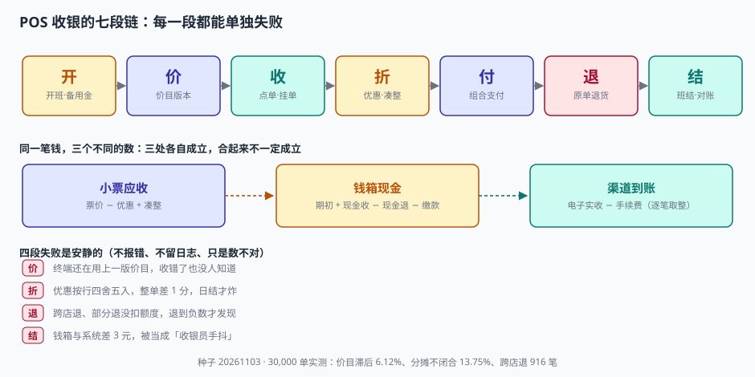
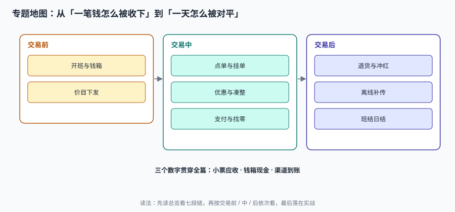

# 门店零售与 POS 收银工程

一家便利店早上七点开门，收银员从保险柜里取出 500 元备用金，按下「开班」。这一天里，她收了两百多笔钱：有的扫码、有的刷卡、有的掏现金还要找零，中途还退了一单、挂了两单、断网十一分钟。晚上十点，她把钱箱里的现金倒在桌上数——数出来的数和系统里的数差 3 块 2。

这 3 块 2 不是「收银员手抖」，而是一整条链路上所有「安静失败」的合计：可能是一笔现金凑整记错了方向，可能是一单退货没冲减钱箱，可能是断网期间的十一分钟里有三笔没补传上来。**在线上系统里，这些都会被同一次请求的返回值暴露；在门店里，它们全都不报错。**

::: tip 一句话理解
POS 不是「网页版的收银台」，它是**一个会断网、会找零、会在凌晨数现金的独立系统**——所以每一笔钱必须在离线时也算得清，联网后还能对得上。
:::

## 一、这个专题讲什么

从「开门取备用金」到「日结把三张表对平」，一条流水要走七段：

| 段 | 这一段在做什么 | 产物 | 失败是否安静 |
| --- | --- | --- | --- |
| ① 开 | 开班、领备用金、绑钱箱 | `shift`（OPEN） | 显性（不绑钱箱不能收现） |
| ② 价 | 拿到当日应生效的价目版本 | `price_version` | **安静**（用旧价照收，没人报错） |
| ③ 收 | 点单、称重、挂单、取单 | `ticket` + `ticket_line` | 半显性（挂单丢了顾客会吵） |
| ④ 折 | 优惠叠加、按行分摊、凑整 | `discount_share` / `rounding` | **安静**（差 1 分，日结才炸） |
| ⑤ 付 | 组合支付、找零、冲正 | `tender` | **安静**（多收的钱记成第二笔收款） |
| ⑥ 退 | 找原单、扣额度、退款 | `refund` | **安静**（跨店退、退超了都不报错） |
| ⑦ 结 | 班结、日结、三口径对账 | `shift`（CLOSED）+ 对账结果 | **安静**（长短款被当成手抖） |

七段里**四段的失败是安静的**。它们的共同形态是：票据打得出来、金额加得起来、账面看起来是平的，只有「这一笔该收多少、这一天到底收了多少钱」没人能回答。

本机实测最能说明问题的一组读数：30,000 笔流水、2,723,479.75 元小票应收，其中**价目滞后一个版本的有 1,837 笔（6.12%）**——按当日应生效价目算，少收 2,145.95 元、多收 2,586.63 元，**净额只有 −440.68 元**。净额看起来「几乎没错」，双向绝对值却有 4,732.59 元。这就是门店系统最典型的缺陷形态：**错误互相抵消，平均数把问题吃掉。**

## 二、三个「收了多少钱」

| 口径 | 定义 | 谁在关心 | 常见错法 |
| --- | --- | --- | --- |
| 小票应收 | 票价 − 优惠 + 凑整 | 店长 / 运营 | 把凑整算成优惠，退货时多退 |
| 钱箱现金 | 期初备用金 + 现金收 − 现金退 − 缴款 | 收银员 / 出纳 | 用「净额」当「应有」，看不出结构 |
| 渠道到账 | 电子实收 − 手续费（逐笔取整） | 财务 / 渠道经理 | 用总额算手续费，差几分对不上 |

三者必须分列存、分列对。合成一个 `amount` 字段，就再也回答不了「这一天到底收了多少钱」——而这句问话，是门店系统 80% 工单的开头。

### 一个必须自己算一遍的例子

某班次：备用金 500 元，现金收款 28 元，现金退款 9.90 元，点钞 517.10 元。

| 算法 | 表达式 | 结果 | 与点钞差 |
| --- | --- | --- | --- |
| 只算收 | 500 + 28 | 528.00 | −10.90（冤枉收银员） |
| 期初 + 收 − 退 | 500 + 28 − 9.90 | 518.10 | **−1.00（真实短款）** |
| 只算净 | 28 − 9.90 | 18.10 | −499.00（把备用金吃掉了） |

**三种算法都「有依据」，只有第二种是钱箱里真实存在的钱。** 上表不是编的，是本文实战页脚本 `C6` 断言的输出：应有 518.10、实数 517.10、差异 −1.00。

::: danger 三件事必须写进数据模型，不能留给「店长每天核一下」
1. **票号必须带终端号**：两台终端各自从 1 开始发号，同店同日重号率实测 **11.62%**；重号之后，退货找不到原单、补传分不清哪张是新单。
2. **优惠必须落到行上**：整单满减 20 元不退到每一行，退货时就算不出「这件该退多少」。按行独立四舍五入，**13.75% 的单子分摊不闭合**。
3. **退货额度必须落库**：没有 `已退数量` 字段，部分退就能退到负数。这不是应用层「注意一下」能解决的，要靠数据库层的 `BEFORE INSERT` 触发器。
:::

## 三、专题地图

按交易发生的顺序读：

| 阶段 | 页面 | 一句话 |
| --- | --- | --- |
| 交易前 | [班次与钱箱](ShiftDrawer/index.md) | 钱箱不是抽屉，是一条有期初、有流水、有缴款的账 |
| 交易前 | [价目下发](PriceSync/index.md) | 收错价的根因几乎从不在收银端，而在「哪一版价目算数」 |
| 交易中 | [点单与挂单](Basket/index.md) | 挂单不是暂存，是一条占着票号的小票 |
| 交易中 | [优惠与凑整](PromotionStack/index.md) | 先定顺序，再定余数，最后才是抹零 |
| 交易中 | [支付与找零](PaymentTender/index.md) | 应收、实收、找零，只能有一个自由项 |
| 交易后 | [退货与冲红](ReturnRefund/index.md) | 先找原单，再扣额度，最后才是钱 |
| 交易后 | [离线补传](OfflineSync/index.md) | 本地先成立，联网再对账 |
| 交易后 | [班结与日结](DayClose/index.md) | 对不平时先看差额的形状，别急着找人 |
| 收口 | [实战：八张表、三个触发器、十三条断言](Practice/index.md) | 能被脚本判定的，才叫设计 |

## 四、和相邻专题的分工

本册只讲「门店这一端怎么把钱收对、对上」。相邻主题各自已经讲透的部分，这里不重复：

| 相邻专题 | 它讲什么 | 本专题不重复讲 |
| --- | --- | --- |
| [订单状态机](../Ecommerce/OrderStateMachine/index.md) | 线上订单从下单到完成的迁移 | 线下小票的生命周期（票/行/挂单） |
| [电商库存](../Ecommerce/Inventory/index.md) | 可售、预占、超卖 | 门店本地库存扣减只讲边界，不讲波次与货位 |
| [电商支付](../Ecommerce/Payment/index.md) | 渠道下单、回调、对账 | 组合支付、找零、现金凑整 |
| [账务与清结算](../Ledger/Reconciliation/index.md) | 分录横平与差异归因 | 小票 / 钱箱 / 渠道三口径的**门店侧**差异 |
| [营销计价与优惠分摊](../PricingPromotion/Overview/index.md) | 规则引擎、最优券、优惠分摊 | 收银端的**固定顺序**与凑整（不让收银员选） |
| [发票开具](../TaxInvoice/Overview/index.md) | 数电票开具与红冲 | 退货与红冲的**衔接点**，不展开票面 |
| [考勤排班](../TimeAttendance/ShiftModel/index.md) | 班次、打卡、工时 | 班次与钱箱的**绑定关系**，不算工时 |
| [幂等状态机](../IdempotencyStateMachine/IdempotencyKey/index.md) | 请求级幂等的通用设计 | 补传队列的**表结构与去重键** |
| [仓储作业](../WarehouseOps/Overview/index.md) | 库位、波次、拣选路径 | 门店后仓与补货 |
| [多币种折算](../MultiCurrency/Overview/index.md) | 汇率快照与期末重估 | 仅境外门店涉及，本册只提一句 |

## 五、版本组织：为什么不建版本目录

POS 侧最常见的问题是「刷卡改扫码了，文档是不是要分一代」。本册**不建 `RetailPOS/V1` 这类目录**，三条理由：

1. **换代的是硬件与支付通道，判据一字没变。** 从磁条卡到扫码到刷脸，变的只是 `tender.method` 的枚举值；「票号唯一、钱箱平、三口径可归因」这三条从 1990 年的收银机到今天的云 POS 完全一致。
2. **并存差异是连锁形态，不是代际。** 直营、加盟、店中店、专柜代收的差别在**参数与权限**（谁能改价、谁能退款、钱进谁的账户），不在链路本身。用版本目录去装「加盟店」，会把权限问题伪装成代码分支问题。
3. **真正需要版本目录的是「同一份代码两套写法」。** 本库已有先例：[Spring5](../Java/Frame/Spring/Spring5/index.md) / [Spring6](../Java/Frame/Spring/Spring6/index.md)、[Vue2](../../Frontend/Frame/Vue/Vue2/index.md) / [Vue3](../../Frontend/Frame/Vue/Vue3/index.md)——同一框架两代 API 并存，旧版必须原样保留并标注维护状态。POS 侧不是这种情形：一套写法接不同设备，设备差异落在配置表里。

::: info 旧版本与旧设备的处置口径
遇到只支持老协议的门店（例如只支持某银行 M0 语音播报的固件），**不新建章节**，在[支付与找零](PaymentTender/index.md)的兼容性表里加一行，标注「仅存量门店使用，新店不再采购」。这条口径和本库对 Spring5 / Vue2 的处理一致：旧内容保留、标注状态、不覆盖。
:::

## 六、建议阅读顺序

1. 先读[总览：七段链与三个「收了多少钱」](Overview/index.md)——把「同一笔钱的三个数」建立起来。
2. 按交易顺序读[班次与钱箱](ShiftDrawer/index.md) → [价目下发](PriceSync/index.md) → [点单与挂单](Basket/index.md)。
3. 再读三篇「算钱」的：[优惠与凑整](PromotionStack/index.md)、[支付与找零](PaymentTender/index.md)、[退货与冲红](ReturnRefund/index.md)。
4. 最后读两篇「对账」的：[离线补传](OfflineSync/index.md)、[班结与日结](DayClose/index.md)。
5. 落地时照[实战](Practice/index.md)把八张表建出来，跑一遍十三条断言。

## 七、本册的读数从哪来

所有数字来自一台 16 GB 笔记本上的 SQLite 3.50.4 / Python 3.13，种子 `20261103`，规模是 12 家门店 × 30 天 × 30,000 笔流水（69,462 条明细行），**不是生产数据，也不是压测结论**。写进正文的每一个数都可以用附录里的脚本重跑：

| 读数 | 值 | 出现在 |
| --- | --- | --- |
| 小票应收 / 客单价 | 2,723,479.75 / 90.78 | 本页、[总览](Overview/index.md) |
| 现金占比（金额 / 笔数） | 27.94% / 29.13% | [班次与钱箱](ShiftDrawer/index.md) |
| 价目滞后单 | 1,837 笔（6.12%） | [价目下发](PriceSync/index.md) |
| 优惠分摊不闭合 | 1,059 / 7,700 笔（13.75%） | [优惠与凑整](PromotionStack/index.md) |
| 组合支付占比 | 3.94% | [支付与找零](PaymentTender/index.md) |
| 跨店退 | 916 / 991 笔 | [退货与冲红](ReturnRefund/index.md) |
| 补传重试重复 | 8.00% | [离线补传](OfflineSync/index.md) |
| 班结分毫不差 | 88.06%（317 / 360） | [班结与日结](DayClose/index.md) |
| 断言通过 | 13 / 13，退出码 0 | [实战](Practice/index.md) |

::: warning 这些数字不能直接当 SLA
单机 SQLite 的 0.3 秒和真实门店终端的 3 秒不是一回事。本文用它们判断**方向和量级**（例如「净额会掩盖双向差异」），不用它们承诺性能。凡涉及性能的结论，文中都注明了「按本机读数」。
:::

## 参考资料

- 中华人民共和国商务部《零售商促销行为管理办法》（商务部令 2006 年第 18 号）：促销不得虚构原价，折扣必须可追溯到原价。
- 中国人民银行《银行卡收单业务管理办法》（中国人民银行公告〔2013〕第 9 号）：收单机构应在交易发生后提供对账明细，商户应保留交易凭证不少于 2 年。
- GB/T 18184—2025《商业自动化术语》（2025-10-05 发布、2026-02-01 实施，代替 GB/T 18184—2008）：「营业日」按门店自身营业时间切分，可与自然日不一致。
- 与本册相邻：[账务与清结算](../Ledger/Overview/index.md)、[营销计价](../PricingPromotion/Overview/index.md)、[发票开具](../TaxInvoice/Overview/index.md)。
