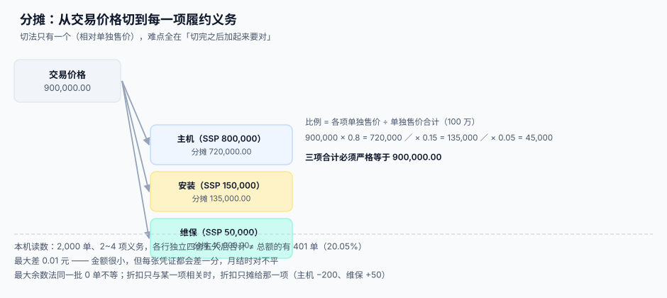

# 交易价格的分摊

<p style="text-align:center;"></p>

分摊这一步的规则只有一句：**按各项履约义务的单独售价比例，把交易价格切开**。但「切开」之后还有三个问题没人替你回答：单独售价怎么来、折扣摊给谁、切开之后加起来为什么少了 0.01。

本机读数：2,000 单、每单 2~4 项义务，**各行独立四舍五入后合计 ≠ 总额的有 401 单（20.05%）**。金额最大只差 0.01 元——小到没人会为它开 case，但每张凭证都差一分，月结时就是对不平。

::: tip 一句话理解
**分摊的正确性 = 比例能解释 + 余数有归属 + 合计严格闭合。** 前两条靠设计，第三条只能靠算法（最大余数法），靠「再 round 一次」永远合不上。
:::



本页判据族 `RVA-A` ~ `RVA-H`，共 8 条，定义在最后一节。

## 单独售价（SSP）的五种来源

分摊的分母是「单独售价」，而单独售价几乎从来不是现成的：

| 方法 | 做法 | 可靠性 | 适用 |
| --- | --- | --- | --- |
| **可观察价格** | 同一商品单独销售的价格（近 12 个月） | 最高 | 有单独售卖记录 |
| **调整后市场评估** | 竞品价格 + 差异调整 | 中 | 无自身价格，有市场参照 |
| **预期成本加毛利** | 成本 × (1 + 行业毛利) | 中低 | 定制、无市场 |
| **余值法** | 交易价格 − 其它义务的 SSP 之和 | **最低（末位手段）** | 价格高度可变且其它项可观察 |
| **组合/分层** | 按价格区间分档取中位数 | 中 | 海量小合同 |

```sql
CREATE TABLE ssp (
  id            INTEGER PRIMARY KEY,
  item_key      TEXT NOT NULL,      -- 商品/服务标识
  method        TEXT NOT NULL,      -- observable / adjusted / cost_plus / residual
  amount        NUMERIC(18,6) NOT NULL,
  effective_from TEXT NOT NULL,
  effective_to  TEXT,
  basis         TEXT NOT NULL,
  CHECK (method IN ('observable','adjusted','cost_plus','residual'))
);
```

::: danger 余值法不能当默认选项
余值法把「估不准」的部分全部推给最后一项义务，于是那一项的收入变成「挤出来的数」。它只在两个条件同时满足时可用：① 交易价格高度可变或不确定；② 其它义务的单独售价高度可观察。

工程上要禁止「余值法 + 单项义务」这个组合——那样等于没有分摊，只是把交易价格原样搬过去。可执行的判据：`method='residual'` 时该合同的义务数必须 ≥ 2，且余值结果必须落在 `[0, 交易价格]` 区间内（负数说明前面的 SSP 之和已经超过了交易价格，分摊逻辑已经崩了）。
:::

## 折扣：摊给谁

折扣不是平均摊的。规则是：**能证明折扣只与某几项相关，就只摊给那几项；不能证明，才按比例摊给全部。**

| 情形 | 处理 | 结果 |
| --- | --- | --- |
| 折扣可归因到特定义务（有价格证据） | 只摊给该义务 | 其它义务按 SSP 全额 |
| 折扣不可归因 | 按 SSP 比例摊给全部 | 各项等比下调 |
| 折扣超过可归因义务的金额 | 超出部分按比例摊给全部 | 混合 |

以「主机 8,000 + 安装 1,500 + 维保 500，合同价 9,000（折扣 1,000）」为例：

```text
按 SSP 比例摊：8,000/10,000 → 7,200.00 ; 1,500/10,000 → 1,350.00 ; 500/10,000 → 450.00
折扣只归主机：主机 7,000.00 ; 安装 1,500.00 ; 维保 500.00
差异：主机 −200.00，维保 +50.00
```

50 元的维保差额，在 12 个月里每月只有 4.17 元；但它会**永久存在**，且每次审计抽到这一项都要重新解释一遍。

## 闭合：最大余数法

```python
from decimal import Decimal, ROUND_HALF_UP, ROUND_DOWN

def allocate(total, ssps):
    """按 SSP 比例分摊，并用最大余数法闭合到分。"""
    s = sum(ssps)
    raw = [total * Decimal(x) / Decimal(s) for x in ssps]
    floors = [r.quantize(Decimal("0.01"), rounding=ROUND_DOWN) for r in raw]
    remainder = total - sum(floors)
    cents = int((remainder * 100).to_integral_value())
    order = sorted(range(len(raw)), key=lambda i: raw[i] - floors[i], reverse=True)
    for k in range(cents):
        floors[order[k % len(order)]] += Decimal("0.01")
    return floors

# 断言：任何输入下都必须闭合
assert sum(allocate(Decimal("9000.00"), [Decimal(8000), Decimal(1500), Decimal(500)])) == Decimal("9000.00")
```

三条实现纪律：

1. **余数按「小数部分从大到小」分配**，不是按顺序补——按顺序补会让第一项永远多拿，长期造成系统性偏差。
2. **只在一处分舍入**：单价可以多留几位（6 位），金额只在分摊结果上舍一次。
3. **分配顺序必须稳定**：`sorted` 要带 tie-breaker（如 `obligation_id`），否则同分时结果依赖字典序，重跑会变。

本机读数：同一批 2,000 单，最大余数法 **0 单**不闭合。

## 折后分摊与「相对单独售价」的两种口径

有两个容易混的口径：

| 口径 | 公式 | 用在哪 |
| --- | --- | --- |
| **相对 SSP**（relative SSP） | 分摊额 = 交易价格 × SSP ÷ ΣSSP | 默认口径 |
| **残值法**（residual） | 分摊额 = 交易价格 − 其它项 SSP 之和 | 末位手段 |

两者在「交易价格 > ΣSSP」时结果差异巨大——溢价（交易价格高于各项单独售价之和）在残值法下会全部落到最后一项，而在相对 SSP 下按比例摊。溢价场景常见于「打包卖得比单买贵」（含服务、含优先权），这时必须用相对 SSP。

## 分摊之后的重分配

三种情况需要重新分摊：

| 触发 | 处理 | 是否追溯 |
| --- | --- | --- |
| 义务拆分变更（原判错了） | 按更正后的义务重新分摊 | 作为差错更正，追溯 |
| 合同变更走 ② 终止并新建 | 剩余对价 + 新增对价重新分摊 | 不追溯 |
| 可变对价变动且**与该义务相关** | 只调整该义务的分摊额 | 不追溯 |
| 可变对价变动且**与整体相关** | 按原比例重新分摊到全部义务 | 不追溯 |

```sql
-- 重分配：按原比例把「变动额」摊下去，并保持闭合
WITH base AS (
  SELECT obligation_id, ratio, allocated_amount
  FROM po_allocation WHERE contract_id = :cid
), delta AS (
  SELECT :delta_amount AS d
)
SELECT obligation_id,
       ratio,
       allocated_amount + round((SELECT d FROM delta) * ratio, 2) AS new_amount
FROM base;
```

::: warning 最后一行还要再过一次最大余数法
`round(d × ratio, 2)` 逐行舍入之后，合计又会差几分。重分配同样要闭合——把 `delta` 当作新的「总额」再走一次分摊算法，而不是给每行加一个四舍五入后的增量。
:::

## 判据清单

| 编号 | 判据 | 怎么验 |
| --- | --- | --- |
| `RVA-A` | 每项义务都有 `ssp`，且带来源方法 | `ssp` 为空或方法为空的合同 = 0 |
| `RVA-B` | 余值法只在义务数 ≥ 2 且结果落在 `[0, 交易价格]` 时使用 | 查 `method='residual'` 的行，逐条验两个条件 |
| `RVA-C` | 折扣按「可归因 / 不可归因」二分处理 | 抽 5 份带折扣合同，能说出折扣归因依据 |
| `RVA-D` | 分摊用最大余数法，合计严格等于交易价格 | `HAVING diff <> 0` 返回 0 行 |
| `RVA-E` | 余数分配顺序稳定（含 tie-breaker） | 同一输入跑两次，逐行金额相同 |
| `RVA-F` | 只在分摊结果上舍入一次，单价保留 6 位 | 代码里金额舍入点只有一处 |
| `RVA-G` | 重分配把「变动额」当新总额再分摊，并闭合 | 重分配后 `HAVING diff <> 0` 返回 0 行 |
| `RVA-H` | 溢价（交易价格 > ΣSSP）走相对 SSP，不走残值法 | 构造一份溢价合同，断言无 `residual` 行 |

## 验证方式

```shell
# 1) 闭合：预期 0 行
sqlite3 /tmp/rv.db "SELECT c.contract_no, t.total_amount - sum(a.allocated_amount) AS diff
  FROM contract c JOIN transaction_price t ON t.contract_id=c.id
  JOIN po_allocation a ON a.contract_id=c.id GROUP BY c.id HAVING diff <> 0;"

# 2) 余值法越界：预期 0 行（不允许负数或超过交易价格）
sqlite3 /tmp/rv.db "SELECT a.contract_id, a.obligation_id, a.allocated_amount
  FROM po_allocation a JOIN ssp s ON s.item_key = a.item_key
  WHERE s.method='residual' AND (a.allocated_amount < 0 OR a.allocated_amount >
        (SELECT total_amount FROM transaction_price t WHERE t.contract_id = a.contract_id));"

# 3) 比例之和为 1（允许 1e-9 误差）
sqlite3 /tmp/rv.db "SELECT contract_id, round(sum(ratio),6) AS r FROM po_allocation
  GROUP BY contract_id HAVING abs(r - 1) > 0.000001;"
```

## 参考资料

- [五步法的工程落点](../FiveStep/index.md)：第 ④ 步在整条链里的位置
- [合同变更与退款](../Modification/index.md)：② 分支的重分摊
- [营销计价与优惠分摊](../../PricingPromotion/index.md)：消费者侧的优惠分摊，与本页的「分摊给义务」是两件事
- IFRS 15 第 73~80 段（分摊与单独售价）、第 81~86 段（折扣分摊）、第 87~90 段（可变对价的重分配）：<https://www.ifrs.org/issued-standards/list-of-standards/ifrs-15-revenue-from-contracts-with-customers/>
- 财政部《企业会计准则第 14 号——收入》第二十条至第二十三条：<https://kjs.mof.gov.cn/zhengcefabu/201707/t20170719_2653110.htm>
