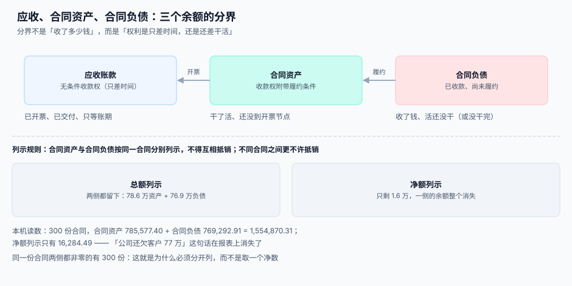

# 合同资产、合同负债与应收

<p style="text-align:center;"></p>

「我们欠客户多少」和「客户欠我们多少」——这两个问题在收入系统里对应**三个不同的科目**，而它们的边界不是「收了多少钱」，而是「你的权利还差什么」：只差时间，就是应收账款；还差干活，就是合同资产；活还没干、钱已经到了，就是合同负债。

这三个科目一旦混用，最典型的后果是**报表上看不见风险**：本机读数里 300 份合同，合同资产 785,577.40、合同负债 769,292.91，两侧合计 1,554,870.31；如果按净额列示，只剩 **16,284.49**——「公司还欠客户 77 万」这句话整个消失。

::: tip 一句话理解
**应收账款是「只差时间」，合同资产是「还差干活」，合同负债是「还差交付」。** 三者都跟钱有关，但只有第一个是无条件的。
:::



本页判据族 `RVB-A` ~ `RVB-H`，共 8 条，定义在最后一节。

## 三个余额的分界

| 科目 | 定义 | 转移条件 | 典型场景 |
| --- | --- | --- | --- |
| **应收账款** | 无条件收款权（仅取决于时间流逝） | 已开票或已到约定付款节点 | 交付并开票、账期 30 天 |
| **合同资产** | 收款权**取决于时间之外的因素**（继续履约、验收） | 已履约但尚未取得无条件收款权 | 干了一个月、合同约定验收后统一开票 |
| **合同负债** | 已收对价（或已取得无条件收款权）而尚未履约 | 收款/开票在前、履约在后 | 预收年费、充值、预付定金 |

```sql
CREATE TABLE contract_balance (
  id            INTEGER PRIMARY KEY,
  contract_id   INTEGER NOT NULL REFERENCES contract(id),
  period        TEXT NOT NULL,
  receivable    NUMERIC(18,2) NOT NULL DEFAULT 0,   -- 应收账款
  contract_asset NUMERIC(18,2) NOT NULL DEFAULT 0,  -- 合同资产
  contract_liability NUMERIC(18,2) NOT NULL DEFAULT 0, -- 合同负债
  UNIQUE (contract_id, period),
  CHECK (receivable >= 0 AND contract_asset >= 0 AND contract_liability >= 0)
);
```

一条来自准则的硬规则：**同一合同产生的合同资产与合同负债应当分别列示，不得相互抵销**；不同合同之间更不许抵销。上表的三个列都带 `>= 0` 约束，正是为了让「抵销」在数据库层就写不进去。

::: danger 抵销的三种「看起来很合理」的写法
1. **「这个客户既有应收又有预收，冲一下更清楚」**——不同合同不能抵销；同一合同的资产与负债也不能抵销。冲完之后，资产规模与负债规模同时被低估，资产负债率失真。
2. **「先记预收，等确认时直接冲减预收」**——这会让合同负债的**发生额**消失。附注要披露「合同负债本期增加/减少」，只有余额没有发生额，披露就写不出来。
3. **「合同资产和应收用一个科目，靠 `status` 区分」**——可以，但 `status` 必须是「是否有无条件收款权」，而不是「有没有开票」。开票只是取得无条件收款权的一种方式。
:::

## 从履约到收款：余额怎么走

一份 12 万、12 个月的合同，按月履约、按季开票：

| 时点 | 履约累计 | 开票累计 | 合同资产 | 合同负债 | 应收 |
| --- | --- | --- | --- | --- | --- |
| 第 1 月末 | 10,000 | 0 | 10,000 | 0 | 0 |
| 第 3 月末（开票 3 万） | 30,000 | 30,000 | 0 | 0 | 30,000 |
| 第 4 月末 | 40,000 | 30,000 | 10,000 | 0 | 30,000 |
| 期初预收 12 万的情形 | 10,000 | 0 | 0 | 110,000 | 0 |

```sql
-- 每月末从「履约累计」和「开票累计」推出三个余额
WITH agg AS (
  SELECT e.contract_id,
         sum(e.amount) AS earned,
         (SELECT coalesce(sum(i.amount),0) FROM invoice i
           WHERE i.contract_id = e.contract_id AND i.period <= :period) AS billed,
         (SELECT coalesce(sum(p.amount),0) FROM payment p
           WHERE p.contract_id = e.contract_id AND p.received_at < :next_period_start) AS paid
  FROM revenue_entry e
  WHERE e.period <= :period
  GROUP BY e.contract_id
)
SELECT contract_id,
       max(paid - billed, 0)                AS receivable,        -- 已收未开票 → 预收，见下
       max(earned - billed, 0)              AS contract_asset,    -- 已履约未开票
       max(billed - earned, 0)              AS contract_liability,-- 已开票未履约
       max(billed - paid, 0)                AS receivable_gap
FROM agg;
```

::: warning 上面这段 SQL 的 `receivable` 列是错的，别照抄
`paid - billed` 算出来的是**预收款**（已收未开票），它应该进合同负债而不是应收。应收的正确算法是 `billed - paid`（已开票未收款），且仅当该笔已开票金额对应**无条件收款权**时才成立。这个错误非常常见——因为它只在「先收款后开票」的业务上才暴露，而大多数测试数据都是「先开票后收款」。
:::

## 账龄：合同资产也要计提减值

合同资产不是「准应收账款」就可以不计提。按预期信用损失模型，合同资产与应收账款一样要计提减值，只是**合同资产的账龄起点是「履约完成日」**，而不是开票日。

```sql
-- 合同资产账龄（按履约月份分桶）
SELECT contract_id,
       sum(CASE WHEN :period <= period THEN 0
                WHEN months_between(:period, period) <= 1 THEN contract_asset ELSE 0 END) AS m0_1,
       sum(CASE WHEN months_between(:period, period) BETWEEN 2 AND 3 THEN contract_asset ELSE 0 END) AS m2_3,
       sum(CASE WHEN months_between(:period, period) > 3 THEN contract_asset ELSE 0 END) AS m3p
FROM contract_balance
GROUP BY contract_id;
```

本机读数：300 份合同里，**履约超过开票 20% 的有 66 份**——这 66 份就是「干了活没开票」的部分，也是账龄最长、最容易被漏计提的部分。它们的共同特征是合同约定「验收后统一开票」，而验收迟迟不来。

## 与开票系统的接口

收入系统与开票系统的关系只有三条：

| 方向 | 内容 | 约束 |
| --- | --- | --- |
| 收入 → 开票 | 「这期可以开多少」的建议额度 | 建议值，不是指令；开票由业务决定 |
| 开票 → 收入 | 开票金额与期间 | **只影响应收与合同负债，不产生确认明细** |
| 双向对账 | 已开票 vs 已确认 vs 已收款 | 三条线各自成表，差异必须能归类 |

```sql
-- 三线对账：每月必须为 0，或差异全部落在已知类别里
SELECT c.contract_no,
       (SELECT coalesce(sum(amount),0) FROM revenue_entry e WHERE e.contract_id=c.id AND e.period=:p) AS earned,
       (SELECT coalesce(sum(amount),0) FROM invoice i WHERE i.contract_id=c.id AND i.period=:p)        AS billed,
       (SELECT coalesce(sum(amount),0) FROM payment p WHERE p.contract_id=c.id AND p.period=:p)       AS paid
FROM contract c
WHERE earned <> 0 OR billed <> 0 OR paid <> 0;
```

三列不等是**正常**的：收入看履约、开票看节点、收款看账期。判据不是「三列相等」，而是「三列的差能被三个余额解释」：

```text
earned - billed = 合同资产 - 合同负债（同期变动）
billed - paid   = 应收账款（期末余额）
```

## 判据清单

| 编号 | 判据 | 怎么验 |
| --- | --- | --- |
| `RVB-A` | 应收账款、合同资产、合同负债三个科目分列存储，无「净额」字段 | 表结构里三列同时存在，且无 `net_balance` |
| `RVB-B` | 三者均带 `>= 0` 约束，抵销在数据库层写不进去 | 插入负值必须失败 |
| `RVB-C` | 合同资产的存在条件是「已履约且无无条件收款权」 | 抽 10 份，逐个能说出缺的是验收还是开票 |
| `RVB-D` | 合同负债保留发生额（本期增加/减少），不只有余额 | 余额表能按月算出变动额 |
| `RVB-E` | 合同资产按履约完成日起算账龄，并按账龄计提减值 | 账龄分桶 SQL 返回三档且合计 = 余额 |
| `RVB-F` | 开票不产生确认明细 | 开票前后 `revenue_entry` 行数不变 |
| `RVB-G` | 三线对账的差异能被三个余额解释（恒等式成立） | 逐合同断言 `earned-billed` 与余额变动一致 |
| `RVB-H` | 净额列示只出现在报表层，且只用于「同一合同同一科目」的合并展示 | 全库搜净额计算，只允许出现在报表视图 |

## 验证方式

```shell
# 1) 负值写不进去（预期：CHECK constraint failed）
sqlite3 /tmp/rv.db "UPDATE contract_balance SET contract_asset = -1 WHERE id = 1;"

# 2) 净额字段不存在（预期：无输出）
sqlite3 /tmp/rv.db "SELECT m.name, p.name FROM sqlite_master m JOIN pragma_table_info(m.name) p
  WHERE m.type='table' AND p.name LIKE '%net%';"

# 3) 账龄三档合计 = 合同资产余额（预期：两列相等）
sqlite3 /tmp/rv.db "WITH a AS (
    SELECT sum(contract_asset) AS total FROM contract_balance WHERE period='2026-06')
  SELECT (SELECT total FROM a),
         (SELECT sum(contract_asset) FROM contract_balance WHERE period='2026-06');"
```

## 参考资料

- [总览：五段确认链与五个「收入」](../Overview/index.md)：五个金额为什么必须分开
- [可变对价与退款负债](../VariableConsideration/index.md)：退款负债与合同负债的区别
- [披露口径与月结](../Disclosure/index.md)：合同余额变动表怎么出
- [复式记账与分录](../../Ledger/DoubleEntry/index.md)：三个科目在分录里怎么落
- IFRS 15 第 105~109 段（合同资产与合同负债的列示）、第 116~118 段（余额变动披露）：<https://www.ifrs.org/issued-standards/list-of-standards/ifrs-15-revenue-from-contracts-with-customers/>
