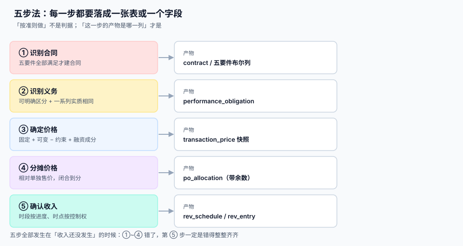

# 五步法的工程落点

<p style="text-align:center;"></p>

准则的五步法读起来像一段哲学论述：识别合同、识别义务、确定价格、分摊价格、确认收入。但把它落进系统时，每一步都要回答一个非常具体的问题——**这一步的产物是哪张表的哪一列？** 答不出来的那一步，最后一定会变成月结时某个人手工填的一个 Excel。

::: tip 一句话理解
**「按准则做」不是判据，「这一步的产物是哪一列」才是。** 五步法真正的工程价值不是拆分流程，而是逼你在写代码之前先说清「这一判断存哪儿、谁改的、依据是什么」。
:::



本页判据族 `RVF-A` ~ `RVF-H`，共 8 条，定义在最后一节。

## 第 1 步：识别合同——五要件是五个布尔列

合同要成立，五个条件必须**全部**满足：

| 要件 | 判断内容 | 工程上落成什么 |
| --- | --- | --- |
| ① 各方已批准并承诺履行 | 有签署或书面确认 | `approved_at`（非空即满足，来源是签署系统） |
| ② 权利可识别 | 谁给什么、给多少 | `scope_doc_id`（指向合同正文的结构化摘要） |
| ③ 付款条款可识别 | 什么时候付、付多少 | `payment_terms`（结构化的账期与节点） |
| ④ 有商业实质 | 未来现金流会因这笔交易改变 | `commercial_substance` 布尔 + 说明 |
| ⑤ 对价很可能收回 | 客户有能力也有意愿付 | `collectibility_assessed_at` + 评估结论 |

```sql
CREATE TABLE contract (
  id                        INTEGER PRIMARY KEY,
  contract_no               TEXT NOT NULL UNIQUE,
  customer_id               INTEGER NOT NULL,
  signed_at                 TEXT,
  approved_at               TEXT,                -- ① 已批准并承诺履行
  scope_doc_id              INTEGER,             -- ② 权利可识别
  payment_terms             TEXT,                -- ③ 付款条款
  commercial_substance      INTEGER NOT NULL DEFAULT 0,  -- ④ 商业实质
  collectibility_assessed_at TEXT,               -- ⑤ 对价可收回（评估时点）
  collectibility_result     TEXT,                -- 'probable' / 'not_probable'
  status                    TEXT NOT NULL DEFAULT 'draft',
  -- 五要件是否齐备由视图算，不存冗余布尔
  CHECK (status IN ('draft','active','suspended','closed','cancelled'))
);

CREATE VIEW v_contract_ready AS
SELECT id, contract_no,
       (approved_at IS NOT NULL)          AS c1,
       (scope_doc_id IS NOT NULL)         AS c2,
       (payment_terms IS NOT NULL)        AS c3,
       (commercial_substance = 1)         AS c4,
       (collectibility_result = 'probable') AS c5
FROM contract;
```

::: danger 不要存一个 `is_ready` 冗余布尔
1. **它会过期。** 今天齐备、明天客户被列为失信被执行人（要件⑤翻转），冗余列没人去改，而视图用的是 `collectibility_assessed_at` 的当前评估结果。
2. **它掩盖了「差哪一个」。** 审计问「为什么这份合同没确认收入」，答案是 `is_ready = 0`——等于没说。视图的五个列会直接指出是 ④ 还是 ⑤ 不满足。
3. **它是双写。** 双写必然漂移；五要件全都能从既有列算出来，就不该再存一份。
:::

### 合同不成立时，收到的钱怎么办

这是最容易被跳过的一段：客户先打了钱，但合同还没满足五要件（比如还在走内部审批）。此时**不能确认收入，也不能挂应收账款**，只能挂「其他应付款 / 预收」并在附注里说明。工程上的判据是：`revenue_entry` 一行都不能有，`contract_liability` 里有余额。

已收到的对价如果**无需转移商品即可退还**，退回时冲减负债；如果不可退还，则要判断是否满足「无合同对价」的确认条件（通常在合同终止、对价不可退、且不再有履约义务时才确认）。

### 合同合并：三个条件同时满足就合并

同一客户、同一时点或相近时点签的多份合同，若满足「① 一揽子交易、② 价格相互关联、③ 商品构成单一履约义务」三条，就要**合并成一份**做会计处理。

```sql
-- 合并候选：同一客户、签署日相差 30 天内、且被标记为一揽子
SELECT a.id AS a_id, b.id AS b_id
FROM contract a JOIN contract b
  ON a.customer_id = b.customer_id AND a.id < b.id
WHERE julianday(b.signed_at) - julianday(a.signed_at) BETWEEN 0 AND 30
  AND a.package_group = b.package_group
  AND a.package_group IS NOT NULL;
```

工程上必须有一个 `package_group` 字段承载「一揽子」这个判断，否则合并只能靠人工记忆。合并后分摊要以**合并口径**的交易价格与单独售价重算，而不是各自算完再相加。

## 第 2 步：识别义务——「可明确区分」是两个测试

履约义务的判定是五步法里最容易做错、也最贵的一步。准则给的是**两个测试，都要过**：

| 测试 | 问题 | 不过会怎样 |
| --- | --- | --- |
| **能够区分**（capable of being distinct） | 客户能否单独从这件商品/服务中受益，或与其它易得资源一起受益 | 过不了 → 与其它承诺合并成一个义务 |
| **在合同内可区分**（distinct within the context） | 它是否**不可分割**地与其它承诺相互关联（重大整合、重大修改、高度依赖） | 过不了 → 合并（哪怕单独卖得出去） |

典型判定结果：

| 场景 | 结论 | 理由 |
| --- | --- | --- |
| 硬件 + 三年维保（分别标价、可单独购买） | **两个义务** | 两项都能单独受益，且不构成重大整合 |
| 定制软件 + 一年免费缺陷修复 | **一个义务** | 修复是保证「符合约定规格」，不是单独服务 |
| 设备 + 专属耗材（设备只能用它家耗材） | **一个义务** | 高度依赖，整合成一项 |
| 软件许可 + 实施（实施由第三方也能做） | 视情况，通常是**两个** | 若实施不显著修改软件功能，则可区分 |
| 一系列每月相同的运维服务 | **一个义务**（系列） | 实质相同、转移模式相同，可作为一个义务按进度确认 |

工程落点：

```sql
CREATE TABLE performance_obligation (
  id             INTEGER PRIMARY KEY,
  contract_id    INTEGER NOT NULL REFERENCES contract(id),
  seq            INTEGER NOT NULL,
  name           TEXT NOT NULL,
  kind           TEXT NOT NULL,       -- good / service / license / series
  timing         TEXT NOT NULL,       -- 'over_time' / 'point_in_time'
  distinct_capable   INTEGER NOT NULL,   -- 测试一
  distinct_in_context INTEGER NOT NULL,  -- 测试二
  satisfy_event  TEXT,                -- 时点法：哪个事件代表控制权转移
  UNIQUE (contract_id, seq),
  CHECK (timing IN ('over_time','point_in_time'))
);
```

::: warning 「保证类质保」和「服务类质保」不是一回事
保证「产品符合约定规格」的质保是**保证类**，按或有事项处理，不单列履约义务；额外提供两年以上维修的**服务类**质保是单独履约义务，要分摊价格。区分判据是「它是否给客户提供了单独销售的服务」。把服务类质保漏拆，会让全部收入挤在主产品交付那一天。
:::

## 第 3 步：确定交易价格——四个加减项

交易价格 = 固定对价 + 可变对价（受约束）− 应付客户对价 + 重大融资成分调整。四项都要有独立字段，因为它们的**估计方法、复核责任人、披露要求**都不同。

```sql
CREATE TABLE transaction_price (
  id                 INTEGER PRIMARY KEY,
  contract_id        INTEGER NOT NULL UNIQUE REFERENCES contract(id),
  fixed_amount       NUMERIC(18,2) NOT NULL,
  variable_estimate  NUMERIC(18,2) NOT NULL DEFAULT 0,
  variable_method    TEXT,           -- 'expected_value' / 'most_likely'
  constraint_amount  NUMERIC(18,2) NOT NULL DEFAULT 0,  -- 约束（负数为调减）
  consideration_to_customer NUMERIC(18,2) NOT NULL DEFAULT 0,
  financing_component NUMERIC(18,2) NOT NULL DEFAULT 0,
  total_amount       NUMERIC(18,2) NOT NULL,
  computed_at        TEXT NOT NULL,
  basis              TEXT NOT NULL,  -- 估计依据（数据来源 + 期间）
  CHECK (fixed_amount >= 0)
);
```

`basis` 不是装饰：本机读数里退货率估 5%、实际 7.3%，计提缺口 **115,000 元（占销售额 2.30%）**。事后审计问「为什么估 5%」，只能靠 `basis` 里那句「近 24 个月同品类退货率均值 4.8%，上浮至 5%」来回答。

## 第 4 步：分摊——见[分摊](../Allocation/index.md)一页

这里只强调一条工程约束：**分摊必须闭合**。本机读数：2,000 单里，各行独立四舍五入后合计 ≠ 总额的有 **401 单（20.05%）**；用最大余数法后 **0 单**。

```sql
CREATE TABLE po_allocation (
  id               INTEGER PRIMARY KEY,
  contract_id      INTEGER NOT NULL,
  obligation_id    INTEGER NOT NULL,
  ssp              NUMERIC(18,6) NOT NULL,   -- 单独售价
  ratio            NUMERIC(12,10) NOT NULL,  -- ssp / sum(ssp)
  allocated_amount NUMERIC(18,2) NOT NULL,   -- 含余数分配后的结果
  rounding_cents   INTEGER NOT NULL DEFAULT 0, -- 该行拿到的余数（分）
  UNIQUE (contract_id, obligation_id)
);
```

余额检查必须是**一条 SQL 就能跑**的：

```sql
SELECT c.contract_no,
       t.total_amount,
       sum(a.allocated_amount) AS alloc_sum,
       t.total_amount - sum(a.allocated_amount) AS diff
FROM contract c
JOIN transaction_price t ON t.contract_id = c.id
JOIN po_allocation a ON a.contract_id = c.id
GROUP BY c.id
HAVING diff <> 0;   -- 预期 0 行
```

## 第 5 步：确认——排期表 + 明细表

```sql
CREATE TABLE rev_schedule (            -- 计划：这一年每一期该确认多少
  id            INTEGER PRIMARY KEY,
  contract_id   INTEGER NOT NULL,
  obligation_id INTEGER NOT NULL,
  period        TEXT NOT NULL,
  planned_amount NUMERIC(18,2) NOT NULL,
  method        TEXT NOT NULL,         -- 'straight_line' / 'input' / 'output' / 'milestone'
  UNIQUE (contract_id, obligation_id, period)
);

CREATE TABLE revenue_entry (           -- 事实：实际确认了什么、凭什么
  id            INTEGER PRIMARY KEY,
  contract_id   INTEGER NOT NULL,
  obligation_id INTEGER NOT NULL,
  period        TEXT NOT NULL,
  amount        NUMERIC(18,2) NOT NULL,
  recognized_at TEXT NOT NULL,
  evidence      TEXT NOT NULL,
  UNIQUE (contract_id, obligation_id, period)
);
```

**计划与事实必须分表。** 合并成一张表（用 `status` 区分）看起来省事，但会带来两个后果：① 变更时要就地改计划行，历史被覆盖；② 审计无法回答「原计划是多少」。分表之后，计划可以有多版（`schedule_version`），事实只有一份。

## 判据清单

| 编号 | 判据 | 怎么验 |
| --- | --- | --- |
| `RVF-A` | 五要件均由既有列算出，无 `is_ready` 冗余布尔 | `v_contract_ready` 五列全为 1 才允许建义务 |
| `RVF-B` | 合同不成立时收到的钱只进合同负债，不进 `revenue_entry` | 构造一份 `c5=0` 的合同，断言确认明细 0 行 |
| `RVF-C` | 一揽子合并由 `package_group` 承载，合并后重算分摊 | 取一组 `package_group` 相同的合同，断言分摊合计 = 合并交易价格 |
| `RVF-D` | 每个义务同时记录 `distinct_capable` 与 `distinct_in_context` | 两列任一为 0 时，`timing` 必须为 `over_time`（视为单一义务） |
| `RVF-E` | 保证类质保不单列义务，服务类质保必须单列 | 抽 10 份带质保的合同，逐个能说出属哪类 |
| `RVF-F` | 交易价格四个加减项分列，且带 `basis` | `basis` 为空的合同数 = 0 |
| `RVF-G` | 分摊合计 = 交易价格，可用一条 SQL 查出全部破例 | `HAVING diff <> 0` 返回 0 行 |
| `RVF-H` | 排期表与确认明细表分表，排期可有多版 | `rev_schedule` 有 `schedule_version`，`revenue_entry` 无 |

## 验证方式

```shell
# 1) 五要件视图可直接判：预期每份合同 5 列全 1 才 active
sqlite3 /tmp/rv.db "SELECT contract_no,c1,c2,c3,c4,c5 FROM v_contract_ready WHERE status<>'active';"

# 2) 合同不成立却确认了收入：预期 0 行
sqlite3 /tmp/rv.db "SELECT c.contract_no FROM contract c
  JOIN v_contract_ready v ON v.id=c.id
  JOIN revenue_entry e ON e.contract_id=c.id
  WHERE v.c1*v.c2*v.c3*v.c4*v.c5 = 0;"

# 3) 分摊闭合：预期 0 行
sqlite3 /tmp/rv.db "SELECT c.contract_no, t.total_amount - sum(a.allocated_amount) AS diff
  FROM contract c JOIN transaction_price t ON t.contract_id=c.id
  JOIN po_allocation a ON a.contract_id=c.id GROUP BY c.id HAVING diff<>0;"
```

## 参考资料

- [总览：五段确认链与五个「收入」](../Overview/index.md)：五个金额的分工
- [时段与时点：走哪条路](../Timing/index.md)：第 ⑤ 段的判定细则
- [交易价格的分摊](../Allocation/index.md)：第 ④ 段的算法与闭合
- IFRS 15 第 9~16 段（合同五要件）、第 17~19 段（合同合并）、第 22~30 段（履约义务）：<https://www.ifrs.org/issued-standards/list-of-standards/ifrs-15-revenue-from-contracts-with-customers/>
- 财政部《企业会计准则第 14 号——收入》第二章「确认」：<https://kjs.mof.gov.cn/zhengcefabu/201707/t20170719_2653110.htm>
