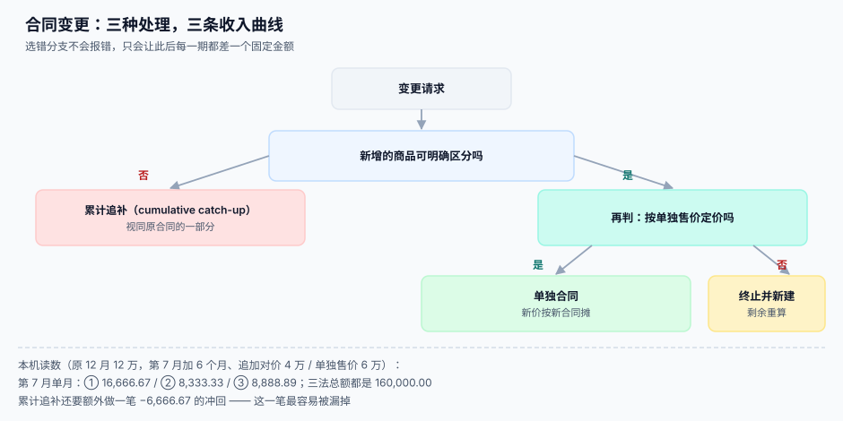

# 合同变更与退款

<p style="text-align:center;"></p>

合同签完之后几乎一定会变：加量、延期、减项、换型号、降价。变更在业务侧只是「改一版」，在收入侧却要回答三个问题：**这是新合同、旧合同的补充，还是把旧合同推翻重算？** 选错分支不会报错——它只会让此后每一期的收入都差一个固定金额，而且差额恰好「看起来像业务波动」。

::: tip 一句话理解
**变更的三种处理，分界线只有两条：新增的东西能不能明确区分、定价是不是按单独售价。** 两条都「是」→ 单独合同；区分但不定价 → 终止并新建；不能区分 → 累计追补。
:::



本页判据族 `RVM-A` ~ `RVM-H`，共 8 条，定义在最后一节。

## 三种处理

| 分支 | 条件 | 处理 | 对当期的影响 |
| --- | --- | --- | --- |
| **① 单独合同** | 新增商品**可明确区分** 且 定价反映**单独售价** | 当作一份新合同，按新价单独分摊 | 无追溯，旧合同照原计划走 |
| **② 终止并新建** | 新增商品**可明确区分** 但定价**不反映**单独售价 | 剩余未履约部分 + 新增部分合并成新合同，重新分摊 | 无追溯，但从当期起重算 |
| **③ 累计追补** | 新增商品**不可明确区分**（与原合同构成单一履约义务） | 视同原合同的一部分，重算总进度并一次性追补 | 当期出现一笔正/负调整 |

```text
判定伪代码（三条分支互斥，必须写成一个函数，不许散落在业务代码里）

if 可明确区分(新增商品):
    if 按单独售价定价(追加对价, 新增商品的单独售价):
        → ① 单独合同
    else:
        → ② 终止并新建
else:
    → ③ 累计追补
```

## 同一份变更，三个结果

原合同：12 个月、12 万、每月 1 万。第 7 个月初变更：**延长 6 个月，追加对价 4 万**（该 6 个月服务的单独售价为 6 万）。

| 分支 | 第 7 月起每月确认 | 第 7 月单月 | 合同总额 |
| --- | --- | --- | --- |
| ① 单独合同 | 原合同 10,000.00 + 新合同 6,666.67 | **16,666.67** | 160,000.00 |
| ② 终止并新建 | (剩余 60,000 + 追加 40,000) ÷ 剩余 12 个月 | **8,333.33** | 160,000.00 |
| ③ 累计追补 | 160,000 ÷ 18 个月 = 8,888.89 | **8,888.89**（另加 −6,666.67 追补） | 160,000.00 |

```text
三法总额都是 160,000.00，差别全在「期间分布」：
① 第 7~12 月每月 16,666.67，第 13~18 月每月 6,666.67
② 第 7~18 月每月 8,333.33
③ 第 7 月先冲回 6,666.67（已确认 60,000 → 应确认 53,333.33），此后每月 8,888.89
```

::: danger 累计追补那一笔最容易被漏
③ 的追补金额 = **按新总进度应确认的累计数 − 已确认的累计数**。上例是 53,333.33 − 60,000 = **−6,666.67**（负数，冲回）。

漏掉它的后果：此后每月都按 8,888.89 确认，但起点还停在 60,000，于是期末累计会多出 6,666.67，**而且这个差额永久存在**，只能在审计时被当作「前期差错」调账。
:::

```sql
CREATE TABLE contract_modification (
  id              INTEGER PRIMARY KEY,
  contract_id     INTEGER NOT NULL REFERENCES contract(id),
  mod_no          TEXT NOT NULL,
  effective_period TEXT NOT NULL,        -- 从哪一期开始生效
  added_amount    NUMERIC(18,2) NOT NULL,
  added_ssp       NUMERIC(18,2),         -- 新增部分的单独售价
  is_distinct     INTEGER NOT NULL,      -- 新增商品可明确区分？
  at_ssp          INTEGER NOT NULL,      -- 追加对价反映单独售价？
  branch          TEXT NOT NULL,         -- 'separate' / 'terminate' / 'cumulative'
  catch_up_amount NUMERIC(18,2) NOT NULL DEFAULT 0,  -- 仅 ③ 非零
  decided_by      TEXT NOT NULL,
  memo            TEXT NOT NULL,
  UNIQUE (contract_id, mod_no),
  CHECK (branch IN ('separate','terminate','cumulative')),
  -- 分支必须与两个判断自洽，这是把「判错」变成「写不进」的关键
  CHECK ((branch='separate'    AND is_distinct=1 AND at_ssp=1)
      OR (branch='terminate'   AND is_distinct=1 AND at_ssp=0)
      OR (branch='cumulative'  AND is_distinct=0 AND catch_up_amount <> 0))
);
```

`CHECK` 里的第三条要求 `catch_up_amount <> 0`：累计追补**必须**带一笔追补金额，哪怕是 0.00 也要显式给（用 `catch_up_amount IS NOT NULL` 无法区分「算了是 0」和「忘了算」）。这正是把「容易漏」变成「写不进」的手法。

## 追补金额怎么算

```sql
-- ③ 累计追补：重算总进度，差额一次性调整
WITH before AS (
  SELECT coalesce(sum(amount),0) AS recognized
  FROM revenue_entry WHERE contract_id = :cid AND period < :eff_period
),
after AS (
  SELECT :total_price * :progress_ratio AS should_be   -- 按新总价与新总进度
)
SELECT (SELECT should_be FROM after) - (SELECT recognized FROM before) AS catch_up;
```

关键在 `progress_ratio`：它是**累计进度**，不是本期进度。用本期进度去算追补，会得到一个「看起来合理但永远对不上」的数——因为追补的定义就是「补到累计应该的那个位置」。

## 退款：变更的一种特例

退款分三类，处理完全不同：

| 类型 | 场景 | 处理 | 收入影响 |
| --- | --- | --- | --- |
| **未履约退款** | 服务还没开始就取消 | 冲减合同负债 | 无（收入还没确认） |
| **部分履约退款** | 用了 3 个月退剩余 9 个月 | 冲减合同负债 + 冲回已确认对应部分 | 负收入或冲减收入 |
| **履约后折让** | 服务有问题，退一部分钱 | 冲减收入（作为可变对价的变动） | 负收入 |

```sql
CREATE TABLE refund (
  id            INTEGER PRIMARY KEY,
  contract_id   INTEGER NOT NULL,
  refund_no     TEXT NOT NULL UNIQUE,
  kind          TEXT NOT NULL,        -- 'unearned' / 'partial' / 'concession'
  amount        NUMERIC(18,2) NOT NULL CHECK (amount > 0),
  period        TEXT NOT NULL,
  applied_to    TEXT NOT NULL,        -- 'contract_liability' / 'revenue'
  idempotency_key TEXT NOT NULL UNIQUE,  -- 同一笔退款只能冲一次
  CHECK (kind IN ('unearned','partial','concession'))
);
```

`idempotency_key` 是必需的：退款接口被支付网关重试是常态，没有它，一次退款会冲两次收入。

::: warning 「负收入」还是「冲减收入」——这是披露口径问题
准则不允许把退款记成「负收入」单独一行展示，而应当作为收入的**减少**（或可变对价的变动）计入同一行。所以 `revenue_entry` 里出现负数是可以的（表示冲回），但报表层要按净额展示，并在附注里说明本期冲回金额。

工程上的落法：`revenue_entry.amount` 允许为负，但**汇总时必须先按合同聚合再按行展示**，避免出现「收入 … 1,000,000 / 冲回 … −50,000 / 净额 …」这种三行结构被误读。
:::

## 变更的幂等与顺序

变更单可能重复推送（业务系统重试、人工重复提交），也可能**乱序到达**（第 3 号变更先到、第 2 号后到）。两条规则：

1. **幂等靠 `(contract_id, mod_no)` 唯一键**，重复推送只写一次。
2. **顺序靠 `effective_period` + `mod_no` 双排序**，追补计算必须按生效期顺序逐个叠加，不能一次性把所有变更合并——因为每次追补的基数都是「上一次变更后的累计数」。

```sql
-- 按生效期顺序重放全部变更（而不是一次性合并）
SELECT mod_no, effective_period, branch, added_amount, catch_up_amount
FROM contract_modification
WHERE contract_id = :cid
ORDER BY effective_period, mod_no;
```

## 判据清单

| 编号 | 判据 | 怎么验 |
| --- | --- | --- |
| `RVM-A` | 分支由「可明确区分 + 是否按单独售价」两个布尔唯一决定 | `CHECK` 约束存在；构造 4 种组合，只有 3 种能插入 |
| `RVM-B` | 累计追补必须带 `catch_up_amount`，0 也要显式写 | `branch='cumulative'` 且金额为 NULL 的插入必须失败 |
| `RVM-C` | 追补按累计进度算，不按本期进度算 | 抽一期，用累计分子分母复算，差 = 0 |
| `RVM-D` | 变更按生效期顺序重放，不合并计算 | 构造乱序到达的两个变更，结果与顺序到达一致 |
| `RVM-E` | 变更单幂等：`(contract_id, mod_no)` 唯一 | 重复插入必须失败 |
| `RVM-F` | 退款分三类，落不同科目（负债 vs 收入） | 抽 3 笔，科目与类型对应 |
| `RVM-G` | 退款幂等：`idempotency_key` 唯一 | 同一笔退款重放，`revenue_entry` 不变 |
| `RVM-H` | 冲回以负数明细入账，报表层按净额展示 | 明细里存在负值，报表不出现「负收入」单列 |

## 验证方式

```shell
# 1) 分支自洽：这一条必须失败（预期：CHECK constraint failed）
sqlite3 /tmp/rv.db "INSERT INTO contract_modification(contract_id,mod_no,effective_period,added_amount,is_distinct,at_ssp,branch,decided_by,memo)
  VALUES (1,'M-TEST','2026-07',40000,0,1,'separate','qa','negative test');"

# 2) 累计追补没算的变更（预期 0 行）
sqlite3 /tmp/rv.db "SELECT mod_no FROM contract_modification WHERE branch='cumulative' AND catch_up_amount IS NULL;"

# 3) 追补后累计是否回到「应确认」：预期差 = 0
sqlite3 /tmp/rv.db "SELECT c.contract_no,
  (SELECT coalesce(sum(amount),0) FROM revenue_entry e WHERE e.contract_id=c.id) AS recognized
  FROM contract c WHERE c.id IN (SELECT contract_id FROM contract_modification WHERE branch='cumulative');"
```

## 参考资料

- [五步法的工程落点](../FiveStep/index.md)：变更前的义务拆分决定了变更走哪条分支
- [交易价格的分摊](../Allocation/index.md)：② 分支需要重新分摊剩余对价
- [可变对价与退款负债](../VariableConsideration/index.md)：退款作为可变对价变动的另一条路径
- IFRS 15 第 18~21 段（合同变更的三种处理）：<https://www.ifrs.org/issued-standards/list-of-standards/ifrs-15-revenue-from-contracts-with-customers/>
- 财政部《企业会计准则第 14 号——收入》第八条：<https://kjs.mof.gov.cn/zhengcefabu/201707/t20170719_2653110.htm>
