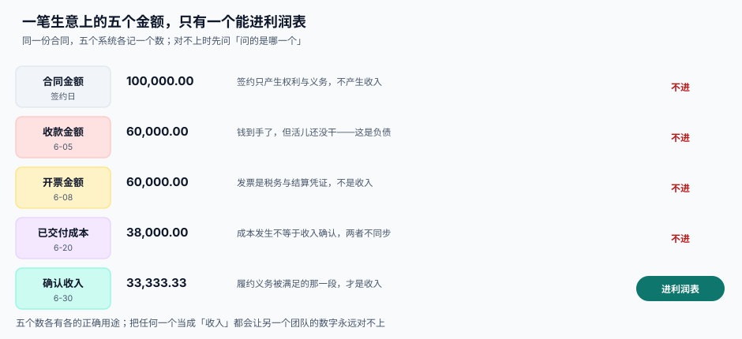
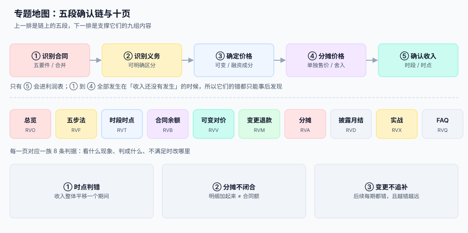

# 总览：五段确认链与五个「收入」

<p style="text-align:center;"></p>

一家 SaaS 公司的月会上，三个部门报了三个数：销售报「本月签约 320 万」，财务报「本月确认收入 187 万」，出纳报「本月回款 216 万」。老板问「到底是多少」，三个人同时说「我这个才是」。这不是沟通问题——**他们说的是三件不同的事**，而系统如果只存了一个「收入」字段，就永远只能给出一本账。

::: tip 一句话理解
**收入不是收到钱，也不是开出发票，而是「你已经没有欠客户的东西了」。** 钱、发票、交付、验收、回款是五件独立的事，各有各的时间；收入只跟其中一件有关：**义务被满足**。
:::

本页判据族 `RVO-A` ~ `RVO-H`，共 8 条，定义在最后一节。

## 五个都像收入的数

同一份 10 万元的年度服务合同，在五个时点会留下五个数：

| 数 | 什么时候产生 | 记账含义 | 能进利润表吗 |
| --- | --- | --- | --- |
| **合同金额** 100,000.00 | 签约日 | 双方产生权利与义务，尚无金额可确认 | 不能 |
| **收款金额** 60,000.00 | 客户打款 | 资产（银行）增加、负债（合同负债）增加 | 不能 |
| **开票金额** 60,000.00 | 开票日 | 税务与结算凭证，可能对应的还是负债 | 不能 |
| **已交付成本** 38,000.00 | 服务发生 | 成本按配比结转，与收入不同步 | 不能（是成本） |
| **确认收入** 33,333.33 | 期末按进度 | 合同负债释放，收入增加 | **能** |



这五个数**都必须是系统里独立的一等公民**。把它们合并成一个「金额」字段，是收入系统最常见的第一个错误：

```sql
-- 错误写法：一张表一个金额，谁也说不清它是哪个数
CREATE TABLE contract_bad (
  id      INTEGER PRIMARY KEY,
  amount  NUMERIC NOT NULL   -- 这是合同额？收款额？还是收入？
);

-- 正确写法：五个数各自成列或成表，带各自的时点
CREATE TABLE contract (
  id             INTEGER PRIMARY KEY,
  contract_no    TEXT NOT NULL UNIQUE,
  signed_at      TEXT NOT NULL,
  total_amount   NUMERIC(18,2) NOT NULL,   -- 合同额
  currency       TEXT NOT NULL,
  status         TEXT NOT NULL             -- draft / active / closed
);

CREATE TABLE revenue_entry (               -- 确认收入明细，唯一进利润表的表
  id              INTEGER PRIMARY KEY,
  contract_id     INTEGER NOT NULL REFERENCES contract(id),
  obligation_id   INTEGER NOT NULL,
  period          TEXT NOT NULL,           -- '2026-06'
  amount          NUMERIC(18,2) NOT NULL,
  recognized_at   TEXT NOT NULL,
  evidence        TEXT NOT NULL,           -- 进度快照 / 验收单 / 交付时间戳
  UNIQUE (contract_id, obligation_id, period)
);
```

`revenue_entry` 上那个 `UNIQUE` 是整条链最重要的一个约束：**同一合同、同一义务、同一期间只能确认一次**。本机读数（[实战](../Practice/index.md)复跑）：去掉它，重跑三次月结得到 **600 行 / 60,000 元**；带上它，三次重跑仍是 **200 行 / 20,000 元**。

## 五段确认链

收入确认不是一个动作，是五段首尾相接的判断：

| 段 | 判断 | 产物 | 失败是否安静 |
| --- | --- | --- | --- |
| ① 识别合同 | 五要件是否全部满足 | `contract` + 五要件布尔列 | 安静：合同建早了，后面全部提前 |
| ② 识别义务 | 承诺的东西「可明确区分」吗 | `performance_obligation` | 安静：拆少了，收入被平均摊到所有东西上 |
| ③ 确定价格 | 固定 + 可变 − 约束 + 融资成分 | `transaction_price` 快照 | 安静：估计值不留区间，事后无法解释 |
| ④ 分摊价格 | 相对单独售价，且闭合到分 | `po_allocation` | 安静：差一分钱，凭证永远对不平 |
| ⑤ 确认收入 | 时段按进度、时点按控制权 | `rev_schedule` + `revenue_entry` | 安静：确认早了，报表好看，没人投诉 |



**五段里没有一段会报错。** 这是它和订单、支付、库存这类链路的根本区别：那些链路的失败会抛异常（库存不足、支付失败、状态非法），而收入确认的失败只表现为**某个月的毛利率看起来不太对**——而那通常会被解释成「业务波动」。

::: danger 四个必失接缝
1. **合同 ≠ 订单。** 订单是一次交易，合同是一组权利义务。一个框架合同下可能有 20 个订单，而收入要按**合同**分摊，不是按订单。把 `order_id` 当分摊单位，会让框架合同的折扣永远摊不平。
2. **交付 ≠ 验收。** 交付是「我给了」，验收是「客户收了」。时点确认要的是**控制权转移**，多数场景下它有明确证据的时间点是验收（或签收），不是发货。
3. **开票 ≠ 确认。** 开票只看税务与结算节点，与履约进度无关；把开票当确认，等于让财务的开票节奏决定收入曲线。
4. **变更 ≠ 新合同。** 变更之后是「补一笔」还是「从头重算」，取决于新增的东西能不能明确区分；选错分支不会报错，只会让此后每一期都差一个固定金额。
:::

## 三个时点，别混成一个

| 时点 | 什么时候 | 会计上发生什么 |
| --- | --- | --- |
| 合同开始日 | 五要件满足 | 确认合同资产/负债的起点，开始判断履约义务 |
| 控制权转移 | 客户能主导使用并取得几乎全部经济利益 | **收入确认的那一刻**（时点法），或时段法的起算点 |
| 收款日 | 钱到账 | 只影响应收与现金，不影响收入 |

把这三个时点混成一个（比如都用「订单完成时间」），系统在**当天交付当天收款**的业务上会完全正确——这正是它最难被发现的原因：小客户场景全对，大客户场景全错。

## 为什么工程要管这件事

因为准则要的是**可复核**，而可复核只能靠系统留痕：

1. **审计会要证据。** 「这一期为什么确认 33,333.33」必须能答出「合同 10 万、12 个月、直线法、这是第 4 个月」。答不出，就要重算，重算就要调账，调账就要披露。
2. **月结有窗口。** 每月 1~3 日关账，之后任何改动都要走调整分录。所以确认逻辑必须**可重跑、可回滚、可对账**，而不是「月结那晚手工跑一遍」。
3. **口径会变。** 从「按开票确认」改成「按履约进度确认」，历史数据要不要追溯？这是产品决策，但**数据模型必须先支持两种口径并存**（见[时段与时点](../Timing/index.md)）。

本机读数：同一项目在第 6 月末，产出法确认 840,000、投入法 1,220,000、时间法 1,000,000，最大差 **380,000 元（合同额的 19.00%）**。三种都合规——差别只在「拿哪个刻度量进度」。所以口径必须**在合同层写死并存快照**，不能留到月结时临时选。

## 判据清单

| 编号 | 判据 | 怎么验 |
| --- | --- | --- |
| `RVO-A` | 合同额、收款额、开票额、成本、确认收入五个数分列存放，无一字段复用 | 列出所有含 `amount` 的列，逐个能说出它属于哪一个数 |
| `RVO-B` | 只有 `revenue_entry` 能被汇总进利润表口径 | 全库搜「收入合计」，只允许出现一处来源表 |
| `RVO-C` | `revenue_entry` 存在 `(contract_id, obligation_id, period)` 唯一键 | 插入重复行必须报错（负向测试） |
| `RVO-D` | 每条确认记录都带 `evidence`，且能追到进度快照或验收单 | 抽 10 条，逐个打开证据；空值计数为 0 |
| `RVO-E` | 合同与订单是多对一或一对多，分摊单位是合同而非订单 | 取一个框架合同，断言其分摊明细之和 = 合同交易价格 |
| `RVO-F` | 交付时间与验收时间分列存放，时点确认取验收（或合同约定的控制权转移证据） | 抽 10 单，两列不等的单必须能在 `evidence` 里说清取哪个 |
| `RVO-G` | 开票动作不产生 `revenue_entry` | 开票前后各查一次确认明细行数，必须不变 |
| `RVO-H` | 同一份合同在任一时点重算，得到与已入账完全相同的金额 | 幂等断言：重跑月结后 `sum(amount)` 不变 |

## 验证方式

```shell
# 1) 五个数确实分开：列出所有金额列，人工确认无复用
sqlite3 /tmp/rv.db "SELECT m.name AS tbl, p.name AS col FROM sqlite_master m
  JOIN pragma_table_info(m.name) p
  WHERE m.type='table' AND (p.name LIKE '%amount%' OR p.name LIKE '%amt%');"

# 2) 确认明细的唯一键真实生效（预期：Error: UNIQUE constraint failed）
sqlite3 /tmp/rv.db "INSERT INTO revenue_entry(contract_id,obligation_id,period,amount,recognized_at,evidence)
  SELECT contract_id,obligation_id,period,amount,recognized_at,evidence FROM revenue_entry LIMIT 1;"

# 3) 确认明细合计 = 合同层可确认总额（预期：两数相等，差 0.00）
sqlite3 /tmp/rv.db "SELECT (SELECT sum(amount) FROM revenue_entry),
                           (SELECT sum(allocated_amount) FROM po_allocation);"
```

三条命令的输出就是 `RVO-A`、`RVO-C`、`RVO-H` 的机械证据。

## 参考资料

- [五步法的工程落点](../FiveStep/index.md)：五段链的每一段各落成哪张表
- [时段与时点：走哪条路](../Timing/index.md)：第 ⑤ 段的判定细则
- [交易价格的分摊](../Allocation/index.md)：第 ④ 段的闭合规则
- IFRS 15 第 15~22 段（五步法与合同五要件）：<https://www.ifrs.org/issued-standards/list-of-standards/ifrs-15-revenue-from-contracts-with-customers/>
- 财政部《企业会计准则第 14 号——收入》第一章「总则」与第二章「确认」：<https://kjs.mof.gov.cn/zhengcefabu/201707/t20170719_2653110.htm>
