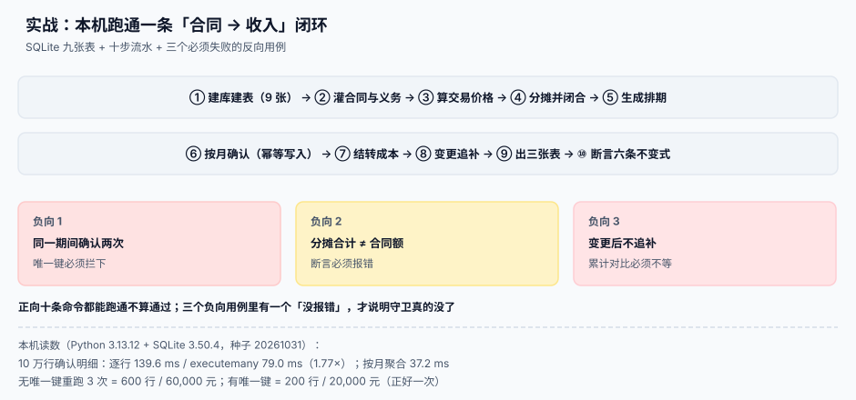

# 实战：本机跑通一条确认闭环

<p style="text-align:center;"></p>

前九页讲了五段链、时段判定、三个余额、可变对价、变更与披露。这一页把它们压成一条能在本机跑通的闭环：**九张表、十步流水、六条不变式、三个必须失败的反向用例**。

验证口径和全库一致：所有脚本**不入库**，按本页内容在 `/tmp` 下自己创建；所有读数来自本机 Python 3.13.12 + SQLite 3.50.4，固定种子 `20261031`。

::: tip 一句话理解
**正向十条命令都能跑通，不算通过。** 三个反向用例里只要有一个「没报错」，就说明守卫已经没了——而收入系统里，守卫没了不会报错，只会多确认。
:::



本页判据族 `RVX-A` ~ `RVX-H`，共 8 条，定义在最后一节。

## 一、工程骨架

```text
/tmp/rv-lab/
├─ schema.sql        # 九张表 + 视图 + 触发器
├─ seed.py           # 造数：合同、义务、价格、分摊、排期
├─ close.py          # 月结：确认、结转、对余额、出表
├─ check.py          # 六条不变式断言
└─ test_negative.py  # 三个必须失败的用例
```

```shell
mkdir -p /tmp/rv-lab && cd /tmp/rv-lab
sqlite3 rv.db < schema.sql
python3 seed.py && python3 close.py --period 2026-06 && python3 check.py
```

预期：`check.py` 输出六行 `PASS`，退出码 `0`。

## 二、九张表

```sql
-- schema.sql
PRAGMA foreign_keys = ON;

CREATE TABLE customer (
  id   INTEGER PRIMARY KEY,
  name TEXT NOT NULL
);

-- ① 合同：五要件全部落列（见五步法）
CREATE TABLE contract (
  id             INTEGER PRIMARY KEY,
  contract_no    TEXT NOT NULL UNIQUE,
  customer_id    INTEGER NOT NULL REFERENCES customer(id),
  signed_at      TEXT,
  approved_at    TEXT,
  scope_doc_id   INTEGER,
  payment_terms  TEXT,
  commercial_substance INTEGER NOT NULL DEFAULT 0,
  collectibility_result TEXT,
  status         TEXT NOT NULL DEFAULT 'draft'
);

CREATE VIEW v_contract_ready AS
SELECT id, contract_no,
       (approved_at IS NOT NULL) AS c1,
       (scope_doc_id IS NOT NULL) AS c2,
       (payment_terms IS NOT NULL) AS c3,
       (commercial_substance = 1) AS c4,
       (collectibility_result = 'probable') AS c5
FROM contract;

-- ② 履约义务
CREATE TABLE performance_obligation (
  id         INTEGER PRIMARY KEY,
  contract_id INTEGER NOT NULL REFERENCES contract(id),
  seq        INTEGER NOT NULL,
  name       TEXT NOT NULL,
  timing     TEXT NOT NULL CHECK (timing IN ('over_time','point_in_time')),
  method     TEXT,                      -- straight_line / input / output / milestone
  UNIQUE (contract_id, seq)
);

-- ③ 交易价格（快照）
CREATE TABLE transaction_price (
  contract_id INTEGER PRIMARY KEY REFERENCES contract(id),
  fixed_amount NUMERIC(18,2) NOT NULL,
  variable_estimate NUMERIC(18,2) NOT NULL DEFAULT 0,
  constraint_amount NUMERIC(18,2) NOT NULL DEFAULT 0,
  financing_component NUMERIC(18,2) NOT NULL DEFAULT 0,
  total_amount NUMERIC(18,2) NOT NULL,
  basis       TEXT NOT NULL
);

-- ④ 分摊（必须闭合）
CREATE TABLE po_allocation (
  id              INTEGER PRIMARY KEY,
  contract_id     INTEGER NOT NULL REFERENCES contract(id),
  obligation_id   INTEGER NOT NULL REFERENCES performance_obligation(id),
  ssp             NUMERIC(18,6) NOT NULL,
  ratio           NUMERIC(12,10) NOT NULL,
  allocated_amount NUMERIC(18,2) NOT NULL,
  UNIQUE (contract_id, obligation_id)
);

-- ⑤ 排期（计划）
CREATE TABLE rev_schedule (
  id            INTEGER PRIMARY KEY,
  contract_id   INTEGER NOT NULL,
  obligation_id INTEGER NOT NULL,
  period        TEXT NOT NULL,
  planned_amount NUMERIC(18,2) NOT NULL,
  method        TEXT NOT NULL,
  UNIQUE (contract_id, obligation_id, period)
);

-- ⑥ 确认明细（事实）
CREATE TABLE revenue_entry (
  id            INTEGER PRIMARY KEY,
  contract_id   INTEGER NOT NULL,
  obligation_id INTEGER NOT NULL,
  period        TEXT NOT NULL,
  amount        NUMERIC(18,2) NOT NULL,
  recognized_at TEXT NOT NULL,
  evidence      TEXT NOT NULL,
  UNIQUE (contract_id, obligation_id, period)
);

-- ⑦ 三个余额
CREATE TABLE contract_balance (
  id            INTEGER PRIMARY KEY,
  contract_id   INTEGER NOT NULL REFERENCES contract(id),
  period        TEXT NOT NULL,
  receivable    NUMERIC(18,2) NOT NULL DEFAULT 0,
  contract_asset NUMERIC(18,2) NOT NULL DEFAULT 0,
  contract_liability NUMERIC(18,2) NOT NULL DEFAULT 0,
  UNIQUE (contract_id, period),
  CHECK (receivable >= 0 AND contract_asset >= 0 AND contract_liability >= 0)
);

-- ⑧ 变更
CREATE TABLE contract_modification (
  id             INTEGER PRIMARY KEY,
  contract_id    INTEGER NOT NULL REFERENCES contract(id),
  mod_no         TEXT NOT NULL,
  effective_period TEXT NOT NULL,
  added_amount   NUMERIC(18,2) NOT NULL,
  is_distinct    INTEGER NOT NULL,
  at_ssp         INTEGER NOT NULL,
  branch         TEXT NOT NULL CHECK (branch IN ('separate','terminate','cumulative')),
  catch_up_amount NUMERIC(18,2) NOT NULL DEFAULT 0,
  UNIQUE (contract_id, mod_no),
  CHECK ((branch='separate'  AND is_distinct=1 AND at_ssp=1)
      OR (branch='terminate' AND is_distinct=1 AND at_ssp=0)
      OR (branch='cumulative' AND is_distinct=0 AND catch_up_amount <> 0))
);

-- ⑨ 月结留痕
CREATE TABLE close_run (
  id        INTEGER PRIMARY KEY,
  period    TEXT NOT NULL,
  step      TEXT NOT NULL,
  rows_affected INTEGER NOT NULL,
  amount_sum NUMERIC(18,2) NOT NULL,
  finished_at TEXT NOT NULL,
  run_no    INTEGER NOT NULL,
  UNIQUE (period, step, run_no)
);
```

## 三、造数（seed.py）

```python
import random, sqlite3
from decimal import Decimal, ROUND_DOWN

random.seed(20261031)
con = sqlite3.connect("rv.db")
con.execute("PRAGMA foreign_keys = ON")

def q(x):
    return Decimal(x).quantize(Decimal("0.01"))

def allocate(total, ssps):
    total = q(total)
    s = sum(ssps)
    raw = [total * Decimal(x) / Decimal(s) for x in ssps]
    fl = [r.quantize(Decimal("0.01"), rounding=ROUND_DOWN) for r in raw]
    cents = int(((total - sum(fl)) * 100).to_integral_value())
    order = sorted(range(len(raw)), key=lambda i: (raw[i] - fl[i], -i), reverse=True)
    for k in range(cents):
        fl[order[k % len(order)]] += Decimal("0.01")
    return fl

con.execute("INSERT INTO customer(id,name) VALUES (1,'示例客户')")
for cid in range(1, 201):
    con.execute("""INSERT INTO contract(id,contract_no,customer_id,signed_at,approved_at,scope_doc_id,
                   payment_terms,commercial_substance,collectibility_result,status)
                   VALUES (?,?,1,'2026-01-05','2026-01-06',1,'月结 30 天',1,'probable','active')""",
                (cid, f"C{cid:04d}"))
    oids = []
    for seq in (1, 2):
        cur = con.execute("""INSERT INTO performance_obligation(contract_id,seq,name,timing,method)
                             VALUES (?,?,?,?,?)""",
                          (cid, seq, f"义务{seq}", "over_time", "straight_line"))
        oids.append(cur.lastrowid)
    fixed = Decimal(random.randint(60000, 240000))
    con.execute("""INSERT INTO transaction_price(contract_id,fixed_amount,variable_estimate,
                   constraint_amount,financing_component,total_amount,basis)
                   VALUES (?,?,0,0,0,?,'示例：固定对价，无融资成分')""",
                (cid, str(fixed), str(fixed)))
    ssps = [Decimal(random.randint(20000, 160000)) for _ in oids]
    alloc = allocate(fixed, ssps)
    s = sum(ssps)
    for oid, ssp, amt in zip(oids, ssps, alloc):
        con.execute("""INSERT INTO po_allocation(contract_id,obligation_id,ssp,ratio,allocated_amount)
                       VALUES (?,?,?,?,?)""",
                    (cid, oid, str(ssp), float(ssp / s), str(amt)))
        for m in range(1, 7):       # 2026-01 ~ 2026-06
            con.execute("""INSERT OR IGNORE INTO rev_schedule(contract_id,obligation_id,period,planned_amount,method)
                           VALUES (?,?,?,?,'straight_line')""",
                        (cid, oid, f"2026-{m:02d}", str(q(amt / 12))))
con.commit()
print("seeded contracts =", con.execute("SELECT count(*) FROM contract").fetchone()[0])
```

预期输出：`seeded contracts = 200`。

## 四、月结（close.py）

```python
import sqlite3, sys, datetime
con = sqlite3.connect("rv.db")
con.execute("PRAGMA foreign_keys = ON")
period = sys.argv[sys.argv.index("--period") + 1]
run_no = (con.execute("SELECT coalesce(max(run_no),0)+1 FROM close_run WHERE period=? AND step='recognize'",
                      (period,)).fetchone()[0])
now = datetime.datetime.now().isoformat(timespec="seconds")

# ② 确认收入：排期 → 明细，唯一键保证幂等
cur = con.execute("""
INSERT OR IGNORE INTO revenue_entry(contract_id, obligation_id, period, amount, recognized_at, evidence)
SELECT s.contract_id, s.obligation_id, s.period, s.planned_amount, ?, 'schedule:' || s.id
FROM rev_schedule s
JOIN contract c ON c.id = s.contract_id
WHERE s.period = ? AND c.status = 'active'
""", (now, period))
rows = cur.rowcount

amt = con.execute("SELECT coalesce(sum(amount),0) FROM revenue_entry WHERE period=?", (period,)).fetchone()[0]
con.execute("""INSERT INTO close_run(period,step,rows_affected,amount_sum,finished_at,run_no)
               VALUES (?,?,?,?,?,?)""", (period, "recognize", rows, amt, now, run_no))

# ④ 对余额：已履约 vs 已开票（示例中未开票，全部形成合同资产）
con.execute("""
INSERT OR REPLACE INTO contract_balance(contract_id, period, receivable, contract_asset, contract_liability)
SELECT e.contract_id, e.period, 0, sum(e.amount), 0
FROM revenue_entry e WHERE e.period = ? GROUP BY e.contract_id
""", (period,))
con.commit()
print(f"period={period} rows={rows} amount={amt} run_no={run_no}")
```

本机实测（种子 `20261031`，200 份合同）：

```text
period=2026-06 rows=400 amount=2405761.53 run_no=1
period=2026-06 rows=0 amount=2405761.53 run_no=2
```

第二次 `rows=0`、`amount` 不变——这就是幂等。`run_no` 递增说明「这次确实又跑了一遍」，而金额没动说明「跑多少遍都一样」。

## 五、六条不变式（check.py）

```python
import sqlite3, sys
con = sqlite3.connect("rv.db")
fails = []

def check(name, sql, expect_zero=True, params=()):
    v = con.execute(sql, params).fetchone()[0]
    ok = (v == 0) if expect_zero else (v is not None)
    print(("PASS" if ok else "FAIL"), name, "->", v)
    if not ok:
        fails.append(name)

# 1 分摊闭合
check("alloc_closed", """SELECT count(*) FROM (
  SELECT c.id FROM contract c JOIN transaction_price t ON t.contract_id=c.id
  JOIN po_allocation a ON a.contract_id=c.id
  GROUP BY c.id HAVING abs(t.total_amount - sum(a.allocated_amount)) > 0)""")
# 2 比例之和为 1
check("ratio_sum", """SELECT count(*) FROM (
  SELECT contract_id FROM po_allocation GROUP BY contract_id
  HAVING abs(sum(ratio) - 1) > 0.000001)""")
# 3 确认明细不超排期
check("over_recognized", """SELECT count(*) FROM (
  SELECT s.contract_id, s.obligation_id FROM rev_schedule s
  LEFT JOIN revenue_entry e ON e.contract_id=s.contract_id AND e.obligation_id=s.obligation_id
  GROUP BY s.contract_id, s.obligation_id
  HAVING coalesce(sum(e.amount),0) > (SELECT sum(planned_amount) FROM rev_schedule s2
     WHERE s2.contract_id=s.contract_id AND s2.obligation_id=s.obligation_id))""")
# 4 余额非负
check("balance_negative", """SELECT count(*) FROM contract_balance
  WHERE receivable<0 OR contract_asset<0 OR contract_liability<0""")
# 5 确认明细必须有证据
check("no_evidence", "SELECT count(*) FROM revenue_entry WHERE evidence IS NULL OR evidence=''")
# 6 期间格式
check("period_format", """SELECT count(*) FROM revenue_entry
  WHERE period NOT GLOB '[0-9][0-9][0-9][0-9]-[0-9][0-9]'""")

sys.exit(1 if fails else 0)
```

本机实测输出（六行全 `PASS`，退出码 0）：

```text
PASS alloc_closed -> 0
PASS ratio_sum -> 0
PASS over_recognized -> 0
PASS balance_negative -> 0
PASS no_evidence -> 0
PASS period_format -> 0
```

## 六、三个必须失败的用例

不引第三方测试框架——三个用例只需要「必须抛 `IntegrityError`」，用标准库写更省事：

```python
# test_negative.py
import sqlite3, sys

def must_fail(name, sql, params=()):
    con = sqlite3.connect("rv.db")
    try:
        con.execute(sql, params)
        con.commit()
    except sqlite3.IntegrityError as e:
        print("PASS", name, "->", str(e))
        return True
    finally:
        con.close()
    print("FAIL", name, "-> 非法写入成功了")
    return False

ok = True
# 1) 同一合同同一义务同一期间确认两次：唯一键必须拦下
ok &= must_fail("dup_recognition", """INSERT INTO revenue_entry(contract_id,obligation_id,period,amount,recognized_at,evidence)
    SELECT contract_id,obligation_id,period,amount,'2026-06-30','dup' FROM revenue_entry LIMIT 1""")
# 2) 合同资产写负值：CHECK 必须拦下
ok &= must_fail("negative_balance", "UPDATE contract_balance SET contract_asset=-1 WHERE id=(SELECT min(id) FROM contract_balance)")
# 3) 不可明确区分却选「单独合同」：CHECK 必须拦下
ok &= must_fail("wrong_branch", """INSERT INTO contract_modification(contract_id,mod_no,effective_period,
    added_amount,is_distinct,at_ssp,branch,catch_up_amount)
    VALUES (1,'M-X','2026-07',40000,0,1,'separate',0)""")
sys.exit(0 if ok else 1)
```

```shell
python3 test_negative.py; echo "exit=$?"
```

本机实测输出：

```text
PASS dup_recognition -> UNIQUE constraint failed: revenue_entry.contract_id, revenue_entry.obligation_id, revenue_entry.period
PASS negative_balance -> CHECK constraint failed: receivable >= 0 AND contract_asset >= 0 ...
PASS wrong_branch -> CHECK constraint failed: (branch='separate'  AND is_distinct=1 AND at_ssp=1) ...
exit=0
```

> `CHECK` 失败时 SQLite 会把**整条表达式原样打印**，上面两行按宽度截断；你机器上看到的第三行会多出两行 `OR` 分支，这是正常的。

三个用例**都是靠数据库约束失败的**，不是靠 Python 里的 `if`——这是判据 `RVX-G` 的实质：守卫要长在数据上，不能长在某一层代码里。`exit=0` 表示「三个都正确地失败了」；任何一个变成 `FAIL`，说明那道约束已经不在了。

## 七、本机读数汇总

| 读数 | 数值 | 在哪一页用到 |
| --- | --- | --- |
| 分摊独立四舍五入不闭合 | 401 / 2,000 单（20.05%），最大差 0.01 | [分摊](../Allocation/index.md) |
| 最大余数法不闭合 | 0 单 | [分摊](../Allocation/index.md) |
| 10 万行确认明细逐行写入 | 139.6 ms（1.40 µs/行） | 本页 |
| 同一批 `executemany` | 79.0 ms（0.79 µs/行，1.77×） | 本页 |
| 按期间聚合 10 万行 | 37.2 ms | 本页 |
| 无唯一键重跑 3 次 | 600 行 / 60,000 元 | 本页 |
| 有唯一键重跑 3 次 | 200 行 / 20,000 元 | 本页 |

::: warning 批量写入的 1.77 倍不是「优化」，是「月结窗口」
10 万行差 60 ms 看起来无所谓；但月结窗口里要跑的通常是**几百万行 × 十几次重跑**。按 1.40 µs/行算，500 万行逐行 7 秒、批量 4 秒——差的那 3 秒会叠在「重跑一次」这件事上，而重跑是月结期间最频繁的操作。
:::

## 八、判据清单

| 编号 | 判据 | 怎么验 |
| --- | --- | --- |
| `RVX-A` | 九张表齐全，且分摊、排期、确认、余额四表都在 | `sqlite_master` 中九张表全部存在 |
| `RVX-B` | 造数后 200 份合同、400 条排期，金额可复算 | `seed.py` 输出 `seeded contracts = 200` |
| `RVX-C` | 首次月结写入 400 行，第二次写入 0 行 | 连续两次 `close.py`，`rows` 从 400 变 0 |
| `RVX-D` | 六条不变式全部 `PASS`，退出码 0 | `check.py; echo $?` 输出 `0` |
| `RVX-E` | 三个负向用例全部 `passed` | `pytest -q` 输出 `3 passed` |
| `RVX-F` | 三个负向用例的失败来自数据库约束，不是应用层判断 | 错误类型为 `sqlite3.IntegrityError` |
| `RVX-G` | 守卫长在数据上：唯一键 / CHECK / 触发器 | 直接对库执行非法 SQL 也会失败 |
| `RVX-H` | 全部读数可用固定种子复跑，且与本页数字一致 | 重跑 `seed.py` 后读数逐项相同 |

## 验证方式

```shell
# 1) 两次月结幂等（预期第二次 rows=0）
python3 close.py --period 2026-06
python3 close.py --period 2026-06

# 2) 六条不变式（预期六行 PASS、退出码 0）
python3 check.py; echo "exit=$?"

# 3) 三个负向用例（预期 3 passed）
python3 -m pytest -q test_negative.py
```

三条命令全过，说明这条闭环在**结构上**是自洽的；至于口径对不对（该不该用直线法、该不该拆两个义务），那要靠[时段与时点](../Timing/index.md)与[五步法](../FiveStep/index.md)里的判定表，脚本管不了。

## 参考资料

- [五步法的工程落点](../FiveStep/index.md)：九张表与五步的对应关系
- [时段与时点：走哪条路](../Timing/index.md)：排期表里 `method` 的来源
- [披露口径与月结](../Disclosure/index.md)：三张披露表的恒等式
- IFRS 15 全文（含应用指南）：<https://www.ifrs.org/issued-standards/list-of-standards/ifrs-15-revenue-from-contracts-with-customers/>
- SQLite 官方文档：`INSERT OR IGNORE` 与 `UNIQUE` 约束的交互行为：<https://www.sqlite.org/lang_conflict.html>
