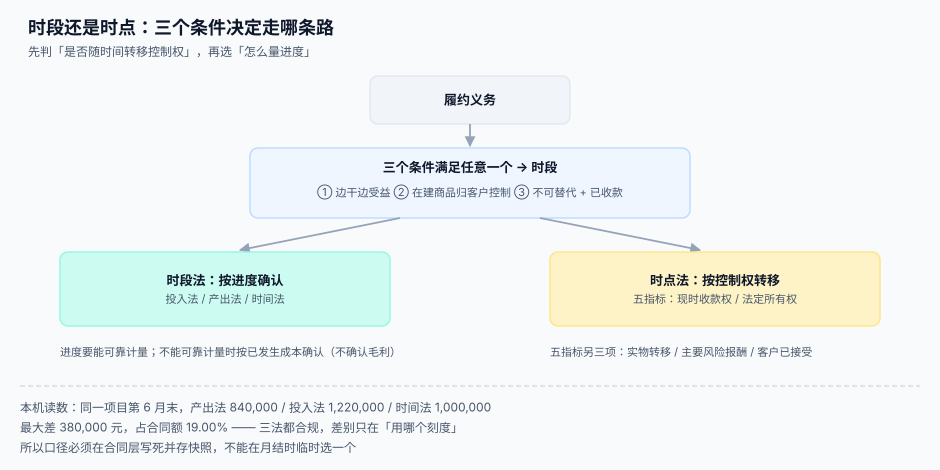

# 时段与时点：走哪条路

<p style="text-align:center;"></p>

同一份 200 万的工程项目，在第 6 个月末：产出法说确认 84 万，投入法说 122 万，时间法说 100 万。三个数都能从系统里跑出来，都有「依据」，都能自圆其说——**而且都合规**。差别只在「拿哪个刻度量进度」。

这一页讲两件事：**先判走时段还是时点**（决定性质），**再判拿什么量进度**（决定金额）。两件事都定不下来的时候，系统的收入曲线就是一根没有意义的折线。

::: tip 一句话理解
**时段法问「干了多少」，时点法问「交给谁了」。** 前者要一个刻度，后者要一个证据；两者都要在合同层写死，不能留到月结时临时选。
:::



本页判据族 `RVT-A` ~ `RVT-H`，共 8 条，定义在最后一节。

## 时段法的三个条件

满足**任意一个**，就是时段履约，按进度确认：

| 条件 | 判断问题 | 典型场景 | 工程证据 |
| --- | --- | --- | --- |
| ① 客户同时取得并消耗 | 你干活的同时，客户就在受益 | 物业、运维、SaaS、通话 | 服务期起止 + 用量或时长 |
| ② 客户控制在建商品 | 干到一半的东西归客户控制 | 在客户场地上施工、客户自有物料代工 | 场地进入记录、物料归属 |
| ③ 不可替代 + 已收款有权收款 | 做的东西别人用不了，且你随时有权就已完成部分收款 | 高度定制的咨询、专用设备 | 定制条款 + 收款权条款 |

三个条件**都不满足**就是时点法。注意条件③是**两个都要有**：不可替代（no alternative use）**且**（and）在整个合同期间有权就迄今已完成的履约收款。

```sql
CREATE TABLE obligation_timing (
  obligation_id   INTEGER PRIMARY KEY,
  path            TEXT NOT NULL,      -- 'over_time' / 'point_in_time'
  condition_1     INTEGER NOT NULL DEFAULT 0,   -- 边干边受益
  condition_2     INTEGER NOT NULL DEFAULT 0,   -- 客户控制在建商品
  condition_3a    INTEGER NOT NULL DEFAULT 0,   -- 不可替代
  condition_3b    INTEGER NOT NULL DEFAULT 0,   -- 有权就已完成部分收款
  decided_by      TEXT NOT NULL,      -- 谁判的（角色，不是人名）
  decided_at      TEXT NOT NULL,
  memo            TEXT NOT NULL,      -- 判定理由（审计会要）
  CHECK (path IN ('over_time','point_in_time')),
  -- 时段必须至少有一个条件成立；时点则必须三个都不成立
  CHECK ((path='over_time' AND (condition_1=1 OR condition_2=1 OR (condition_3a=1 AND condition_3b=1)))
      OR (path='point_in_time' AND condition_1=0 AND condition_2=0 AND (condition_3a=0 OR condition_3b=0)))
);
```

::: danger 三个高危误判
1. **「我们做的是定制项目，所以是时段法」**——定制只满足「不可替代」，还要有「随时有权收款」。合同里写「验收后一次性付款」的项目，条件③不成立，往往要退回时点法（或按里程碑）。
2. **「客户能随时叫停，所以是时段法」**——叫停权是**终止条款**，不是控制权。判据是客户能否主导用途并取得几乎全部经济利益。
3. **「已经发货了，所以是时点法且已确认」**——发货只满足五指标里的「实物转移」一项，若客户还没验收、退货期未过、安装未完成，控制权可能尚未转移。
:::

## 时点法的五个指标

时点法要判「控制权在这一刻转移了吗」。准则给五个指标，**不要求全部满足**，但满足的越多越有把握：

| 指标 | 含义 | 系统里对应什么 |
| --- | --- | --- |
| ① 现时收款权 | 客户此时就有付款义务 | 账期起算日、发票日 |
| ② 法定所有权 | 所有权已转移 | 交付单、产权登记 |
| ③ 实物转移 | 客户已占有实物 | 签收单、物流签收时间 |
| ④ 主要风险报酬 | 毁损、跌价、滞销风险归客户 | 退货条款、验收条款 |
| ⑤ 客户已接受 | 客户验收或按约定视为验收 | 验收单、自动验收规则 |

本机读数（5,000 单模拟，指标满足概率 0.82/0.75/0.55/0.48/0.62）：

| 判定口径 | 判定为「已转移」的单数 | 占比 |
| --- | --- | --- |
| 「≥ 3 项满足」 | 3,812 | 76.2% |
| 「5 项全满足」 | 510 | 10.2% |

两者相差 **3,302 单**。这就是为什么判定口径必须写死：同一批单据，换一条规则，收入能差七倍。

```sql
-- 五指标逐项落列，判定规则集中在一处
CREATE TABLE delivery_evidence (
  obligation_id     INTEGER PRIMARY KEY,
  payment_right_at  TEXT,       -- ① 现时收款权成立时点
  title_transfer_at TEXT,       -- ② 法定所有权转移
  physical_at       TEXT,       -- ③ 实物转移（签收）
  risk_transfer_at  TEXT,       -- ④ 主要风险报酬转移
  accepted_at       TEXT,       -- ⑤ 客户接受（验收）
  control_transfer_at TEXT NOT NULL,   -- 最终认定：取上面哪一个
  basis             TEXT NOT NULL      -- 取它的理由
);
```

::: warning 「视为验收」要写成规则，不要写成口头约定
B 端交付里大量存在「交付后 7 日未提出异议视为验收」。这条必须落成一个**可执行的定时任务**（到期自动写 `accepted_at`），否则时点永远空着，收入永远确认不了，最后变成「财务每月手工填一次日期」。
:::

## 进度怎么量：三种刻度

时段法必须选一个「能可靠计量」的进度方法：

| 方法 | 怎么算 | 适用 | 陷阱 |
| --- | --- | --- | --- |
| **投入法**（input） | 已发生成本 ÷ 预计总成本 | 成本与履约强相关 | 早期采购大量材料会虚高进度 |
| **产出法**（output） | 已交付单位 ÷ 总单位 | 单位可数、价值均匀 | 单位价值不均时失真 |
| **时间法**（straight-line） | 已过期间 ÷ 总期间 | 服务均匀发生（SaaS、运维） | 前期投入大时严重滞后 |

### 同一项目，三种刻度差多少

合同 200 万、12 个月，第 6 月末：

```text
产出法：已交付 420 / 1,000 单位           → 42.00% → 840,000.00
投入法：已发生成本 610,000 / 1,000,000    → 61.00% → 1,220,000.00
时间法：6 / 12                            → 50.00% → 1,000,000.00

最大差 380,000.00 元，占合同额 19.00%
```

三种方法**都合规**，所以选择不是技术问题而是政策问题。工程上要做的是：把方法写进合同（`obligation_timing.method`），把每期读数落成快照，让任何一次重算都能复现当时的数。

### 直线法与投入法的差额会自己收敛

12 万、12 个月的服务，成本前重后轻（半年累计 60%）：

| 时点 | 直线法累计 | 投入法累计 | 差额 |
| --- | --- | --- | --- |
| 第 1 月 | 10,000.00 | 19,200.00 | +9,200.00 |
| 第 3 月 | 30,000.00 | 50,400.00 | +20,400.00 |
| 第 6 月 | 60,000.00 | 72,000.00 | +12,000.00 |
| 第 9 月 | 90,000.00 | 91,200.00 | +1,200.00 |
| 第 12 月 | 120,000.00 | 120,000.00 | 0.00 |

差额在第 3 个月达到峰值，然后**自己收敛到 0**。这条曲线解释了一个常见现象：用投入法的公司在前几个季度收入明显偏高，年报却对得上——审计如果不看中期，就发现不了。

::: danger 投入法的「已发生成本」要剔除三类
1. **与履约无关的成本**：返工、废品、非正常损耗，不能算进度。
2. **已采购未安装的材料**：材料堆在客户现场但没装，算进进度会让收入虚高（这也是最常被用来「做高当期收入」的手法）。
3. **预付给分包商的款项**：付了钱不等于干了活。
:::

## 进度无法可靠计量时

准则给了兜底：**在能可靠计量之前，按已发生的成本确认收入，不确认毛利**（即收入 = 成本，毛利为 0）。工程上要有一个显式的 `progress_unmeasurable` 状态，而不是「进度填 0」——填 0 会让收入为 0，而兜底要求的是「成本打平」。

```sql
-- 兜底：无法计量时，收入按已发生成本确认，毛利为 0
UPDATE revenue_entry
SET amount = (SELECT cost_incurred FROM project_cost c WHERE c.obligation_id = revenue_entry.obligation_id
              AND c.period = revenue_entry.period),
    evidence = 'progress_unmeasurable: cost-recovery basis'
WHERE obligation_id = :oid AND period = :period;
```

## 切点：期间边界是最大的隐形错误源

本机读数：20,000 条业务记录，用 `< '2026-02-01'` 与 `<= '2026-01-31'` 两种写法，合计相差 **164,521.32 元**；落在 1 月 31 日当天的记录 **654 条**，被整个丢掉。

```sql
-- 错误：<= '2026-01-31' 会漏掉当天所有带时刻的记录
SELECT sum(amount) FROM biz_event WHERE done_at <= '2026-01-31';

-- 正确一：边界用「下月 1 日」且严格小于
SELECT sum(amount) FROM biz_event WHERE done_at < '2026-02-01';

-- 正确二（推荐）：直接存期间号，比较只在报表层做一次
SELECT period, sum(amount) FROM biz_event GROUP BY period;
```

::: tip 期间字段就该是 `TEXT 'YYYY-MM'`
期间号是**业务概念**，时间戳是**技术概念**。让确认明细只存期间号，切点问题就从「每一次查询」收敛成「写期间的那一处」，而那一处可以做单测。
:::

## 判据清单

| 编号 | 判据 | 怎么验 |
| --- | --- | --- |
| `RVT-A` | 每个义务都有 `path`，且与三个条件的组合自洽（CHECK 约束） | 违反 CHECK 的插入必须失败 |
| `RVT-B` | 时段法必须有 `method`，且方法在合同层固定 | 同一义务两期的方法不同 → 报错 |
| `RVT-C` | 时点法必须有 `control_transfer_at` 与 `basis` | 两列任一为空则禁止确认 |
| `RVT-D` | 五指标逐项落列，不合并成一个「已交付」布尔 | 列出交付证据表，五项各有列 |
| `RVT-E` | 投入法的「已发生成本」剔除无关成本、未安装材料、预付款 | 抽查 3 期，能与成本系统对账 |
| `RVT-F` | 无法可靠计量时有显式状态，按成本确认、毛利为 0 | 构造该状态，断言 `amount = cost_incurred` |
| `RVT-G` | 期间以 `YYYY-MM` 存储，边界比较不在业务查询里出现 | 全库搜 `<= '20` 与 `datetime(` 在确认逻辑中的出现 |
| `RVT-H` | 每期进度落快照，重算能复现当时的百分比 | 取 3 期快照，用当时的分子分母重算，差 = 0 |

## 验证方式

```shell
# 1) 判定自洽：违反 CHECK 的写法必须失败（预期：CHECK constraint failed）
sqlite3 /tmp/rv.db "INSERT INTO obligation_timing(obligation_id,path,condition_1,condition_2,condition_3a,condition_3b,decided_by,decided_at,memo)
  VALUES (9999,'over_time',0,0,0,1,'qa','2026-06-30','negative test');"

# 2) 时点法缺证据却确认了收入的：预期 0 行
sqlite3 /tmp/rv.db "SELECT o.id FROM performance_obligation o
  LEFT JOIN delivery_evidence d ON d.obligation_id=o.id
  JOIN revenue_entry e ON e.obligation_id=o.id
  WHERE o.timing='point_in_time' AND (d.control_transfer_at IS NULL OR d.basis IS NULL);"

# 3) 期间切点：两种写法的差额（预期：0 行，因为确认表只存期间号）
sqlite3 /tmp/rv.db "SELECT count(*) FROM revenue_entry WHERE period NOT GLOB '[0-9][0-9][0-9][0-9]-[0-9][0-9]';"
```

## 参考资料

- [总览：五段确认链与五个「收入」](../Overview/index.md)：五个金额为什么必须分开
- [五步法的工程落点](../FiveStep/index.md)：第 ② 段如何先拆出义务，再判时段/时点
- [实战：本机跑通一条确认闭环](../Practice/index.md)：进度快照与断言的可执行版本
- IFRS 15 第 35~38 段（时段三条件与时点五指标）、第 39~45 段（进度计量）：<https://www.ifrs.org/issued-standards/list-of-standards/ifrs-15-revenue-from-contracts-with-customers/>
- 财政部《企业会计准则第 14 号——收入》第十一条至第十三条：<https://kjs.mof.gov.cn/zhengcefabu/201707/t20170719_2653110.htm>
