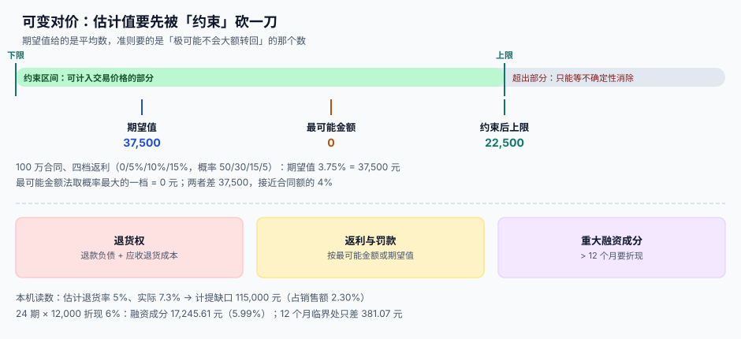

# 可变对价与退款负债

<p style="text-align:center;"></p>

「返利最高 15%」这句话在合同里只是一行字，在系统里却是一个**区间**：你既不能按 15% 确认，也不能按 0% 确认，而要估一个「极可能不会大额转回」的金额。而这句话的每一次重新估计，都会改变本期收入——**收入系统里唯一一个「每期都该动」的数**。

::: tip 一句话理解
**可变对价不是一个数，是一个带上下限的区间。** 估计方法决定区间的中心，约束决定区间能取多宽；只写一个数，等于把「不确定性」这件事从账上抹掉了。
:::



本页判据族 `RVV-A` ~ `RVV-H`，共 8 条，定义在最后一节。

## 四类可变对价

| 类型 | 例子 | 方向 | 估计难点 |
| --- | --- | --- | --- |
| **折扣与返利** | 年采购满 500 万返 3% | 减 | 期末才知道全年量，需按月估 |
| **罚款与扣款** | 延期交付按日扣 0.5% | 减 | 是否真的会扣、扣多少 |
| **激励与奖金** | 提前完工奖 10 万 | 加 | 达成的概率 |
| **价格保护** | 市场降价则补差 | 减 | 未来价格走势 |

四类的工程共性：**都必须有「估计值 + 约束值 + 依据」三件套**。少任何一件，事后都无法解释。

```sql
CREATE TABLE variable_consideration (
  id            INTEGER PRIMARY KEY,
  contract_id   INTEGER NOT NULL REFERENCES contract(id),
  kind          TEXT NOT NULL,        -- rebate / penalty / incentive / price_protection
  method        TEXT NOT NULL,        -- 'expected_value' / 'most_likely'
  estimate      NUMERIC(18,2) NOT NULL,   -- 估计值
  constraint_amt NUMERIC(18,2) NOT NULL,  -- 约束后的可计入金额
  basis         TEXT NOT NULL,            -- 数据来源 + 期间 + 计算式
  assessed_at   TEXT NOT NULL,
  CHECK (kind IN ('rebate','penalty','incentive','price_protection')),
  CHECK (method IN ('expected_value','most_likely'))
);
```

## 两种估计方法

| 方法 | 怎么算 | 适用 |
| --- | --- | --- |
| **期望值法**（expected value） | 各情形金额 × 概率求和 | 合同数量多、结果呈连续分布（大量小合同、组合返利） |
| **最可能金额法**（most likely amount） | 取概率最大的那一档 | 结果只有两个或少数几个（达标/不达标、罚款/不罚款） |

选错的代价不是「不准确」，而是**无法解释**。本机读数（100 万合同，四档返利 0/5%/10%/15%，概率 50/30/15/5%）：

```text
期望值法：0×0.5 + 5%×0.3 + 10%×0.15 + 15%×0.05 = 3.75%  → 37,500.00
最可能金额：概率最大的一档 = 0%                          → 0.00
差额 37,500.00 元 ≈ 合同额的 3.75%
```

两个数都能算出来，都对「同一份合同」成立。所以**方法必须写进合同层**，并与业务形态匹配：单一大客户用最可能金额，海量小客户组合用期望值。

## 约束：估计值要先被砍一刀

估出来的数不能全额计入交易价格，只能计入「**极可能**（highly probable）不会发生重大转回」的部分。约束的判断依据三条：

1. **不确定性的大小**——金额区间越宽，能计入的越少。
2. **经验与数据**——同类合同的历史转回率。
3. **政策与依赖**——是否取决于第三方、是否长期未解决。

```sql
-- 约束后的可计入金额必须有明确计算式，不能是「凭经验打个折」
UPDATE variable_consideration
SET constraint_amt = round(estimate * 0.6, 2),   -- 示例：按历史转回率留 40% 缓冲
    basis = basis || ' | 约束：近 24 期同类返利实际转回率 38%，按 60% 计入'
WHERE id = :id;
```

本机读数：期望值 37,500 被约束到 **22,500**（按 60% 计入），差 15,000。这 15,000 不是「藏起来的收入」，而是**留在区间外、等不确定性消除后再计入**的部分。

::: danger 约束的三条红线
1. **只在「转回」方向做约束。** 有利变动（可能增加收入）同样要约束，不能只砍不利的一侧——「坏消息留缓冲、好消息全确认」是典型的盈余管理。
2. **约束不是固定的百分比。** 每期都要重新评估；用同一个 60% 用三年，等于把估计变成了规则。
3. **约束变化要改当期，不改以前。** 本期重新估计只调整本期（及未来），不得追溯调整已确认期间，除非是差错更正。
:::

## 退货权：退款负债 + 应收退货成本

带退货条款的销售，确认收入时要同时做两件事：

| 科目 | 金额 | 含义 |
| --- | --- | --- |
| **退款负债** | 预计退货部分的对价 | 你欠客户的「退钱义务」 |
| **应收退货成本** | 预计退回商品的原成本（扣除再销售价值损耗） | 你将来会收回的「货」 |

```sql
CREATE TABLE return_estimate (
  id             INTEGER PRIMARY KEY,
  contract_id    INTEGER NOT NULL,
  period         TEXT NOT NULL,
  sales_amount   NUMERIC(18,2) NOT NULL,
  return_rate    NUMERIC(6,4) NOT NULL,       -- 估计退货率
  refund_liab    NUMERIC(18,2) NOT NULL,      -- 退款负债
  return_asset   NUMERIC(18,2) NOT NULL,      -- 应收退货成本
  basis          TEXT NOT NULL,
  UNIQUE (contract_id, period)
);
```

本机读数（销售额 500 万）：

| 估计 | 实际 | 计提 | 实际发生 | 缺口 |
| --- | --- | --- | --- | --- |
| 5.0% | 7.3% | 250,000.00 | 365,000.00 | **+115,000.00（2.30% 销售额）** |
| 8.0% | 6.1% | 400,000.00 | 305,000.00 | −95,000.00（−1.90% 销售额） |

两个方向都会错，而且**方向相反**。这说明估计不是「越保守越好」：估高了是隐藏利润，估低了是虚增利润，两者都要在下一期调整，而调整的那一期会被解释成「业务波动」。

::: warning 退货率不能直接用「历史退货数 ÷ 历史销售数」
分母要用**同期可退货的销售额**，而不是全部销售额。用全部销售额做分母，会把「还没到退货期的单」算成「没退货」，从而系统性低估退货率。正确的分母是「已过退货期的销售额」。
:::

## 重大融资成分

付款与履约间隔超过 **1 年**时，交易价格要按折现后的金额确认，差额作为利息费用（或利息收入）在期间内摊销。

```sql
-- 折现：把未来现金流折成现价
-- r 为月利率，n 为期数
WITH RECURSIVE t(k, pv) AS (
  SELECT 1, :cash / (1 + :r)
  UNION ALL
  SELECT k+1, pv + :cash / power(1 + :r, k+1) FROM t WHERE k < :n
)
SELECT max(pv) AS present_value FROM t;
```

本机读数：

| 场景 | 名义金额 | 现值（6% 年化） | 融资成分 |
| --- | --- | --- | --- |
| 24 期 × 12,000 | 288,000.00 | 270,754.39 | **17,245.61（5.99%）** |
| 12 期 × 1,000（临界） | 12,000.00 | 11,618.93 | **381.07（3.18%）** |

24 期的融资成分接近 6%，足以让毛利率差好几个点；12 期临界处只有 3.18%，实务上可以用简化处理（不超过 1 年的，可不考虑融资成分）。

::: tip 简化处理要写进会计政策，不是写进代码注释
「不超过 1 年的合同不考虑融资成分」是一条**政策选择**，必须出现在附注的会计政策里，并在代码里落成一个显式的开关（`financing_component_policy = 'expedient_1y'`）。写在注释里，下一个人重构时就会把它删掉。
:::

## 应付客户对价

给客户的返点、进场费、陈列费，要冲减交易价格（除非是为了取得**可明确区分**的商品或服务）。判断标准是「这笔钱换回了什么」：

| 付出 | 换回 | 处理 |
| --- | --- | --- |
| 年返利 | 无（只是价格优惠） | 冲减交易价格 |
| 上架费 | 货架位置（可明确区分的服务） | 作为采购成本，不冲减收入 |
| 联合营销费 | 品牌曝光（难以区分） | 冲减交易价格 |

## 判据清单

| 编号 | 判据 | 怎么验 |
| --- | --- | --- |
| `RVV-A` | 每笔可变对价都有 `method`、`estimate`、`constraint_amt`、`basis` 四件套 | 任一为空则该合同禁止确认 |
| `RVV-B` | 估计方法与业务形态匹配（单一大额→最可能；海量组合→期望值） | 抽查 10 份，方法与合同数量分布一致 |
| `RVV-C` | 约束同时作用于有利与不利变动 | 构造一个正向变动，断言也被约束 |
| `RVV-D` | 约束比例每期重估，不写死为常量 | 代码中不出现 `* 0.6` 之类常量，值来自配置或计算 |
| `RVV-E` | 退货同时产生退款负债与应收退货成本，两者都入账 | 两列均非零，且能对上成本系统 |
| `RVV-F` | 退货率分母为「已过退货期的销售额」 | 抽查一期，分母可复算 |
| `RVV-G` | 间隔超过 1 年的合同必须折现，且有显式政策开关 | 政策开关存在；抽 1 份长周期合同，现值可复算 |
| `RVV-H` | 应付客户对价按「换回什么」分流，不一律冲减收入 | 抽查 3 笔，能说出换回的是不是可区分服务 |

## 验证方式

```shell
# 1) 四件套缺失的合同（预期 0 行）
sqlite3 /tmp/rv.db "SELECT contract_id FROM variable_consideration
  WHERE method IS NULL OR basis IS NULL OR basis = '' OR constraint_amt IS NULL;"

# 2) 约束不得超过估计值（预期 0 行）
sqlite3 /tmp/rv.db "SELECT id FROM variable_consideration WHERE abs(constraint_amt) > abs(estimate);"

# 3) 退货负债与退货资产同时存在（预期 0 行缺失）
sqlite3 /tmp/rv.db "SELECT contract_id FROM return_estimate WHERE refund_liab > 0 AND return_asset = 0;"
```

## 参考资料

- [合同资产、合同负债与应收](../ContractBalance/index.md)：退款负债与合同负债的区别
- [合同变更与退款](../Modification/index.md)：退款发生时的红冲与追溯
- [会员积分与储值账户](../../LoyaltyProgram/LiabilityRecon/index.md)：breakage 与合同负债的另一种写法
- IFRS 15 第 50~59 段（可变对价与约束）、第 60~65 段（重大融资成分）、附录 B20~B27（退货权）：<https://www.ifrs.org/issued-standards/list-of-standards/ifrs-15-revenue-from-contracts-with-customers/>
- 财政部《企业会计准则第 14 号——收入》第十五条至第二十条：<https://kjs.mof.gov.cn/zhengcefabu/201707/t20170719_2653110.htm>
