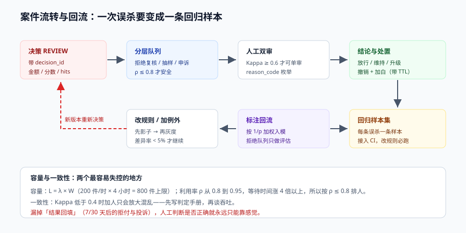

# 案件与人工审核：队列、SLA 与回流

自动决策解决的是「大部分请求」，人工审核解决的是「自动决策不敢下结论的那部分」。但人工审核不是「兜底按钮」，它是一个**有容量上限、有延迟、有主观偏差**的子系统——把它当无限资源用，风控就会在下一次流量高峰时整体堵死。

这一页讲四件事：队列怎么分层、容量怎么算、两个人为什么会给出不同结论、以及人工结论怎么变成可用的样本（而不是一堆有偏的标签）。



本页判据族 `RDC-A` ~ `RDC-H`，共 8 条。定义表见文末「本页判据」一节。

## 一、三种队列，三种目的

| 队列 | 来源 | 目的 | 时效要求 | 处置结果 |
| --- | --- | --- | --- | --- |
| 拒绝复核（REJECT_REVIEW） | 自动拒绝的大额/可疑单 | 减少误杀 | 分钟~小时 | 放行 / 维持拒绝 / 升级 |
| 抽样复核（SAMPLING） | 对**通过**的单按比例抽样 | 发现漏放（false negative） | 天 | 补拦截 / 调阈值 |
| 申诉（APPEAL） | 用户主动申诉 | 合规义务 + 体验 | 工作日 24~48h | 撤销 / 维持 + 说明 |

**抽样复核是最容易被砍掉、也最不该砍的一项**。拒绝复核只能看到「已经拦下来的」，永远看不到「放过的好人里混了多少坏人」。没有对通过单的抽样，你手里的样本是**单边截断**的——用这种样本训练出来的模型，只会越来越爱拦。

::: danger 注意
1. **申诉队列不能和拒绝复核共用优先级**。申诉是有法定时限的（《反电信网络诈骗法》要求对涉诈异常账号的处置提供申诉渠道），被业务高峰挤掉就是合规风险。
2. **不要把「抽样复核」做成随机抽样就完事**。纯随机抽样在小拦截率场景下效率极低，应按「分数分层 + 高风险段加密」抽样，见第六节。
3. **同一个案件不能被两个人同时领走**。缺锁会导致重复劳动，更糟的是两个人给出相反结论，谁最后写谁生效。
:::

## 二、分层：先算「值不值得看」

案件优先级不是「越可疑越优先」，而是「**单位审核时间的收益**」。一个可用的打分：

```text
priority = w1 × log(1 + amount)                       # 金额越大越值得看
         + w2 × (1 − |score − threshold| / threshold)  # 越接近阈值越模糊，越值得看
         + w3 × repeat_flag                            # 同一主体反复进队列
         − w4 × age_hours                              # 等太久的要么过期要么已流失
```

三个经验值：

- **`amount` 取 log**。不取 log 时，一个 50 万的单会把所有队列压死；取 log 后，5 万和 50 万的区别只有 1.4 倍。
- **「接近阈值」比「极端可疑」更值得人工看**。极端可疑的单机器基本不会错，人工看了也是维持；**边界样本才是人工价值最高的地方**，而且它们正好是校准模型最需要的样本。
- **`age_hours` 的惩罚项必须有**。没有时效惩罚时，队列会自然倾向「处理新单」，老单永久沉淀，最后没人知道队列底部有什么。

## 三、容量：利特尔法则与它的非线性

人工审核的容量规划只需要一个公式：

```text
L = λ × W
L：队列长度（在制品）
λ：到达率（件/小时）
W：平均停留时间（小时）
```

举例：`λ = 200 件/小时`，要求 `W ≤ 4 小时`（SLA），则 **队列上限 L = 800 件**。

但真正的坑不在公式，而在**处理能力是有限且会崩的**：

| 人工处理能力 | 单件耗时 | 每人每小时 | 20 人团队每小时 | 需求 200/小时时 |
| --- | --- | --- | --- | --- |
| 熟练 | 90 s | 40 件 | **800 件** | 余量 4 倍，健康 |
| 一般 | 150 s | 24 件 | **480 件** | 余量 2.4 倍，可接受 |
| 新人 | 300 s | 12 件 | **240 件** | 余量 1.2 倍，**一次流量高峰就崩** |

**排队系统的崩溃是非线性的**：当利用率 ρ 从 0.8 涨到 0.95，平均等待时间不是涨 19%，而是涨到 4 倍以上（M/M/c 排队）。所以容量必须按 **ρ ≤ 0.8** 规划，也就是「20 人 × 40 件 × 80% = 640 件/小时」才是安全水位，而不是 800。

一旦超过水位，只有三个选择，且必须**事先**定好：

1. **降低进队列的比例**（提高自动拒绝的确定性阈值，或对低金额单直接放行 + 事后追溯）。
2. **加严而不是放宽**（把「复核」降级为「挑战」，用验证码换人工）。
3. **接受延迟并对外说明**（对大额单保留人工，对小额单走自动）。

**最差的选择是「什么都照收」**：队列无限增长后，SLA 全部违约，等于既没服务好用户，也没控住风险。

## 四、两个人为什么结论不同：一致性度量

人工审核的核心质量问题不是「慢」，而是「不一致」：同一个人不同时间、不同的人同一案件，结论可能相反。度量用 **Cohen's Kappa**：

```text
Po = 观测一致率
Pe = 随机一致率（按两人各自的边际分布算）
Kappa = (Po − Pe) / (1 − Pe)
```

| Kappa | 解读 | 动作 |
| --- | --- | --- |
| > 0.8 | 高度一致 | 可以只做单审 |
| 0.6 ~ 0.8 | 基本一致 | 边界案件双审 |
| 0.4 ~ 0.6 | 中等 | 必须双审 + 分歧仲裁 |
| < 0.4 | 差 | **先改判定标准，别急着加人** |

Kappa 低于 0.4 时加人只会放大混乱。正确顺序是：**先写判定手册（每个 reason_code 一条明确判据）→ 再双审 → 再看 Kappa**。

### 4.1 分歧仲裁

分歧不要「谁级别高听谁的」，要留结构化记录：

```sql
CREATE TABLE case_review (
  case_id      text PRIMARY KEY,
  decision_id  text NOT NULL,
  reviewer_a   text NOT NULL,
  verdict_a    text NOT NULL,        -- PASS / REJECT / ESCALATE
  reviewer_b   text,
  verdict_b    text,
  final        text NOT NULL,
  arbitrated_by text,                -- 分歧时的仲裁人
  reason_code  text NOT NULL,        -- 必填，不能是「其他」
  note         text,
  reviewed_at  timestamptz NOT NULL DEFAULT now()
);
```

`reason_code` 必须枚举、不能自由文本——自由文本的标注数据没法聚合，也没法变成规则候选。

## 五、回流：人工结论怎么变成样本

人工结论是风控最贵的标注数据，但直接拿去训练会引入**选择偏差**：只有「被拦下来的」才有标签，被放过的没有。

三条修法：

1. **只把「复核结论」用于评估，不直接用于训练**。用它们算「拒绝队列里的真实坏率」，这个数很干净，但它只代表「被拦的那部分人」。
2. **抽样复核的样本可以进训练，但必须带权重**。抽样是分层的，每层的抽样概率不同，训练时要按 `1/p` 加权，否则模型会以为「高风险段的人特别多」。
3. **申诉撤销的样本是「明确的假阳性」**，价值最高，但要单独看——申诉的人本身就不是随机样本（愿意申诉的用户群体有偏）。

```text
样本权重 = 1 / 抽样概率 × 场景权重
例：高风险段抽样 20%（权重 5），低风险段抽样 2%（权重 50）——
    不加权时，模型会把高风险段当成总体的 10 倍
```

## 六、抽样复核怎么抽才有效

| 方式 | 做法 | 每 1000 单能发现 | 适合 |
| --- | --- | --- | --- |
| 纯随机 | 均匀抽 1% | 约等于总体坏率 × 10 | 建立基线 |
| 分数分层 | 高风险段 20%、中 5%、低 1% | 高风险段发现率提升 5~10 倍 | 迭代模型 |
| 不确定性抽样 | 抽「分数离阈值最近」的那批 | 最省的「找到边界错误」 | 调阈值/校准 |
| 冠军挑战者 | 让挑战模型在 10% 流量上真跑，抽样两者的分歧单 | 直接量化「新模型是否更好」 | 换模型 |

**冠军挑战者（champion/challenger）是唯一能回答「新模型是不是真的更好」的抽样方式**，因为它不是看离线指标，而是让两个模型在真实流量上分别决策、对比结果。代价是要承担 10% 流量的风险，所以要配熔断。

## 七、闭环：一条案件要留下什么

一条完整的案件记录应能回答四个问题：**为什么拦、谁看的、凭什么放的、后来怎样了**。

```text
case_id → decision_id → 决策时刻的 hits / score / rule_version
        → reviewer_a/b 的结论与 reason_code
        → final 与仲裁记录
        → 7/30 天后的「结果回填」：是否发生拒付、投诉、二次欺诈
```

最后一项「结果回填」最容易被漏掉，但它是**唯一能验证「人工判断是否正确」的证据**。没有它，人工审核的质量永远是「感觉还行」。

## 本页判据

| 编号 | 判据 | 看什么现象 | 不满足时改哪里 |
| --- | --- | --- | --- |
| `RDC-A` | 三类队列独立且各有 SLA | 监控里三个队列分别有积压与超时率 | 拆队列，别混一个池子 |
| `RDC-B` | 对通过单有分层抽样 | 有 `SAMPLING` 队列且按分数分层 | 补抽样链路，比例写进配置 |
| `RDC-C` | 容量按 ρ ≤ 0.8 规划 | 人力 × 单件产能 × 0.8 ≥ 到达率 | 补容量表，超水位触发预案 |
| `RDC-D` | 有明确的超水位预案 | 三种处置（降比例/改挑战/限流）已配置 | 写进 runbook，演练一次 |
| `RDC-E` | Kappa 有度量且 ≥ 0.6 | 每月输出 Kappa，低于阈值触发复盘判定标准 | 补双审与仲裁流程 |
| `RDC-F` | `reason_code` 是枚举 | 表里没有自由文本结论 | 建立码表，禁止「其他」兜底 |
| `RDC-G` | 抽样样本带权重入模 | 训练代码里有 `1/p` 权重 | 补权重列，防止分布失真 |
| `RDC-H` | 案件有结果回填 | 7/30 天后有拒付/投诉/二次欺诈标记 | 补回填任务，接进模型评估 |

## 参考资料

- Cohen, *A Coefficient of Agreement for Nominal Scales*（Kappa 原始论文）：<https://doi.org/10.1177/001316446002000104>
- Landis & Koch, *The Measurement of Observer Agreement for Categorical Data*（Kappa 分档的经验标准）
- Little & Graves, *Little's Law*（排队与在制品的关系）：<https://people.cs.umass.edu/~emery/classes/cmpsci691st/papers/LittlesLaw.pdf>
- Google SRE Book, *Managing Load*（利用率与等待时间的非线性）：<https://sre.google/sre-book/handling-overload/>
- 《中华人民共和国反电信网络诈骗法》第四十条（申诉与救济渠道）：<https://www.gov.cn/xinwen/2022-09/03/content_5707885.htm>
- Provost & Fawcett, *Data Science for Business*, Ch.7（抽样偏差与选择偏差）
