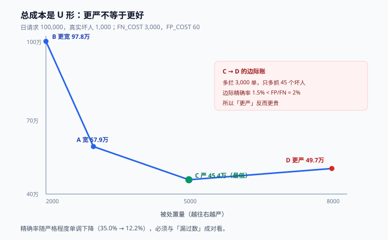

# 度量与误杀治理：四个率与一条成本线

风控团队的日常争论几乎都能还原成一句话：**「最近是不是拦多了」**。这句话之所以难回答，是因为它同时涉及四个率，而这四个率的分母各不相同——只要有人偷偷换了分母，同一个系统能被描述成「越来越准」或「越来越乱」。

这一页只做一件事：把四个率的定义、成本模型和阈值移动的边际算清楚，让「拦多了」变成一个可以用数字回答的问题。



本页判据族 `RDM-A` ~ `RDM-H`，共 8 条。定义表见文末「本页判据」一节。

## 一、四个率，四把尺子

| 指标 | 定义 | 分母 | 回答什么问题 | 常见误用 |
| --- | --- | --- | --- | --- |
| 拦截率 | 被处置（非 PASS）的量 / 总请求 | **请求数** | 风控「手有多重」 | 换成「订单数」会漏掉被拦在提交前的请求 |
| 拦截精确率 | 真坏 / 被处置 | **被处置数** | 拦得准不准 | 只看它会让系统越来越松（少拦就准） |
| 误杀率 | 被误处置 / **正常请求** | 正常请求数 | 伤害了多少好人 | 用「拦截数」做分母会得到虚高的小数 |
| 资损率 | 漏过的欺诈金额 / 总交易金额 | **金额** | 钱有没有守住 | 用笔数算会低估大额欺诈 |

::: danger 注意
1. **拦截率与拦截精确率必须成对报**。单报拦截率，团队会倾向于少拦（数字好看、客诉少）；单报精确率，团队会倾向于严拦（精确率的分母变小，比值反而上升）。**两个数一起看，才没有偷懒的空间。**
2. **误杀率的分母只能是「正常请求」，而这个数在线上不可直接观测**——你不知道被放过的请求里谁是真坏人，也不知道被拦的谁是好人。它只能通过**抽样复核 + 申诉撤销**估算，必须标注置信区间。
3. **资损率必须按金额**。1000 笔 1 元欺诈和 1 笔 100 万欺诈，笔数口径下前者是灾难、后者是噪声；金额口径下结论完全相反。
:::

## 二、成本模型：把「拦不拦」变成一个减法

设：

- `FN_COST`：漏过一单的损失（金额 × 损失率，含拒付、赔付、人工追讨）
- `FP_COST`：误杀一单的成本（客诉处理 + 用户流失的期望损失 + 补偿）

则总成本：

```text
TotalCost = FN_COST × 漏过数 + FP_COST × 误杀数
```

用一组真实量级的参数算一遍（日请求 100,000，真实坏人 1,000，`FN_COST=3000`，`FP_COST=60`）：

| 策略 | 被处置 | 其中真坏 | 误杀 | 漏过 | 拦截精确率 | 总成本 |
| --- | --- | --- | --- | --- | --- | --- |
| A 宽 | 3,000 | 850 | 2,150 | 150 | 28.3% | **579,000** |
| B 更宽 | 2,000 | 700 | 1,300 | 300 | 35.0% | **978,000** |
| C 严 | 5,000 | 930 | 4,070 | 70 | 18.6% | **454,200** |
| D 更严 | 8,000 | 975 | 7,025 | 25 | 12.2% | **496,500** |

四个读数，各自是一节课：

1. **成本是 U 形**，最低点在 C。B 太松（漏 300 单，损失 90 万），D 太严（误杀 7,025，成本 42 万）。
2. **「更严」不等于「更好」**：D 比 C 多拦 3,000 单，只多抓到 45 个坏人——**边际精确率 1.5%**。用 3,000 次打扰换 45 单拦截，只有在 `FN_COST/FP_COST > 66` 时才划算。
3. **拦截精确率随严格程度单调下降**（35.0% → 28.3% → 18.6% → 12.2%）。所以「精确率」这个指标本身会奖励懒惰——**它必须和「漏过数」一起看**。
4. **`FP_COST` 的估计误差会移动最优阈值**。如果 `FP_COST` 实际是 120 而不是 60，C 的成本变成 940,200，最优解会回到 A 附近。**成本参数必须来自业务方，并且写明假设。**

::: tip 提示
把这张表放进月度评审，比任何「风控效果好」的形容词都有说服力。它同时回答了「为什么这个月多拦了 2,000 单」和「多拦的这 2,000 单值不值」。
:::

## 三、阈值移动的边际：算「下一格」而不是「整体」

调阈值时最有用的问题不是「新阈值总成本多少」，而是**「再严一格，边际上划算吗」**：

```text
边际收益 = 多抓到的坏单数 × FN_COST
边际成本 = 多误杀的好单数 × FP_COST
划算条件：多抓到 / 多误杀 > FP_COST / FN_COST
```

代入上表 C→D：`45 / 3000 = 1.5%`，而 `FP_COST / FN_COST = 60 / 3000 = 2%`。**1.5% < 2%，所以不划算**——这就是 C 优于 D 的算术表达。

这个比值有个直接用法：**它是「一次拦截最多能容忍多少误杀」的上限**。当 `FN_COST=3000`、`FP_COST=60` 时，1 个真坏人最多配 50 个误杀；超过 50 就该放宽，而不是继续加规则。

## 四、对抗：指标会被人为制造

风控指标和普通业务指标最大的不同是**对手会读你的指标**。三种典型形态：

| 形态 | 对手在做什么 | 指标表现 | 怎么发现 |
| --- | --- | --- | --- |
| 试探边界 | 用大量小额请求试规则阈值 | 拦截率平稳，但**小额请求量异常上升** | 按金额分段的请求量分布监控 |
| 养号 | 前期小额正常交易养高通过率，后期一次性大额 | 单用户通过率 99%，直到某天爆掉 | 「历史通过率高 + 本次金额突增」的组合特征 |
| 分散 | 把一笔大额拆成几十笔小额，绕过单笔阈值 | 单笔金额下降、笔数上升，总金额不变 | 按主体聚合的「笔数 × 金额」联合监控 |

**共同的防线是「聚合维度」**：单笔看正常、单用户看正常，但同一设备、同一收货地址、同一支付工具在 24 小时内聚起来就异常。所以指标不能只按「请求」统计，必须有设备/证件/卡多维度的聚合视图。

::: warning 说明
对抗还带来一个隐性成本：**规则一旦被公开（发公告、客服话术、甚至客诉回复），它的有效期就开始倒计时**。所以「拒绝理由」对外要给粗粒度原因（`交易环境异常`），不要给具体阈值（`单笔超过 5000 元`）。
:::

## 五、漂移监控：三个必须分开看的信号

| 信号 | 度量 | 变了说明什么 | 该做什么 |
| --- | --- | --- | --- |
| 数据漂移 | 特征 PSI | 用户结构或采集链路变了 | 先查采集，再查业务 |
| 分数漂移 | 分数分布 PSI | 模型或上游特征变了 | PSI > 0.25 停用该分数 |
| 效果漂移 | 拦截精确率 / 抽样坏率 | 真实世界变了 | 重新校准、重训或改规则 |

三者必须**分开看**：分数漂移但效果不漂，说明只是人群结构变了（新客变多），不必惊慌；效果漂移但分数不漂，说明**对手换了手法而你的模型没感知到**，这是最危险的一种。

## 六、误杀治理：一条完整的回收链

误杀治理不是「把阈值调低」，而是四个动作串起来的闭环：

```text
发现 → 定性 → 回收 → 防复发
```

| 环节 | 具体做法 | 产出 |
| --- | --- | --- |
| 发现 | 申诉量突增、客诉关键词、社媒舆情、抽样复核的假阳性 | 一批 `decision_id` |
| 定性 | 按 `reason_code` 聚类，看集中在哪条规则/哪个分箱 | 定位到「规则 X 在场景 Y 上误杀」 |
| 回收 | 撤销处置 + 加白（带到期时间）+ 通知用户 | 用户侧闭环，名单可追溯 |
| 防复发 | 改规则/加例外/补特征，走影子 + 灰度 | 规则变更记录 + 回归样本 |

第四条最关键：**每一个被确认的误杀都必须变成一个回归测试样本**。否则同样的误杀会在下一次规则调整时原样重演——因为改规则的人根本不知道它曾经错过。

```python
# 回归样本的最小结构：输入特征 + 期望动作 + 来源
{
    "case_id": "FP-20261012-0031",
    "features": {"amount": 4800, "pay_fail_cnt_1h": 3, "device_first_seen_days": 420},
    "expect_action": "PASS",          # 人工复核后的正确结论
    "source": "APPEAL_REVOKED",
    "added_at": "2026-10-12",
}
```

## 七、日报怎么写才有人看

一份能活下来的风控日报只有五行：

```text
1. 决策量 / 拦截率 / 挑战率（与前 7 天均值比）
2. 拦截构成：名单 x% / 规则 y% / 评分 z%
3. 拦截精确率（抽样估算）与置信区间
4. 误杀信号：申诉量、撤销率、Top3 reason_code
5. 一条需要人决策的事项（不是罗列，是提问）
```

第 5 行是灵魂：**没有待决事项的日报等于「一切正常」，而「一切正常」的日报持续两周后就不会有人打开**。

## 本页判据

| 编号 | 判据 | 看什么现象 | 不满足时改哪里 |
| --- | --- | --- | --- |
| `RDM-A` | 四个率各有固定分母并写进看板 | 看板标注分母，口径变更要留记录 | 建口径字典，禁止口头定义 |
| `RDM-B` | 拦截率与精确率成对出现 | 同一张图里两个数并列 | 补一个指标，禁止单报 |
| `RDM-C` | 成本模型有 `FN_COST` / `FP_COST` 与假设 | 有成本参数表与来源 | 找业务方确认，季度复核 |
| `RDM-D` | 调阈值看边际而非整体 | 变更单里有边际收益/成本比 | 补边际计算模板 |
| `RDM-E` | 有设备/证件/卡维度的聚合监控 | 存在多维聚合视图与异常告警 | 补聚合指标，覆盖分散型攻击 |
| `RDM-F` | 三类漂移分开监控 | 特征/分数/效果三条曲线独立 | 拆指标，别合成一个「健康度」 |
| `RDM-G` | 每个确认误杀都进回归样本 | 回归集条数随误杀治理增长 | 建回归集，接入 CI |
| `RDM-H` | 日报有明确的待决事项 | 每天有一条需要人拍板的问题 | 改模板，删掉纯罗列 |

## 参考资料

- Provost & Fawcett, *Data Science for Business*, Ch.8（成本敏感决策与阈值）
- Elkan, *The Foundations of Cost-Sensitive Learning*（代价矩阵下的最优决策）：<https://cseweb.ucsd.edu/~elkan/rescale.pdf>
- Google SRE Workbook, *Monitoring Distributed Systems*（指标与分母的选择）
- OWASP Automated Threats to Web Applications（对抗形态分类）：<https://owasp.org/www-project-automated-threats-to-web-applications/>
- 《中华人民共和国反电信网络诈骗法》第三十条（风险防控措施与告知义务）：<https://www.gov.cn/xinwen/2022-09/03/content_5707885.htm>
