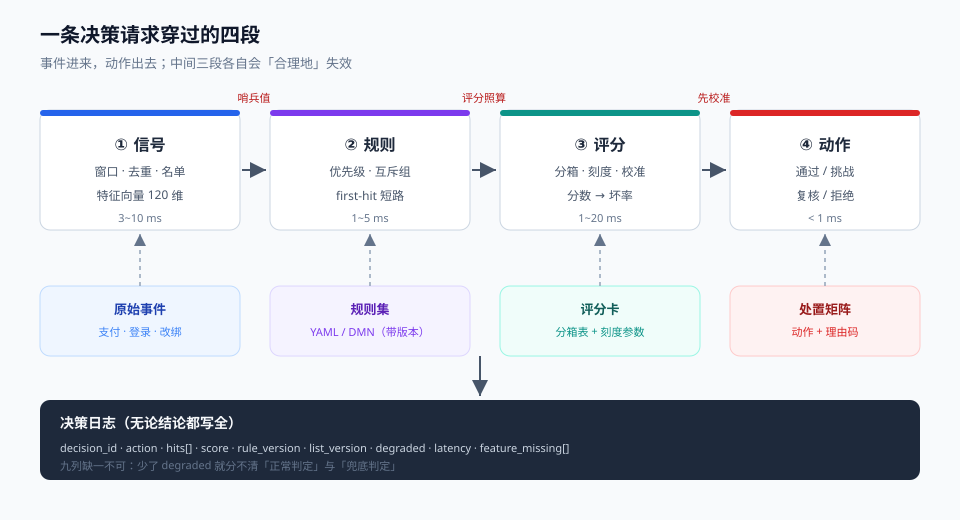

# 总览：一条决策请求穿过的四段

一次风控决策从「用户点了提交」到「订单被放行或拦下」，中间只发生四件事：**把事件变成信号（信号）→ 按业务约定判断该不该拦（规则）→ 算一个「有多像坏人」的分数（评分）→ 选一个处置力度（动作）**。这四段的失效长得完全不一样，但线上症状常常都表现为「风控不准」。

这一页给的是全局图和三个交界：哪一段该为哪一类现象负责、出了问题先看哪里、以及为什么「模型 AUC 涨了」不能作为任何一段通过验收的证据。



本页判据族 `RDO-A` ~ `RDO-H`，共 8 条。定义表见文末「本页判据」一节。

## 一、四段各管什么，各自怎么坏

| 段 | 输入 → 输出 | 常见耗时预算 | 这一段坏了的典型症状 | 对应章节 |
| --- | --- | --- | --- | --- |
| 信号 | 原始事件 + 维度 → 特征向量 | 3~10 ms（读在线存储） | 同一用户两次请求分数跳变；特征大面积落默认值 | [信号与特征](../Signals/index.md) |
| 规则 | 特征向量 → 命中集合 | 1~5 ms（80~500 条规则） | 拦截率无故涨跌；改了规则但结论没变 | [规则与决策表](../Rules/index.md) |
| 评分 | 特征向量 → 分数 / 概率 | 1~3 ms（线性）/ 5~20 ms（树模型） | 分数不可解释；分数分布整体漂移 | [评分卡](../Scorecard/index.md) |
| 动作 | 命中 + 分数 → 处置 | < 1 ms | 拦得太狠（客诉）或太松（资损）；无法申诉 | 本页第五、六节 |

**关键比例**：规则和评分不是「谁替代谁」的关系。规则管**确定性**（这条卡号今天已经挂了 7 次、这个设备指纹属于已知团伙），评分管**相似性**（这个人整体像不像历史欺诈样本）。一个只有规则的系统会在黑产换手法后集体失效；一个只有评分的系统会在**已知坏人再次出现**时给出一个「看起来还行的分数」。

一个可以自查的经验值：**把评分阈值整体下调 20%，如果拦截量涨了 30% 以上而人工复核的「真坏人占比」没变**，说明规则层几乎没在干活，全压在模型上。反过来，如果拦截面完全不动，说明评分被规则短路了（见第二节第三个交界）。

## 二、三个交界，各有一个「默认错误」

四段之间的三个交界是事故最喜欢待的地方。它们的共同点是**两段各自都正确，接起来就错**。

| 交界 | 默认错误 | 表现 | 怎么钉死 |
| --- | --- | --- | --- |
| 信号 → 规则 | 特征缺失回落成 `0` / `""` / `null`，而规则条件是「大于某值」 | 一次存储故障把整条策略线静默关掉，**没有任何报错** | 缺失必须有独立哨兵值（如 `MISSING`），规则对哨兵走「进复核」分支 |
| 规则 → 评分 | 规则命中后直接 `return REJECT`，评分根本没跑 | 决策日志里没有分数，事后无法复盘、无法调阈值 | 决策日志**无论结论如何**都要记分数与命中集合 |
| 评分 → 动作 | 分数被当成概率用（0.6 就代表 60% 是坏人） | 阈值按「概率」拍，实际通过率与预期差 3~5 倍 | 必须先做校准（分数 → 实际坏率），再按成本定阈值 |

第三条最容易被忽略：评分卡的原始输出是**odds 的对数**，不是概率。训练样本里坏人只占 0.8%，模型输出的均值天然在 0.008 附近——直接拿 0.5 当阈值，等于把「坏人比好人多」当成了前提。

## 三、一条请求的时间轴

把四段摊在时间轴上，才看得出预算该怎么分：

```text
t=0     请求到达（主体、设备、金额、场景、上下文）
t=1ms   幂等检查（decision_id 已存在 → 直接返回上次结论）
t=2ms   名单查询（黑/灰/白名单，含来源与有效期）
t=4ms   特征读取（在线存储，30 个窗口特征，批量取）
t=8ms   规则求值（按优先级短路，命中即停）
t=10ms  评分（线性评分卡 / 树模型）
t=12ms  动作编排（映射到 通过 / 挑战 / 复核 / 拒绝）
t=13ms  写决策日志（异步，失败不回滚决策）
t=14ms  返回
```

三个读法：

1. **幂等检查必须排在第一名之后**。`decision_id` 命中时直接返回，能省掉后面全部开销——重试、超时重发、上游 bug 导致的重复请求在真实流量里很常见。机制见[幂等与状态机](../../IdempotencyStateMachine/index.md)。
2. **特征读取是唯一「可以并行」的一段**。30 个窗口特征分布在 Redis / 特征平台 / 数据库时，串行 30 次往返能吃掉 30 ms；改成批量（pipeline / multi-get）通常能压到 3~5 ms。规则与评分是纯计算，**没有并行空间**。
3. **决策日志写失败不能回滚决策**。风控是旁路判定，日志写不进去是观测问题，不是业务问题——但必须打点计数，否则「日志丢了一半」会伪装成「流量掉了一半」。

## 四、四个必失点

所谓必失点，是不做就会有、而且不会报错的东西。四段各一个：

| 段 | 必失点 | 为什么会失 | 一条可执行的守卫 |
| --- | --- | --- | --- |
| 信号 | 事件重复计入窗口 | 上游至少一次投递 + 消费端没按 `event_id` 去重，1 次支付被算成 3 次 | 窗口聚合前按 `(subject, event_id)` 去重，落库时用唯一键 |
| 规则 | 互斥组漏配 | 两条规则对同一场景给出相反动作，结果取决于**规则在文件里的顺序** | 同一 `(scene, action_domain)` 只能有一个生效动作；冲突检测进 CI |
| 评分 | 分箱边界与训练不一致 | 训练用 `[0,100)`，上线用 `<=100`，边界样本全部落错箱 | 分箱定义与评分卡同源（同一个 YAML），上线前对拍 |
| 动作 | 拒绝不可撤销 | 自动拒绝写进了不可回滚的黑名单，误杀后只能人工捞 | 拒绝先落「临时拒绝 + TTL」，复核确认后才升级为长期名单 |

第四条是真实事故的常见形态：一次规则误配把 2 万个正常用户写进永久黑名单，**技术上一键回滚了规则，但名单里的人和已经发生的客诉回不去**。

## 五、动作不是二值的：四种形态与它们的代价

新手常把风控写成 `if (hit) reject else pass`。真实系统至少有四种动作，它们的代价方向完全不同：

| 动作 | 对用户 | 对黑产 | 代价 | 什么时候用 |
| --- | --- | --- | --- | --- |
| 通过（PASS） | 无感 | 放行 | 资损风险 | 证据不足，或代价低于打扰成本 |
| 挑战（CHALLENGE） | 一次额外验证（短信/人脸/支付密码） | 提高成本 | 转化率下降（通常 3~8%） | **默认答案**：不确定时加一道验证，而不是直接拒 |
| 复核（REVIEW） | 延迟（分钟~小时） | 冻结 | 人工成本 + 时效 | 金额大、链路长，可以等 |
| 拒绝（REJECT） | 直接失败 | 阻断 | 客诉 + 声誉 | 确定性证据（名单、盗卡、团伙） |

**「挑战」是风控最重要的发明**：它把「二元判断」变成了「三态 + 一次博弈」——真正的用户多花 10 秒就过去了，批量作案的脚本则要为每个账号准备一条可接收验证码的通道。定动作时先问「这一步能不能换成挑战」，再问「要不要拒」。

::: warning 说明
挑战不是免费的：它会真实地打掉一部分正常转化。所以**挑战率本身是一个需要设定上限的指标**（常见 3%~10%），超过上限时要么放宽规则，要么承认「最近黑产压力大」并同步给业务方，而不是让它悄悄涨到 40%。
:::

## 六、先问三个数，再谈模型

任何一次「风控不准」的排查，先要三个数，缺一个就不要往下走：

1. **规则命中率与命中分布**：这次拦截里，多少是名单命中、多少是规则命中、多少是评分越阈值？三者比例决定该改哪一层。
2. **特征缺失率**：这条请求用到的特征里，有多少是哨兵值？超过 5% 就先修特征，不要动规则。
3. **决策动作分布**：通过 / 挑战 / 复核 / 拒绝各占多少？与上周比变化最大的那一档，就是问题所在。

这三个数都能从决策日志里直接算，不需要重新训练、也不需要复现用户操作。**先定位段，再谈方法**——这是本专题所有章节的共同前提。

## 七、与「反欺诈业务」的边界

本专题刻意**不写**这些东西：黑产的话术与产业链、各类欺诈场景的识别经验、具体行业的监管报送口径。它们属于业务与合规团队的领域知识，更新频率高、地域差异大，写进技术文档只会迅速过期。

本专题只回答一个工程问题：**给定一批业务规则和一个模型分，怎么在几十毫秒内、可解释地、可回滚地把决策做出来，并且事后能证明它当时是对的**。

## 本页判据

| 编号 | 判据 | 看什么现象 | 不满足时改哪里 |
| --- | --- | --- | --- |
| `RDO-A` | 四段各有独立耗时与失败指标 | 监控里信号/规则/评分/动作各有 p99 与错误率 | 拆 span，别只报一个「风控接口 p99」 |
| `RDO-B` | 特征缺失有独立哨兵值 | 能找到「哨兵值占比」指标，且规则对它走复核 | 缺失不要回落 0，改为 `MISSING` 并进复核分支 |
| `RDO-C` | 决策日志无论结论都记分数与命中集合 | 抽查一条 PASS 记录，能看到分数与规则命中列表 | 日志结构里把 `score`、`hits` 设为必填 |
| `RDO-D` | 分数经过校准才当概率用 | 有「预测坏率 vs 实际坏率」的校准曲线 | 先做校准，再按成本定阈值，见[评分卡](../Scorecard/index.md) |
| `RDO-E` | 事件按 `event_id` 去重后才进窗口 | 窗口计数与源事件条数可对账 | 聚合前加去重键，落库加唯一索引 |
| `RDO-F` | 同一场景只有一个生效动作 | 冲突检测能拦住「两条规则给相反动作」 | 引入互斥组，冲突进 CI 阻断 |
| `RDO-G` | 拒绝可以先临时、再长期 | 拒绝记录带 TTL 与升级路径 | 自动拒绝落临时名单，复核确认后升级 |
| `RDO-H` | 排查先定位段 | 每次「不准」的结论能指到某一段 | 按第六节三个数走一遍，再决定改哪里 |

## 参考资料

- Apache Flink 2.3.0 发布说明（窗口与 changelog 语义）：<https://flink.apache.org/2026/06/25/apache-flink-2.3.0-release-announcement/>
- Google SRE Book, *Handling Overload* 与 *Addressing Cascading Failures*（旁路系统的降级方向）：<https://sre.google/sre-book/handling-overload/>
- Provost & Fawcett, *Data Science for Business*, Ch.8（成本敏感分类与阈值）：<https://data-science-for-biz.com/>
- NIST SP 800-63B（风险型认证：何时该加一道验证）：<https://pages.nist.gov/800-63-4/sp800-63b.html>
- OWASP Automated Threats to Web Applications（自动化威胁分类，用于对齐「挑战」的对手模型）：<https://owasp.org/www-project-automated-threats-to-web-applications/>
