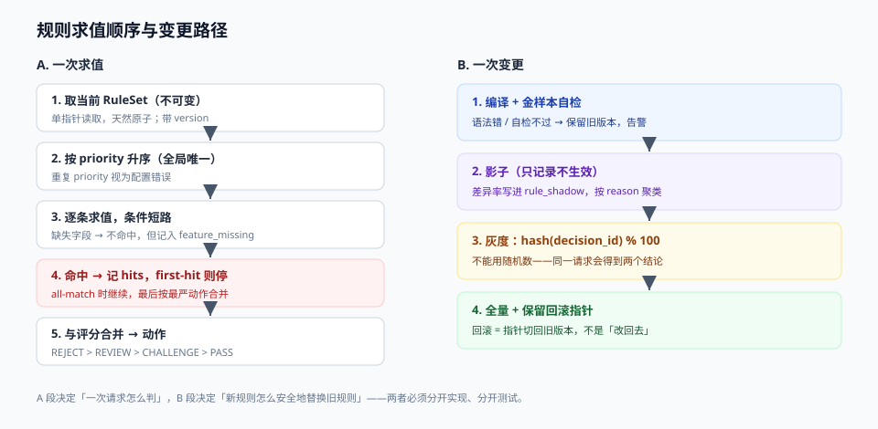
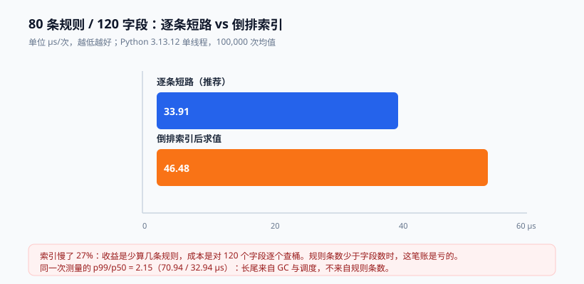

# 规则与决策表：优先级、互斥与灰度

规则是风控里唯一**能对人解释**的部分：客诉时你要说的是「因为您这张卡在今天 22:14 已失败 3 次」，而不是「模型给了 0.83 分」。所以规则系统真正的难点不是「怎么表达条件」，而是**怎么在几百条规则互相冲突时，稳定地给出唯一那个动作，并且证明它昨天给的是另一个**。

这一页讲四件事：规则怎么表达、优先级怎么定、变更怎么灰度、热更新怎么在不重启的前提下安全发生。



本页判据族 `RDR-A` ~ `RDR-H`，共 8 条。定义表见文末「本页判据」一节。

## 一、四种表达方式，各自的代价

| 方式 | 表达力 | 谁能改 | 变更成本 | 可解释性 | 适合 |
| --- | --- | --- | --- | --- | --- |
| 代码 `if` | 最强（可查库、可调模型） | 只有研发 | 发版 | 中（要读代码） | 强依赖外部状态、复杂计算 |
| YAML/JSON AST | 中（受限算子） | 研发 + 策略同学（配好编辑器） | 热更新 | 高 | **绝大多数线上规则** |
| DMN 决策表 | 中（标准表结构） | 业务方（Excel 式） | 取决于引擎 | 最高 | 多条件组合的准入/额度/定价 |
| DRL（Drools） | 强（前向推理、事实集合） | 研发 | 发版（KIE 10 起） | 中 | 推理链复杂、需要 Rete 的场景 |

::: danger 注意
**别把「业务方可以自己改规则」当成免费的收益**。放开编辑权就必然要配一整套东西：语法校验、灰度、双人复核、影子对比、回滚。缺任何一项，「业务自助」都会在下一次误配时变成一次事故。没有这套东西时，老老实实让研发改 YAML 更快。
:::

## 二、优先级：三个必须明确的语义

一段规则配置，如果下面三件事没写清，谁都说不准它会怎么执行：

```yaml
# rules/pay_risk.yaml（节选）
version: 2026.10.1
scene: PAY
rules:
  - id: R_CARD_BLACK
    group: BLOCK_LIST          # 互斥组
    priority: 10               # 数字小 = 先判
    match_all: false           # first-hit：命中即停
    when:
      - field: card_hash
        op: in_list
        args: { list: CARD_BLACK }
    action: REJECT
    reason: CARD_BLACKLIST

  - id: R_PAY_FAIL_1H
    group: BEHAVIOR
    priority: 50
    when:
      - { field: pay_fail_cnt_1h, op: gte, args: { value: 3 } }
      - { field: amount, op: gte, args: { value: 500 } }
    action: CHALLENGE
    reason: REPEATED_FAIL

  - id: R_NEW_DEVICE_BIG
    group: BEHAVIOR
    priority: 60
    when:
      - { field: device_first_seen_days, op: lte, args: { value: 1 } }
      - { field: amount, op: gte, args: { value: 3000 } }
    action: REVIEW
    reason: NEW_DEVICE_LARGE_AMOUNT
```

三件事：

1. **`first-hit` 还是 `all-match`**。`first-hit` 只返回第一条命中（性能好、结论唯一）；`all-match` 返回全部命中再按「最严动作」合并（可解释性好、便于统计）。**同一场景里只能选一种**，混用会让「为什么这条没生效」变成玄学。
2. **`priority` 相同的规则，顺序是什么**。如果引擎按文件顺序，那么「调整 YAML 里两行的位置」就是一次**无人察觉的策略变更**——这必须在规范里禁掉，或要求 `priority` 全局唯一。
3. **动作合并规则**。`REJECT > REVIEW > CHALLENGE > PASS`，但**「拒绝」不能覆盖「名单命中」的理由**（否则日志里只看到 `REJECT`，看不到是名单还是规则导致的，申诉时说不清）。

## 三、互斥组：冲突不是「谁赢」，而是「配置非法」

同一个 `(scene, 主体维度)` 下，两条规则给出相反动作，是配置错误，不是优先级问题。做法是引入**互斥组 + 动作域**：

```text
互斥检查（CI 里跑）：
  对每个 (scene, group)：
    收集所有规则的 action
    若同时存在 PASS 与 (REJECT|REVIEW|CHALLENGE) → 报错
    若同一 priority 出现两次 → 报错
    若 REJECT 规则的 when 被另一条 PASS 规则的 when 完全包含 → 告警（等价于死代码）
```

第三条是最有价值的一条：**一条永远不会被执行的规则是技术债**。它常常意味着「有人加了例外但忘了删老规则」，半年后没人敢动。

### 3.1 影子模式的默认流程

任何规则变更都走三步，缺一不可：

| 步骤 | 做什么 | 判据 |
| --- | --- | --- |
| 影子（dry-run） | 新版本对**真实流量**跑一遍，只记录不生效 | 影子结论与线上结论的差异率 < 预期改动幅度 |
| 灰度 | 按 `hash(decision_id) % 100 < pct` 分桶生效 | 灰度桶与对照桶的拦截率差在置信区间内 |
| 全量 | 灰度 24~72 小时无异常后全量 | 保留一键回滚（版本指针切回） |

影子的价值在于：**它能在不影响任何用户的前提下，告诉你这次改动会多拦多少人**。跳过影子的团队，等于每次都拿真实用户做实验。

## 四、热更新：KIE 10 移除 KieScanner 之后怎么做

Drools 进入 Apache KIE 之后，社区版的一次关键变化是：**Business Central 与 KIE Server 不在社区版内，KJAR + KieScanner 的运行时热部署被移除**。官方给出的路径是「规则变更 = 重建镜像重新发布」。

对风控这意味着：**你不能靠引擎自带的热部署，必须自己做「规则即数据」**。做法是把规则从代码里彻底剥离：

```text
规则文件（YAML/DMN）  →  对象存储 / 数据库（带版本号）
        ↓  拉取 + 校验 + 编译
   不可变 RuleSet 对象（v1, v2, ...）
        ↓  原子切换
   AtomicReference<RuleSet> current   ← 决策线程只读它
```

四条实现纪律：

1. **编译失败不许切换**。新版本编译或校验失败时，保留旧版本并告警；「切换到一个空规则集」等于关掉风控。
2. **切换必须原子**。用单个 `AtomicReference` 换引用，不要「先清空再加载」——那中间会有一个窗口期，所有规则都不生效。
3. **必须能回答「这条决策用的是哪个规则版本」**。决策日志里写 `rule_version`，否则事后无法证明当时的行为。
4. **回滚 = 切回上一个版本的引用**，不是「改回去」。改回去需要重新编译、重新发布，事故里没有这个时间。

## 五、反直觉的实测：倒排索引不一定更快

「几百条规则逐条跑太慢，按首个条件建索引」是很自然的优化直觉。本机实测的结果是反的。



| 实现 | 每次决策耗时 | 相对 |
| --- | --- | --- |
| 逐条规则、条件短路（80 条规则 / 120 字段） | **33.91 µs** | 1.00× |
| 按首条件建桶（倒排）后再求值 | **46.48 µs** | **0.73×（更慢）** |

::: info 读数口径
Python 3.13.12，单线程，100,000 次调用取均值；规则集 80 条、每条 2~4 个条件（含集合判定），事实字典 120 个字段。同一台机器上跑三次，波动 < 8%。**这是解释器层面的对照实验，不是生产压测**——JVM 上因为 JIT 与对象布局不同，绝对值会低一个数量级，但结论方向常常一致。
:::

为什么反了：索引的收益是「少算几条规则」，成本是「对 120 个字段逐个查桶」。当**规则条数 < 字段数** 时，遍历桶比遍历规则更贵；而且桶里的规则还要再做全条件校验，等于多花了一次哈希。

**可执行的结论**：

- 规则条数在**几百以内**时，逐条短路就是最优解，别做索引。
- 真正该优化的是**条件本身的成本**：`in_list` 走 Redis 往返要 0.5~1 ms，比 500 条内存规则都贵。把名单**预加载进本地缓存**（带版本号 + 定期刷新）才是数量级的收益。
- 单次 p99 / p50 的比值是 **2.15**（32.94 µs / 70.94 µs）——**长尾来自 GC 与调度，不来自规则条数**。所以对规则求值做微优化，几乎不会改善 p99。

## 六、变更审计：三张表就够

规则系统的合规成本远高于技术成本。最小可用的审计模型只有三张表：

```sql
CREATE TABLE rule_change (
  id           bigserial PRIMARY KEY,
  rule_id      text NOT NULL,
  version_from text,
  version_to   text NOT NULL,
  diff         jsonb NOT NULL,      -- 结构化 diff，不要只存文本
  author       text NOT NULL,
  reviewer     text NOT NULL,       -- 双人复核，同一个人不能兼任
  ticket       text NOT NULL,       -- 关联工单，出事后能追到「为什么改」
  applied_at   timestamptz NOT NULL DEFAULT now()
);

CREATE TABLE rule_shadow (
  batch_id     text NOT NULL,       -- 一次影子运行
  decision_id  text NOT NULL,
  old_action   text NOT NULL,
  new_action   text NOT NULL,
  diff_reason  text,
  PRIMARY KEY (batch_id, decision_id)
);

CREATE TABLE decision_log (
  decision_id  text PRIMARY KEY,
  subject_id   text NOT NULL,
  scene        text NOT NULL,
  rule_version text NOT NULL,
  hits         text[] NOT NULL,     -- 命中规则 ID 列表
  score        numeric,
  action       text NOT NULL,
  created_at   timestamptz NOT NULL DEFAULT now()
);
```

`rule_shadow` 是很多人漏掉的一张表，但它是**灰度决策的唯一证据**：没有它，「影子跑了一周没异常」这句话无法被验证，只能靠人回忆。

## 七、该写规则还是该写模型

一条经验边界：

- **能用一句话说清、且阈值有业务含义的** → 写规则。例如「同卡 1 小时内失败 ≥ 3 次且金额 ≥ 500」。
- **需要综合十几个弱信号、且信号之间是「加权」关系的** → 写评分卡/模型。
- **需要看「关系」的**（同一设备关联了多少账号、是否与已知团伙有共同邻居）→ 写图查询，规则和模型都不擅长。

三者不是替代关系：**规则负责兜底与合规，评分负责排序与分层，图负责发现团伙**。把它们混成一坨「大模型一把梭」，最先失去的是可解释性，其次是回滚能力。

## 本页判据

| 编号 | 判据 | 看什么现象 | 不满足时改哪里 |
| --- | --- | --- | --- |
| `RDR-A` | `first-hit` / `all-match` 明确且全场景一致 | 配置里有显式开关，代码里只有一条执行路径 | 统一语义，禁止混用 |
| `RDR-B` | `priority` 全局唯一或冲突可检测 | CI 能报出重复 `priority` | 改自增序号或加冲突检查 |
| `RDR-C` | 同 `(scene, group)` 动作不冲突 | CI 输出「PASS 与 REJECT 并存」为错误 | 引入互斥组与动作域 |
| `RDR-D` | 死规则可被发现 | 有「180 天 0 命中」的规则清单 | 补命中计数，季度清理 |
| `RDR-E` | 变更先影子再灰度 | 有 `rule_shadow` 表与差异率报表 | 补影子链路，灰度前必须看差异 |
| `RDR-F` | 热更新是原子切换且失败不生效 | 切换用单次引用替换，编译失败保留旧版 | 重写加载逻辑，禁止「清空再加载」 |
| `RDR-G` | 决策日志带 `rule_version` 与 `hits` | 抽查一条决策能看到版本与命中列表 | 日志结构补两列，历史无需回填 |
| `RDR-H` | 规则变更双人复核且关联工单 | `rule_change` 里 `author != reviewer`，`ticket` 非空 | 加审批流，禁止自审自批 |

## 参考资料

- Apache KIE / Drools 项目主页（10.x 的部署模型变化）：<https://kie.apache.org/>
- Drools 10 迁移要点（Business Central / KIE Server / KJAR / KieScanner）：<https://www.higson.io/blog/drools-alternatives-and-migration-guide-how-to-choose-a-path-and-move-your-rules-safely>
- OMG DMN 1.x 规范与一致性等级：<https://www.omg.org/dmn/>
- DMN TCK（技术兼容性套件，可查各引擎通过率）：<https://github.com/dmn-tck/tck>
- Martin Fowler, *RulesEngine*（规则引擎的适用边界）：<https://martinfowler.com/bliki/RulesEngine.html>
- Google SRE Workbook, *Canarying Releases*（灰度与影子流量的方法论）：<https://sre.google/workbook/canarying-releases/>
