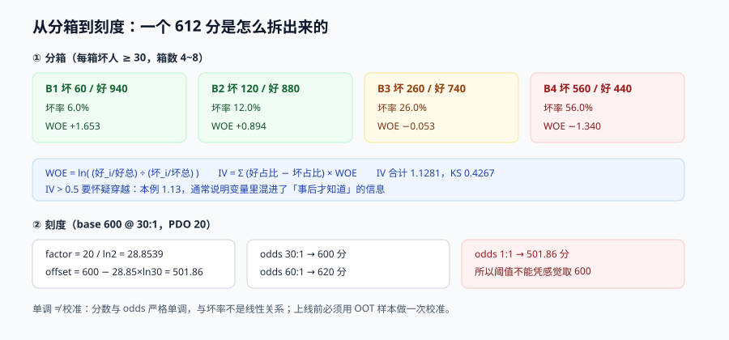
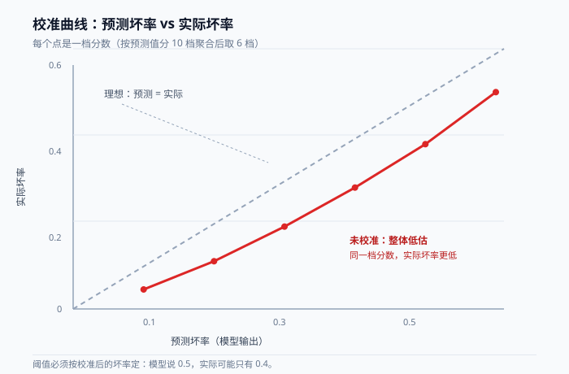

# 评分卡：WOE、刻度与校准

评分卡是风控里最「老」也最难被替换的东西。原因不是它准，而是它**能被拆开看**：一个 612 分，可以一路拆到「这张卡的历史逾期分箱贡献 -18 分、设备年限贡献 +9 分」，客诉和监管都认这个。

这一页讲清楚四件事：分箱怎么定、WOE/IV 怎么算、分数怎么落到刻度上、以及**为什么「分数单调」不等于「分数可当概率用」**。



本页判据族 `RDK-A` ~ `RDK-H`，共 8 条。定义表见文末「本页判据」一节。

## 一、分箱：先定边界，再谈模型

连续变量必须离散化，这是评分卡的代价，也是它的可解释性来源。四种常用方法：

| 方法 | 怎么切 | 优点 | 坑 |
| --- | --- | --- | --- |
| 等频（quantile） | 每箱样本数相同 | 每箱统计稳定 | 边界落在业务上没有意义的位置，且**换一批样本边界就变** |
| 等距（equal width） | 按值域均分 | 简单、边界稳定 | 长尾变量会出现「一箱 99% 样本」 |
| 卡方分箱（ChiMerge） | 合并 WOE 最接近的相邻箱 | 兼顾统计与业务 | 需要最小箱样本数约束，否则过拟合 |
| 决策树分箱 | 用树的分裂点 | 自动找非线性 | 边界依赖随机种子，不可复现 |

**风控的默认选择是「业务先验 + 卡方微调」**：先用业务经验定粗边界（如金额 `[0,100) [100,1000) [1000,5000) [5000,+)`），再用卡方合并掉样本太少的箱。纯算法分箱在风控里几乎总会切出「没有业务解释」的边界，评审时过不去。

### 1.1 三条硬约束

1. **箱数 4~8**。少了没区分度，多了每箱样本不足、WOE 不稳定。
2. **每箱坏人 ≥ 30（经验值）**。低于这个数，WOE 的方差大到可以让符号翻转。
3. **WOE 必须单调**（或至少「业务上说得通」）。非单调分箱通常意味着「这一箱混进了两类人」，需要拆箱。

## 二、WOE 与 IV：本机跑一遍

```text
WOE_i = ln( (Good_i / Good_total) / (Bad_i / Bad_total) )
IV_i  = ( Good_i/Good_total − Bad_i/Bad_total ) × WOE_i
IV    = Σ IV_i

约定：WOE 用「好坏比」，所以 WOE 越正 = 这一箱越安全
```

用一组 4 箱的样本（坏 : 好）跑一遍：

| 箱 | 坏 | 好 | 坏率 | WOE | IV 贡献 |
| --- | --- | --- | --- | --- | --- |
| B1 | 60 | 940 | 6.0% | **+1.653** | 0.4187 |
| B2 | 120 | 880 | 12.0% | **+0.894** | 0.1549 |
| B3 | 260 | 740 | 26.0% | **-0.053** | 0.0007 |
| B4 | 560 | 440 | 56.0% | **-1.340** | 0.5538 |
| 合计 | 1,000 | 3,000 | 25.0% | — | **1.1281** |

同一组样本的 **KS = 0.4267**（按分数升序累计好坏占比的最大差）。

::: info 读数口径
Python 3.13.12 直接计算，输入是上表的四箱计数，可手算复核。IV 与 KS 都是**样本内**读数——它们只说明「这个变量在这批样本上有区分度」，不说明上线后还有。
:::

读法三条：

1. **IV 的量级**：< 0.02 基本无用，0.02~0.1 弱，0.1~0.3 中，0.3~0.5 强，**> 0.5 要怀疑穿越**。本例 1.13 明显偏高——真实业务里这种变量通常已经混进了「事后信息」（比如用了催收结果当特征）。
2. **IV 高不等于好用**：IV 只衡量单变量区分度。两个 IV 都很高的变量如果高度相关，同时入模只会让系数不稳定。
3. **B3 的 IV 只有 0.0007**：这一箱几乎不提供信息，可以考虑与 B2 或 B4 合并，减少一箱、降低过拟合。

## 三、刻度：把 odds 变成分数

原始输出是 `Σ(WOE_i × β_i) + β_0`，它是 log-odds，可正可负、没有业务含义。落到分数上要两个参数：**基准分**与 **PDO（Points to Double the Odds）**。

```text
factor = PDO / ln(2)
offset = base_score − factor × ln(base_odds)

score = offset + factor × ln(odds)        # odds = 好/坏
```

取 `base=600 @ 30:1`、`PDO=20`：

| 参数 / 输入 | 值 |
| --- | --- |
| `factor` | **28.8539** |
| `offset` | **501.8622** |
| odds 30:1（基准） | **600.00** |
| odds 60:1（好坏比翻倍） | **620.00** |
| odds 1:1 | **501.86** |

三个直接可用的结论：

- **PDO=20 意味着「风险减半 = 加 20 分」**。业务方最容易理解的表述是这句话，不是「β 系数」。
- **1:1 落在 501.86**，而不是 600——基准点选在 30:1，所以「好坏各半」的人天然低于基准分。**阈值不能凭感觉取 600**。
- **分数与 odds 是严格单调的**，但**与坏率不是线性的**。`PD = 1/(1+odds)`，所以在高分段「加 20 分」带来的坏率下降远小于低分段。

## 四、校准：单调不等于可用

这是风控最常被跳过的一步。评分卡天然单调，但**它给出的分数不是概率**——训练样本里坏人只占 0.8% 时，模型的原始输出均值就会贴近 0.008，而你真正想知道的是「这个人的坏率是 0.5% 还是 5%」。



三种校准方法与它们的适用面：

| 方法 | 做法 | 适用 | 代价 |
| --- | --- | --- | --- |
| 直接换算 | `PD = 1 / (1 + exp(score − offset) / factor)` 反解 | 线性评分卡，理论上严格成立 | 前提是 WOE 与 log-odds 真的线性，实际常有偏差 |
| Platt scaling | 用验证集拟合 `1/(1+exp(A·s+B))` | 分数单调但非线性 | 需要一份**未参与训练**的样本 |
| Isotonic | 保序回归，分段常数 | 样本足够（每段 ≥ 1000） | 容易过拟合，且输出不光滑、不利于做阈值 |

**校准的验收只有一条**：把分数分成 10 档，比较「每档预测坏率均值」与「每档实际坏率」，偏差应 < 20%（相对）。超过就重做校准，不要动阈值——**动阈值只是把校准误差藏进了拦截率**。

::: danger 注意
1. **不要用训练集做校准**。训练集上的预测已经被拟合过，校准曲线天然漂亮。必须留一份时间上更晚的样本（out-of-time）。
2. **样本权重会破坏校准**。为了处理样本不均衡做了 1:10 加权，模型输出的概率就不再对应真实坏率。**加权训练的模型必须重新校准**，否则阈值全线偏移。
3. **校准会随时间漂移**。业务结构变化（新客占比上升）会让实际坏率整体下移，校准曲线整体偏离——这也是 PSI 要监控的原因。
:::

## 五、漂移：PSI 与它的误用

PSI（Population Stability Index）衡量「当前分数分布」与「建模时分布」的差异：

```text
PSI = Σ (实际占比_i − 期望占比_i) × ln(实际占比_i / 期望占比_i)
```

| PSI | 常见解读 | 风控里的动作 |
| --- | --- | --- |
| < 0.1 | 稳定 | 无需动作 |
| 0.1 ~ 0.25 | 有偏移 | 查是「业务变化」还是「特征故障」 |
| > 0.25 | 显著偏移 | **先停用该模型分**，回退到规则兜底，再排查 |

**PSI 最常见的误用是「拿它当模型效果的替代」**：PSI 只说明分布变了，不说明变好还是变坏。分布偏移可能来自「黑产换手法」（坏事），也可能来自「营销带来一批新客」（中性）。要判断好坏，还是得看**坏率与拦截率**。

另一个坑：**PSI 的分箱必须与建模时一致**。重新分箱后再算 PSI，等于换了一把尺子量身高。

## 六、评分卡还是树模型

| 维度 | 线性评分卡 | GBDT / 树模型 |
| --- | --- | --- |
| 区分度（AUC） | 中 | 高（通常 +0.02~0.05） |
| 可解释 | 每个分箱一个分数贡献 | 需要 SHAP 等事后解释 |
| 稳定性 | 高（系数不会突变） | 中（换一批样本结构会变） |
| 上线成本 | 低（一次点积） | 中（模型文件 + 特征顺序） |
| 监管接受度 | 高 | 中（需要额外解释材料） |

实务里的折中是**「评分卡做主决策 + 树模型做辅助信号」**：评分卡决定「拦不拦」，树模型分只作为一个特征或一个「加严条件」（如 `model_score > 0.9` 时把 PASS 升级为 REVIEW）。这样既拿到区分度，又保住可解释的主链路。

## 七、上线前必须做的一次对拍

分箱边界错位是评分卡最隐蔽的 bug：训练用 `amount <= 1000` 落 B2，上线写成 `amount < 1000`，边界上的样本全部换箱，而 AUC 只掉 0.001——**看不出来，但每个边界用户都被算了不一样的分数**。

对拍办法：用同一份 1,000 条样本，分别在「训练侧代码」和「服务侧代码」上算分，逐条比对。

```python
# 对拍：score_train 来自建模脚本，score_serve 来自线上服务导出的决策日志
diff = [(a, b) for a, b in zip(score_train, score_serve) if abs(a - b) > 1e-6]
assert not diff, f"边界不一致：{diff[:5]}"
```

**判据是「零差异」，不是「差异小于 1 分」**——1 分的差异就说明有两套实现，两套实现迟早会分叉。

## 本页判据

| 编号 | 判据 | 看什么现象 | 不满足时改哪里 |
| --- | --- | --- | --- |
| `RDK-A` | 分箱边界有业务解释且箱数 4~8 | 分箱表能逐箱说出「这箱是谁」 | 重做分箱，先业务后卡方 |
| `RDK-B` | 每箱坏样本 ≥ 30 | 分箱统计表里最小坏数达标 | 合并小箱，或延长采样窗口 |
| `RDK-C` | WOE 单调或非单调有解释 | 分箱表 WOE 列方向一致 | 拆/并箱，别硬拟合 |
| `RDK-D` | IV 异常高时排查穿越 | IV > 0.5 的变量有单独说明 | 回溯特征时间点，做 point-in-time 复核 |
| `RDK-E` | 分数有 `factor` / `offset` / `PDO` 三项记录 | 评分卡配置文件里三项齐全 | 补参数，写进模型卡 |
| `RDK-F` | 上线前做过校准且有 OOT 样本 | 有校准曲线与偏差表 | 用时间更晚的样本重做校准 |
| `RDK-G` | PSI 分箱与建模一致，且有动作阈值 | 监控里有 PSI 曲线与 0.25 停用线 | 固定分箱，接告警 |
| `RDK-H` | 训练侧与服务侧算分零差异 | 对拍脚本输出为空 | 统一分箱实现，服务侧不重写 |

## 参考资料

- Siddiqi, *Credit Risk Scorecards: Developing and Implementing Intelligent Credit Scoring*（分箱、WOE、刻度的经典教材）
- Thomas, Edelman & Crook, *Credit Scoring and Its Applications*（第 2 版，评分卡的统计基础）
- Niculescu-Mizil & Caruana, *Predicting Good Probabilities With Supervised Learning*（Platt / isotonic 校准）：<https://www.cs.cornell.edu/~alexn/papers/calibration.icml05.crc.rev3.pdf>
- scikit-learn `CalibratedClassifierCV` 文档（校准的实现与陷阱）：<https://scikit-learn.org/stable/modules/calibration.html>
- *Population Stability Index* 的计算与误用（PSI 原始出处综述）：<https://mwburke.github.io/data%20science/2018/04/29/population-stability-index.html>
- 中国银保监会《商业银行互联网贷款管理暂行办法》（风险模型管理与验证要求）：<https://www.gov.cn/zhengce/zhengceku/2020-07/17/content_5527683.htm>
