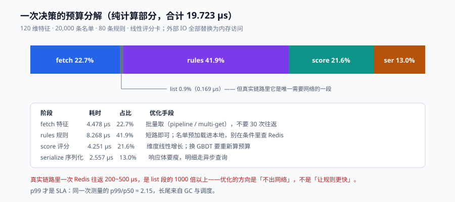

# 在线服务：预算、热更新与降级

风控服务是典型的**同步旁路**：它在支付链路上，用户必须等它返回。这意味着它同时背两个锅——**慢了就是转化率下降，挂了就是业务停摆**。而它的正确性又依赖于一堆外部系统（名单、特征平台、模型服务），任何一个抖动都会传导到主链路。

这一页讲四件事：钱花在哪（预算分解）、规则怎么换（热更新）、坏了怎么办（降级方向）、以及怎么保证「同一个请求问两次，答案一样」。



本页判据族 `RDV-A` ~ `RDV-H`，共 8 条。定义表见文末「本页判据」一节。

## 一、预算分解：钱到底花在哪

「风控接口 30 ms」这个数没有意义，除非你知道里面每一段花了多少。把一次决策拆成五段实测：

| 阶段 | 做什么 | 耗时 | 占比 |
| --- | --- | --- | --- |
| `fetch` | 从在线存储取 120 维特征 | **4.478 µs** | 22.7% |
| `list` | 3 次名单命中判定（内存 set） | **0.169 µs** | **0.9%** |
| `rules` | 80 条规则 × 3 条件，全表扫描 | **8.268 µs** | **41.9%** |
| `score` | 120 维点积 + sigmoid | **4.251 µs** | 21.6% |
| `serialize` | 结果组装 + JSON 序列化 | **2.557 µs** | 13.0% |
| **合计** | — | **19.723 µs** | 100% |

::: info 读数口径
Python 3.13.12，单线程，50,000 次循环取均值；特征 120 维（内存字典）、名单 20,000 条（内存 set）、规则 80 条（每条 3 条件）、模型为线性评分卡。**所有外部 IO 都被替换成内存访问**——这正是本节要看的：纯计算部分的相对占比。真实链路里网络往返会把总量放大 10~100 倍，但**各段的比例关系会保留**。
:::

三个读法：

1. **`rules` 是最大单项（41.9%）**，但它只有 8.3 µs。真正贵的是「去 Redis 查一次名单」——一次往返 200~500 µs，是 `list` 段（0.169 µs）的 **1000 倍以上**。所以**优化方向不是让规则更快，而是让名单不出网络**。
2. **`serialize` 占 13% 很容易被忽略**。当响应体里有十几个字段、包含数组时，序列化能吃掉 2~5 ms（含反射/对象映射），比整个决策逻辑都贵。**响应体要瘦**：只返回决策必需字段，明细走异步查询。
3. **`score` 的 21.6% 说明「模型越大越贵」是线性的**。120 维点积 4.25 µs，1000 维就是 35 µs；如果换 GBDT（几百棵树），单次 200~800 µs，**直接吃掉一半预算**。所以「上复杂模型」必须先确认预算。

### 1.1 预算怎么切

| 环节 | 预算（典型） | 超了怎么办 |
| --- | --- | --- |
| 网关 + 网络 | 2~5 ms | 同机房部署、长连接 |
| 幂等检查 | < 1 ms | 本地缓存 + Redis |
| 特征读取 | 3~8 ms | 批量取、加超时、缺失走哨兵 |
| 规则 + 评分 | 1~5 ms | 规则短路、模型降级 |
| 日志与序列化 | 1~3 ms | 异步写、瘦响应 |
| **总计** | **15~25 ms（p99）** | 超过 40 ms 触发降级 |

**p99 是唯一该写进 SLA 的数**。p50 好看没有意义——用户遇到的慢，永远是长尾那一次。

## 二、并行：只有一段能并行

```python
import asyncio

async def decide(ctx):
    # 名单与特征互不依赖，可以并行
    list_task = asyncio.create_task(load_lists(ctx))     # 2 次批量查询
    feat_task = asyncio.create_task(load_features(ctx))  # 1 次批量查询
    lists, feats = await asyncio.gather(list_task, feat_task)

    # 规则与评分是纯计算，串行，没有并行空间
    hits = engine.evaluate(feats, lists)
    score = model.score(feats)
    return compose(hits, score, feats)
```

两个关键点：

- **`gather` 之后 p99 由最慢的那一路决定**。并行不是「变快」，是**把「串行之和」变成「最大值」**——同时也把「一段慢」变成「整体慢」。
- **每一次 `await` 都必须带超时**。没有超时的 `gather` 等于把风控的可用性绑在最慢的依赖上：

```python
lists, feats = await asyncio.wait_for(
    asyncio.gather(list_task, feat_task), timeout=0.008
)  # 8 ms 硬超时；超时走降级分支，不是抛 500
```

## 三、热更新：单指针原子切换

规则、名单、模型都要能换，但不能重启进程。唯一安全的模式是**不可变对象 + 单次引用替换**：

```python
from dataclasses import dataclass

@dataclass(frozen=True)
class Runtime:
    rule_set: object
    model: object
    list_snapshot: object
    version: str

class RuntimeHolder:
    def __init__(self, rt: Runtime):
        self._rt = rt

    @property
    def current(self) -> Runtime:
        return self._rt          # 单次读，天然原子

    def swap(self, rt: Runtime) -> None:
        self._rt = rt            # 单次写，决策线程不会看到「半个新版本」

    def reload(self, compile_fn) -> None:
        try:
            rt = compile_fn()    # 编译 + 校验 + 自检
        except Exception:
            metrics.inc("risk_reload_failed")   # 保留旧版本，告警
            return
        self.swap(rt)
```

四条纪律：

1. **`compile_fn` 必须先跑一组「金样本」自检**（历史决策 + 期望动作），全绿才允许切换。这是热更新唯一的安全网。
2. **切换后必须打点 `version`**，并在决策日志里落这一列——否则事故复盘时无法区分「改之前」和「改之后」。
3. **不要做「增量修改规则集」**。可变对象在多线程下必然出现「读到一半」的状态，而风控的 bug 一旦出现就是错判。
4. **KIE 10 之后没有 KieScanner**（见[规则与决策表](../Rules/index.md)），这套「规则即数据 + 进程内编译」不是可选优化，而是唯一路径。

## 四、降级：先定方向，再写代码

降级最容易犯的错是「所有依赖一视同仁地 fail-open」。正确的做法是**按依赖的性质分方向**：

| 依赖 | 不可用时 | 方向 | 理由 |
| --- | --- | --- | --- |
| 黑名单 | 读不到 | **fail-closed**（进复核/挑战） | 名单是确定性证据，读不到等于失去最强守卫 |
| 灰名单 | 读不到 | fail-open（放行） | 灰名单只是「加严提示」，误拦代价高 |
| 历史特征 | 超时 | **进复核**（哨兵值） | 缺失即不确定，不确定交给人 |
| 模型服务 | 超时/5xx | fail-open 到 **规则档** | 规则仍能兜住已知手法 |
| 决策日志 | 写失败 | 继续决策 + 本地缓冲 | 观测问题不该变成业务问题 |
| 配置中心 | 不可用 | 用**本地最后一版** | 启动时就把配置固化到磁盘 |

```python
def decide_with_degrade(ctx):
    try:
        feats = fetch_features(ctx, timeout_ms=8)
    except TimeoutError:
        feats = None                      # → 哨兵值，规则走复核
    try:
        score = model.score(feats) if feats else None
    except Exception:
        score = None                      # → 规则档
    hits = rules.evaluate(feats, lists_snapshot)
    return compose(hits, score, degraded=feats is None or score is None)
```

`degraded` 这个标志必须**透传到响应头和日志**。没有它，「降级运行了三天」会完全隐形——指标看起来一切正常，只是拦截率莫名其妙低了 40%。

::: danger 注意
1. **不要让降级逻辑自己再依赖远程服务**。降级路径里再查一次配置中心，等于把两个故障点串起来。
2. **降级要有上限时长**。允许「规则档运行 10 分钟」，不允许「运行一周」——超过就要人工介入，否则规则档会变成事实上的常态。
3. **降级必须能被演练**。定期注入「特征超时」，看降级是否真的生效、`degraded` 是否真的上报。没演练过的降级路径，第一次运行就是在事故里。
:::

## 五、幂等与「同请求同结论」

风控决策必须是幂等的：同一个 `decision_id` 重放，必须返回**同一个结论**，不能因为「这次名单多了一条」而改变。

```sql
CREATE TABLE decision_result (
  decision_id  text PRIMARY KEY,
  subject_id   text NOT NULL,
  scene        text NOT NULL,
  action       text NOT NULL,
  score        numeric,
  hits         text[],
  rule_version text NOT NULL,
  degraded     boolean NOT NULL DEFAULT false,
  created_at   timestamptz NOT NULL DEFAULT now(),
  expire_at    timestamptz NOT NULL DEFAULT now() + interval '24 hours'
);
```

- **写入用 `INSERT ... ON CONFLICT DO NOTHING`，读取先于计算**。先算再写的竞态会让两个并发请求各算一次、写两次。
- **TTL 24 小时**。永久幂等会把「昨天的名单」永远固化，等于风控停止更新。
- **`degraded=true` 的决策允许被重算**（可选策略）：降级期间的结论质量低，重试时若依赖恢复，允许覆盖。这条要写进契约，别让调用方猜。

### 5.1 抖动：同一用户两次请求结论不同

这是最常被投诉的现象，原因通常有三个，按概率排序：

1. **特征来自不同快照**（一次读到旧窗口，一次读到新窗口）→ 用同一 `decision_id` 绑定同一快照版本。
2. **名单本地缓存与远端不一致**（节点之间刷新时间不同）→ 名单快照带版本号，决策日志记录版本。
3. **随机化分流**（A/B 或灰度按 `random()` 分桶）→ 分桶必须用 `hash(decision_id)`，不能用随机数。

## 六、可观测：决策日志的必填字段

| 字段 | 为什么必须 |
| --- | --- |
| `decision_id` | 幂等键与全链路追踪的锚点 |
| `subject_id` / `scene` | 聚合分析的两个基本维度 |
| `action` | 通过率/拦截率的唯一来源 |
| `hits[]` | 解释「为什么拦」，客诉与复盘都靠它 |
| `score` + `score_bucket` | 阈值调整与校准分析的输入 |
| `rule_version` / `list_version` / `model_version` | 事故归因的三个坐标 |
| `degraded` | 区分「正常判定」与「兜底判定」 |
| `latency_ms` + 分段耗时 | 预算分析的唯一数据 |
| `feature_missing[]` | 缺失率与静默失效的发现手段 |

**九列缺一不可**。尤其是 `degraded` 和 `feature_missing`——它们不产生业务影响，但决定了你能不能在下一次事故里 5 分钟定位、而不是 5 小时。

## 本页判据

| 编号 | 判据 | 看什么现象 | 不满足时改哪里 |
| --- | --- | --- | --- |
| `RDV-A` | 有分段耗时且 p99 进 SLA | 监控能按 fetch/list/rules/score 拆 p99 | 加 span，别只报总耗时 |
| `RDV-B` | 每次远程调用都有超时 | 代码里不存在无超时的 `await` / client 调用 | 补超时，默认 8 ms 量级 |
| `RDV-C` | 热更新是单引用原子切换 | 只有一处 `self._rt = rt`，无「清空再加载」 | 重写加载逻辑 |
| `RDV-D` | 切换前跑金样本自检 | 加载流程里有自检步骤与失败计数 | 补金样本集与自检 |
| `RDV-E` | 降级方向按依赖性质定义 | 有一张依赖 → 方向的表，代码与表一致 | 补表，禁止全部 fail-open |
| `RDV-F` | `degraded` 透传到响应与日志 | 响应头与日志都有该字段 | 补字段，接告警 |
| `RDV-G` | 决策幂等且有 TTL | `decision_result` 有主键与 `expire_at` | 补表，先读后算 |
| `RDV-H` | 决策日志九列齐全 | 抽查一条记录，九个字段都在 | 补列，缺失字段设为必填 |

## 参考资料

- Google SRE Book, *Handling Overload* / *Addressing Cascading Failures*：<https://sre.google/sre-book/handling-overload/>
- Google SRE Workbook, *Implementing SLOs*（p99 与错误预算）：<https://sre.google/workbook/implementing-slos/>
- Nygard, *Release It!*（断路器、舱壁与超时模式）
- Apache KIE / Drools 10 部署模型变化：<https://kie.apache.org/>
- OpenTelemetry 语义约定（`http.server.request.duration` 等指标命名）：<https://opentelemetry.io/docs/specs/semconv/>
- 本库[幂等与状态机](../../IdempotencyStateMachine/index.md)、[分布式缓存](../../DistributedCache/index.md)：幂等键设计与名单缓存的具体机制
