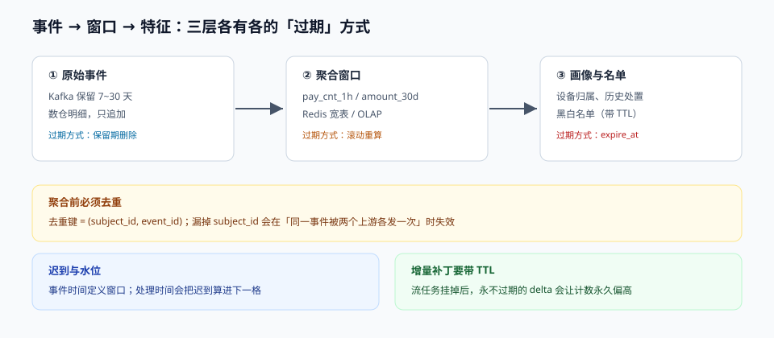

# 信号与特征：窗口、去重与时间旅行

规则和模型都不会自己「看到」用户，它们只看到特征。特征错一位，后面全错——而且**错得安静**：不会抛异常，只会让拦截率在某个周二下午悄悄翻倍。

这一页讲三件事：事件怎么变成窗口（聚合口径）、窗口怎么变成可用的特征（去重、迟到、缺失），以及训练和服务怎么保证看到的是**同一个时刻的数**（时间旅行）。



本页判据族 `RDS-A` ~ `RDS-H`，共 8 条。定义表见文末「本页判据」一节。

## 一、三层结构：事件、聚合、画像

| 层 | 内容 | 存储 | 更新方式 | 典型延迟 |
| --- | --- | --- | --- | --- |
| 原始事件 | 一笔支付、一次登录、一次改绑 | Kafka（保留 7~30 天）+ 数仓明细 | 追加写，永不更新 | 秒级 |
| 聚合窗口 | `pay_cnt_1h`、`fail_cnt_24h`、`amount_sum_30d` | Redis / 宽表 / OLAP | 流式增量 + 定时回补 | 秒~分钟 |
| 画像与名单 | 设备归属、历史处置、黑白名单 | KV + 关系表 | 批量 + 实时写入 | 分钟~小时 |

三层各有各的「过期」方式：原始事件靠保留期，聚合窗口靠滚动重算，画像靠 TTL。**决策时读到的是哪一层、它有多旧，必须写在特征定义里**——而不是靠工程师记忆。

## 二、窗口：三个必须写死的口径

同一个「1 小时失败次数」，三种实现能给出三个不同的数：

1. **滚动窗口（tumbling）**：`[10:00, 11:00)`，按整点切。优点是结果稳定、可缓存；缺点是**跨边界的两笔失败永远不会被同时看到**——10:59 和 11:01 各失败 3 次，两次都不触发「1 小时 5 次」。
2. **滑动窗口（sliding）**：以当前时刻为右端点，往前推 1 小时。风控用这个——它回答的是「**此刻**过去一小时」。
3. **会话窗口（session）**：按行为间隔切分。适合作弊脚本的「一次性批量操作」，不适合计数类规则。

::: danger 注意
1. **不要用「按天分区表的当日累计」冒充 1 小时窗口**。前者在 00:00 会把计数清零，攻击者只需要等到零点。
2. **窗口右端点必须是事件时间还是处理时间，要写清楚**。按处理时间算，迟到 5 分钟的事件会被算进「下一小时」；按事件时间算，需要一个水位（watermark）来界定「还会不会再来」。
3. **时区**。业务口径的「当日」是 `Asia/Shanghai`，而数据库 `date_trunc` 默认按 UTC——差 8 小时，等于把风控最活跃的凌晨时段算到了前一天。
:::

### 2.1 Flink SQL 里的写法（2.3）

```sql
-- 按事件时间去重 + 1 小时滑动窗口计数
CREATE VIEW pay_dedup AS
SELECT *
FROM (
  SELECT *,
         ROW_NUMBER() OVER (PARTITION BY subject_id, event_id ORDER BY event_time) AS rn
  FROM pay_events
) WHERE rn = 1;

CREATE VIEW pay_cnt_1h AS
SELECT
  subject_id,
  window_start,
  window_end,
  COUNT(*) AS pay_cnt_1h,
  SUM(amount) AS amount_sum_1h
FROM TABLE(
  HOP(TABLE pay_dedup, DESCRIPTOR(event_time), INTERVAL '5' MINUTE, INTERVAL '1' HOUR)
)
GROUP BY subject_id, window_start, window_end;
```

两个细节：

- **去重必须发生在聚合之前**，且去重键要包含 `subject_id`。只说 `event_id` 会在「同一笔事件被两个上游系统各发一次」时失效。
- **`HOP` 的滑动步长决定写入放大**。步长 5 分钟、窗口 1 小时 = 每条事件写 12 个窗口；步长 1 分钟就是 60 个。风控常见做法是**步长 5 分钟 + 决策时用「最近一个已闭合窗口 + 实时增量」补齐**，否则窗口延迟本身就是误判来源。
- Flink 2.x 起 SQL 引擎有变化（2.3 新增 `FROM_CHANGELOG`/`TO_CHANGELOG`），1.20 时代的写法不要直接搬，升级前按 2.3 文档核对一遍。

### 2.2 决策时读窗口的三种方法

```python
# 方法 A：读最近闭合窗口（最简单，最多旧 5 分钟）
cnt = redis.hget(f"w:{subject_id}", "pay_cnt_1h")

# 方法 B：闭合窗口 + 实时增量（推荐）
base = redis.hget(f"w:{subject_id}", "pay_cnt_1h") or 0
delta = redis.get(f"d:{subject_id}:pay_cnt_1h") or 0     # 由流任务写，带 90s TTL
cnt = int(base) + int(delta)

# 方法 C：直接查明细（最准，最慢，只用于大额复核）
# SELECT count(*) FROM pay_events WHERE subject_id=%s AND event_time > now() - interval '1 hour'
```

方法 B 的 `delta` 必须带 TTL：流任务挂掉时，`delta` 会停止更新，如果它永不过期，一个挂掉的增量会让计数**永久偏高**，把整条规则变成常态拦截。

## 三、去重与乱序：至少一次投递的代价

Kafka 的语义是「至少一次」，所以消费端一定会看到重复。重复的代价不是「多算一次」，而是**规则被误触发**：

| 场景 | 不去重的后果 | 正确做法 |
| --- | --- | --- |
| 支付成功事件重复 3 次 | `pay_cnt_1h` 从 1 变 3，触发「短时多次支付」规则 | 按 `(subject_id, event_id)` 去重 |
| 上游重放 1 小时数据 | 窗口计数瞬间翻倍，批量误杀 | 消费端按 `event_id` 幂等写 + 处理位点与数据版本对齐 |
| 同一订单的状态变更事件乱序 | 「先看到退款、后看到支付」，退款金额大于支付金额 | 按 `(order_id, seq)` 排序，或以 `event_time` + 版本号做最后写赢 |

::: tip 提示
**「窗口计数」和「明细条数」必须能对上账**。每天跑一次「窗口值 vs 明细 count」的差集，是发现去重失效最省事的办法——它不需要任何额外埋点，只需要一条 SQL。
:::

## 四、名单：三条元数据比名单本身更重要

黑名单是最古老的风控手段，也是最容易腐坏的手段。一条可用的名单记录至少要有：

```sql
CREATE TABLE risk_list (
  list_type     text NOT NULL,          -- BLACK / GREY / WHITE
  dimension     text NOT NULL,          -- CARD / DEVICE / PHONE / IP / ACCOUNT
  value_hash    bytea NOT NULL,         -- 存哈希不存明文
  source        text NOT NULL,          -- RULE / MANUAL / PARTNER / MODEL
  reason_code   text NOT NULL,
  created_at    timestamptz NOT NULL DEFAULT now(),
  expire_at     timestamptz NOT NULL,   -- 必须有值，不允许 NULL
  hit_count     bigint NOT NULL DEFAULT 0,
  last_hit_at   timestamptz,
  PRIMARY KEY (list_type, dimension, value_hash)
);
CREATE INDEX ON risk_list (expire_at);
```

四条约定的理由：

1. **`expire_at` 不允许 NULL**。没有失效时间的黑名单，三年后还在拦已经不存在的卡号。经验值：人工确认的欺诈卡 90~180 天，设备指纹 30~90 天，IP 段 7~30 天。
2. **`source` 决定申诉路径**。`PARTNER`（合作方同步）来的名单误杀时，你连自己为什么拦都说不清，必须能回溯到同步批次。
3. **`hit_count` 是名单质量的度量**。一条 180 天内 0 命中的黑名单，大概率是垃圾；一条命中率异常高的名单，大概率是**规则写得太宽**，把正常用户也扫进去了。
4. **`value_hash` 而不是明文**。名单本身就是高敏数据，泄露等于给黑产一份「哪些卡已被标记」的答案。

白名单是另一个坑：**白名单必须有到期时间和审批人**，否则它会变成内部人放行通道——出事时查不到是谁加的。

## 五、时间旅行：训练和服务看到同一个数

模型训练用的是历史快照，线上用的是当下值。如果训练时用了「该用户未来 30 天的累计消费」，模型离线 AUC 会很漂亮，上线后直接失效——这个错误叫**穿越（leakage）**。

正确的做法是 **point-in-time join**：按「标签发生时刻」取当时可得的最新特征值，而不是取「表里最新的一行」。

```python
# Feast 0.67：按实体行的时间戳取当时的值（不是最新值）
training_df = store.get_historical_features(
    entity_df=labels[["subject_id", "label_time"]],
    features=[
        "subject_stats:pay_cnt_1h",
        "subject_stats:amount_sum_30d",
        "device_stats:account_cnt_7d",
    ],
).to_df()
```

三个注意点：

- **`entity_df` 的时间列必须是「决策时刻」**，不是「标签产生时刻」。用退款时间做 join 会把退款之后的特征带进来。
- **TTL 决定「多久以前的值算缺失」**。`amount_sum_30d` 的 TTL 设成 7 天，等于训练时一半样本是缺失值，而线上几乎不缺失——训练/服务分布直接错位。
- **Feast 0.65 起 `total_timeout_ms` 改名为 `batch_total_timeout_ms`**，升级时配置文件不改会启动失败；这不是语义变化，但会让「昨天还能跑」的训练任务今天报错。

## 六、缺失：唯一正确的默认值是「不知道」

```python
SENTINEL = "MISSING"

def feat_int(name: str, value):
    return int(value) if value is not None else SENTINEL

# 规则里显式区分「缺失」与「等于 0」
# 反例：if feat("amount_sum_30d", v) > 5000:   # 缺失时 v=SENTINEL → TypeError 或静默 False
def rule_large_amount(f: dict) -> str:
    v = f.get("amount_sum_30d")
    if v is None or v == SENTINEL:
        return "REVIEW"      # 不知道 → 交给人
    return "HIT" if v > 5000 else "MISS"
```

为什么不能回落成 `0`：`0` 在业务上是一个**合法且常见**的值（新用户、没消费过的卡），所以「缺失」和「真实的 0」在被规则消费时无法区分。回落 `0` 会让「大于阈值」类规则**永不命中**，等于把这条策略静默关掉；而「小于阈值」类规则会**全部命中**，等于把所有人拦下来。两个方向都是灾难。

## 七、一份可用的特征定义清单

| 字段 | 为什么必须有 |
| --- | --- |
| `name` / `version` | 同名不同口径的特征是事故之源，必须有版本 |
| `window` + `timezone` | 「1 小时」是滑动还是滚动、按哪个时区算 |
| `aggregation` | `count` / `sum` / `distinct` / `max`，`distinct` 要写清去重键 |
| `source_topic` / `source_table` | 出问题时能回溯到哪份数据 |
| `freshness_sla` | 承诺的最大延迟，超过就要降级 |
| `missing_policy` | 缺失时走 `REVIEW` 还是 `PASS`，写死，不靠默认值 |
| `owner` | 谁负责口径变更，没有 owner 的特征会自己长歪 |

## 本页判据

| 编号 | 判据 | 看什么现象 | 不满足时改哪里 |
| --- | --- | --- | --- |
| `RDS-A` | 窗口口径写死在特征定义里 | 定义里有 `window`、滑动/滚动、时区三项 | 补定义字段，禁止「口头约定」 |
| `RDS-B` | 去重键包含主体维度 | 聚合前去重键是 `(subject_id, event_id)` | 修正去重键，并补唯一索引 |
| `RDS-C` | 窗口值与明细条数可对账 | 每天有一条 SQL 输出差集，且差集为 0 | 补对账任务，差集进日报 |
| `RDS-D` | 增量补丁有 TTL | 实时 `delta` 键带 ≤ 90s 过期 | 加 TTL，防流任务挂掉后计数永久偏高 |
| `RDS-E` | 名单必须有 `expire_at` 与 `source` | 表结构里两列 `NOT NULL` | 补列并回填历史数据 |
| `RDS-F` | 白名单有到期时间与审批人 | 白名单记录带 `expire_at`、`approved_by` | 补审批字段，季度清理 |
| `RDS-G` | 训练用 point-in-time join | `entity_df` 时间列是决策时刻 | 改用 `get_historical_features`，禁用「取最新一行」 |
| `RDS-H` | 缺失用哨兵值且规则显式分支 | 代码里能搜到 `MISSING` 常量与分支 | 替换所有 `or 0` / `or ""` 写法 |

## 参考资料

- Apache Flink 2.3.0 发布说明（窗口、changelog 转换）：<https://flink.apache.org/2026/06/25/apache-flink-2.3.0-release-announcement/>
- Flink SQL `HOP` / `CUMULATE` 窗口聚合文档：<https://nightlies.apache.org/flink/flink-docs-release-2.3/docs/dev/table/sql/queries/window-agg/>
- Feast 文档（point-in-time join 与 online/offline store）：<https://docs.feast.dev/>
- Kafka 4.x KRaft 模式与投递语义：<https://kafka.apache.org/documentation/>
- Akidau et al., *The Dataflow Model*（事件时间、水位与迟到数据的原始论文）：<https://research.google/pubs/pub43864/>
- 《反电信网络诈骗法》第二十九条（风险核查与处置留痕）：<https://www.gov.cn/xinwen/2022-09/03/content_5707885.htm>
