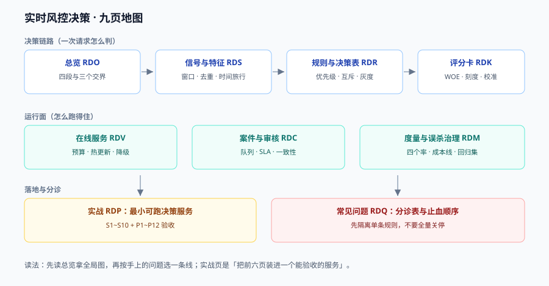

# 实时风控决策

风控系统的核心矛盾很直白：**它必须在 50 毫秒内对一个它看不全的人做判断，而且判错的两种代价方向相反**——放过了骗子是资损，拦住了正常人是体验与收入。更麻烦的是这两种代价不同步：资损当天就体现在账上，误杀要等客诉、退款、舆情才慢慢显形。

本专题讲**决策链路本身**：一条请求从事件信号到最终动作要过哪四段、每段的失效长什么样、以及怎么用可复跑的读数把「这次规则改得对不对」钉下来。模型怎么训练、特征怎么造，只在解释失效原因时点到。

::: tip 一句话理解
风控 = **信号**（数对不对）+ **规则**（该不该拦）+ **评分**（有多像）+ **动作**（拦到什么程度）。四段里任何一段没有判据，另外三段的调优都会变成「今天拦截率高、明天客诉率高」的拉锯。
:::

::: info 本专题与相邻专题的分工
- **反欺诈的业务侧（场景、话术、黑产画像）** → 本专题只讲工程链路；业务规则从哪来，属于业务团队输入，不在库内展开。
- **秒杀与高并发的库存护栏** → [高并发与隔离](../HighConcurrency/Isolation/index.md)：那边用唯一约束与隔离级别防超卖，本专题用规则与评分防「同一个人刷 500 单」——**一个是物理约束，一个是概率判断，不能互相替代**。
- **状态机与幂等** → [幂等与状态机](../IdempotencyStateMachine/index.md)：风控决策本身必须幂等（同一 `decision_id` 重放不得改变结论），机制那边讲。
- **账务与对账** → [复式记账与清结算](../Ledger/index.md)：资损的最终口径在那里定义，本专题只负责「决策时刻拦没拦住」。
- **缓存与分布式锁** → [分布式缓存](../DistributedCache/index.md)：名单与计数器的存储选型在那里，本专题只讲「名单过期了会怎样」。
- **模型与排序** → [推荐系统工程](../RecommenderSystems/index.md)：评分卡的统计口径与那边同源（AUC、校准、PSI），但**风控的分数必须能解释到分箱**，这是硬差别。
- **项目侧的订单链路** → [EventOrderHub 项目总览](../../../project/Complete/EventOrderHub/index.md)：下单、支付、履约的守卫在项目页，本专题提供它们背后的决策层。
:::

## 目录

- [总览：一条决策请求穿过的四段](Overview/index.md)
- [信号与特征：窗口、去重与时间旅行](Signals/index.md)
- [规则与决策表：优先级、互斥与灰度](Rules/index.md)
- [评分卡：WOE、刻度与校准](Scorecard/index.md)
- [案件与人工审核：队列、SLA 与回流](CaseReview/index.md)
- [度量与误杀治理：四个率与一条成本线](Metrics/index.md)
- [在线服务：预算、热更新与降级](Serving/index.md)
- [实战：一个能跑起来的最小决策服务](Practice/index.md)
- [常见问题与分诊](FAQ/index.md)

## 专题地图

## 判据纪律

沿用全库写法：**每页 8 条，编号形如 `RDO-A`**，逐页前缀唯一，可被 `utils/audit` 下的判据类巡检机械核对。每条判据回答四件事：**看什么现象、判成什么、不满足时改哪里**。

| 页 | 判据族 | 这一族管什么 | 条数 |
| --- | --- | --- | --- |
| 总览 | `RDO-A` ~ `RDO-H` | 四段链路、三个交界、四个必失点 | 8 |
| 信号与特征 | `RDS-A` ~ `RDS-H` | 窗口口径、去重、时间旅行、名单时效 | 8 |
| 规则与决策表 | `RDR-A` ~ `RDR-H` | 优先级、互斥、first-hit、灰度、版本 | 8 |
| 评分卡 | `RDK-A` ~ `RDK-H` | 分箱、WOE/IV、刻度、校准、漂移 | 8 |
| 案件与审核 | `RDC-A` ~ `RDC-H` | 队列分层、SLA、双人一致性、标注回流 | 8 |
| 度量与误杀 | `RDM-A` ~ `RDM-H` | 四个率、成本线、阈值移动、对抗 | 8 |
| 在线服务 | `RDV-A` ~ `RDV-H` | 预算分解、热更新、降级方向、幂等 | 8 |
| 实战 | `RDP-A` ~ `RDP-H` | 端到端验收、可观测、交付物 | 8 |
| 常见问题 | `RDQ-A` ~ `RDQ-H` | 分诊表、误判、止血顺序 | 8 |

合计 **9 族 72 条**。

## 事实与规格速览（2026-10 口径）

风控不像框架那样有清晰的「大版本」，但下面这些事实会直接影响选型与合规，写清楚以免被旧文误导：

| 事项 | 现状 | 对决策链路的影响 |
| --- | --- | --- |
| 规则引擎 | Drools 进入 **Apache KIE（incubating）**，社区版 **10.2.0**（2026-03/04） | Java 17+；**Business Central 与 KIE Server 已不在社区版**，KJAR + KieScanner 热部署被移除——规则变更等于**重建镜像重新发布**，热更新必须自己做 |
| 规则热更新 | 社区版不再提供运行时 KJAR 扫描 | 决策表以数据（YAML/JSON/DMN 文件）形式落库，进程内编译 + 版本指针切换，见[规则与决策表](Rules/index.md) |
| DMN 一致性 | Apache KIE 10.2.0 通过 DMN TCK **3388/3391** | 用 DMN 时先跑一遍 TCK 里的失败项，别假设「标准」等于「全支持」 |
| 流式聚合 | Apache Flink **2.3.0**（2026-06-25） | 窗口与水位语义按 2.3 文档写；2.x 起 `Table` API 与 SQL 有变化，1.20 的写法不能直接搬 |
| 消息与缓存 | Kafka 4.2.x（KRaft，无 ZooKeeper）、Redis 8.2 | 事件流至少一次 → 消费端必须按 `event_id` 幂等，见[信号与特征](Signals/index.md) |
| 特征平台 | Feast **0.67.0**（2026-10-13） | 训练/服务同源；`0.65` 起 `total_timeout_ms` 改名 `batch_total_timeout_ms`，升级要改配置 |
| 活体与生物识别 | ISO/IEC 30107-3:**2023**（第 2 版，2023-01-10） | 报 APCER / BPCER 两个数；**iBeta 的 Level 1/2/3 是测试档位，不是 ISO 定义的等级**，别在合规材料里混写 |
| 反诈合规 | 《反电信网络诈骗法》2022-12-01 施行 | 「风险核查」与「处置」要有留痕与申诉通道，见[案件与人工审核](CaseReview/index.md) |

## 为什么这里没有版本目录

本专题**不建 `v1/` `v2/` 这类版本目录**，理由三条：

1. **换代的是引擎，不是判据**。从 Drools 7 到 Apache KIE 10，换掉的是「规则怎么部署」，而「优先级冲突怎么判」「互斥组漏了会怎样」「灰度按什么分桶」这三类问题一字未变。判据跟着问题走，不跟着引擎走。
2. **并存差异是选型，不是代际**。同一时期里，有人用 DMN 决策表、有人用 YAML 规则树、有人直接写 Java `if`——它们是**三种选型**，不是新旧版本。按版本建目录会把「选型对照」拆成「历史存档」。
3. **可验证的差异已收敛进表格**。凡是有「新旧两套做法」的地方（Drools 7 的 KJAR 热部署 vs KIE 10 的重建发布、Drools 7 的 `.xls` vs 10 的 `.drl.xls`），都用同一张表写清「什么时候用哪个」。

作为对照，本库确实存在需要版本目录的主题：[Spring 5 / Spring 6](../Java/Frame/Spring/index.md)、[Vue 2 / Vue 3](../../Frontend/Frame/Vue/index.md)、[MySQL 版本演进](../../DB/SchemaEvolution/index.md)——它们的共同点是**同一个产品的两代 API 不兼容且旧版仍在跑**，与本题不同。

## 三条底线

::: danger 三条不可让步的底线
1. **名单不能是唯一的拦截理由，除非它能自证时效**。一份没有 `expire_at` 的黑名单，三个月后会把已经换号的人继续拦在门外；反过来，没有 `source` 与 `hit_count` 的白名单会变成「内部人放行通道」。**每条名单记录必须有三样东西：来源、写入时间、失效时间。**
2. **特征缺失时必须「变严」而不是「变松」**。规则写成 `amount_30d > 5000`，特征缺失回落成 `0`，这条规则就**永远不会命中**——一次特征故障等于把一整条策略线静默关掉。正确写法是「缺失即进入复核」，把不确定性交给人工，见[信号与特征](Signals/index.md)。
3. **任何自动拒绝都必须可解释、可申诉、可回滚**。决策日志里没有「命中了哪条规则、哪个分箱、哪个名单」，客诉时只能靠人肉猜；没有申诉入口，误杀就永远修不掉——因为**你收不到被误杀者的反馈**，他们只会走。
:::

## 阅读顺序

先读[总览](Overview/index.md)拿到四段链路的全局图，然后按手上的问题选主线：

- **拦截率突然涨/跌，不知道为什么** → [度量与误杀治理](Metrics/index.md) → [规则与决策表](Rules/index.md)
- **同一用户两次请求结论不同（抖动）** → [信号与特征](Signals/index.md) → [在线服务](Serving/index.md)
- **要上线一个新模型分** → [评分卡](Scorecard/index.md) → [度量与误杀治理](Metrics/index.md)
- **人工审核队列爆了 / 积压** → [案件与人工审核](CaseReview/index.md)
- **要从零搭一个能验收的最小系统** → [实战](Practice/index.md)，按 S1~S10 走
- **线上正在误杀，先止血** → [常见问题与分诊](FAQ/index.md) 的分诊表

## 参考资料

- ISO/IEC 30107-3:2023《生物特征呈现攻击检测 第 3 部分：测试与报告》：<https://www.iso.org/standard/79520.html>
- Apache KIE（Drools / jBPM / Kogito）项目主页：<https://kie.apache.org/>
- OMG DMN 规范（决策模型与标记）：<https://www.omg.org/dmn/>
- Apache Flink 2.3.0 发布说明：<https://flink.apache.org/2026/06/25/apache-flink-2.3.0-release-announcement/>
- Feast 特征平台文档（point-in-time join）：<https://docs.feast.dev/>
- NIST SP 800-63B《数字身份指南：认证与生命周期管理》（风险型认证的分级思路）：<https://pages.nist.gov/800-63-4/sp800-63b.html>
- 《中华人民共和国反电信网络诈骗法》全文：<https://www.gov.cn/xinwen/2022-09/03/content_5707885.htm>
- Siddiqi, *Credit Risk Scorecards: Developing and Implementing Intelligent Credit Scoring*（评分卡分箱与刻度）
- Provost & Fawcett, *Data Science for Business*（成本敏感分类与阈值选择）
