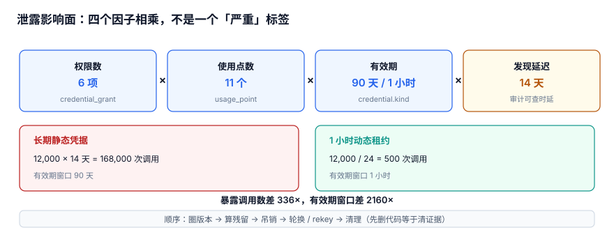

# 泄露影响面：把「最小权限」算成一笔账

「最小权限」人人都认同，但很少有人能回答：这把密钥泄露之后，**到底会丢多少东西、要查多久、该轮换几个版本**。答不上来，泄露响应就只剩下「全量轮换 + 通知全员」这一招，代价高、还常常漏掉真正被用过的那条路径。

本页把影响面拆成四个可量化的因子，用本机实测算出差别，并给出一套「泄露之后先查哪张表」的动作顺序。

::: tip 一句话定位
本页回答「**一把凭据泄露，影响面怎么算、怎么圈、怎么把它压小**」；轮换与吊销的机制在[轮换窗口](../RotationWindow/index.md)与[吊销传播](../Revocation/index.md)，密文与版本的绑定在[版本绑定](../VersionBinding/index.md)。
:::

本页判据族 `KYG-A` ~ `KYG-H`，共 8 条。



## 一、四个因子，缺一个就低估

影响面不是一个「严重 / 不严重」的标签，而是四个数的乘积：

| 因子 | 英文 | 含义 | 谁能改它 | 典型错误 |
| --- | --- | --- | --- | --- |
| 权限数 | permissions | 这把凭据能调多少个接口 / 读多少张表 | 授权模型 | 一个 `admin:all` 顶掉所有分级 |
| 使用点数 | usage points | 有多少进程、任务、第三方在用它 | 分发与登记 | 复制进 CI、脚本、同事的 `.env`，没人登记 |
| 有效期 | validity window | 从签发到失效的时长 | 凭据形态 | 长期 AccessKey 一发 90 天 |
| 发现延迟 | detection lag | 从泄露到被发现、再到吊销生效 | 检测与传播 | 只有扫描、没有运行时留痕 |

前三项决定**上限**，第四项决定**实际损失**。工程上最容易被忽略的是第四项：泄露不是「被发现的那一刻」结束的，而是「最后一个缓存副本过期」才结束（见[吊销传播](../Revocation/index.md)）。

### 1.1 一个可复制的算式

```text
暴露调用数 ≈ 每日调用量 × 发现延迟(天) + 吊销残留窗口内的调用数
吊销残留   ≈ rps × cache_ttl(秒)
```

本机读数（20 万请求/天 = 2.3148 rps、发现延迟 14 天、每日 12,000 次调用）：

| 形态 | 有效期 | 暴露调用数 | 相对倍数 |
| --- | --- | --- | --- |
| 长期静态凭据 | 90 天 | 12,000 × 14 = **168,000** | 1×（基线） |
| 1 小时动态租约 | 1 小时 | 12,000 / 24 × 1 = **500** | **336×** 差距 |
| 有效期窗口比 | 90 天 vs 1 小时 | — | **2160×** |

::: danger 两个常见的低估
1. **只算「有效期」不算「发现延迟」**：以为 1 小时租约最多暴露 1 小时，实际上扫描器 14 天后才报，期间租约会不断续发。正确写法是把「检测延迟」单独列成一个因子，并给它一个可测的上限（例如「凭据读取审计 T+5 分钟可查」）。
2. **把吊销当成瞬时动作**：TTL 3600s 时，点完吊销后仍有 **8,333 次（4.1665%）**请求用旧密钥；TTL 300s 是 694 次，30s 是 69 次。影响面算式里必须加上这一项，否则「止血完成」是假的。
:::

## 二、把「最小权限」变成可核对的表

权限数与使用点数不是文档里的一句承诺，而是两条能跑出来的 SQL：

```sql [schema.sql]
CREATE TABLE credential (
  cred_id    TEXT PRIMARY KEY,
  kind       TEXT NOT NULL CHECK (kind IN ('STATIC','DYNAMIC_LEASE','OIDC_SHORT')),
  issued_at  INTEGER NOT NULL,
  expires_at INTEGER NOT NULL,
  revoked_at INTEGER,
  CHECK (expires_at > issued_at)
);
CREATE TABLE credential_grant (
  cred_id TEXT NOT NULL, permission TEXT NOT NULL,
  PRIMARY KEY (cred_id, permission)
);
CREATE TABLE usage_point (
  cred_id TEXT NOT NULL, point_id TEXT NOT NULL, last_seen_at INTEGER NOT NULL,
  PRIMARY KEY (cred_id, point_id)
);
```

```sql
-- 泄露响应第一条查询：这把凭据到底能碰什么、被谁用过
SELECT c.kind,
       COUNT(DISTINCT g.permission) AS permissions,
       COUNT(DISTINCT u.point_id)   AS usage_points,
       c.expires_at - c.issued_at   AS validity
FROM credential c
LEFT JOIN credential_grant g ON g.cred_id = c.cred_id
LEFT JOIN usage_point      u ON u.cred_id = c.cred_id
WHERE c.cred_id = :leaked_cred
GROUP BY c.cred_id;
```

本机实战里，一把 `STATIC` 凭据有 **6 项权限 / 11 个使用点**。这个数字的意义不在大小，而在**它必须查得出来**：查不出来，响应就只能「把所有密钥都换一遍」。

::: tip 一句话理解
动态凭据之所以强，不是因为它「更安全」这种形容词，而是因为它把**有效期**这个因子从 90 天压到 1 小时——2,160 倍的窗口差，比任何审查流程都有效。
:::

## 三、泄露之后先查哪张表（动作顺序）

顺序错了，最常见的后果是「先删代码、后轮换」，等于把证据清掉而门还开着。治理层的流程见[密钥与凭据治理](../../../Ops/SecurityHardening/SecretGovernance/index.md)的「先止血、后清理」；本页补的是**运行时侧要先查什么**：

1. **先圈版本**：在审计表里按 `key_id` + `key_version` 查出这把密钥被解封的时间区间与调用方。这一步依赖每条审计行都记了 `key_version`（见[版本绑定](../VersionBinding/index.md)）。
2. **再算残留**：查 `cache_entry` 的 `ttl_sec`，算出最晚失效时刻 `refreshed_at + ttl_sec`，得到「吊销后还有多少请求会用旧密钥」。
3. **然后吊销 / 禁用**：写 `revoke_event(revoked_at, propagated_at)`，并触发主动失效；不要只依赖被动过期。
4. **最后才轮换、rekey、清理**：轮换用 CAS（见[轮换窗口](../RotationWindow/index.md)），rekey 前先确认旧版本引用数（见[重加密](../Rekey/index.md)）。

### 3.1 为什么「审计行记 key_version」是第一步的前提

本机 20 万条审计日志实测：按 `key_version` 全表扫描 **11.514 ms**，建索引后 **0.5389 ms**，快 **21.4×**；[实战](../Practice/index.md)里 `ciphertext(key_version)` 索引是 **0.6156 ms vs 10.7546 ms（17.5×）**。

没有版本列，影响面只能按「时间区间」粗筛，一次泄露就要把该时段**所有**密钥的调用全查一遍；有版本列，是一条索引点查。

::: warning 一个口径提醒
审计里的时间戳不要用本地时钟排序。σ=5 ms 的抖动、5 ms 一条的高密度流，相邻逆序率是 **24.149%**；用单调 `seq` 恒为 **0%**。影响面报告要能被第三方复核，顺序本身就得站得住（详见[审计留痕专题](../../AuditForensics/index.md)）。
:::

## 四、四种压小影响面的手段，按性价比排序

| 手段 | 压住哪个因子 | 本机读数 / 代价 | 落地位置 |
| --- | --- | --- | --- |
| 短期租约 / OIDC 换临时凭据 | 有效期 | 90 天 → 1 小时，**2160×** 窗口差 | 凭据形态，见治理层 |
| 每凭据单独授权、按接口分级 | 权限数 | 6 项 → 1 项，影响面降 6× | `credential_grant` |
| 使用点登记 + 定期双向对账 | 使用点数 | 11 个使用点全部可查，未登记项 = 0 | `usage_point` |
| 缩短缓存 TTL + 主动失效 | 发现延迟 | 8,333 → 694 → 69 次残留 | `cache_entry.ttl_sec` |

**顺序不能反**：先缩短 TTL 而不做短期租约，只是把「吊销后的尾巴」剪短，暴露窗口主体（14 天发现延迟 × 长期凭据）一点没变；反过来，上了短期租约但没有使用点登记，泄露后仍然不知道该通知谁。

## 五、判据 `KYG-A` ~ `KYG-H`

| 编号 | 判据 | 不满足时改哪里 | 验证方式 |
| --- | --- | --- | --- |
| `KYG-A` | 每条凭据有 `kind`，`STATIC` 必须书面说明为何不用短期租约 | `credential.kind` 与评审记录 | 查 `kind='STATIC'` 的凭据，逐条有理由 |
| `KYG-B` | 权限按接口分级，单凭据权限数可查且不为 `admin:*` | `credential_grant` | 上面的分组查询返回具体数字（本机 6） |
| `KYG-C` | 每个使用点登记 `last_seen_at`，与配置引用双向对账为 0 差异 | `usage_point` 表 | 跑双向对账命令，输出 `0 / 0` |
| `KYG-D` | 影响面算式包含「发现延迟」与「吊销残留」两项，不只算有效期 | 事件报告模板 | 报告里能找到 168,000 与 8,333 两类数 |
| `KYG-E` | 审计行带 `key_id` + `key_version`，且该列有索引 | `audit_log` / 索引定义 | `EXPLAIN QUERY PLAN` 命中索引，实测 21.4× |
| `KYG-F` | 缓存 TTL 有上限，吊销残留请求数可算 | `cache_entry.ttl_sec` | TTL 3600/300/30 对应 8,333/694/69 |
| `KYG-G` | 泄露响应顺序固定为「圈版本 → 算残留 → 吊销 → 轮换」，先轮换后清理 | 响应手册与 `revoke_event` | 事件时间线里 `rotated_at` 早于 `cleanup_at` |
| `KYG-H` | 顺序用单调 `seq`，不用本地时钟 | `audit_log.seq` / `tg_audit_seq` | σ=5 ms 抖动下逆序数为 0 |

## 六、验证方式

```shell
cd /tmp && python3 - <<'PY'
# 本机读数复算：暴露调用数、吊销残留、索引前后
daily, lag_days = 12000, 14
print("long_lived_exposure_calls =", daily * lag_days)
print("one_hour_lease_exposure_calls =", daily / 24 * 1)
print("exposure_ratio =", (daily * lag_days) / (daily / 24))
print("validity_window_ratio =", 90 * 24 / 1)
rps = 200000 / 86400
for ttl in (30, 300, 3600):
    print(f"ttl={ttl}s stale_after_revoke={round(rps*ttl)}")
PY
```

预期输出（与本册实测一致）：

```text
long_lived_exposure_calls = 168000
one_hour_lease_exposure_calls = 500.0
exposure_ratio = 336.0
validity_window_ratio = 2160.0
ttl=30s stale_after_revoke=69
ttl=300s stale_after_revoke=694
ttl=3600s stale_after_revoke=8333
```

如果你们的影响面报告里没有 `exposure_ratio` 这一行，说明「有效期」还没被当成可计算的量。

## 参考资料

- [NIST SP 800-57 Part 1 Rev.5: key states and transitions](https://csrc.nist.gov/pubs/sp/800/57/pt1/r5/final)
- [AWS: Security best practices in IAM — temporary credentials](https://docs.aws.amazon.com/IAM/latest/UserGuide/best-practices.html)
- [Google: BeyondCorp / short-lived credentials](https://cloud.google.com/security/best-practices)
- [OWASP Secrets Management Cheat Sheet](https://cheatsheetseries.owasp.org/cheatsheets/Secrets_Management_Cheat_Sheet.html)
- [HashiCorp Vault: Dynamic secrets](https://developer.hashicorp.com/vault/docs/secrets/databases)
