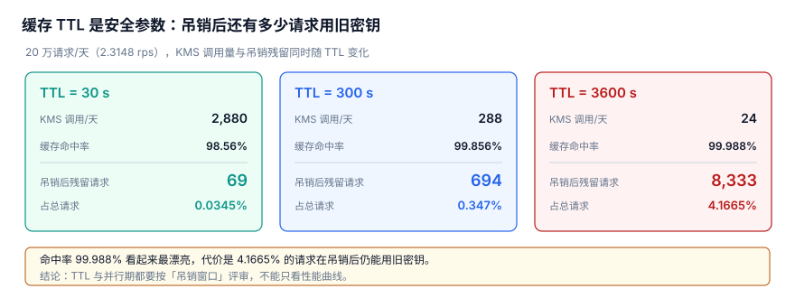

# 凭据分发与进程内缓存：TTL 是安全参数

本页判据族 `KYC-A` ~ `KYC-H`，共 8 条。

密钥取到手之后，谁来用、缓存到几时、点了「吊销」之后多久真的不能用——本页管三个「这把密钥」里的**使用点**。适合任何把凭据 / DEK 缓存进进程、又要在吊销时尽快生效的后端服务。

::: tip 一句话定位
**TTL 不是性能参数，是吊销窗口**：每调大一档 TTL，KMS 调用是降了，但吊销之后还在用旧密钥的请求也同步变多；密钥怎么包见[密钥分层](../Layering/index.md)，版本怎么绑见[版本绑定](../VersionBinding/index.md)，全专题骨架见[总览](../Overview/index.md)。
:::



## 一、四层注入方式与各自暴露面

| 层 | 做法 | 凭据落在哪 | 主要暴露面 | 适用 |
| --- | --- | --- | --- | --- |
| 环境变量 | `export DB_PASSWORD=...` / 容器 `env` | 进程环境块 | `ps eww`、`/proc/<pid>/environ` 可读，被子进程继承、被打进 crash dump 与镜像层 | 本地开发、临时脚本 |
| 挂载文件 `*_FILE` | 值写进文件，应用读 `XXX_FILE` 指向的路径 | tmpfs / Secret 卷 | 文件权限配错、被误打进镜像或备份、被 `cat` 进日志 | 容器 / Swarm / K8s 常见 |
| SDK 直取 | 启动后用平台身份向 KMS / Vault 换短期凭据 | 只在内存 | 身份本身成了新密钥（谁能当这个身份谁就能取）、租约生命周期 | 生产首选（动态凭据） |
| 进程级注入 | 父进程取回后经 fd / 本地 socket 交给 worker | 不落 env、不落盘 | 父进程成单点、IPC 需鉴权、共享缓存的一致性 | 多 worker 共享一份缓存 |

四层不是「四选一」，而是**暴露面逐级收敛**：越往下，凭据存活的副本越少、存活时间越短。`ps eww` 为什么能读到环境变量，是[本机凭据暴露面](../../../Tools/DevEnvironment/Secrets/index.md)反复强调的点；K8s 里 Secret 该怎么挂，看[K8s ConfigMap 与 Secret](../../../Ops/Kubernetes/ConfigMapSecret/index.md)。

::: warning 明确交接：本页不写这些
「怎么搭 Vault、怎么配动态凭据引擎、怎么做 CI OIDC 免密、泄漏响应流程怎么走、轮换周期表怎么定」——这些是**治理制度**，统一看[密钥治理与生命周期](../../../Ops/SecurityHardening/SecretGovernance/index.md)与[本机凭据暴露面](../../../Tools/DevEnvironment/Secrets/index.md)。本页只回答一件事：**凭据已经到手之后，进程里那份缓存该怎么活、该怎么死**。应用凭据本身的签名与验签看[应用凭据](../../OpenPlatform/AppCredential/index.md)。
:::

## 二、TTL 三档实测：结论是「TTL 是吊销窗口」

20 万请求 / 天（2.3148 rps）的固定语料下，只改缓存 TTL，得到三档读数：

| TTL | 每日 KMS 调用 | 命中率 | 吊销后旧密钥残留请求 | 占比 | 最坏残留时长 |
| --- | --- | --- | --- | --- | --- |
| 30 s | 2,880 次 | 98.56% | 69 次 | 0.0345% | 30 s |
| 300 s | 288 次 | 99.856% | 694 次 | 0.347% | 300 s |
| 3600 s | 24 次 | 99.988% | 8,333 次 | 4.1665% | 3600 s |

命中率只从 98.56% 涨到 99.988%；可吊销后的残留请求却从 69 次涨到 8,333 次。**性能收益是边际递减的，安全代价是线性放大的**。这就是六个安静的失败第 ② 条：把 TTL 当性能参数 → 吊销后 8,333 次请求仍用旧密钥，而且这些请求全部「成功返回 200」，没有一条报错。

接上全专题的主张：`current_key` 这个名字在吊销前后指向两把不同的密钥，缓存让旧名字多活了一个 TTL——「同一个名字，在不同时刻指向不同的东西」，失败照样是安静的。

::: tip 选型的问法要换
别问「KMS 会不会被打爆」（缓存后一天才 288 次，见[密钥分层](../Layering/index.md)的 694.4×），要问「**吊销之后，我能容忍多少次请求还在用旧密钥**」。先定这个上限，再反推 TTL。
:::

## 三、完整可运行示例：单飞、抖动、主动失效、脱敏

```python [src/secret_cache_demo.py]
import threading, time, random, re

random.seed(0)

class SecretCache:
    def __init__(self, fetcher, ttl, jitter=0.2):
        self.fetcher, self.ttl, self.jitter = fetcher, ttl, jitter
        self._lock = threading.Lock()
        self._value = None
        self._expire_at = 0.0
        self._version = 0

    def _ttl_once(self):
        # 刷新抖动：避免多实例在同一时刻一起到期打向 KMS（惊群）
        return self.ttl * (1 + random.uniform(-self.jitter, self.jitter))

    def get(self):
        now = time.monotonic()
        with self._lock:                  # 单飞：同一时刻只有一个线程刷新
            if self._value is None or now >= self._expire_at:
                self._value = self.fetcher()
                self._version += 1
                self._expire_at = now + self._ttl_once()
            return self._value, self._version

    def invalidate(self):                 # 主动失效：吊销事件到达时立刻调用
        with self._lock:
            self._value = None
            self._expire_at = 0.0

fetch_calls = {"n": 0}

def fetch_from_kms():
    fetch_calls["n"] += 1
    return "sk-live-" + str(fetch_calls["n"])

cache = SecretCache(fetch_from_kms, ttl=0.05)
barrier = threading.Barrier(10)

def worker():
    barrier.wait()
    return cache.get()[0]

threads = [threading.Thread(target=worker) for _ in range(10)]
for t in threads: t.start()
for t in threads: t.join()
print("1) 单飞：10 线程并发只取了", fetch_calls["n"], "次 KMS")

time.sleep(0.07)
cache.get()                               # TTL 到期后被动过期
print("2) TTL 到期自动刷新后累计取:", fetch_calls["n"])

cache.invalidate()                        # 不等 TTL，立刻刷新
cache.get()
print("3) 主动失效后立刻刷新累计取:", fetch_calls["n"])

secret = "EXAMPLE_API_TOKEN_0001"   # 示例占位，不是真实凭据
def mask(line, s):
    return re.sub(re.escape(s), "***REDACTED***", line)   # 只对整串精确匹配生效

print("4) 完整值被掩码:", mask("key=" + secret, secret))
print("5) 拼接/截断值不命中:", mask("key=" + secret[:8], secret))
```

运行输出：

```text
1) 单飞：10 线程并发只取了 1 次 KMS
2) TTL 到期自动刷新后累计取: 2
3) 主动失效后立刻刷新累计取: 3
4) 完整值被掩码: key=***REDACTED***
5) 拼接/截断值不命中: key=sk-live-
```

四个机制各管一段：**单飞刷新**（singleflight）用一把锁包住「判空 + 取回 + 设过期」，TTL 到点那一刻 10 个线程也只打一次 KMS，防缓存击穿；**刷新抖动**给每次 TTL 乘 `(1 ± 20%)`，把多实例的到期时刻打散，消除周期性尖峰；**主动失效**由吊销事件推过来立刻 `invalidate()`，把残留从「整个 TTL」压到「事件传播延迟」；**被动过期**只是兜底上限。光靠 TTL 永远消不掉残留，必须配主动失效。

::: tip 三件套缺一不可
**短 TTL 兜底 + 单飞防击穿 + 主动失效消残留**：少了主动失效，残留就恒等于一个 TTL；少了单飞，短 TTL 反而会在到期瞬间把 KMS 打穿。
:::

## 四、KMS 超时降级的两难（16.2×）

| 指标 | 读数 |
| --- | --- |
| 样本数 / 注入的 200 ms 超时 | 4,000 / 5% |
| p50 / p99 / 均值 | 2.02 ms / 200.0 ms / 12.34 ms |
| p99 / 均值 | 16.2× |

长尾很重：5% 的 200 ms 注入把均值拉到 12.34 ms，p99 是均值的 16.2 倍。于是「超时了怎么办」是个两难：硬失败，5% 的慢请求直接 5xx；降级沿用缓存里的旧 DEK，请求是 200 了，可如果此刻恰好刚吊销，旧 DEK 就被合法地多用了一次——**DEK 缓存把暴露窗口从「一次 KMS 调用」拉长到整个 TTL**。

| 策略 | 超时请求的结果 | 吊销语义 | 风险 |
| --- | --- | --- | --- |
| 硬失败 | 5xx | 干净，旧密钥不再用 | 5% 慢请求全失败 |
| 降级用旧 DEK | 200（旧值） | 残留窗口 = TTL 剩余 | 吊销被静默推迟，就是 8,333 次那种残留 |
| 短 TTL + 单飞 + 主动失效 | 单飞挡住击穿，失效事件立刻清 | 残留 ≈ 事件传播延迟 | 需要一条可靠的吊销广播通道 |

正确取舍：降级只允许「用**同一把已知未吊销**的密钥重试」，不允许「拿不到就默认沿用」，且降级必须打点告警、不能静默。至于那条吊销广播通道怎么建，属于治理，交接给[密钥治理与生命周期](../../../Ops/SecurityHardening/SecretGovernance/index.md)。

## 五、易错点

::: danger 六个坑，逐条给正确写法
1. **把 TTL 当性能参数往上调**：3600 s 把 KMS 调用压到 24 次 / 天，但吊销后 8,333 次（4.1665%）请求仍用旧密钥且全部返回 200。正确写法：先定「可容忍残留次数」上限再反推 TTL（30 s 档只残留 69 次 / 0.0345%），并配主动失效。
2. **只用被动过期、没有主动失效**：点了吊销还要等满一个 TTL 才生效，最坏 30 / 300 / 3600 秒。正确写法：吊销事件到达即 `invalidate()`，TTL 只当兜底上限。
3. **缓存 miss 不做单飞**：TTL 到期瞬间 N 个线程一起打 KMS，把 2.02 ms 的 p50 打成雪崩。正确写法：`threading.Lock` 包住「判空 + 取回 + 设过期」，示例 1 里 10 线程只取 1 次。
4. **多实例 TTL 完全对齐、不加抖动**：每到整点一起刷新，形成周期性尖峰。正确写法：每次 TTL 乘 `(1 ± 20%)` 抖动打散，如 `_ttl_once()`。
5. **超时就静默降级沿用旧 DEK**：p99 / 均值 16.2× 的长尾里，5% 慢请求可能正好跨过吊销点。正确写法：降级只重试「同一把未吊销密钥」，且必须打告警，不得默认沿用。
6. **以为掩码能兜住所有日志**：`re.sub` 只对**完全匹配**整串生效，日志里出现截断值、base64 片段、拼接串时全部漏出（示例 5）。正确写法：结构化日志里根本不记录密钥字段，掩码只作最后一道兜底；配合[本机凭据暴露面](../../../Tools/DevEnvironment/Secrets/index.md)的扫描。
:::

::: info 读数口径
第二、四节的数字来自 Python 3.13.12 标准库 + SQLite 3.50.4 的**模拟压测**（固定种子 `20261107`），不是生产 KMS 基准；采集脚本不入库，读者可照「验证方式」复现示例行为。
:::

## 判据

| 编号 | 判据 | 不满足时改哪里 | 验证方式 |
| --- | --- | --- | --- |
| `KYC-A` | 四层注入方式在部署清单里逐项标注暴露面，生产长期凭据不进环境变量 | 部署清单 / `Deployment` 的 `env` 段 | 检查生产 `env` 无明文长期密钥，改用 `*_FILE` 或 SDK 直取 |
| `KYC-B` | TTL 由「可容忍的吊销残留上限」反推，而非由命中率决定 | `SecretCache(ttl=...)` 配置 | 对照三档表：30 s → 69 次 0.0345%、3600 s → 8,333 次 4.1665% |
| `KYC-C` | 20 万请求 / 天（2.3148 rps）下，KMS 调用数与残留次数同时埋点 | 缓存指标埋点 | 三档实测：30 s 2,880/69、300 s 288/694、3600 s 24/8,333 |
| `KYC-D` | 缓存 miss 有单飞，并发只触发一次 fetch | `SecretCache.get()` 的 `threading.Lock` | 示例 1：10 线程并发 `fetch_calls == 1` |
| `KYC-E` | 每次 TTL 带刷新抖动，多实例不同时到期 | `_ttl_once()` 的 `random.uniform` | 压测观察刷新时刻分布，无整点尖峰 |
| `KYC-F` | 吊销有主动失效通道，不等 TTL | `SecretCache.invalidate()` 与吊销事件订阅 | 示例 3：失效后立即刷新，残留 ≠ 整个 TTL |
| `KYC-G` | 超时降级不默认沿用旧 DEK，且降级必告警 | KMS 客户端的超时分支 | 注入 200 ms 超时（p99/均值 16.2×），确认无静默沿用 |
| `KYC-H` | 结构化日志不记录密钥字段；掩码注明「仅完全匹配生效」 | 日志格式化器 / `mask()` | 示例 4 / 5：完整值被掩码、截断值不命中 |

## 验证方式

标准库即可，重点看 **1 必须是 1 次、5 必须漏出截断值**（后者恰恰证明掩码不能当主防线）：

```shell
cd /tmp && python3 - <<'PY'
import threading, time, random, re
random.seed(0)
class SecretCache:
    def __init__(self, fetcher, ttl, jitter=0.2):
        self.f, self.ttl, self.j = fetcher, ttl, jitter
        self.l = threading.Lock(); self.v = None; self.e = 0.0
    def get(self):
        now = time.monotonic()
        with self.l:
            if self.v is None or now >= self.e:
                self.v = self.f(); self.e = now + self.ttl * (1 + random.uniform(-self.j, self.j))
            return self.v
    def invalidate(self):
        with self.l: self.v = None; self.e = 0.0
calls = {"n": 0}
def fetch(): calls["n"] += 1; return "sk-live-" + str(calls["n"])
c = SecretCache(fetch, ttl=0.05)
b = threading.Barrier(10)
def w(): b.wait(); return c.get()
ts = [threading.Thread(target=w) for _ in range(10)]
for t in ts: t.start()
for t in ts: t.join()
print("1) 单飞(10 线程只取 1 次):", calls["n"] == 1)
time.sleep(0.07); c.get()
print("2) TTL 到期刷新(累计 2):", calls["n"] == 2)
c.invalidate(); c.get()
print("3) 主动失效立刻刷新(累计 3):", calls["n"] == 3)
s = "sk-live-7788"
mask = lambda line: re.sub(re.escape(s), "***REDACTED***", line)
print("4) 完整值被掩码:", mask("key=" + s) == "key=***REDACTED***")
print("5) 截断值不命中(漏出):", mask("key=" + s[:8]) == "key=sk-live-")
PY
```

预期输出：

```text
1) 单飞(10 线程只取 1 次): True
2) TTL 到期刷新(累计 2): True
3) 主动失效立刻刷新(累计 3): True
4) 完整值被掩码: True
5) 截断值不命中(漏出): True
```

## 参考资料

- [OWASP Secrets Management Cheat Sheet](https://cheatsheetseries.owasp.org/cheatsheets/Secrets_Management_Cheat_Sheet.html)
- [OWASP Logging Cheat Sheet（日志最小化与脱敏）](https://cheatsheetseries.owasp.org/cheatsheets/Logging_Cheat_Sheet.html)
- [The Twelve-Factor App: Config（环境变量与配置暴露面）](https://12factor.net/config)
- [Docker Swarm secrets（`*_FILE` 挂载约定）](https://docs.docker.com/engine/swarm/secrets/)
- [HashiCorp Vault: Lease, Renew, and Revoke（动态凭据与 TTL）](https://developer.hashicorp.com/vault/docs/concepts/lease)
