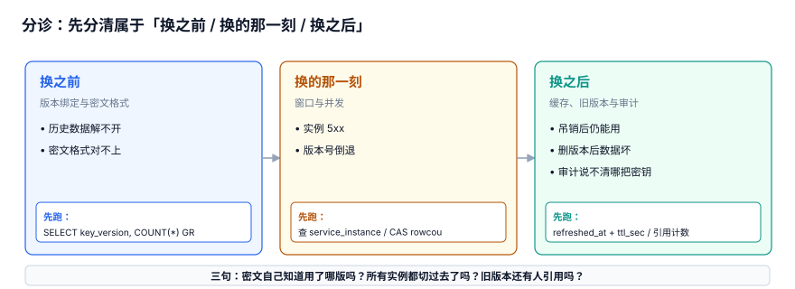

# 常见问题与分诊

这一页收的是「线上出现某个现象时，先看哪一条」的十个判断题。答案不是查文档能直接查到的那种，而是**先分清现象属于三段里的哪一段**：换之前（版本绑定）、换的那一刻（窗口与并发）、换之后（缓存与旧版本）。

::: tip 一句话定位
本页回答「**遇到具体现象，第一条该跑什么命令**」；原理与表结构在各自章节，本页只给判断与动作，且每条都指向能验证它的那一页。
:::

本页判据族 `KYQ-A` ~ `KYQ-H`，共 8 条。



## 一、十个判断题

### 1. 「轮换之后，历史数据解不开了」，先看哪里？

**先看密文里有没有版本号，不要先看 KMS 权限。**

```sql
SELECT key_version, COUNT(*) FROM ciphertext GROUP BY key_version ORDER BY key_version;
```

如果只有一列或者全是同一个值，问题在[版本绑定](../VersionBinding/index.md)：解密时用了「当前版本」。本机实测，不带版本号的 20 万条密文在 12 个版本下只有 **16,750** 条可解，失败 **91.625%**；密文自带版本后是 **200,000 / 200,000**。

### 2. 「点了吊销，怎么还有请求在用旧凭据？」

这是**预期行为**，不是 bug——除非你没给缓存设上限。查最晚失效时刻：

```sql
SELECT cache_key, refreshed_at, ttl_sec,
       refreshed_at + ttl_sec AS latest_usable_at
FROM cache_entry ORDER BY latest_usable_at DESC;
```

TTL 3600s 时本机残留 **8,333 次（4.1665%）**，300s 是 694 次，30s 是 69 次。详见[吊销传播](../Revocation/index.md)。

### 3. 「轮换后一批实例开始 5xx」，是回滚还是等？

先查有多少实例没切，再决定：

```sql
SELECT COUNT(*) FROM service_instance WHERE active_version < :new_version;
```

4,000 个实例的切换耗时 p50 **319.3 s**、p99 **2164.3 s（36.1 min）**；并行期只给 5 分钟时，还有 **2,093（52.325%）**没切完就禁用了旧版本。**先恢复旧版本的 `DECRYPT_ONLY`，再延长窗口**，不要直接回滚整次轮换（回滚会让新写入的版本号倒退）。详见[轮换窗口](../RotationWindow/index.md)。

### 4. 「两个任务同时点了轮换」，版本号怎么少了？

无条件 `UPDATE ... SET version = version + 1` 在并发下会丢更新：本机 10,000 次、35% 重叠概率下 **3,480 次（34.8%）**丢失。正确写法是带条件：

```sql
UPDATE kek_version SET state = 'ACTIVE', not_before = :now
WHERE key_id = :key_id AND version = :new_version AND state = 'PENDING';
-- rowcount 必须为 1；为 0 说明别人已经推进过，直接读取当前版本
```

### 5. 「旧版本留着占空间，能删吗？」

先查引用，为 0 才删：

```sql
SELECT COUNT(*) FROM ciphertext WHERE key_id = :key_id AND key_version = :old;
```

本机实战里这一步是 **183,250 条**，删掉旧版本后 20 万条密文**全部不可读**。正确终态是 `DECRYPT_ONLY`，只有 rekey 完成、引用归零才进 `DISABLED`。详见[重加密](../Rekey/index.md)。

### 6. 「审计里能查到解封记录，但说不清用的哪把密钥」

审计行缺 `key_version`。补列 + 建索引：

```sql
ALTER TABLE audit_log ADD COLUMN key_version INTEGER;
CREATE INDEX ix_audit_ver ON audit_log(key_id, key_version);
```

本机 20 万条：全扫 **11.514 ms** → 索引 **0.5389 ms**（**21.4×**）。影响面圈定见[泄露影响面](../BlastRadius/index.md)。

### 7. 「审计时间戳顺序对不上」

不要用本地时钟排序。σ=5 ms 抖动、5 ms 间隔的高密度流下，相邻逆序 **24.149%**；用单调 `seq` 恒为 **0%**。

```sql
SELECT COUNT(*) FROM (
  SELECT seq, LAG(seq) OVER (ORDER BY seq) AS prev FROM audit_log
) WHERE seq <= prev;   -- 必须为 0
```

### 8. 「KMS 偶发超时，要不要把 DEK 缓存时间调长？」

这是**安全与可用的交换**，不是性能优化。缓存后每日 KMS 调用从 200,000 降到 **288（694.4×）**，但缓存的 DEK 在 TTL 内即使吊销也仍可用（8,333 次残留）。注入 5% 的 200 ms 超时后，p50 仍是 **2.02 ms**，p99 却是 **200 ms**（均值 12.34 ms，**16.2×**）——**平均值会把长尾完全抹平**。折中做法是短 TTL + 抖动刷新 + 主动失效，见[凭据分发](../Distribution/index.md)。

### 9. 「泄露了，是不是把密钥全换一遍就行？」

不是。顺序错了会清掉证据而门还开着：**圈版本 → 算残留 → 吊销 → 轮换/rekey → 清理**。先查这把凭据有几项权限、几个使用点（本机 6 项 / 11 个），再算暴露窗口（长期凭据 168,000 次调用 vs 1 小时租约 500 次，**336×**）。制度级流程见[密钥与凭据治理](../../../Ops/SecurityHardening/SecretGovernance/index.md)。

### 10. 「证书过期和密钥轮换，是不是一套动作？」

不是。证书（X.509）靠**短寿命 + 自动续签**，因为吊销依赖客户端愿意查；密钥靠**轮换 + 主动吊销**。把证书当成「又一个密钥」，会在吊销上白花时间，而正确做法是把有效期压短。两者的失败爆炸半径也不同：一个调用方的凭据影响局部，证书配错是全站同时不可用。

## 二、分诊表

| 现象 | 先跑 | 属于哪一段 | 去哪 |
| --- | --- | --- | --- |
| 历史数据解不开 | 按 `key_version` 分组 | 换之前 | [版本绑定](../VersionBinding/index.md) |
| 密文格式对不上 | 查密文头字段 | 换之前 | [密钥分层](../Layering/index.md) |
| 实例 5xx / 版本倒退 | 查未切实例数、CAS 影响行数 | 换的那一刻 | [轮换窗口](../RotationWindow/index.md) |
| 吊销后仍能用 | `refreshed_at + ttl_sec` | 换之后 | [吊销传播](../Revocation/index.md) |
| 删旧版本后数据全坏 | 引用计数 | 换之后 | [重加密](../Rekey/index.md) |
| 审计说不清用了哪把密钥 | `EXPLAIN` + 版本列 | 换之后 | [泄露影响面](../BlastRadius/index.md) |
| 延迟偶发飙高 | p99 而非均值 | 换之后 | [凭据分发](../Distribution/index.md) |

::: danger 分诊时最常见的三个错
1. **先看 KMS 权限**：轮换后解不开，九成是密文没带版本，不是 IAM 配错；查权限会白花半小时。
2. **用平均值判断延迟**：p50 2.02 ms、均值 12.34 ms 都很健康，而 p99 是 200 ms。压测报告里平均值是最没用的一个数。
3. **把「删代码里的密钥」当成止血**：Git 历史里还在，且旧缓存还在用。先吊销，再轮换，最后清理。
:::

::: tip 一句话总结
所有「换密钥」的问题，先问三句：**密文自己知道用了哪版吗？所有实例都切过去了吗？旧版本还有人引用吗？** 三句都有可查的答案，剩下的就是执行。
:::

## 三、判据 `KYQ-A` ~ `KYQ-H`

| 编号 | 判据 | 不满足时改哪里 | 验证方式 |
| --- | --- | --- | --- |
| `KYQ-A` | 分诊第一步是「按版本分组」，不是查 KMS 权限 | 响应手册第 1 条 | 手册里能找到对应 SQL |
| `KYQ-B` | 每个现象都有「先跑什么」的一条命令 | 本页分诊表 | 七行现象各有一条可执行语句 |
| `KYQ-C` | 5xx 的处置是恢复 `DECRYPT_ONLY` + 延长窗口，不是整次回滚 | 轮换任务状态机 | 演练记录里无「版本号倒退」 |
| `KYQ-D` | 吊销残留用 `refreshed_at + ttl_sec` 计算，不靠感觉 | `cache_entry` | 30/300/3600s 对应 69/694/8,333 |
| `KYQ-E` | 删版本前引用计数为 0 | `tg_no_drop_used_kek` | 有引用时 DELETE 被 ABORT |
| `KYQ-F` | 延迟判据用 p99，报告不得只给均值 | 压测报告模板 | 能找到 200 ms 与 2.02 ms 两行 |
| `KYQ-G` | 证书与密钥的失效动作分开描述 | 运维手册 | 手册里两者有独立小节 |
| `KYQ-H` | 十个判断题各指向本册一页，且链接可达 | 本页链接 | `pnpm docs:build` 无死链 |

## 四、验证方式

把分诊第一条变成一条能跑的命令（干净库上应该返回 0 行异常）：

```shell
cd /tmp && python3 - <<'PY'
import sqlite3
con = sqlite3.connect(":memory:")
c = con.cursor()
c.execute("CREATE TABLE ciphertext (ct_id INTEGER PRIMARY KEY, key_version INTEGER NOT NULL CHECK(key_version>0))")
c.executemany("INSERT INTO ciphertext(key_version) VALUES(?)", [(v % 12 + 1,) for v in range(200000)])
print("1) 无版本密文:", c.execute("SELECT COUNT(*) FROM ciphertext WHERE key_version<=0").fetchone()[0])
print("2) 旧版本密文:", c.execute("SELECT COUNT(*) FROM ciphertext WHERE key_version<12").fetchone()[0])
c.execute("CREATE TABLE audit_log (seq INTEGER PRIMARY KEY, key_version INTEGER)")
c.executemany("INSERT INTO audit_log(key_version) VALUES(?)", [(v % 12 + 1,) for v in range(2000)])
print("3) 序号逆序:", c.execute("SELECT COUNT(*) FROM (SELECT seq, LAG(seq) OVER (ORDER BY seq) p FROM audit_log) WHERE seq<=p").fetchone()[0])
PY
```

预期输出：

```text
1) 无版本密文: 0
2) 旧版本密文: 183250
3) 序号逆序: 0
```

第 2 行不为 0 是正常的（历史数据本来就用了旧版本）；**它不为 0 恰恰说明旧版本不能删**。

## 参考资料

- [NIST SP 800-57 Part 1 Rev.5](https://csrc.nist.gov/pubs/sp/800/57/pt1/r5/final)
- [AWS KMS: Troubleshooting key access](https://docs.aws.amazon.com/kms/latest/developerguide/key-policies.html)
- [OWASP Secrets Management Cheat Sheet](https://cheatsheetseries.owasp.org/cheatsheets/Secrets_Management_Cheat_Sheet.html)
- [Google SRE Book: Handling Overload](https://sre.google/sre-book/handling-overload/) — 为什么看 p99 而不是均值
