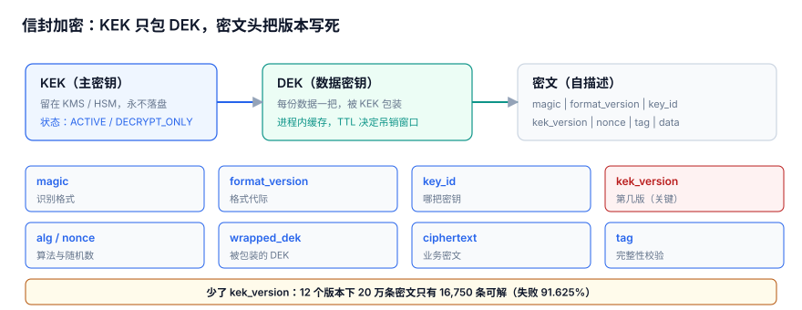

# 密钥分层与信封加密：KEK、DEK 与密文格式

本页判据族 `KYA-A` ~ `KYA-H`，共 8 条。

一次加密到底生成了几把密钥、落盘的那串字节里装了什么——本页把信封加密拆成 **KEK / DEK 两层**，并把密文当成一种「自带说明书的二进制格式」来设计。适合要自定义落盘密文格式、又不肯把主密钥交给业务代码的后端。

::: tip 一句话定位
本页回答三个「这把密钥」里的第一个——**定义**：这串字节是什么、由哪几段组成、少一段会怎样；版本归[版本绑定](../VersionBinding/index.md)，缓存到几时归[凭据分发](../Distribution/index.md)，全专题骨架见[总览](../Overview/index.md)。
:::



## 一、两层密钥：KEK 和 DEK 各管什么

**信封加密（Envelope Encryption）** 的核心不是「多了一把钥匙」，而是**两把钥匙的职责彻底分开**：一把只管包钥匙，一把只管数据。

| 层 | 全称 | 职责 | 数量 | 存放位置 | 轮换方式 |
| --- | --- | --- | --- | --- | --- |
| **KEK**（Key Encryption Key） | 密钥加密密钥 / 主密钥 | 只用来「包装」DEK，永不接触明文 | 一个租户 / 一个环境通常一把，数量很少 | KMS / HSM 内，**不出硬件边界** | 慢，改的是 `kek_version` |
| **DEK**（Data Encryption Key） | 数据加密密钥 | 直接加密这一份明文 | **每份数据一把**，一次加密现生成 | 只以「被 KEK 包好的 `wrapped_dek`」形态落盘 | 换数据就换一把，不动 KEK |

为什么坚持「每份数据一把 DEK」，而不是全库共用一把：

1. **缩小爆炸半径**：一把 DEK 泄露只暴露一份数据；共用一把 DEK，一次泄露就是全库。
2. **KMS 只碰小东西**：KMS 每次只包 / 解包 32 字节的 DEK，调用量与明文体积、请求量彻底解耦——这正是第四节的 694.4× 的来源。
3. **密钥使用量有上限**：NIST SP 800-57 用 crypto period（密钥使用期）约束单把密钥能保护的数据量，分把才不会超额。
4. **改内容不用动主密钥**：重写一份数据就重新生成 DEK，历史密文与其它数据的 DEK 都不受影响。

一句话接上全专题的主张：密钥事故大多不是「密码被猜到」，而是「**同一个名字，在不同时刻指向不同的东西**」；而密文头里少写一个字段，就是后续「六个安静的失败」里好几个的共同起点。

::: info 本机读数口径
下文所有数字来自 Python 3.13.12 标准库 + SQLite 3.50.4 的**模拟压测**（固定种子 `20261107`），不是生产 KMS 基准；采集脚本不入库，读者可照「验证方式」复现。
:::

## 二、信封格式：密文是一份自带说明书的二进制包

明文用 DEK 加密，DEK 用 KEK 包好，两者连同说明信息一起塞进同一个「信封」——**密文自己说清楚「我是谁、用哪把钥匙、怎么解」**。下面是一份自拟的二进制头（字段顺序即字节顺序），每个字段都回答「少了会怎样」：

| 字段 | 类型 / 长度 | 含义 | 少了会怎样 |
| --- | --- | --- | --- |
| `magic` | 4B `b'SKX1'` | 格式魔数，声明「这是本系统的密文」 | 无法区分密文 / 随机字节 / 别家格式，解密只能抛一堆含糊异常 |
| `format_version` | 1B `uint8` | 头部布局版本 | 将来加字段，老解析器把新字节当密文，静默解错 |
| `key_id` | 16B | KEK / 密钥环的逻辑标识（不是密钥本身） | 多租户共库时不知道去哪找钥匙，只能靠文件名或外部表去猜 |
| `kek_version` | 4B `uint32` | 用哪一版 KEK 包了 `wrapped_dek` | 轮换后历史密文全解不开，见[版本绑定](../VersionBinding/index.md)的 91.625% |
| `alg` | 1B 枚举 | 算法套件编号（如 `1` = AES-256-GCM） | 算法迁移时无法识别旧格式，也没法双读过渡 |
| `nonce` | 12B | GCM nonce，每次加密唯一 | 与 DEK 一起复用会直接破坏 GCM 安全性 |
| `wrapped_dek` | 48B | 被 KEK 包装后的 DEK | 没它就得把 DEK 明文落盘，等于没加密 |
| `ciphertext` | 变长 | 明文经 DEK + AEAD 得到的密文 | —— |
| `tag` | 16B | AEAD 认证标签 | 密文被改也发现不了，失去完整性 |

::: tip 一句话记住这份头
**密文要能被「单独拿起来读懂」**：从库里 copy 出来、拷到另一台机器、隔三年再解，都不许依赖任何外部映射表。这条约束就是[版本绑定](../VersionBinding/index.md)那一章的起点。
:::

## 三、完整可运行示例：标准库把结构跑通

下面这段只用 Python 标准库，把「字段布局 → 包装 DEK → 认证标签 → 解包校验」完整跑一遍。重点是**每个字段都在、且被用到**，不是算法强度。

```python [src/envelope_demo.py]
import struct, secrets, hashlib, hmac

MAGIC = b"SKX1"
FORMAT_VERSION = 1
ALG = 1                       # 演示套件编号：1 = "SHA256 密钥流 + HMAC 标签"，非 AEAD
FMT = ">4sB16sIB12s"          # magic, ver, key_id, kek_version, alg, nonce
HEADER_LEN = struct.calcsize(FMT)   # = 38
DEK_LEN, TAG_LEN = 32, 16

KEK = hashlib.sha256(b"demo-kek").digest()      # 真实项目：放在 KMS / HSM 里
KEY_ID = b"tenant-a/ring-1".ljust(16, b"\0")[:16]
KEK_VERSION = 7

def _keystream(key, nonce, n):
    out, ctr = bytearray(), 0
    while len(out) < n:
        out += hashlib.sha256(key + nonce + ctr.to_bytes(4, "big")).digest()
        ctr += 1
    return bytes(out[:n])

def _xor(a, b):
    return bytes(x ^ y for x, y in zip(a, b))

def _wrap_dek(dek, nonce):
    return _xor(dek, _keystream(KEK, nonce, DEK_LEN))

def _unwrap_dek(wrapped, nonce):
    return _xor(wrapped, _keystream(KEK, nonce, DEK_LEN))

def encrypt(plaintext):
    dek = secrets.token_bytes(DEK_LEN)          # 每份数据一把 DEK
    nonce = secrets.token_bytes(12)             # 每次加密一个新 nonce
    header = struct.pack(FMT, MAGIC, FORMAT_VERSION, KEY_ID,
                         KEK_VERSION, ALG, nonce)
    body = header + _wrap_dek(dek, nonce) \
           + _xor(plaintext, _keystream(dek, nonce, len(plaintext)))
    return body + hmac.new(dek, body, hashlib.sha256).digest()[:TAG_LEN]

def decrypt(blob):
    magic, fver, key_id, kek_ver, alg, nonce = struct.unpack(FMT, blob[:HEADER_LEN])
    assert magic == MAGIC, "不是本系统密文"
    assert fver == FORMAT_VERSION, "不支持的格式版本"
    assert alg == ALG, "不支持的算法"
    wrapped = blob[HEADER_LEN:HEADER_LEN + DEK_LEN]
    ciphertext = blob[HEADER_LEN + DEK_LEN:-TAG_LEN]
    tag = blob[-TAG_LEN:]
    dek = _unwrap_dek(wrapped, nonce)           # 真实项目：KMS.Decrypt(key_id, kek_ver, wrapped)
    expected = hmac.new(dek, blob[:-TAG_LEN], hashlib.sha256).digest()[:TAG_LEN]
    assert hmac.compare_digest(tag, expected), "认证失败：头部或密文被篡改"
    return _xor(ciphertext, _keystream(dek, nonce, len(ciphertext)))

if __name__ == "__main__":
    msg = b"order-secret-20261107"
    blob = encrypt(msg)
    print("头部长度:", HEADER_LEN, "密文总长:", len(blob))
    print("自描述 KEK 版本:", struct.unpack(FMT, blob[:HEADER_LEN])[3])
    print("解密一致:", decrypt(blob) == msg)
    bad = bytearray(blob); bad[10] ^= 0x01     # 篡改 key_id 的一个字节
    try:
        decrypt(bytes(bad))
        print("篡改未发现  <-- 不应该出现")
    except AssertionError as e:
        print("篡改被拦截:", e)
```

运行输出：

```text
头部长度: 38 密文总长: 107
自描述 KEK 版本: 7
解密一致: True
篡改被拦截: 认证失败：头部或密文被篡改
```

注意最后一行：改的是 `key_id`，它并不参与本例的密钥派生，却仍被拦下——因为**认证标签覆盖了整个信封（含头部）**，头部任何一字节被改都会导致校验失败。这正是「字段不能少」的兜底。

::: warning 这段代码的边界，别拿去上生产
`_keystream` 用 SHA-256 拼 XOR、`_wrap_dek` 用 XOR 包装，只是把「字段布局 + 包装 / 解包 + 认证标签」跑通，**既不是认证加密，也不是生产实现**。真实项目请换成 `cryptography` 库的 `AESGCM`（一次拿到 `ciphertext` 与 `tag`）与 KMS 的 `Encrypt` / `Decrypt`（生成 / 解开 `wrapped_dek`）；具体 SDK 调用以你所用 KMS 的官方文档为准，本页**不编造任何云厂商 API**。
:::

## 四、KMS 调用量与延迟：694.4× 从哪来

| 指标 | 读数 |
| --- | --- |
| 样本数 | 4,000 |
| 注入的 200 ms 超时比例 | 5% |
| p50 | 2.02 ms |
| p99 | 200.0 ms |
| 均值 | 12.34 ms |
| p99 / 均值 | 16.2× |
| 不缓存 DEK：每日 KMS 调用 | 200,000 次 |
| 缓存 DEK 后：每日 KMS 调用 | 288 次 |
| 降幅 | 694.4× |

每份数据一把 DEK，但 DEK 被包好后跟着密文落盘；进程第一次用到这份密文时才去 KMS 解一次 `wrapped_dek`，之后 DEK 留在进程内缓存。于是「KMS 调用次数」约等于「被访问的不同密文种类数」，与请求总数脱钩——这就是 200,000 → 288 的由来。缓存怎么活、怎么死，是[凭据分发](../Distribution/index.md)的主题。

p99 200 ms 对均值 12.34 ms 的 **16.2×** 说明延迟是长尾的：5% 的 200 ms 注入把均值明显拉高。于是「KMS 超时要不要降级」成了两难——降级沿用旧 DEK 会把暴露窗口拉长到整个 TTL，硬失败又直接吃掉 5% 的可用性，这个两难在[凭据分发](../Distribution/index.md)展开。

::: tip 694.4× 首先不是「性能优化」
它是**正确性设计的副作用**：如果全库共用一把 DEK，你根本不需要缓存、也不需要这个倍数——但一次泄露就是全库。分层先为缩小爆炸半径，调用量下降是顺带的结果。把顺序想反了，就会为了「再省几次调用」去复用 DEK，正好踩中第五节的坑。
:::

## 五、易错点

::: danger 五个坑，逐条给正确写法
1. **把 base64 当加密**：`base64.b64encode(plaintext)` 只是编码，谁都能 decode。正确写法：用 AEAD（AES-GCM）产出 `ciphertext + tag`；base64 仅用于把二进制密文转成可打印字符落库 / 传输。
2. **把 `key_id` 放文件名或外部映射表**：`enc_20261107_tenantA.dat` 或一张 `file → key` 表，文件一挪走 / 表一清空，密文就成了孤儿。正确写法：`key_id` 是头部的第 3 个字段（`16s`），随密文一起走。
3. **DEK 或 nonce 复用**：一把 DEK 加密多份数据、甚至复用同一个 nonce，GCM 下两段密文 XOR 会直接泄露明文 XOR。正确写法：`dek = secrets.token_bytes(32)`、`nonce = secrets.token_bytes(12)` 每次重取，nonce 写进头部。
4. **头部不写 `format_version` / `alg`**：将来换算法或加字段，老解析器把新字节当密文，返回乱码而不报错。正确写法：头部固定带这两个字段，解密入口先 `assert` 再解，如第三节 `decrypt()` 的开头三行。
5. **省掉 `tag` 或「先解再验」**：密文被改一个字节也照样「解出」一段错误明文。正确写法：先 `hmac.compare_digest`（或 AEAD 自带 tag 校验）通过，再返回明文；第三节篡改 `key_id` 即被拦截。
:::

本节只管「密文长什么样」。密钥怎么建、Vault 怎么配、CI 怎么免密，属于治理制度，看[密钥治理与生命周期](../../../Ops/SecurityHardening/SecretGovernance/index.md)；本机怎么注入、环境变量为什么会被 `ps eww` 读到，看[本机凭据暴露面](../../../Tools/DevEnvironment/Secrets/index.md)；K8s 里 Secret 怎么挂，看[K8s ConfigMap 与 Secret](../../../Ops/Kubernetes/ConfigMapSecret/index.md)。

## 判据

| 编号 | 判据 | 不满足时改哪里 | 验证方式 |
| --- | --- | --- | --- |
| `KYA-A` | 密文是自带说明书的二进制包，9 个字段齐全且 `magic = SKX1` | `encrypt()` 的 `struct.pack(FMT, ...)` 格式串 | 第三节示例：`HEADER_LEN == 38` 且 magic 断言通过 |
| `KYA-B` | 每份数据独立 DEK 与 nonce，每次加密都重取 | `encrypt()` 里两行 `secrets.token_bytes` | 连加两次，比较两段 `wrapped_dek` 与 `nonce` 均不等 |
| `KYA-C` | `key_id` 与 `kek_version` 写在头部，不依赖文件名 / 外部映射表 | 头部格式串的 `16s`、`I` 两个字段 | 把密文 copy 到新文件名后仍能 `decrypt()` 成功 |
| `KYA-D` | `format_version`、`alg` 在解密入口先校验再解 | `decrypt()` 开头三个 `assert` | 手工把 `fver` 改成 2，应抛「不支持的格式版本」 |
| `KYA-E` | 有认证标签且「先验后解」，校验在返回明文之前 | `decrypt()` 中 `compare_digest` 的位置 | 篡改头部任一字节，应抛「认证失败」 |
| `KYA-F` | DEK 只以 `wrapped_dek` 形态落盘，磁盘 / 日志搜不到裸 DEK | `_wrap_dek()` 的调用点 | 全量 grep 密文目录，不命中 32 字节裸 DEK |
| `KYA-G` | KMS 调用量与请求数脱钩：缓存后 288 次 / 天而非 200,000 次（694.4×） | 进程内 DEK 缓存的 TTL 配置（见[凭据分发](../Distribution/index.md)） | 统计一天 `KMS.Decrypt` 调用次数 |
| `KYA-H` | 上述七条各有一条可执行命令，能在干净环境复现 | 本页「验证方式」脚本 | 执行下方 `python3 - <<'PY'`，5 条断言全 True |

## 验证方式

无需任何第三方库，标准库即可复现「结构、独立 DEK、认证、版本字段」四条不变量：

```shell
cd /tmp && python3 - <<'PY'
import struct, secrets, hashlib, hmac
FMT = ">4sB16sIB12s"; HL = struct.calcsize(FMT)          # 38
KEK = hashlib.sha256(b"demo-kek").digest()
KID = b"tenant-a/ring-1".ljust(16, b"\0")[:16]; KV = 7
def ks(k, n, L):
    out, c = bytearray(), 0
    while len(out) < L:
        out += hashlib.sha256(k + n + c.to_bytes(4, "big")).digest(); c += 1
    return bytes(out[:L])
def xor(a, b): return bytes(x ^ y for x, y in zip(a, b))
def enc(p):
    dek = secrets.token_bytes(32); nonce = secrets.token_bytes(12)
    body = struct.pack(FMT, b"SKX1", 1, KID, KV, 1, nonce) \
           + xor(dek, ks(KEK, nonce, 32)) + xor(p, ks(dek, nonce, len(p)))
    return body + hmac.new(dek, body, hashlib.sha256).digest()[:16]
def dec(b):
    m, fv, kid, kv, alg, nonce = struct.unpack(FMT, b[:HL])
    assert m == b"SKX1" and fv == 1 and alg == 1
    dek = xor(b[HL:HL + 32], ks(KEK, nonce, 32)); ct = b[HL + 32:-16]
    assert hmac.compare_digest(b[-16:], hmac.new(dek, b[:-16], hashlib.sha256).digest()[:16])
    return xor(ct, ks(dek, nonce, len(ct)))
msg = b"order-secret-20261107"; a = enc(msg); b2 = enc(msg)
print("A 头部 38 字节、9 字段齐全:", HL == 38)
print("B 每份 DEK/nonce 独立:", a[HL:HL + 32] != b2[HL:HL + 32] and a[26:38] != b2[26:38])
print("C 解密一致:", dec(a) == msg and dec(b2) == msg)
try: dec(a[:4] + bytes([2]) + a[5:]); d = False
except AssertionError: d = True
print("D 格式版本被拒:", d)
t = bytearray(a); t[10] ^= 1
try: dec(bytes(t)); e = False
except AssertionError: e = True
print("E 头部篡改被认证标签拦截:", e)
PY
```

预期输出（5 行全为 `True` 才算通过）：

```text
A 头部 38 字节、9 字段齐全: True
B 每份 DEK/nonce 独立: True
C 解密一致: True
D 格式版本被拒: True
E 头部篡改被认证标签拦截: True
```

若 E 为 `False`，说明认证标签没覆盖头部——把 `hmac.new` 的输入从「只算密文」改成「整个 `body`」。

## 参考资料

- [NIST SP 800-57 Part 1 Rev.5: Recommendation for Key Management（密钥分层与 crypto period）](https://csrc.nist.gov/publications/detail/sp/800-57-part-1/rev-5/final)
- [NIST SP 800-38D: GCM 与 GMAC（nonce / tag 要求）](https://csrc.nist.gov/publications/detail/sp/800-38d/final)
- [RFC 3394: AES Key Wrap Algorithm（`wrapped_dek` 的标准做法）](https://www.rfc-editor.org/rfc/rfc3394)
- [Google Cloud KMS: Envelope encryption](https://cloud.google.com/kms/docs/envelope-encryption)
- [OWASP Cryptographic Storage Cheat Sheet](https://cheatsheetseries.owasp.org/cheatsheets/Cryptographic_Storage_Cheat_Sheet.html)
