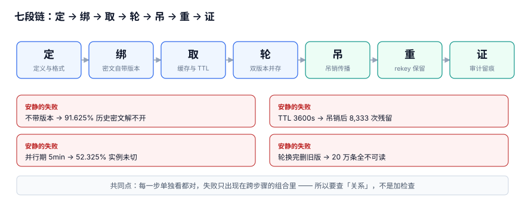

# 总览：三个「这把密钥」与六个安静的失败

密钥系统最贵的故障不是「被攻破」，而是**换了一把密钥之后，系统里有一半地方还指着旧的那把，而且谁都没发现**。这类失败不抛异常、不触发告警，往往要等到有人读一条半年前的数据、或者审计问「这次解封用的是哪把密钥」时才浮出来。

本页把整册的骨架搭起来：三个「这把密钥」、七段链、六个安静的失败。后面九章都在这张骨架上落细节。

::: tip 一句话定位
本页回答「**密钥轮换到底会牵动多少东西、为什么这些失败都不报错**」；具体的密文格式从[密钥分层与信封加密](../Layering/index.md)开始，制度与工具选型请看[密钥与凭据治理](../../../Ops/SecurityHardening/SecretGovernance/index.md)。
:::

本页判据族 `KYO-A` ~ `KYO-H`，共 8 条。



## 一、三个「这把密钥」

「换密钥」这三个字，在代码里通常对应三个完全不同的对象。不拆开，讨论就会一直错位。

| 名字 | 英文 | 具体是什么 | 变化频率 | 谁负责 |
| --- | --- | --- | --- | --- |
| 定义 | key definition | `key_id`、算法、用途（加密 / 签名 / 派生）、归属、谁能取 | 年级 | 平台 / 安全 |
| 版本 | key version | `(key_id, version)` 这一版密钥材料的状态与生效区间 | 月级 / 事件驱动 | KMS + 轮换任务 |
| 使用点 | usage point | 某个进程此刻缓存的那一版、缓存到几时、审计里有没有留痕 | 秒级 | 每个服务实例 |

三个对象共用同一个变量名 `KEY`，是绝大多数事故的起点：运维说「换了」，指的是**版本**；开发说「换了」，改的是**定义**；而线上真正出问题的，是几千个**使用点**没跟上。

### 1.1 用一张表把三者对齐

```sql [schema.sql]
CREATE TABLE kek_version (
  key_id      TEXT    NOT NULL,             -- 定义：这把密钥叫什么
  version     INTEGER NOT NULL,             -- 版本：第几次轮换
  state       TEXT    NOT NULL
    CHECK (state IN ('PENDING','ACTIVE','DECRYPT_ONLY','DISABLED')),
  not_before  INTEGER,                     -- 生效时刻（由 KMS 侧单调序号定，不用本地时钟）
  retired_at  INTEGER,
  PRIMARY KEY (key_id, version)
);

CREATE TABLE service_instance (
  instance_id    INTEGER PRIMARY KEY,
  key_id         TEXT NOT NULL,
  active_version INTEGER NOT NULL,          -- 使用点：这个进程此刻用哪一版
  switched_at    INTEGER
);
```

`service_instance.active_version` 是整册最容易被省略、也最要命的一列：**没有它，「并行期能不能关」就只能靠等时间，而等时间一定会错**（见[轮换窗口](../RotationWindow/index.md)）。

## 二、七段链

| 段 | 动作 | 输出物 | 下一段依赖它什么 |
| --- | --- | --- | --- |
| 定 | 定义 KEK / DEK 与密文格式 | 密文头字段表 | 版本号必须有地方写 |
| 绑 | 把 `key_id` + `kek_version` 写进密文 | 自描述的密文 | 解密时不再猜「当前版本」 |
| 取 | 运行时取密钥、进程内缓存 | 缓存项 + TTL | TTL 决定吊销残留窗口 |
| 轮 | 新版本上线、旧版本并存 | 并行窗口 | 窗口关闭要可判定 |
| 吊 | 凭据吊销 / 版本禁用 | 吊销事件 + 传播时刻 | 传播完成才算失效 |
| 重 | rekey 全部 DEK、保留旧版本 | 引用计数归零 | 归零后才能删旧版本 |
| 证 | 审计留痕、界定影响面 | 带 `key_version` 的审计行 | 事后能回答「哪把密钥」 |

七段里**六段的失败是安静的**：不报错、返回旧值、或者在轮换完一段时间后才集中爆发。这也是为什么这一层不能只靠监控——监控看的是「有没有异常」，而这里全是「正常」。

## 三、六个安静的失败（全部有本机读数）

下表来自本机 Python 3.13.12 标准库 + SQLite 3.50.4 的模拟压测，固定种子 `20261107`，20 万条密文 / 20 万次日请求 / 4,000 个服务实例。**这是模拟读数，不是生产 KMS 基准**；采集脚本不入库，读者可照[实战](../Practice/index.md)一章复现。

| # | 失败 | 现象 | 实测 |
| --- | --- | --- | --- |
| 1 | 密文不带版本 | 轮换后历史数据解不开 | 不带版本只有 **16,750 / 200,000** 可解，失败 **91.625%**；带版本 **0%** 失败 |
| 2 | 缓存 TTL 只当性能参数 | 吊销后仍能用旧密钥 | TTL 3600s → **8,333 次（4.1665%）**请求残留；30s → 69 次 |
| 3 | 并行期凭感觉给 5 分钟 | 旧版本被提前禁用，实例 5xx | 5 分钟仍有 **2,093 / 4,000（52.325%）**未切；切换 p99 **2164.3 s（36.1 min）** |
| 4 | 并发轮换无 CAS | 版本号回退 / 丢失更新 | 10,000 次里 **3,480 次（34.8%）**丢更新；条件更新后 **0** |
| 5 | 轮换完删旧版本 | 历史密文全成死数据 | 删旧 KEK 版本 → **20 万条全部不可读**（183,250 条属旧版本） |
| 6 | 用本地时钟给版本定序 | 版本顺序与审计顺序不一致 | σ=5 ms、5 ms 间隔下相邻逆序 **24.149%**，单调 `seq` 恒 **0%** |

::: danger 最容易漏掉的一条：第 5 条不会立刻疼
删掉旧 KEK 版本的那一刻，线上**一点反应都没有**——新写入、新读取都走新版本，接口全绿。直到有人去读三个月前的一条记录，才报一次「解密失败」，而这时旧版本可能连备份都过了保留期。

1. 删除前必须查引用计数：`SELECT COUNT(*) FROM ciphertext WHERE key_version = :v`，**为 0 才允许删**。
2. 用数据库触发器把这条规则写死（见[实战：`tg_no_drop_used_kek`](../Practice/index.md)），不要靠发布清单里的一句「记得检查」。
3. 轮换的正确终态是 `DECRYPT_ONLY`，不是 `DISABLED`；只有 rekey 完成、引用归零后才进 `DISABLED`。
:::

## 四、为什么这些失败都不报错

因为**每一步单独看都是对的**：

- 缓存命中旧版本，是缓存设计允许的行为；
- 实例还没重新拉配置，是最终一致性的正常窗口；
- 用「当前版本」去解没有版本号的密文，在轮换前 100% 正确；
- 删掉一个没人再用的 KEK 版本，从 KMS 视角看毫无问题。

失败只出现在**跨步骤的组合**里，而组合没有任何一个组件负责校验。所以本册的判据几乎都不是「加一个检查」，而是**加一条跨对象的关系**：密文 ↔ 版本、缓存 ↔ 吊销事件、实例 ↔ 窗口、审计行 ↔ key_version。

## 五、与邻页的分工（读这一册之前先分流）

| 你想知道 | 去哪 |
| --- | --- |
| 密钥生命周期六阶段、Vault 动态凭据、CI 里 OIDC 怎么配 | [密钥与凭据治理](../../../Ops/SecurityHardening/SecretGovernance/index.md) |
| `export` 之后同机用户能不能看到、`op run` 怎么写 | [开发环境密钥](../../../Tools/DevEnvironment/Secrets/index.md) |
| 应用 ID / Secret 的签名串与验签五步 | [应用凭据](../../OpenPlatform/AppCredential/index.md) |
| K8s 里 ExternalSecret 的 `refreshInterval` 怎么配 | [ConfigMap 与 Secret](../../../Ops/Kubernetes/ConfigMapSecret/index.md) |
| 证书（X.509）的签发、链与自动续期 | 证书与信任链专题（短寿命 + 自动续签，与密钥「轮换 + 吊销」不是同一套动作） |
| **一次解封请求绑定到哪一版、吊销多久生效、旧版本能不能删** | 本册 |

::: tip 一句话记住边界
邻页把密钥当作**要管好的资产**，本册把密钥当作**带版本的运行时依赖**。资产管得好，不代表换的那一刻系统自洽。
:::

## 六、判据 `KYO-A` ~ `KYO-H`

| 编号 | 判据 | 不满足时改哪里 | 验证方式 |
| --- | --- | --- | --- |
| `KYO-A` | 密文自带 `key_id` 与 `kek_version`，不依赖外部映射 | 密文头格式 / `ciphertext` 表 | 轮换一次后解一条历史密文，必须成功 |
| `KYO-B` | `kek_version` 有四态，旧版本默认是 `DECRYPT_ONLY` | `kek_version.state` 的 CHECK 与迁移脚本 | 查状态分布，不允许从 `ACTIVE` 直接 `DISABLED` |
| `KYO-C` | 每个服务实例登记 `active_version`，窗口关闭靠查询而非计时 | `service_instance` 表 / 轮换任务 | 关窗前查 `COUNT(*) WHERE active_version < :new` 必须为 0 |
| `KYO-D` | 缓存 TTL 有上限，且按「吊销残留窗口」评审而非按命中率 | `cache_entry.ttl_sec` / 配置中心 | 把 TTL 从 3600 改 300，残留请求应从 8,333 降到 694 |
| `KYO-E` | 轮换用条件更新（CAS），不允许无条件 `version + 1` | 轮换任务的 UPDATE 语句 | 并发跑 10,000 次，丢失更新必须为 0 |
| `KYO-F` | 删除 KEK 版本前引用计数为 0，且有触发器兜底 | `tg_no_drop_used_kek` | 对有密文引用的版本执行 DELETE，必须 ABORT |
| `KYO-G` | 版本与审计用单调 `seq` 定序，不用本地时钟排序 | `audit_log.seq` / 触发器 `tg_audit_seq` | σ=5 ms 抖动下逆序数必须为 0 |
| `KYO-H` | 上述七条各有一条可执行命令，能在干净库上复现 | [实战脚本](../Practice/index.md) | `PRACTICE 10/10 PASS / EXIT=0` |

## 七、验证方式

在仓库根目录跑下面这段，它把「三个对象是否被拆开」变成一条可判定的 SQL：

```shell
cd /tmp && python3 - <<'PY'
import sqlite3
con = sqlite3.connect(":memory:")
c = con.cursor()
c.execute("CREATE TABLE kek_version (key_id TEXT, version INTEGER, state TEXT, PRIMARY KEY(key_id,version))")
c.execute("CREATE TABLE ciphertext (ct_id INTEGER PRIMARY KEY, key_version INTEGER NOT NULL CHECK(key_version>0))")
c.execute("CREATE TABLE service_instance (instance_id INTEGER PRIMARY KEY, active_version INTEGER NOT NULL)")
c.executemany("INSERT INTO kek_version VALUES('kek-main',?,'DECRYPT_ONLY')", [(v,) for v in range(1,12)])
c.execute("INSERT INTO kek_version VALUES('kek-main',12,'ACTIVE')")
c.executemany("INSERT INTO ciphertext(key_version) VALUES(?)", [(v % 12 + 1,) for v in range(200000)])
c.executemany("INSERT INTO service_instance(active_version) VALUES(12)", [(12,)]*4000)

# 1) 密文是否都自带版本
print("1) 无版本密文:", c.execute("SELECT COUNT(*) FROM ciphertext WHERE key_version IS NULL OR key_version<=0").fetchone()[0])
# 2) 删旧版本会丢多少条
print("2) 旧版本密文:", c.execute("SELECT COUNT(*) FROM ciphertext WHERE key_version<12").fetchone()[0])
# 3) 窗口能否关（未切实例数）
print("3) 未切实例:", c.execute("SELECT COUNT(*) FROM service_instance WHERE active_version<12").fetchone()[0])
PY
```

预期输出：

```text
1) 无版本密文: 0
2) 旧版本密文: 183250
3) 未切实例: 0
```

第 2 行的 183,250 就是「删掉旧版本会丢的数据量」——**这个数字在轮换的那一刻是查得出来的，只是没人查**。

## 参考资料

- [NIST SP 800-57 Part 1 Rev.5: Recommendation for Key Management](https://csrc.nist.gov/pubs/sp/800/57/pt1/r5/final)
- [AWS KMS: Envelope encryption concepts](https://docs.aws.amazon.com/kms/latest/developerguide/concepts.html#enveloping)
- [Google Cloud: Key rotation](https://cloud.google.com/kms/docs/key-rotation)
- [OWASP Secrets Management Cheat Sheet](https://cheatsheetseries.owasp.org/cheatsheets/Secrets_Management_Cheat_Sheet.html)
