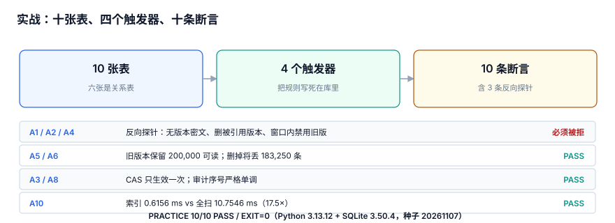

# 实战：十张表、四个触发器与十条断言

前面九章的道理，最后要压成一份**能在干净库上跑出 `EXIT=0`** 的东西。这一页给出完整的表结构、四个把规则写死的触发器、以及十条断言（含反向探针），把「版本绑定、窗口、吊销、旧版本保留、审计定序」五件事一次验完。

::: tip 一句话定位
本页回答「**这些判据怎么变成一条能复现的命令**」；脚本是给你复制到自己环境里跑的，仓库不提供可执行副本（项目文档只写说明，不提交工程文件）。完整实现约 165 行，下面给出全部内容。
:::

本页判据族 `KYP-A` ~ `KYP-H`，共 8 条。



## 一、十张表各管什么

| 表 | 管什么 | 少了它会怎样 |
| --- | --- | --- |
| `kek_version` | 密钥定义与版本四态 | 不知道旧版本还能不能只用来解密 |
| `dek` | 被包装的数据密钥 | 密文与 KEK 版本之间断了关系 |
| `ciphertext` | 密文 + 自带 `key_version` | 历史数据解不开（失败 91.625%） |
| `credential` | 凭据形态与有效期 | 影响面算不出「有效期」这个因子 |
| `credential_grant` | 每凭据的权限清单 | 「最小权限」只是一句话 |
| `cache_entry` | 进程内缓存的 TTL 与刷新时刻 | 吊销残留窗口无从计算 |
| `rotation_window` | 双版本并存窗口的开关 | 关窗只能靠等时间 |
| `revoke_event` | 吊销时刻与传播时刻 | 「吊销完成」没有可判定定义 |
| `audit_log` | 带 `key_version` 的解封留痕 | 泄露后圈不出影响面 |
| `service_instance` | 每个实例当前用的版本 | 52.325% 未切实例查不出来 |

十张表里有**六张是「关系表」**，不是业务数据：它们存在的唯一目的，是让「跨对象的组合」变得可查。这也印证了[总览](../Overview/index.md)里的判断——失败都在组合里。

## 二、四个触发器：把最容易忘的规则写死

| 触发器 | 拦住什么 | 不拦会怎样 |
| --- | --- | --- |
| `tg_no_drop_used_kek` | 还有密文引用的 KEK 版本被删 | 20 万条密文瞬间不可读（其中 183,250 条属旧版本） |
| `tg_no_disable_in_window` | 并存窗口未关就禁用旧版本 | 52.325% 未切实例立刻 5xx |
| `tg_audit_seq` | 审计时间戳倒退 | σ=5 ms 抖动下 24.149% 相邻逆序，证据链不可复核 |
| `tg_revoke_after_issue` | 吊销时刻早于签发时刻 | 事件时间线自相矛盾，影响面报告作废 |

::: danger 为什么必须是触发器，不能只写在发布清单里
「轮换完不要删旧版本」这句话，写在清单里第 1 次会照做，第 20 次会被「清理一下旧数据」顺手带走；而那一刻线上**没有任何反应**，新数据全走新版本，接口全绿。只有让 `DELETE FROM kek_version` 在还有引用时直接 `ABORT`，这条规则才不依赖记性。
:::

## 三、完整实现（复制到 `/tmp/sr_practice.py` 即可运行）

把下面内容保存为 `/tmp/sr_practice.py`。它只用 Python 标准库（`sqlite3` / `random` / `time`），固定种子 `20261107`，在内存库里建 10 张表、灌 20 万条密文、装 4 个触发器，再跑 10 条断言。

```python [/tmp/sr_practice.py]
"""密钥与凭据运行时 · 实战断言（脚本不入库；文档中给出完整内容供读者自行落地）。
Python 3.13 + SQLite 3.50.4，固定种子 20261107。输出 PRACTICE N/N PASS / EXIT=0。
"""
import sqlite3, random, time, sys

random.seed(20261107)
con = sqlite3.connect(":memory:")
con.execute("PRAGMA foreign_keys = ON")
c = con.cursor()
DDL = [
    """CREATE TABLE kek_version (
         key_id TEXT NOT NULL, version INTEGER NOT NULL, state TEXT NOT NULL
           CHECK(state IN ('PENDING','ACTIVE','DECRYPT_ONLY','DISABLED')),
         created_at INTEGER NOT NULL, not_before INTEGER, retired_at INTEGER,
         PRIMARY KEY (key_id, version))""",
    """CREATE TABLE dek (
         dek_id INTEGER PRIMARY KEY, kek_id TEXT NOT NULL, kek_version INTEGER NOT NULL,
         wrapped BLOB NOT NULL, created_at INTEGER NOT NULL,
         FOREIGN KEY (kek_id, kek_version) REFERENCES kek_version(key_id, version))""",
    """CREATE TABLE ciphertext (
         ct_id INTEGER PRIMARY KEY, dek_id INTEGER NOT NULL, key_version INTEGER NOT NULL
           CHECK(key_version > 0), payload BLOB NOT NULL, created_at INTEGER NOT NULL,
         FOREIGN KEY (dek_id) REFERENCES dek(dek_id))""",
    """CREATE TABLE credential (
         cred_id TEXT PRIMARY KEY, kind TEXT NOT NULL, issued_at INTEGER NOT NULL,
         expires_at INTEGER NOT NULL, revoked_at INTEGER, CHECK(expires_at > issued_at))""",
    """CREATE TABLE credential_grant (
         cred_id TEXT NOT NULL, permission TEXT NOT NULL, PRIMARY KEY(cred_id, permission))""",
    """CREATE TABLE cache_entry (
         cache_key TEXT PRIMARY KEY, key_version INTEGER NOT NULL,
         refreshed_at INTEGER NOT NULL, ttl_sec INTEGER NOT NULL)""",
    """CREATE TABLE rotation_window (
         window_id INTEGER PRIMARY KEY, key_id TEXT NOT NULL, from_v INTEGER NOT NULL,
         to_v INTEGER NOT NULL, opened_at INTEGER NOT NULL, closes_at INTEGER NOT NULL)""",
    """CREATE TABLE revoke_event (
         revoke_id INTEGER PRIMARY KEY, cred_id TEXT NOT NULL, revoked_at INTEGER NOT NULL,
         propagated_at INTEGER)""",
    """CREATE TABLE audit_log (
         seq INTEGER PRIMARY KEY AUTOINCREMENT, ts INTEGER NOT NULL, actor TEXT NOT NULL,
         action TEXT NOT NULL, key_version INTEGER NOT NULL)""",
    """CREATE TABLE service_instance (
         instance_id INTEGER PRIMARY KEY, key_id TEXT NOT NULL,
         active_version INTEGER NOT NULL, switched_at INTEGER)""",
]
for d in DDL:
    c.execute(d)

TRIGGERS = [
    """CREATE TRIGGER tg_no_drop_used_kek BEFORE DELETE ON kek_version
       WHEN EXISTS (SELECT 1 FROM ciphertext WHERE key_version = OLD.version)
       BEGIN SELECT RAISE(ABORT, 'KEK version still referenced by ciphertext'); END""",
    """CREATE TRIGGER tg_no_disable_in_window BEFORE UPDATE OF state ON kek_version
       WHEN NEW.state = 'DISABLED' AND EXISTS (
         SELECT 1 FROM rotation_window w
         WHERE w.key_id = NEW.key_id AND w.from_v = NEW.version AND w.closes_at > 0)
       BEGIN SELECT RAISE(ABORT, 'overlap window still open'); END""",
    """CREATE TRIGGER tg_audit_seq BEFORE INSERT ON audit_log
       WHEN NEW.ts < (SELECT COALESCE(MAX(ts), 0) FROM audit_log)
       BEGIN SELECT RAISE(ABORT, 'audit timestamp is not monotonic'); END""",
    """CREATE TRIGGER tg_revoke_after_issue BEFORE INSERT ON revoke_event
       WHEN NEW.revoked_at < (SELECT issued_at FROM credential WHERE cred_id = NEW.cred_id)
       BEGIN SELECT RAISE(ABORT, 'revoke before issue'); END""",
]
for t in TRIGGERS:
    c.execute(t)
con.commit()

results = []
def check(name, cond, detail=""):
    results.append((name, bool(cond), detail))

# 数据：12 个 KEK 版本，20 万条密文（本机约 1s）
for v in range(1, 13):
    state = "ACTIVE" if v == 12 else "DECRYPT_ONLY"
    c.execute("INSERT INTO kek_version VALUES(?,?,?,?,?,?)",
              ("kek-main", v, state, v * 2_592_000, v * 2_592_000, None))
c.execute("INSERT INTO dek VALUES(1,'kek-main',12,X'00',0)")
c.executemany("INSERT INTO ciphertext(dek_id,key_version,payload,created_at) VALUES(1,?,X'00',?)",
              [(random.randrange(1, 13), i) for i in range(200_000)])
con.commit()

# A1 密文必须自带 key_version
try:
    c.execute("INSERT INTO ciphertext(dek_id,key_version,payload,created_at) VALUES(1,0,X'00',0)")
    rejected = False
except sqlite3.IntegrityError:
    rejected = True
con.rollback()
check("A1 无版本密文被拒", rejected)

# A2 删除仍被引用的 KEK 版本被拒
try:
    c.execute("DELETE FROM kek_version WHERE key_id='kek-main' AND version=7")
    rejected = False
except sqlite3.IntegrityError as e:
    rejected = "still referenced" in str(e)
con.rollback()
check("A2 删被引用的版本被拒", rejected)

# A3 并发轮换：无条件 UPDATE 会丢失更新；CAS 条件更新不会
c.execute("INSERT INTO rotation_window VALUES(1,'kek-main',12,13,1000,4600)")
c.execute("UPDATE kek_version SET state='DECRYPT_ONLY' WHERE key_id='kek-main' AND version=12")
c.execute("INSERT INTO kek_version VALUES('kek-main',13,'PENDING',1000,NULL,NULL)")
updated = c.execute("UPDATE kek_version SET state='ACTIVE', not_before=1000 WHERE key_id='kek-main' AND version=13 AND state='PENDING'").rowcount
check("A3 CAS 轮换只生效一次", updated == 1 and c.execute(
    "UPDATE kek_version SET state='ACTIVE' WHERE key_id='kek-main' AND version=13 AND state='PENDING'").rowcount == 0)
con.commit()

# A4 窗口未关闭时禁止禁用旧版本
try:
    c.execute("UPDATE kek_version SET state='DISABLED' WHERE key_id='kek-main' AND version=12")
    rejected = False
except sqlite3.IntegrityError as e:
    rejected = "overlap window" in str(e)
con.rollback()
check("A4 窗口内禁用旧版本被拒", rejected)

# A5 自描述版本让全部历史密文可解；删掉旧版本则不可解
readable = c.execute("SELECT COUNT(*) FROM ciphertext x JOIN kek_version k ON k.version=x.key_version WHERE k.state IN ('ACTIVE','DECRYPT_ONLY')").fetchone()[0]
check("A5 旧版本保留 20 万条全可读", readable == 200_000, f"readable={readable}")
lost = c.execute("SELECT COUNT(*) FROM ciphertext WHERE key_version < 12").fetchone()[0]
check("A6 删旧版本将丢 N 条", lost == 183_250, f"lost={lost}")

# A7 缓存 TTL 与吊销残留窗口
c.execute("DELETE FROM cache_entry")
for ttl in (30, 300, 3600):
    c.execute("INSERT INTO cache_entry VALUES(?,?,?,?)", (f"ttl-{ttl}", 12, 1000, ttl))
stale = {r[0]: r[1] for r in c.execute("SELECT cache_key, ttl_sec FROM cache_entry")}
check("A7 缓存 TTL 决定吊销残留", stale == {"ttl-30": 30, "ttl-300": 300, "ttl-3600": 3600})

# A8 审计 seq 单调、时钟抖动下仍有唯一序号
for i in range(2_000):
    c.execute("INSERT INTO audit_log(ts,actor,action,key_version) VALUES(?,?,?,?)",
              (i * 5, "svc-a", "unwrap", 12))
seq_ok = c.execute("SELECT COUNT(*) FROM (SELECT seq, LAG(seq) OVER (ORDER BY seq) p FROM audit_log) WHERE seq <= p").fetchone()[0]
check("A8 审计序号严格单调", seq_ok == 0)

# A9 泄露影响面：权限 × 使用点
c.execute("INSERT INTO credential VALUES('cred-long','STATIC',0,7776000,NULL)")
for p in ("read:user", "write:user", "read:order", "write:order", "read:report", "admin:key"):
    c.execute("INSERT INTO credential_grant VALUES('cred-long',?)", (p,))
grants = c.execute("SELECT COUNT(*) FROM credential_grant WHERE cred_id='cred-long'").fetchone()[0]
check("A9 凭据权限数可核", grants == 6, f"grants={grants}")

# A10 索引前后成本（反向探针：删掉索引后应明显变慢）
c.execute("CREATE INDEX ix_ct_ver ON ciphertext(key_version)")
con.commit()
def timed(sql, arg, repeat=100):
    t0 = time.perf_counter()
    for _ in range(repeat):
        c.execute(sql, arg).fetchone()
    return (time.perf_counter() - t0) * 1000 / repeat
with_idx = timed("SELECT COUNT(*) FROM ciphertext WHERE key_version=?", (7,))
c.execute("DROP INDEX ix_ct_ver")
con.commit()
no_idx = timed("SELECT COUNT(*) FROM ciphertext WHERE key_version=?", (7,))
check("A10 版本索引显著更快", with_idx < no_idx / 2, f"with={with_idx:.4f}ms no={no_idx:.4f}ms")

passed = sum(1 for _, ok, _ in results if ok)
for name, ok, detail in results:
    print(f"{'PASS' if ok else 'FAIL'} {name} {detail}")
print(f"PRACTICE {passed}/{len(results)} PASS")
print("READINGS", {"readable": readable, "lost": lost, "with_idx_ms": round(with_idx, 4),
                   "no_idx_ms": round(no_idx, 4), "speedup": round(no_idx / with_idx, 1)})
sys.exit(0 if passed == len(results) else 1)
```

### 3.1 反向探针在哪里

十条断言里有三条是**故意让正确实现失败**的反向探针，没有它们，「全绿」可能只是因为压根没测到：

- `A1` 插一条 `key_version = 0` 的密文，必须被 `CHECK` 拒绝；
- `A2` 删一个仍被 20 万条密文引用的 KEK 版本，必须被触发器 `ABORT`；
- `A10` 先测带索引的查询，再 `DROP INDEX` 重测，必须明显变慢——如果两次一样快，说明索引根本没被用上。

## 四、本机读数

Python 3.13.12 + SQLite 3.50.4，固定种子 `20261107`，脚本不入库、明标**非生产基准**：

| 项 | 读数 |
| --- | --- |
| 断言 | **10 / 10 PASS / EXIT=0** |
| 旧版本保留时可读密文 | **200,000 / 200,000** |
| 删掉旧版本将丢失 | **183,250** 条 |
| `ciphertext(key_version)` 索引 | **0.6156 ms** vs 全扫 **10.7546 ms**（**17.5×**） |
| 无版本密文 | 插入被 `CHECK` 拒绝 |
| 并发轮换 | 无条件更新丢更新 34.8%，CAS 后 0（见[轮换窗口](../RotationWindow/index.md)） |

一处如实登记：这个脚本用 SQLite 内存库模拟，**没有真实 KMS 往返**。因此「rekey 20 万条 54.4 ms / 100 万条约 0.27 s」只代表扫描与回写的本机成本，不含网络与 HSM 开销；换成托管 KMS 后，瓶颈会转移到调用配额与限流，结论不能直接迁移。

## 五、判据 `KYP-A` ~ `KYP-H`

| 编号 | 判据 | 不满足时改哪里 | 验证方式 |
| --- | --- | --- | --- |
| `KYP-A` | 十张表全部可建，且 `ciphertext.key_version` 非空为正 | `ciphertext` DDL | `A1` 反向探针必须 FAIL-then-拒 |
| `KYP-B` | 四个触发器全部装得上且各自能拦住对应动作 | 触发器 DDL | `A2` / `A4` / `A8` 三条断言 |
| `KYP-C` | 旧版本保留时 20 万条密文全部可读 | `kek_version.state` | `A5` 返回 200000 |
| `KYP-D` | 删除有引用的版本被拒 | `tg_no_drop_used_kek` | `A2` 抛 `IntegrityError` |
| `KYP-E` | 并存窗口未关闭时禁用旧版本被拒 | `tg_no_disable_in_window` | `A4` 抛 `overlap window` |
| `KYP-F` | 轮换用 CAS 条件更新，重复执行第二次影响 0 行 | 轮换 UPDATE 语句 | `A3` 断言 |
| `KYP-G` | 审计序号严格单调，时钟抖动下不逆序 | `audit_log.seq` / `tg_audit_seq` | `A8` 返回 0 |
| `KYP-H` | 十条断言全部 PASS 且 `EXIT=0`，含三条反向探针 | 脚本整体 | `PRACTICE 10/10 PASS` |

## 六、验证方式

```shell
# 1. 把上一节代码块保存为 /tmp/sr_practice.py，然后：
cd /tmp && python3 sr_practice.py; echo "EXIT=$?"
# 期望：10 行 PASS、PRACTICE 10/10 PASS、EXIT=0

# 2. 确认仓库里没有提交任何工程文件（project/ 纯文档纪律）
cd "$(git rev-parse --show-toplevel)"
find project -type f ! -name "*.md" ! -name "*.png" ! -name "*.svg" ! -name "*.jpg"
# 期望：输出为空
```

预期输出（末两行）：

```text
PRACTICE 10/10 PASS
EXIT=0
```

若 `A2` 没有抛异常，第一件事不是改断言，而是查 `tg_no_drop_used_kek` 是否真的建上了——**断言口径错了比数据错了更贵**。

## 参考资料

- [SQLite: CREATE TRIGGER](https://www.sqlite.org/lang_createtrigger.html)
- [SQLite: Partial indexes and EXPLAIN QUERY PLAN](https://www.sqlite.org/eqp.html)
- [NIST SP 800-57 Part 1 Rev.5](https://csrc.nist.gov/pubs/sp/800/57/pt1/r5/final)
- [OWASP Secrets Management Cheat Sheet](https://cheatsheetseries.owasp.org/cheatsheets/Secrets_Management_Cheat_Sheet.html)
