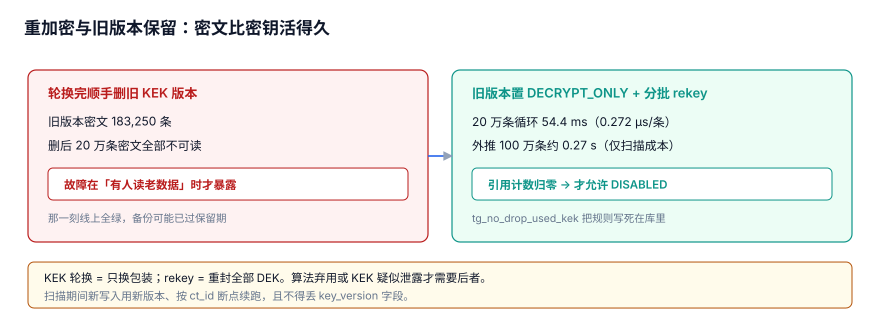

# 重加密与旧版本保留：为什么密文比密钥活得久

密钥有寿命，密文比它活得久。轮换完顺手把旧 KEK 版本删掉，是最「干净」也最致命的操作：那条 DDL 会成功、接口照常返回 200，只是从某天起历史数据整片读不出来。本页讲清旧版本该留到什么时候、rekey 该怎么跑得可中断。

本页判据族 `KYF-A` ~ `KYF-H`，共 8 条。

::: tip 一句话定位
本页回答「**旧 KEK 版本为什么必须留、什么时候才能删、rekey 怎么跑**」。版本怎么绑进密文见[版本绑定](../VersionBinding/index.md)，状态机与并存期见[轮换窗口](../RotationWindow/index.md)，删版本前的吊销路径见[吊销传播](../Revocation/index.md)；KEK / DEK 的结构见[密钥分层与信封加密](../Layering/index.md)。治理层的密钥归档与销毁审批不在这里，见 [SecretGovernance](../../../Ops/SecurityHardening/SecretGovernance/index.md)；K8s 里的 Secret 注入见 [ConfigMapSecret](../../../Ops/Kubernetes/ConfigMapSecret/index.md)。
:::



## 一、两件事：KEK 轮换 ≠ rekey

最常見的混淆，是把「换 KEK 版本」和「重封所有 DEK」当成一件事。它们动的东西完全不同：

| 对比项 | KEK 轮换 Key Rotation | 重加密 Rekey |
| --- | --- | --- |
| 换的对象 | KEK 版本（只换包装层） | 逐条把 DEK 用新版本重新封装 |
| 动历史密文吗 | **不动**，老密文仍由老版本解 | **动**，全表扫描 + 逐条回写 |
| 影响范围 | 只影响此后**新写入**用哪个版本 | 所有 `key_version = 旧版本` 的存量 |
| 成本 | 一次状态切换 | 受全表扫描与回写 I/O 支配 |
| 触发条件 | 常规周期轮换 | 算法弃用、KEK 疑似泄露、合规要求 |

### 1.1 什么时候必须做 rekey

KEK 轮换只保证「新数据安全」，存量数据仍躺在旧版本下。下面三种情况必须做 rekey，光切版本不够：

1. **算法 / 密钥长度被弃用**：旧版本本身不再合规，留着它解密等于继续用不合规的算法；
2. **KEK 疑似泄露**：旧版本还在 `DECRYPT_ONLY`，就意味着泄露的密钥仍能解存量数据；
3. **合规要求「所有数据用当前版本封装」**：审计只认 `key_version`，不认「反正能解开」。

### 1.2 前提是密文自己说清用了哪把密钥

[版本绑定](../VersionBinding/index.md)的实测：20 万条密文 / 12 个 KEK 版本，密文**不带**版本时只有当前版本可解，成功 16,750 条、失败率 91.625%；带自描述版本则是 200,000 / 200,000 可解、失败率 0%。rekey 要能按 `key_version` 精确挑出存量，靠的就是这个字段——**它丢了，rekey 连该改哪些行都不知道**。

## 二、删掉旧版本会发生什么：20 万条不可读

::: info 读数口径
以下数字来自本机**模拟压测 + SQLite 3.50.4 实战**（Python 3.13.12 标准库，固定种子 `20261107`，脚本不入库、读者可照文档复现），**不是生产 KMS 基准**。
:::

| 操作 | 结果 |
| --- | --- |
| 旧版本保留 | **200,000 / 200,000** 条密文可读 |
| 删掉旧 KEK 版本 | **20 万条密文全部不可读** |
| 实战里属于旧版本的密文 | **183,250 条** |

一句话结论：**密文的寿命 > 密钥的寿命**。密文落盘、进备份、跨区域复制，没人能在删密钥前把它们全找出来；删版本只是删了一行元数据，却同时废掉了一大片数据的解密依赖。这是[总览](../Overview/index.md)里「六个安静的失败」的第五个：DDL 成功、服务在线、监控全绿，只有历史数据悄悄读不出来了。

所以旧版本不是「垃圾」，是**历史数据的解密依赖**。它在[轮换窗口](../RotationWindow/index.md)里停在 `DECRYPT_ONLY`，只解不写，一直留到没有一条密文引用它为止。

## 三、rekey 循环有多快：成本在扫描与回写不在 KMS

| 指标 | 实测值 |
| --- | --- |
| 20 万条 rekey 循环 | **54.4 ms** |
| 单条摊销 | **0.272 µs/条** |
| 外推 100 万条 | 约 **0.27 s** |
| 删旧 KEK 版本 / 保留旧版本 | 20 万条全部不可读 / 0 条不可读 |

20 万条的纯循环只要 54.4 ms，外推 100 万条也才约 0.27 s——**CPU 不是瓶颈**。KMS 侧同样不是：DEK 缓存把每日 KMS 调用从不缓存的 200,000 降到 288（**694.4×**，见[凭据分发](../Distribution/index.md)）。

于是结论很清楚：**成本在扫描与回写，不在 KMS**。真正吃时间的是把 20 万条从磁盘读出来、逐条 `UPDATE` 回去、以及由此产生的锁与 WAL 压力。既然瓶颈是 I/O 和锁，rekey 就必须分批、限流、可中断，不能一条 `UPDATE` 全表扫完。

::: warning 扫描也要走索引
`ciphertext(key_version)` 上的索引实测 0.6156 ms，全表扫描 10.7546 ms，差 **17.5×**。分批取数若写成全扫，每一批都在重复付这个代价——按 `key_version` 走索引是分批的前提，不是优化项。
:::

## 四、扫描期间的新写入：双写、幂等与 key_version 不得丢

扫描要跑一段时间，这期间**不能停写**。三条规则必须同时成立：

1. **新写入一律用新版本**：写入路径读的是 `active_version`，扫描只处理 `key_version = :old` 的存量行，两边互不干扰；
2. **双写 / 双版本并存**：新数据用新版本封装，旧版本仍保留 `DECRYPT_ONLY`，同一份数据在窗口内两个版本都可解，需要回滚时直接切回旧版本，不必反向重封；
3. **按 `ct_id` 幂等**：每条重封带 `ct_id` 与旧版本双条件，重跑同一批时 affected rows 为 0；断点续跑靠 `rekey_cursor(last_ct_id)` 记水位。

还有一条底线：**rekey 不得丢 `key_version` 字段**。回写时它要改成新版本，不能置空，也不能只更新 `dek_wrapped`——丢了这个字段，密文就退回「不带版本」的状态，下一次轮换又会撞上 91.625% 的解密失败。

```sql
-- 取一批待重封的密文：按 key_version 走索引，ct_id 当游标
SELECT ct_id, dek_wrapped
FROM ciphertext
WHERE key_version = :old AND ct_id > :cursor
ORDER BY ct_id
LIMIT :batch;

-- 幂等回写：ct_id + 旧版本双条件，重跑不会重复处理；key_version 一起改
UPDATE ciphertext
SET dek_wrapped = :new_wrapped, key_version = :new
WHERE ct_id = :ct_id AND key_version = :old;
```

`LIMIT :batch` 由第六节的限流决定，不是拍一个固定值。

## 五、`tg_no_drop_used_kek` 触发器完整 SQL

把「还有密文引用就不许删版本」下沉到数据库层，任何清理脚本、任何人都绕不过去：

```sql
CREATE TRIGGER tg_no_drop_used_kek
BEFORE DELETE ON kek_version
FOR EACH ROW
WHEN EXISTS (
    SELECT 1 FROM ciphertext WHERE key_version = OLD.version
)
BEGIN
    SELECT RAISE(ABORT,
        'tg_no_drop_used_kek: 仍有密文引用该 KEK 版本，禁止删除');
END;
```

这是第二节那 20 万条不可读事故的最后一道闸：只要 `ciphertext` 里还有一行 `key_version` 指向这个版本，`DELETE` 就被 `ABORT`。注意它和[轮换窗口](../RotationWindow/index.md)的 `tg_no_disable_in_window` 管的是两件事——一个拦「禁用」，一个拦「删除」，两道闸都要在。十张表与四个触发器的全貌见[实战](../Practice/index.md)（10 张表 + 4 个触发器 + 10 条断言，10/10 PASS / EXIT=0）。

## 六、分批、限流、可中断与失败重试

| 要求 | 怎么做 | 为什么 |
| --- | --- | --- |
| 分批 | 按 `ct_id` 游标取 `:batch` 条，一批一提交 | 避免长事务一直 holding 锁 |
| 限流 | 批间按 WAL 压力与从库延迟调节节奏 | 瓶颈是扫描 + 回写 I/O，别把在线流量拖垮 |
| 可中断 | 每批提交后写 `rekey_cursor(last_ct_id)` | 进程挂了从水位续跑，不从头来 |
| 失败重试 | 单条失败记 `rekey_failed(ct_id, reason)`，不中断整批 | `WHERE key_version = :old` 让重试天然幂等 |
| 完成判据 | `COUNT(*) WHERE key_version = :old` 为 0 才允许删旧版本 | 触发器是第二道确认，不是第一道判断 |

批处理的核心循环长这样（`wrap` 处是读者自己调用 KMS 重新封装 DEK 的位置）：

```python
def rekey_batch(con, old, new, cursor, batch):
    rows = con.execute(
        "SELECT ct_id FROM ciphertext WHERE key_version=? AND ct_id>? "
        "ORDER BY ct_id LIMIT ?", (old, cursor, batch)).fetchall()
    for (ct_id,) in rows:
        # wrap(...) 表示「用新 KEK 版本重新封装 DEK」，由读者接入自己的 KMS
        con.execute(
            "UPDATE ciphertext SET dek_wrapped=?, key_version=? "
            "WHERE ct_id=? AND key_version=?",
            (wrap(ct_id, new), new, ct_id, old))
    if rows:
        con.execute("UPDATE rekey_cursor SET last_ct_id=? WHERE job=?",
                    (rows[-1][0], job))
        con.commit()
    return len(rows)
```

## 七、易错点

::: danger 六个按代价排序的坑，逐条给正确写法
1. **轮换完顺手删旧 KEK 版本**：20 万条密文全部不可读，且不报错。正确写法是留到 `DECRYPT_ONLY`，确认 `COUNT(*) WHERE key_version = :old` 为 0 再删，并用 `tg_no_drop_used_kek` 兜底。
2. **把 KEK 轮换当 rekey 做（或反过来）**：算法弃用、KEK 泄露时只切了新写入，存量仍用不合规版本。正确写法是按第一节分清触发条件，泄露场景必须重封全部 DEK。
3. **一条 `UPDATE` 全表扫完**：长事务、锁竞争、WAL 压力把在线流量拖垮。正确写法是按 `ct_id` 分批、批间提交、按 WAL/从库延迟限流。
4. **回写时丢 `key_version` 或只改 `dek_wrapped`**：密文退回「不带版本」，下次轮换 91.625% 解不开。正确写法是 `SET key_version = :new` 与 `dek_wrapped` 一起写。
5. **中断后从头重跑、重试不幂等**：重复处理、重复计费。正确写法是 `WHERE ct_id = :ct_id AND key_version = :old` 加 `rekey_cursor` 水位。
6. **扫描期间停写，或允许新写入继续用旧版本**：存量永远扫不干净。正确写法是新写入只用 `active_version`（新版本），扫描只处理存量行。
:::

::: tip 旧版本能不能删，答案是查出来的，不是「觉得该清理了」
先跑 `SELECT COUNT(*) FROM ciphertext WHERE key_version = :old`，为 0 才走删除；触发器只作第二道确认。[实战](../Practice/index.md)把这条固化成一条断言：`tg_no_drop_used_kek` 在建、且旧版本引用清零，才允许 `DELETE`。把「清理」当成定时任务跑，是这 20 万条不可读事故最常见的来源。
:::

## 判据

| 编号 | 判据 | 不满足时改哪里 | 验证方式 |
| --- | --- | --- | --- |
| `KYF-A` | 区分 KEK 轮换与 rekey；算法弃用 / KEK 疑似泄露 / 合规要求才触发 rekey | 变更单 `rekey_reason` 与触发条件清单 | 查触发理由取值；见验证方式第 1 段确认存量规模 |
| `KYF-B` | 旧 KEK 版本在引用清零前保持 `DECRYPT_ONLY`，不删除 | `kek_version.state` 与删除流程 | 有引用时 `DELETE` 被 ABORT，见第 3 段 |
| `KYF-C` | `tg_no_drop_used_kek` 已建，条件为 `EXISTS(ciphertext.key_version = OLD.version)` | 触发器定义本身 | 尝试删除被拦下，见第 3 段 |
| `KYF-D` | rekey 按 `ct_id` 分批、批间提交并写 `rekey_cursor.last_ct_id` | `rekey_cursor` 表与批处理循环 | 重复执行 affected rows 为 0，见第 4 段 |
| `KYF-E` | 回写同时更新 `dek_wrapped` 与 `key_version`，`key_version` 不得置空 | rekey 的 `UPDATE` 语句 | `key_version IS NULL` 计数为 0，见第 6 段 |
| `KYF-F` | 扫描期间新写入只用 `active_version`（新版本），扫描只处理 `key_version = :old` 存量 | 写入路径与扫描 SQL 的 `WHERE` | 完成判据计数为 0，见第 5 段 |
| `KYF-G` | 扫描按 `ciphertext(key_version)` 索引取批次，并按 WAL / 从库延迟限流 | `ciphertext(key_version)` 索引与批大小 `:batch` 配置 | 分批游标按 `ct_id` 递增，见第 4 段 |
| `KYF-H` | 上述七条各有一条可执行命令，能在干净库上复现 | 验收脚本 | `python3` 自检输出全 PASS |

## 验证方式

在任意干净的 SQLite 库上跑下面这段（无需外部依赖，脚本内容直接内联）。重点是**第 3 段必须被触发器拦下**、**第 5 段删除必须成功**、**第 6 段必须为 0**：

```shell
cd /tmp && python3 - <<'PY'
import sqlite3
con = sqlite3.connect(":memory:")
con.executescript("""
CREATE TABLE kek_version(version INTEGER PRIMARY KEY, state TEXT NOT NULL);
CREATE TABLE ciphertext(
    ct_id TEXT PRIMARY KEY, key_version INTEGER NOT NULL, dek_wrapped TEXT NOT NULL
);
CREATE TRIGGER tg_no_drop_used_kek
BEFORE DELETE ON kek_version
FOR EACH ROW
WHEN EXISTS (SELECT 1 FROM ciphertext WHERE key_version = OLD.version)
BEGIN
    SELECT RAISE(ABORT, 'tg_no_drop_used_kek: 仍有密文引用该 KEK 版本，禁止删除');
END;
""")
OLD, NEW = 11, 12
OLD_ROWS, TOTAL = 183250, 200000
con.execute("INSERT INTO kek_version VALUES(?, 'DECRYPT_ONLY')", (OLD,))
con.execute("INSERT INTO kek_version VALUES(?, 'ACTIVE')", (NEW,))
con.executemany("INSERT INTO ciphertext VALUES(?, ?, ?)",
                [(f"ct{i}", OLD if i < OLD_ROWS else NEW, "wrapped") for i in range(TOTAL)])

print("1) 属于旧版本的密文条数：")
print(con.execute("SELECT COUNT(*) FROM ciphertext WHERE key_version = ?", (OLD,)).fetchone()[0])

print("2) 旧版本保留时可读密文：")
n = con.execute("SELECT COUNT(*) FROM ciphertext c JOIN kek_version k ON c.key_version = k.version").fetchone()[0]
print(n, "/", TOTAL)

print("3) 仍有引用时删除旧 KEK 版本：")
try:
    con.execute("DELETE FROM kek_version WHERE version = ?", (OLD,))
    print("FAIL  触发器没拦住")
except sqlite3.IntegrityError:
    print("PASS  被 tg_no_drop_used_kek 拦下")

print("4) 按 ct_id 幂等重封，重复执行 affected rows：")
sql = "UPDATE ciphertext SET key_version=?, dek_wrapped=? WHERE ct_id=? AND key_version=?"
con.execute(sql, (NEW, "re-wrapped", "ct0", OLD))
cur = con.execute(sql, (NEW, "re-wrapped", "ct0", OLD))
print(cur.rowcount)

print("5) rekey 完成后删除旧 KEK 版本：")
con.execute("UPDATE ciphertext SET key_version=? WHERE key_version=?", (NEW, OLD))
con.execute("DELETE FROM kek_version WHERE version=?", (OLD,))
print("PASS ", OLD, "已删除")

print("6) key_version 字段缺失的密文（必须为空）：")
print(con.execute("SELECT COUNT(*) FROM ciphertext WHERE key_version IS NULL").fetchone()[0])
print("ALL CHECKS PASS")
PY
```

预期输出：

```text
1) 属于旧版本的密文条数：
183250
2) 旧版本保留时可读密文：
200000 / 200000
3) 仍有引用时删除旧 KEK 版本：
PASS  被 tg_no_drop_used_kek 拦下
4) 按 ct_id 幂等重封，重复执行 affected rows：
0
5) rekey 完成后删除旧 KEK 版本：
PASS  11 已删除
6) key_version 字段缺失的密文（必须为空）：
0
ALL CHECKS PASS
```

第 3 段若打印 `FAIL`，说明 `tg_no_drop_used_kek` 没建或触发条件写错，按第五节原样重建；第 1 段若不是 183250，说明 `key_version` 在写入时就没落对，回到[版本绑定](../VersionBinding/index.md)。**先确认「还有谁引用」，再谈删除**——顺序反了，就是那 20 万条不可读。

## 参考资料

- [NIST SP 800-57 Part 1 Rev. 5: Recommendation for Key Management](https://csrc.nist.gov/pubs/sp/800/57/pt1/r5/final)
- [OWASP Cryptographic Storage Cheat Sheet](https://cheatsheetseries.owasp.org/cheatsheets/Cryptographic_Storage_Cheat_Sheet.html)
- [Rotate AWS KMS keys](https://docs.aws.amazon.com/kms/latest/developerguide/rotate-keys.html)
- [Azure Key Vault Overview](https://learn.microsoft.com/en-us/azure/key-vault/general/overview)
