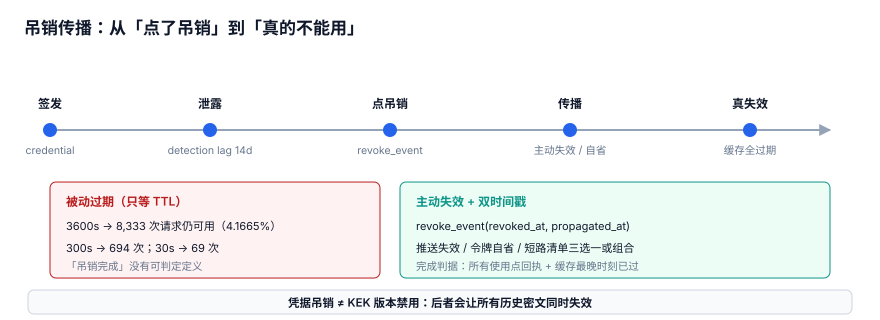

# 吊销传播：从「点了吊销」到「真的不能用」

点了「吊销」按钮，不等于旧凭据立刻不能用。从控制面写入一行记录，到所有使用点真正放行不了旧密钥，中间隔着一段可测量的**传播延迟**；这段延迟里请求还在用旧密钥，而且不报错。本页把这段链拆开，给出「吊销完成」的可判定定义。

本页判据族 `KYE-A` ~ `KYE-H`，共 8 条。

::: tip 一句话定位
本页回答「**从点了吊销到真的不能用，中间发生了什么、凭什么算完成**」。缓存 TTL 为什么是安全参数见[凭据分发与进程内缓存](../Distribution/index.md)，版本状态与并存期见[轮换窗口](../RotationWindow/index.md)；应用凭据的签发与验签见[应用凭据](../../OpenPlatform/AppCredential/index.md)，治理层的泄漏响应流程见 [SecretGovernance](../../../Ops/SecurityHardening/SecretGovernance/index.md)。
:::



## 一、两条路径：凭据吊销 ≠ KEK 版本禁用

最容易出事的地方，是把两件都叫「吊销」的事当成一件。它们的对象、判断者、失效范围完全不同：

| 路径 | 吊销对象 | 谁来判断 | 失效范围 | 典型触发 |
| --- | --- | --- | --- | --- |
| 凭据吊销 Credential Revocation | 某个 token / API key / 租约 | 网关或授权服务器 | 只让**这一个凭据**失效 | 员工离职、凭据泄露、租约到期 |
| KEK 版本禁用 Key Version Disable | 某个 `key_version` | 解密链路按密文自带的 `key_version` 判断 | 影响**该版本包装的所有**密文与 DEK | 算法弃用、KEK 疑似泄露 |

### 1.1 混用的两种后果

- 把「禁用 KEK 版本」当「吊销某人凭据」：**一次误操作打死所有历史密文**。[重加密](../Rekey/index.md)里的实测是删掉旧版本后 20 万条密文全部不可读——那不是「一个人被踢下线」，是「整库读不出来」。
- 把「吊销凭据」当「版本禁用」：KEK 真的泄露了，却只吊销了一个 token，剩下 10 个使用点继续用泄露的密钥，应急等于没做。

::: warning 证书不是密钥
证书（X.509，短寿命、自动续期）与密钥（轮换、吊销、版本）不是一回事：证书靠有效期与 CA 撤销列表收敛，密钥靠版本状态与使用点收敛，别把一套流程套到另一套上。本专题只管后者。
:::

## 二、吊销不是原子动作：缓存 TTL 三档残留

::: info 读数口径
以下数字来自本机**模拟压测**（Python 3.13.12 标准库，固定种子 `20261107`，脚本不入库、读者可照文档复现），**不是生产 KMS 基准**。
:::

20 万请求/天（2.3148 rps）下，进程内缓存的 TTL 直接决定吊销后还有多少请求带着旧密钥放行：

| TTL | KMS 调用/天 | 命中率 | 吊销后旧密钥残留请求 | 占比 | 最坏残留秒数 |
| --- | --- | --- | --- | --- | --- |
| 30s | 2,880 | 98.56% | 69 | 0.0345% | 30 |
| 300s | 288 | 99.856% | 694 | 0.347% | 300 |
| 3600s | 24 | 99.988% | 8,333 | **4.1665%** | 3600 |

结论一句话：**3600s TTL 下，4.1665% 的请求在吊销后仍能用旧密钥**。

这张表最迷惑人的地方是「命中率」那一列越漂亮，残留越糟：99.988% 的命中率意味着几乎不回源，也意味着吊销指令几乎传不进去。缓存 TTL 看着是性能参数，其实是**安全参数**——它定义了「一次吊销最晚多久才生效」的上限。这正是[总览](../Overview/index.md)里「六个安静的失败」的第二个：把 TTL 当性能调优调大，面板一切正常，只是吊销没生效。

所以「点了吊销」和「真的不能用」不是同一时刻。控制面写一行是瞬间，数据面靠传播逐点收敛，下面四种机制决定了收敛得多快。

## 三、四种传播机制对照

没有一种机制能单独兜住所有场景，选型时要说清「它能证伪哪种攻击」：

| 机制 | 英文 | 怎么传播 | 能证伪的攻击 | 收敛上限 | 代价 |
| --- | --- | --- | --- | --- | --- |
| 主动推送失效 | Push Invalidation | 吊销方广播，各节点清本地缓存 / DEK | 「已吊销，节点还拿缓存旧密钥命中」 | 一次广播 RTT | 需要可靠广播通道；离线节点会漏，必须补拉 |
| 令牌自省 | Token Introspection (RFC 7662) | 每笔请求向授权服务器查 `active` | 「拿着已吊销 token 继续访问」 | 0（每笔实时） | 每笔一跳，授权服务器成瓶颈与单点 |
| 短路清单 | Short-circuit Denylist | 网关维护已吊销 ID 集合，请求先过清单 | 「自包含 JWT 本地验签通过、绕过吊销」 | 清单分发延迟 | 清单本身要可靠分发，仍有窗口 |
| 被动过期 | Passive Expiry / TTL | 什么都不做，等缓存到点 | **证伪不了任何攻击** | 一个 TTL（最长 3600s） | 零成本，但正是 8,333 次残留的来源 |

- **被动过期只能当兜底，不能当传播机制**：它不「传播」任何东西，只是给过期兜个底，判「吊销完成」绝不能靠它。
- RFC 7009（OAuth 2.0 Token Revocation）定义的是客户端向授权服务器**发起**吊销的端点，属于「发起」，不是「传播」；别把「调用了 revoke endpoint」当成「传播完成」。
- 自包含令牌（JWT，RFC 7519）本地验签就能通过，天然绕不过短路清单这一层——这是四种机制里最容易被漏掉的一种攻击面。

## 四、双时间戳与「吊销完成」的可判定定义

把「完成」写成可查询的状态，靠的是 `revoke_event` 的**双时间戳**：

```sql
CREATE TABLE revoke_event(
    event_id        TEXT PRIMARY KEY,
    revocation_path TEXT NOT NULL,      -- CREDENTIAL | KEK_VERSION，见第一节
    key_version     INTEGER NOT NULL,
    issued_at       TEXT NOT NULL,
    revoked_at      TEXT,               -- 控制面：决定吊销的时刻
    propagated_at   TEXT,               -- 数据面：最后一个使用点回报 ACK 的时刻
    seq             INTEGER NOT NULL
);
```

- `revoked_at`：**控制面**决定吊销的时刻；
- `propagated_at`：**数据面**最后一个使用点确认失效并回报 ACK 的时刻。

于是「吊销完成」有一句可判定的定义，而不是一次按钮点击：

> `revoked_at IS NOT NULL` 且 `propagated_at IS NOT NULL` 且 `propagated_at >= revoked_at`，且 `pending_acks = 0`。

两者之差 `propagated_at - revoked_at` 就是**传播延迟**，必须可观测、可告警。查「还没完成」的事件直接用：

```sql
SELECT event_id, revocation_path, key_version, revoked_at
FROM revoke_event
WHERE revoked_at IS NOT NULL
  AND (propagated_at IS NULL OR propagated_at < revoked_at);
```

时刻本身也要有兜底，`tg_revoke_after_issue` 保证吊销不早于签发：

```sql
CREATE TRIGGER tg_revoke_after_issue
BEFORE INSERT ON revoke_event
FOR EACH ROW
WHEN NEW.revoked_at IS NOT NULL AND NEW.revoked_at < NEW.issued_at
BEGIN
    SELECT RAISE(ABORT, 'tg_revoke_after_issue: 吊销时刻早于签发');
END;
```

::: details 示例里为什么用 `t1` / `t2` / `t3` 当时间戳
本页示例用 `t1`、`t2`、`t3` 这样的**单调逻辑时刻**，不写真实 wall-clock 时间：因为第六节会看到，本地时钟在 σ=5ms 时有 24.149% 的相邻逆序，用它给「谁先吊销、谁后签发」定序并不可靠。生产里这两列应存单调 `seq` 派生的逻辑时间或统一时钟源的时间戳。
:::

## 五、误吊销的爆炸半径与「先切流量再吊销」

吊销是**不可逆**操作，误吊销的代价要用「使用点」来算，不能只算一个凭据。实测口径下：6 项权限 / 11 个使用点 / 发现延迟 14 天 / 每日 12,000 次调用，长期凭据暴露 168,000 次调用，1 小时动态租约只有 500 次（**336×**）；有效期窗口 90 天 vs 1 小时 = **2160×**。反过来读：一个 KEK 版本被误禁用，11 个使用点同时断，历史密文还会整片读不出来。

所以顺序必须是**先切流量，再吊销**：

1. 把新版本 / 新凭据铺到所有使用点，确认可用；
2. 旧版本保持在 `DECRYPT_ONLY` 兜底（状态机见[轮换窗口](../RotationWindow/index.md)），不急着禁用；
3. 确认新链路流量正常后，才发起吊销；
4. 在 `propagated_at` 落定之前允许撤回；一旦传播完成，只能重新签发，不能「撤销吊销」。

::: danger 五个按代价排序的坑，逐条给正确写法
1. **把 TTL 当性能参数一路调大**：3600s 下 4.1665%（8,333 次）请求在吊销后仍能用旧密钥。正确写法是把 TTL 列为安全参数评审，配主动推送失效或令牌自省，被动过期只当兜底。
2. **把「凭据吊销」和「KEK 版本禁用」混用**：一次误禁用打死所有历史密文。正确写法是按第一节分两条路径，`revoke_event.revocation_path` 显式区分，KEK 版本先停在 `DECRYPT_ONLY`。
3. **用 `revoked_at` 当「吊销完成」**：控制面写完就算完，数据面还在放行。正确写法是判据为 `propagated_at IS NOT NULL` 且所有使用点回报 ACK。
4. **先吊销再切流量**：误吊销没有回滚窗口，11 个使用点一起断。正确写法是先铺新版本、验证可用、再发起吊销，`propagated_at` 落定前可撤回。
5. **用本地时钟给审计与版本定序**：σ=5ms 时 24.149% 的相邻事件逆序，责任链彻底错乱。正确写法是用单调 `seq` 加 `tg_audit_seq`，并用 `tg_revoke_after_issue` 卡住签发/吊销先后。
:::

把爆炸半径算成一笔账见[泄露影响面](../BlastRadius/index.md)；本机注入与凭据分发面见 [DevEnvironment/Secrets](../../../Tools/DevEnvironment/Secrets/index.md)。

## 六、审计留痕：索引 21.4× 与 seq 定序

应急复盘要同时满足两件事：**查得快**、**排得对**，这是两个独立问题。

### 6.1 查得快：按 `key_version` 建索引

20 万条审计记录上，按 `key_version` 全表扫描 11.514 ms，建索引后 0.5389 ms，差 **21.4×**。应急时「这个版本被谁用过」要反复查，没索引就是把复盘时间耗在全扫上。

```sql
CREATE INDEX idx_audit_key_version ON audit_log(key_version);
```

### 6.2 排得对：用 `seq` 不用本地时钟

5ms 间隔的事件流上，本地时钟抖动越大，相邻事件逆序越严重；换成单调 `seq` 恒为 0%：

| 本地时钟 σ | 相邻逆序率 | 用单调 `seq` |
| --- | --- | --- |
| 1 ms | 0.018% | 0% |
| 2 ms | 3.902% | 0% |
| 5 ms | **24.149%** | 0% |

结论一句话：**审计排序用 `seq`，不用本地时钟**。24.149% 的逆序足以让「先吊销还是先签发」这条责任链没法看。用触发器把单调性钉死：

```sql
CREATE TRIGGER tg_audit_seq
BEFORE INSERT ON audit_log
FOR EACH ROW
WHEN NEW.seq <= (SELECT COALESCE(MAX(seq), 0) FROM audit_log)
BEGIN
    SELECT RAISE(ABORT, 'tg_audit_seq: seq 必须单调递增');
END;
```

四个触发器与十张表的全貌见[实战](../Practice/index.md)（10 张表 + 4 个触发器 + 10 条断言，10/10 PASS / EXIT=0），审计侧的更多背景见[审计与取证](../../AuditForensics/index.md)。

::: tip 把「吊销完成」做成面板上的状态，而不是一次点击
每个使用点回报 ACK 后才写 `propagated_at`，面板展示 `pending_acks` 与传播延迟；延迟超过一个 TTL 就告警，说明某个使用点没收到失效通知。这样「点了吊销」和「真的不能用」之间的黑盒就变成了一段可度量的量，而不是靠猜。
:::

## 判据

| 编号 | 判据 | 不满足时改哪里 | 验证方式 |
| --- | --- | --- | --- |
| `KYE-A` | 明确区分「凭据吊销」与「KEK 版本禁用」两条路径，`revoke_event.revocation_path` 只含这两类取值 | `revoke_event.revocation_path` 字段与校验 | 查路径取值集合，见验证方式第 1 段建表 |
| `KYE-B` | 缓存 TTL 作为安全参数纳入评审，3600s 档的 4.1665% 残留有主动缓解机制 | `credential_cache.ttl_seconds` 配置与推送失效通道 | 查 TTL 配置与使用点 ACK 记录，见第 2 段 |
| `KYE-C` | 至少启用一种主动传播机制（推送 / 自省 / 短路清单），被动过期不作完成判据 | 网关或授权服务器的失效通道配置 | 查 `propagated_at` 由 ACK 写入而非按 TTL 推断，见第 5 段 |
| `KYE-D` | `revoke_event` 有 `revoked_at` / `propagated_at` 双时间戳，完成定义为两者非空且 `propagated_at >= revoked_at` | `revoke_event` 两列与关闭逻辑 | 未完成事件查询，见第 1、5 段 |
| `KYE-E` | 吊销时刻不早于签发时刻 | 触发器 `tg_revoke_after_issue` | 插入早于签发的记录应被 ABORT，见第 2 段 |
| `KYE-F` | 误吊销按「先切流量再吊销」执行，`propagated_at` 落定前可撤回 | 变更单执行顺序与 `revoke_event` 撤回状态 | 检查变更记录顺序，见第 5 段 |
| `KYE-G` | 审计表按 `key_version` 建索引，排序用单调 `seq` 而非本地时钟 | `idx_audit_key_version` 索引与 `tg_audit_seq` 触发器 | `EXPLAIN QUERY PLAN` 命中索引、seq 倒退被拦，见第 3、4 段 |
| `KYE-H` | 上述七条各有一条可执行命令，能在干净库上复现 | 验收脚本 | `python3` 自检输出全 PASS |

## 验证方式

在任意干净的 SQLite 库上跑下面这段（无需外部依赖，脚本内容直接内联）。重点是**第 1 段必须查出未完成事件**、**第 5 段必须为空**、**两段触发器必须拦下非法写入**：

```shell
cd /tmp && python3 - <<'PY'
import sqlite3
con = sqlite3.connect(":memory:")
con.executescript("""
CREATE TABLE revoke_event(
    event_id TEXT PRIMARY KEY, revocation_path TEXT NOT NULL,
    key_version INTEGER NOT NULL, issued_at TEXT NOT NULL,
    revoked_at TEXT, propagated_at TEXT, seq INTEGER NOT NULL
);
CREATE TABLE audit_log(
    seq INTEGER PRIMARY KEY, key_version INTEGER NOT NULL, ts TEXT NOT NULL
);
CREATE INDEX idx_audit_key_version ON audit_log(key_version);
CREATE TRIGGER tg_revoke_after_issue
BEFORE INSERT ON revoke_event
FOR EACH ROW
WHEN NEW.revoked_at IS NOT NULL AND NEW.revoked_at < NEW.issued_at
BEGIN
    SELECT RAISE(ABORT, 'tg_revoke_after_issue: 吊销时刻早于签发');
END;
CREATE TRIGGER tg_audit_seq
BEFORE INSERT ON audit_log
FOR EACH ROW
WHEN NEW.seq <= (SELECT COALESCE(MAX(seq), 0) FROM audit_log)
BEGIN
    SELECT RAISE(ABORT, 'tg_audit_seq: seq 必须单调递增');
END;
""")
con.execute("INSERT INTO revoke_event VALUES('e1', 'CREDENTIAL', 12, 't1', 't2', NULL, 1)")
con.execute("INSERT INTO audit_log VALUES(1, 12, 't2')")

print("1) 已吊销但传播未完成的事件（必须能查出来）：")
print(con.execute("SELECT event_id FROM revoke_event WHERE revoked_at IS NOT NULL AND propagated_at IS NULL").fetchall())

print("2) 吊销时刻早于签发：")
try:
    con.execute("INSERT INTO revoke_event VALUES('e2', 'CREDENTIAL', 12, 't1', 't0', NULL, 2)")
    print("FAIL  触发器没拦住")
except sqlite3.IntegrityError:
    print("PASS  被 tg_revoke_after_issue 拦下")

print("3) 审计 seq 倒退：")
try:
    con.execute("INSERT INTO audit_log VALUES(0, 12, 't0')")
    print("FAIL  触发器没拦住")
except sqlite3.IntegrityError:
    print("PASS  被 tg_audit_seq 拦下")

print("4) 审计按 key_version 是否走索引：")
for row in con.execute("EXPLAIN QUERY PLAN SELECT * FROM audit_log WHERE key_version = ?", (12,)):
    print(row[-1])

print("5) 传播完成后仍未完成的事件（必须为空）：")
con.execute("UPDATE revoke_event SET propagated_at='t3' WHERE event_id='e1'")
print(con.execute("SELECT event_id FROM revoke_event WHERE revoked_at IS NOT NULL AND propagated_at IS NULL").fetchall())
print("ALL CHECKS PASS")
PY
```

预期输出：

```text
1) 已吊销但传播未完成的事件（必须能查出来）：
[('e1',)]
2) 吊销时刻早于签发：
PASS  被 tg_revoke_after_issue 拦下
3) 审计 seq 倒退：
PASS  被 tg_audit_seq 拦下
4) 审计按 key_version 是否走索引：
SEARCH audit_log USING INDEX idx_audit_key_version (key_version=?)
5) 传播完成后仍未完成的事件（必须为空）：
[]
ALL CHECKS PASS
```

第 2、3 段若打印 `FAIL`，说明两个触发器没建或触发条件写反了，按第四、六节原样重建；第 4 段若不是 `SEARCH ... USING INDEX`，说明 `idx_audit_key_version` 没建，应急复盘会退化成 11.514 ms 的全表扫描。**「查得快」和「排得对」缺一个，吊销的责任链就断了**。

## 参考资料

- [RFC 7009: OAuth 2.0 Token Revocation](https://www.rfc-editor.org/rfc/rfc7009)
- [RFC 7662: OAuth 2.0 Token Introspection](https://www.rfc-editor.org/rfc/rfc7662)
- [RFC 7519: JSON Web Token (JWT)](https://www.rfc-editor.org/rfc/rfc7519)
- [OWASP Key Management Cheat Sheet](https://cheatsheetseries.owasp.org/cheatsheets/Key_Management_Cheat_Sheet.html)
