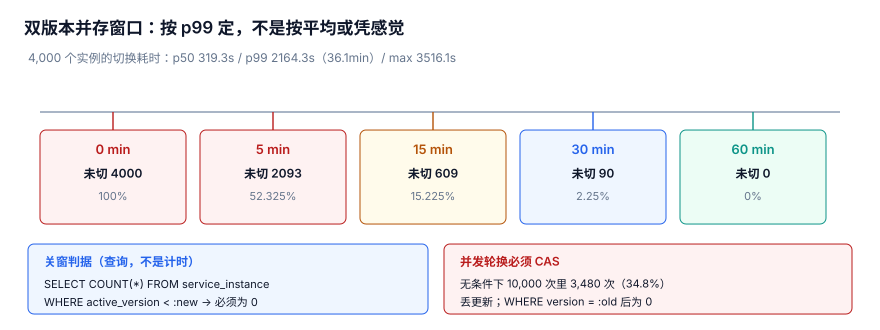

# 轮换窗口：双版本并存期怎么定、怎么关

密钥轮换最危险的一步不是「生成新版本」，而是「旧版本什么时候退」。把新版本一推、旧版本一删、中间不留过渡，正在跑的请求会**安静地失败**：一半解不开密、一半还在用旧密钥，两种都不会报「配置错了」。本页讲清楚这段过渡期——**并存窗口**（Overlap Window）——该定多长、凭什么算关掉了。

本页判据族 `KYD-A` ~ `KYD-H`，共 8 条。

::: tip 一句话定位
本页回答「**双版本并存期该定多长、凭什么算关掉了**」。版本怎么绑进密文见[版本绑定](../VersionBinding/index.md)，关掉之后旧版本能不能删见[重加密与旧版本保留](../Rekey/index.md)；治理制度里的「轮换周期表」不在这里，见 [SecretGovernance](../../../Ops/SecurityHardening/SecretGovernance/index.md)。
:::



## 一、为什么「直接替换」一定出事

轮换事故的主因不是「密码被猜到」，而是**同一个名字，在不同时刻指向不同的东西**（详见[总览](../Overview/index.md)的「三个这把密钥」）。`active_key` 这个名字，在 t0 指向 v11，在 t1 指向 v12——只要系统里还有谁记着 t0 的那份，切换就不是一次配置写入，而是一次**分布式状态收敛**。

### 1.1 请求不会每次都问 KMS

进程启动时把当前 KEK 版本和 DEK 缓存进内存，请求来时直接用缓存解密，不会每笔都回查 KMS（缓存这层见[凭据分发与进程内缓存](../Distribution/index.md)）。于是「KMS 已经切到 v12」和「4,000 个进程都用 v12」是两件完全不同的事，中间隔着的正是并存窗口。

### 1.2 直接替换的三类受害者

- **缓存旧 DEK 的实例**：还在拿 v11 解新写入的密文，或拿 v11 的 DEK 去包装新数据；
- **未提交的长事务**：事务开始时绑定了 v11，提交时的校验还认 v11；
- **历史密文与离线文件**：对象存储里的老数据本来就是 v11 包装的，删了 v11 就永久读不出来。

这三类的共同点是：**都不报错**。解密失败表现为局部 500，用旧密钥表现为「数据看着正常但用的是已退役版本」，历史数据表现为「某天开始读不出来」。所以窗口不是可选项，是把「不一致」明确圈进一段可控时间里的唯一办法。

## 二、四态生命周期与每态允许的操作

给 `key_version` 一个**单向状态机**，比用一个布尔 `enabled` 字段可靠得多。四个状态、每态允许做什么，必须写死在表里：

| 状态 | 含义 | 加密新数据 | 解密历史数据 | 能否禁用 | 推进到下一态的条件 |
| --- | --- | --- | --- | --- | --- |
| `PENDING` | 新版本已生成、未生效 | 否 | 否 | 否 | 由 CAS 推进为 `ACTIVE`，同一时刻只能有一个 |
| `ACTIVE` | 当前写入版本 | 是 | 是 | 否 | 并存窗口 `CLOSED` 后才可转 `DECRYPT_ONLY` |
| `DECRYPT_ONLY` | 退役过渡：只解不写 | 否 | 是 | 否 | 引用它的密文清零（见[重加密](../Rekey/index.md)） |
| `DISABLED` | 终态，不参与任何加解密 | 否 | 否 | — | 不再变化 |

### 2.1 状态推进必须由 SQL 兜底

状态单向、不跳态，靠的是**每次 `UPDATE` 都带当前态作为条件**，而不是靠调用方自觉。任何一次「把 v11 直接改成 `DISABLED`」的跨态写入，都应当被数据库层拦下来，见第七节的触发器。

## 三、4,000 实例切换实测：窗口按 p99 定

::: info 读数口径
以下数字来自本机**模拟压测**（Python 3.13.12 标准库，固定种子 `20261107`，脚本不入库、读者可照文档复现），**不是生产 KMS 基准**。
:::

4,000 个实例各自把缓存里的版本切到新版本，耗时分布如下：

| 指标 | 实测值 | 说明 |
| --- | --- | --- |
| p50 | 319.3s | 中位数，正好卡在「给 5 分钟」这个直觉附近 |
| p99 | 2164.3s（36.1 min） | **99% 的实例在这之前切完** |
| max | 3516.1s | 最慢的那台，接近 1 小时 |

把「并行期」从 0 逐步拉长，未切到新版本的实例数：

| 并行期 | 未切实例 | 占比 | 后果 |
| --- | --- | --- | --- |
| 0 min | 4,000 | 100% | 等于直接替换 |
| 5 min | 2,093 | 52.325% | 「凭感觉给 5 分钟」，一半以上没切 |
| 15 min | 609 | 15.225% | 仍有六百多台在用旧版本 |
| 30 min | 90 | 2.25% | 尾部还没收干净 |
| 60 min | 0 | 0% | 全部收敛 |

结论一句话：**窗口按 p99 定，不是按平均或凭感觉给 5 分钟**。5 分钟几乎等于 p50，实测还剩 52.325% 的实例没切；p99 是 36.1 min，意味着要覆盖 99% 的实例至少得留到 36.1 min；max 3516.1s 又提醒我们尾部比 p99 更长，所以工程上直接取 **60 min** 这一档——它在实测里把未切实例打到了 0。

::: warning p99 是统计量，不是保证
p99 描述的是「上一次采集的尾部」，下一次可能因为 GC 停顿、机器重启、跨区域副本延迟变得更长。所以窗口长度取 p99 留足余量只是**起点**，真正能不能关，仍然要看下一节的实时判据，不能反过来用「时间到了」代替「状态到了」。
:::

## 四、关闭窗口的正确判据

**错误做法**：定时器 `sleep(60min)` 一到就把窗口关掉、把旧版本禁用。这是把统计余量当成了状态保证。

**正确做法**：查所有 `service_instance.active_version` 都等于新版本，并且用带 `NOT EXISTS` 的 CAS 语句关闭窗口——查不到未切实例才允许写 `CLOSED`。

```sql
-- 判据：还有谁没切到 :new ？这一句返回 0 行，才具备关闭资格
SELECT instance_id, active_version
FROM service_instance
WHERE active_version <> :new;

-- 关闭窗口：把「资格」写进同一条 UPDATE，避免查完又被新实例插进来
UPDATE rotation_window
SET state = 'CLOSED', closed_at = :now
WHERE window_id = :wid
  AND state = 'OPEN'
  AND NOT EXISTS (
      SELECT 1 FROM service_instance WHERE active_version <> :new
  );
```

第二条语句仍然要检查 **affected rows 是否为 1**：为 0 说明窗口已被别人关掉、或此刻又冒出未切实例，应当放弃本次操作而不是重试覆盖。这与第五节的 CAS 是同一个道理。

## 五、并发轮换：CAS 不能省

多个控制节点同时推进轮换、或人工点了两次「立即轮换」，就会撞车。实测 10,000 次、35% 重叠概率下：

- **不带 CAS**：丢失更新 3,480 次，占 **34.8%**——典型后果是版本回退、两个节点各自认为自己是 `ACTIVE`；
- **带 CAS**：丢失更新 **0 次**。

正确写法只有一条：把「旧值」放进 `WHERE`，并且只在 `PENDING` 上推进。

```sql
UPDATE kek_version
SET state = 'ACTIVE', activated_at = :now
WHERE version = :old AND state = 'PENDING';
```

执行后立刻看 `changes()`：等于 1 才算抢到推进权；等于 0 就说明这个版本已经不是 `PENDING` 了（被别人推进过），**直接放弃，不要重试、更不要 `UPDATE` 成自己的结果**。丢更新之所以「安静」，正因为两条无 CAS 的 `UPDATE` 都返回成功，只有 `changes()` 能看出谁真的写了。

## 六、窗口内的三类尾巴

窗口长度要覆盖的不只是「实例切缓存」，还有三样更慢的东西：

| 尾巴 | 为什么窗口关不掉 | 正确做法 |
| --- | --- | --- |
| 长事务 | 事务开始时绑定了 v11，提交校验仍认 v11 | 在事务上下文记 `start_version`，提交时校验版本仍可解密；窗口关闭不打断未完成事务 |
| 离线文件 / 历史密文 | 对象存储里的老数据本就是 v11 包装的 | 只要 `ciphertext.key_version` 还有引用，v11 就必须停在 `DECRYPT_ONLY`，交接[重加密](../Rekey/index.md) |
| 跨区域副本 | 副本同步比主区域慢，收敛尾巴更长 | 窗口按**最慢区域**的 p99 定；关闭判据要覆盖所有区域的 `service_instance`，不能只查主库 |

一句话：旧版本能不能退休，取决于**还有谁在用它**（定义 · 版本 · 使用点里的「使用点」），而不是过去了多久。

## 七、窗口未关闭禁止禁用旧版本

把上面这条约束下沉到数据库，用触发器 `tg_no_disable_in_window` 兜底，任何人、任何脚本都绕不过去：

```sql
CREATE TRIGGER tg_no_disable_in_window
BEFORE UPDATE OF state ON kek_version
FOR EACH ROW
WHEN NEW.state = 'DISABLED'
 AND EXISTS (
     SELECT 1 FROM rotation_window WHERE state = 'OPEN'
 )
BEGIN
    SELECT RAISE(ABORT,
        'tg_no_disable_in_window: 并存窗口未关闭，禁止禁用旧版本');
END;
```

配合第二节的状态机，状态只能 `ACTIVE` → `DECRYPT_ONLY` → `DISABLED` 单向推进，且 `DISABLED` 之前窗口必须 `CLOSED`。这样「收敛还没完成就被抽掉地板」这类事故在库层就不可能发生。四个触发器与十张表的全貌见[实战](../Practice/index.md)，审计侧的定序问题见[审计与取证](../../AuditForensics/index.md)。

## 八、易错点

::: danger 五个按代价排序的坑，逐条给正确写法
1. **凭感觉给 5 分钟并行期**：实测 5 min 后仍有 2,093 个实例（52.325%）没切。正确写法是按 p99 2164.3s（36.1 min）留余量，取 60 min 这一档把未切实例打到 0。
2. **用定时器 / `sleep` 关窗口**：p99 只是统计量，尾部抖动会拖长收敛，时间一到就关会打死尾部实例。正确写法是查 `service_instance.active_version <> :new` 返回 0 行，并用带 `NOT EXISTS` 的 CAS 语句关闭。
3. **轮换 `UPDATE` 不带 `WHERE state = 'PENDING'`**：10,000 次里 3,480 次（34.8%）丢更新、版本回退。正确写法是 CAS 加 `changes()` 校验，为 0 就放弃。
4. **关窗口顺手把旧版本置 `DISABLED`**：历史密文会全部解不开（见[重加密](../Rekey/index.md)）。正确写法是只推到 `DECRYPT_ONLY`，等引用清零再禁用。
5. **只查主区域实例表**：跨区域副本还没切完就判定收敛。正确写法是关闭判据覆盖所有区域的 `service_instance`，按最慢区域的 p99 定窗口。
:::

::: tip 把窗口长度做成观测量，而不是配置项
每次轮换都记录 `service_instance.active_version` 的收敛分布（p50 / p99 / max），下一次窗口按上一次的 p99 留余量；[实战](../Practice/index.md)里用 10 条断言把这套判据固化成可复现的自检。别把 60 min 当成 magic number 抄进配置就再也不看——它只是这次实测里让未切实例归零的那一档。
:::

## 判据

| 编号 | 判据 | 不满足时改哪里 | 验证方式 |
| --- | --- | --- | --- |
| `KYD-A` | 并存窗口长度不小于切换耗时 p99（2164.3s / 36.1 min），配置取 60 min 档 | `rotation_window.overlap_minutes` 配置 | 读配置值与 p99 对比，见验证方式第 1 条 |
| `KYD-B` | 窗口关闭条件是「所有 `service_instance.active_version` 等于新版本」，不是定时器 | `rotation_window.state` 的关闭逻辑 SQL | 关闭语句带 `NOT EXISTS`，见第 2 条 |
| `KYD-C` | `key_version` 状态单向 `PENDING`→`ACTIVE`→`DECRYPT_ONLY`→`DISABLED`，无跨态写入 | `kek_version.state` 与状态机写入语句 | 查 state 取值集合与推进 SQL，见第 2 条 |
| `KYD-D` | 轮换推进用 CAS `WHERE version = :old AND state = 'PENDING'` 且校验 `changes()` | 轮换 `UPDATE` 语句与 `changes()` 检查 | 并发压测丢更新为 0，见第 3 条 |
| `KYD-E` | 窗口 `OPEN` 期间禁止把版本置 `DISABLED` | 触发器 `tg_no_disable_in_window` | 尝试禁用应被 ABORT，见第 4 条 |
| `KYD-F` | 长事务绑定 `start_version`，窗口关闭不打断未完成事务 | 事务上下文的 `start_version` 字段 | 提交校验旧版本仍可解密，见第 1 条 |
| `KYD-G` | 关闭判据覆盖所有区域的 `service_instance`，按最慢区域 p99 定窗口 | 实例表汇总视图与区域枚举清单 | 跨区域未切实例查询返回 0 行，见第 2 条 |
| `KYD-H` | 上述七条各有一条可执行命令，能在干净库上复现 | 验收脚本 | `python3` 自检输出全 PASS，见验证方式 |

## 验证方式

在任意干净的 SQLite 库上跑下面这段（无需外部依赖，脚本内容直接内联、读者可复制）。重点是**第 1 段必须返回空列表**、**第 2 段必须被触发器拦下**：

```shell
cd /tmp && python3 - <<'PY'
import sqlite3
con = sqlite3.connect(":memory:")
con.executescript("""
CREATE TABLE kek_version(version INTEGER PRIMARY KEY, state TEXT NOT NULL);
CREATE TABLE service_instance(instance_id TEXT PRIMARY KEY, active_version INTEGER NOT NULL);
CREATE TABLE rotation_window(window_id TEXT PRIMARY KEY, target_version INTEGER NOT NULL, state TEXT NOT NULL);
CREATE TRIGGER tg_no_disable_in_window
BEFORE UPDATE OF state ON kek_version
FOR EACH ROW
WHEN NEW.state = 'DISABLED'
 AND EXISTS (SELECT 1 FROM rotation_window WHERE state = 'OPEN')
BEGIN
    SELECT RAISE(ABORT, 'tg_no_disable_in_window: 并存窗口未关闭');
END;
""")
NEW, OLD = 12, 11
con.execute("INSERT INTO rotation_window VALUES('w1', ?, 'OPEN')", (NEW,))
con.execute("INSERT INTO kek_version VALUES(?, 'ACTIVE')", (NEW,))
con.execute("INSERT INTO kek_version VALUES(?, 'DECRYPT_ONLY')", (OLD,))
con.executemany("INSERT INTO service_instance VALUES(?, ?)",
                [(f"i{i}", NEW) for i in range(4000)])

print("1) 未切到新版本的实例（必须为空）：")
print(con.execute(
    "SELECT instance_id, active_version FROM service_instance WHERE active_version <> ?",
    (NEW,)).fetchall())

print("2) 窗口未关闭时禁用旧版本：")
try:
    con.execute("UPDATE kek_version SET state='DISABLED' WHERE version=?", (OLD,))
    print("FAIL  触发器没拦住")
except sqlite3.IntegrityError:
    print("PASS  被 tg_no_disable_in_window 拦下")

print("3) CAS 抢不到时 affected rows：")
cur = con.execute(
    "UPDATE kek_version SET state='ACTIVE' WHERE version=? AND state='PENDING'",
    (OLD,))
print(cur.rowcount)

print("4) 关闭窗口后禁用旧版本：")
cur = con.execute(
    "UPDATE rotation_window SET state='CLOSED' WHERE window_id='w1' AND state='OPEN' "
    "AND NOT EXISTS (SELECT 1 FROM service_instance WHERE active_version <> ?)",
    (NEW,))
print("PASS  窗口关闭 affected rows =", cur.rowcount)
con.execute("UPDATE kek_version SET state='DISABLED' WHERE version=?", (OLD,))
print("PASS  旧版本 ->", con.execute(
    "SELECT state FROM kek_version WHERE version=?", (OLD,)).fetchone()[0])
print("ALL CHECKS PASS")
PY
```

预期输出：

```text
1) 未切到新版本的实例（必须为空）：
[]
2) 窗口未关闭时禁用旧版本：
PASS  被 tg_no_disable_in_window 拦下
3) CAS 抢不到时 affected rows：
0
4) 关闭窗口后禁用旧版本：
PASS  窗口关闭 affected rows = 1
PASS  旧版本 -> DISABLED
ALL CHECKS PASS
```

第 1 段若不为空，说明还有实例没切完就准备关窗口，回到第四节把关闭语句改成带 `NOT EXISTS` 的写法；第 2 段若打印 `FAIL`，说明 `tg_no_disable_in_window` 没建或写错了触发条件，按第七节原样重建。**这是本页最便宜能修、后果最贵的一个 bug**。

## 参考资料

- [NIST SP 800-57 Part 1 Rev. 5: Recommendation for Key Management](https://csrc.nist.gov/pubs/sp/800/57/pt1/r5/final)
- [Rotate AWS KMS keys](https://docs.aws.amazon.com/kms/latest/developerguide/rotate-keys.html)
- [Azure Key Vault Overview](https://learn.microsoft.com/en-us/azure/key-vault/general/overview)
- [OWASP Key Management Cheat Sheet](https://cheatsheetseries.owasp.org/cheatsheets/Key_Management_Cheat_Sheet.html)
