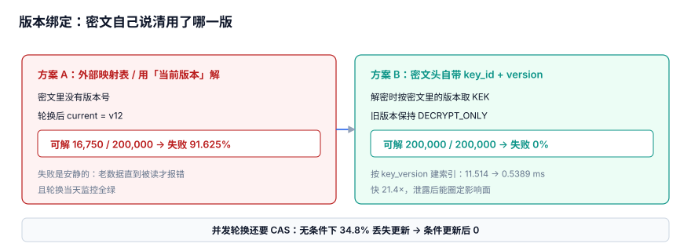

# 版本绑定：密文必须自己说清用了哪把密钥

本页判据族 `KYB-A` ~ `KYB-H`，共 8 条。

轮换之后，三年前落盘的密文凭什么还能解开？本页只讲一件事——**版本（哪一版在生效）必须写在密文自己身上**，而不是记在别处。适合要长期保存密文、又要定期轮换 KEK 的后端。

::: tip 一句话定位
三个「这把密钥」里本页管**版本**：密文不带版本，轮换就是一次安静的全量数据丢失；密文格式见[密钥分层](../Layering/index.md)，骨架见[总览](../Overview/index.md)。
:::



## 一、两种方案：自描述 vs 外部映射表

| 维度 | 密文自描述版本（推荐） | 外部映射表 |
| --- | --- | --- |
| 版本信息在哪 | 密文头部 `kek_version` 字段，与密文同一串字节 | 另一张表 `cipher_id → kek_version` |
| 单条密文能否独立解密 | 能，拿起来就能解 | 不能，先查表 |
| 备份 / 迁移 / 跨环境 | copy 出去仍可读 | 映射表没跟过去就全成孤儿 |
| 轮换时 | 新密文写新版本号，旧密文原地不动 | 要么全表改写，要么表里同时留新旧两版 |
| 一致性 | 版本与密文原子绑定 | 两处写入非原子，存在「表说 v3、密文其实是 v2」的漂移窗口 |
| 实测可解率 | **200,000 / 200,000（失败 0%）** | **16,750 / 200,000（失败 91.625%）** |

本机实测（20 万条密文、12 个 KEK 版本、当前版本 12）：

| 项 | 读数 |
| --- | --- |
| 密文总数 / KEK 版本数 | 200,000 条 / 12 个 |
| 不带自描述版本：可解 | 16,750 条 |
| 不带自描述版本：失败率 | 91.625% |
| 带自描述版本：可解 | 200,000 / 200,000 |
| 带自描述版本：失败率 | 0% |

不带版本时，解密只能拿「当前那一把」（v12）去试，20 万条里恰好属于 v12 的只有 16,750 条，其余全部安静地失败——不是报「版本不对」，而是解出乱码或抛一串解密异常。这就是六个安静的失败里最贵的一条：**密文不带版本 → 轮换后历史数据全解不开**。

::: info 读数口径
以上数字来自 Python 3.13.12 标准库 + SQLite 3.50.4 的**模拟压测**（固定种子 `20261107`），不是生产 KMS 基准；采集脚本不入库，读者可照「验证方式」复现。
:::

## 二、完整可运行示例：把版本钉进表结构

光在文档里写「要带版本」没用，得让数据库**拒绝**不带版本的写入。下面这段 SQLite 示例一次覆盖 `CHECK`、自描述写入、索引、删除保护、CAS 条件更新与单调 `seq`：

```python [src/version_binding_demo.py]
import sqlite3

con = sqlite3.connect(":memory:")
con.execute("PRAGMA foreign_keys = ON")
con.executescript("""
CREATE TABLE kek_version(
    version INTEGER PRIMARY KEY CHECK(version > 0),
    state   TEXT NOT NULL DEFAULT 'ACTIVE');
CREATE TABLE key_ring(
    id              INTEGER PRIMARY KEY CHECK(id = 1),
    current_version INTEGER NOT NULL);
CREATE TABLE ciphertext(
    id          INTEGER PRIMARY KEY,
    key_version INTEGER NOT NULL CHECK(key_version > 0),
    seq         INTEGER NOT NULL,          -- 单调定序，不用本地时钟
    blob        BLOB NOT NULL,
    FOREIGN KEY(key_version) REFERENCES kek_version(version));
CREATE TRIGGER tg_no_drop_used_kek BEFORE DELETE ON kek_version
WHEN EXISTS(SELECT 1 FROM ciphertext WHERE key_version = OLD.version)
BEGIN SELECT RAISE(ABORT, '还有密文引用，禁止删除该 KEK 版本'); END;
""")
con.executemany("INSERT INTO kek_version(version) VALUES(?)", [(v,) for v in range(1, 13)])
con.execute("INSERT INTO key_ring VALUES(1, 12)")

# A. CHECK：版本必须是正整数
try:
    con.execute("INSERT INTO ciphertext(key_version, seq, blob) VALUES(0, 1, x'00')")
    print("A CHECK 未生效  <-- 不应该出现")
except sqlite3.IntegrityError:
    print("A CHECK 拦住 key_version=0: OK")

# B. 写入 20 万条「自带版本」的密文，seq 单调定序
con.executemany("INSERT INTO ciphertext(key_version, seq, blob) VALUES(?, ?, x'00')",
                (((i % 12) + 1, i) for i in range(1, 200001)))
print("B 自描述密文条数:", con.execute("SELECT COUNT(*) FROM ciphertext").fetchone()[0])
print("  按行内 key_version 可解条数:",
      con.execute("SELECT COUNT(*) FROM ciphertext c "
                  "JOIN kek_version k ON k.version = c.key_version").fetchone()[0])

# C. 按 key_version 的查询计划：全扫 -> 索引
print("C 建索引前:",
      con.execute("EXPLAIN QUERY PLAN SELECT id FROM ciphertext WHERE key_version=7").fetchone()[3])
con.execute("CREATE INDEX idx_ct_keyver ON ciphertext(key_version)")
print("  建索引后:",
      con.execute("EXPLAIN QUERY PLAN SELECT id FROM ciphertext WHERE key_version=7").fetchone()[3])

# D. 触发器：删被引用版本必须失败
try:
    con.execute("DELETE FROM kek_version WHERE version=7")
    print("D 触发器未生效  <-- 不应该出现")
except sqlite3.IntegrityError as e:
    print("D 删被引用的 v7 被拦:", e)

# E. CAS 条件更新：两个并发者都拿 old=12，只有一个抢到
def rotate_cas(old):
    cur = con.execute("UPDATE key_ring SET current_version = current_version + 1 "
                      "WHERE id = 1 AND current_version = ?", (old,))
    con.commit()
    return cur.rowcount       # 1 = 抢到，0 = 被人抢先

print("E 两次并发轮换(old 均为 12) 受影响行:", rotate_cas(12), rotate_cas(12),
      "(1=抢到, 0=被挡下)")
con.close()
```

运行输出：

```text
A CHECK 拦住 key_version=0: OK
B 自描述密文条数: 200000
  按行内 key_version 可解条数: 200000
C 建索引前: SCAN ciphertext
  建索引后: SEARCH ciphertext USING COVERING INDEX idx_ct_keyver (key_version=?)
D 删被引用的 v7 被拦: 还有密文引用，禁止删除该 KEK 版本
E 两次并发轮换(old 均为 12) 受影响行: 1 0 (1=抢到, 0=被挡下)
```

三段关键设计：`key_version ... CHECK(key_version > 0)` 让「忘写版本」直接写不进去；`tg_no_drop_used_kek` 让「还有人引用」的旧版本删不掉；`seq` 是 `INTEGER` 单调计数，专门用来替代本地时钟定序（见第三节）。

## 三、三个并发与定序读数

| 主题 | 读数 | 结论 |
| --- | --- | --- |
| 按 `key_version` 检索（20 万条审计 / 密文） | 全表扫描 11.514 ms → 建索引 0.5389 ms（**21.4×**） | 版本字段要查得动，必须建 `idx_ct_keyver` |
| 并发轮换（10,000 次、35% 重叠） | 无 CAS 丢失更新 3,480 次（**34.8%**）→ 带 `UPDATE ... WHERE version = :old` 的 CAS **0 次** | 「读出来 +1 再写回」会让版本回退 |
| 本地时钟定序（5 ms 间隔事件） | σ=1 / 2 / 5 ms → 相邻逆序 0.018% / 3.902% / 24.149%；单调 `seq` 恒 **0%** | 用 `created_at` 排版本，σ=5 ms 时近四分之一顺序是反的 |

三行分别对应三个不同的坑，但根子是同一个：**版本不是一个可以事后补的元数据，它是密文身份的一部分**。并发轮换的 CAS 写法就是示例 E 那一行——把「我以为的旧值」放进 `WHERE`，用 `rowcount` 判断自己有没有抢到；`rowcount = 0` 就必须重读重试，不能硬写。至于时钟，六个安静的失败第 ⑥ 条正是「用本地时钟给版本定序 → σ=5 ms 时 24.149% 逆序」，正确写法只有单调 `seq`。

::: tip 一句话记住
**版本是密文的属性，不是数据库的属性**。判定标准很简单：把这一行密文 dump 出来、删掉其它所有表，还能不能解开？能，才叫自描述。
:::

## 四、rekey 时不得丢版本字段

重加密不是「换个 KEK 再加密一遍」就完了：每写一条新密文，必须把**新的** `key_version` 一起写进去。如果 rekey 脚本只 `UPDATE blob` 不 `UPDATE key_version`，表里就会多出「blob 是 v13 解的、版本字段还写着 v12」的漂移行——等于把自描述又悄悄退化回外部映射表。

本机实测：20 万条 rekey 循环只要 54.4 ms（**0.272 µs/条**），快到没有任何理由为了省事删旧版本；而**删掉旧 KEK 版本 → 20 万条全部不可读，保留旧版本 → 0 条不可读**。所以正确顺序是「新密文带新版本写入 → 旧版本等到零引用才退役」，双版本并存期怎么定、怎么关见[轮换窗口](../RotationWindow/index.md)与[重加密与旧版本保留](../Rekey/index.md)。

## 五、易错点

::: danger 六个坑，逐条给正确写法
1. **密文不写版本、靠「当前密钥」解**：轮换后 91.625% 历史密文解不开，且失败是安静的。正确写法：`key_version` 随密文落盘，解密按它去取对应 KEK 版本。
2. **`key_version` 允许 0 / NULL**：`NULL` 会让 `CHECK` 形同虚设，脏数据照样入库。正确写法：`key_version INTEGER NOT NULL CHECK(key_version > 0)`，如示例建表。
3. **拿本地时钟 `created_at` 给版本定序**：σ=5 ms 时 24.149% 相邻逆序，出现「v3 比 v2 还早」。正确写法：单调 `seq`（`INTEGER PRIMARY KEY` 或序列），恒 0%；所有 `ORDER BY` 只许用 `seq`。
4. **并发轮换「读出来 +1 再写回」**：35% 重叠下 34.8% 丢更新、版本回退。正确写法：`UPDATE ... WHERE current_version = :old` 条件更新 + 判 `rowcount`，如示例 E。
5. **轮换完顺手删旧 KEK 版本**：20 万条密文全部不可读（保留则 0 条）。正确写法：`tg_no_drop_used_kek` 挡住，等 rekey 完成、引用归零再退役。
6. **rekey 只更新 `blob` 不更新 `key_version`**：制造「新版 blob、旧版字段」的漂移行。正确写法：rekey 的 `UPDATE` 同时写 `blob` 与 `key_version` 两列。
:::

密钥治理制度、动态凭据与泄漏响应流程看[密钥治理与生命周期](../../../Ops/SecurityHardening/SecretGovernance/index.md)；本机注入与扫描看[本机凭据暴露面](../../../Tools/DevEnvironment/Secrets/index.md)；应用凭据本身的验签看[应用凭据](../../OpenPlatform/AppCredential/index.md)。

## 判据

| 编号 | 判据 | 不满足时改哪里 | 验证方式 |
| --- | --- | --- | --- |
| `KYB-A` | 每条密文自带 `key_version`，不依赖外部映射表 | `ciphertext.key_version` 列 / 密文头部 `I` 字段 | 示例 B：JOIN 可解数 = 200000 |
| `KYB-B` | `key_version` 为 `NOT NULL CHECK(key_version > 0)` | `ciphertext` 建表 DDL | 示例 A：插入 0 抛 `IntegrityError` |
| `KYB-C` | 20 万条 / 12 版本下全量可解 200,000/200,000（失败 0%，对照不带版本 16,750 / 91.625%） | 解密函数按 `key_version` 取钥匙的逻辑 | 示例 B 的 JOIN 计数 |
| `KYB-D` | 按 `key_version` 有索引，查询走 `SEARCH ... USING INDEX` | `idx_ct_keyver` 索引 | 示例 C 的 `EXPLAIN QUERY PLAN`（全扫 11.514 ms / 索引 0.5389 ms，21.4×） |
| `KYB-E` | 并发轮换用 `UPDATE ... WHERE current_version = :old` 且判 `rowcount` | `rotate_cas()` 的条件更新 | 示例 E：同 old 两次只有 1 成功（34.8% → 0） |
| `KYB-F` | 版本定序用单调 `seq`，代码里搜不到用 `created_at` / `now()` 排序 | `ciphertext.seq` 列与所有 `ORDER BY` | grep `ORDER BY` 只应见 `seq`；σ=5 ms 逆序 24.149% → 0% |
| `KYB-G` | 有触发器阻止删除仍被引用的 KEK 版本 | `tg_no_drop_used_kek` | 示例 D：删 v7 被拦；删旧版将致 20 万条不可读 |
| `KYB-H` | rekey 同时更新 `blob` 与 `key_version`，不丢版本字段 | rekey 的 `UPDATE` 语句 | 对重加密行 `SELECT` 校验两列一致 |

## 验证方式

标准库 `sqlite3` 即可，无需安装任何东西；重点是 **B 必须等于 200000、E 必须是 `1 0`**：

```shell
cd /tmp && python3 - <<'PY'
import sqlite3
con = sqlite3.connect(":memory:"); con.execute("PRAGMA foreign_keys = ON")
con.executescript("""
CREATE TABLE kek_version(version INTEGER PRIMARY KEY CHECK(version>0));
CREATE TABLE key_ring(id INTEGER PRIMARY KEY, current_version INTEGER NOT NULL);
CREATE TABLE ciphertext(id INTEGER PRIMARY KEY,
    key_version INTEGER NOT NULL CHECK(key_version>0), seq INTEGER NOT NULL,
    FOREIGN KEY(key_version) REFERENCES kek_version(version));
CREATE TRIGGER tg_no_drop_used_kek BEFORE DELETE ON kek_version
WHEN EXISTS(SELECT 1 FROM ciphertext WHERE key_version = OLD.version)
BEGIN SELECT RAISE(ABORT, '还有密文引用'); END;
""")
con.executemany("INSERT INTO kek_version VALUES(?)", [(v,) for v in range(1, 13)])
con.execute("INSERT INTO key_ring VALUES(1, 12)")
try:
    con.execute("INSERT INTO ciphertext(key_version,seq) VALUES(0,1)"); a = False
except sqlite3.IntegrityError: a = True
print("A CHECK 拦住 key_version=0:", a)
con.executemany("INSERT INTO ciphertext(key_version,seq) VALUES(?,?)",
                (((i % 12) + 1, i) for i in range(1, 200001)))
n = con.execute("SELECT COUNT(*) FROM ciphertext c JOIN kek_version k "
                "ON k.version=c.key_version").fetchone()[0]
print("B 自描述密文全量可解:", n, "== 200000:", n == 200000)
con.execute("CREATE INDEX idx_ct_keyver ON ciphertext(key_version)")
plan = con.execute("EXPLAIN QUERY PLAN SELECT id FROM ciphertext "
                   "WHERE key_version=7").fetchone()[3]
print("C 走索引:", "USING" in plan and "INDEX" in plan, "|", plan)
try:
    con.execute("DELETE FROM kek_version WHERE version=7"); d = False
except sqlite3.IntegrityError: d = True
print("D 删被引用版本被拦:", d)
def rotate_cas(old):
    cur = con.execute("UPDATE key_ring SET current_version=current_version+1 "
                      "WHERE id=1 AND current_version=?", (old,)); con.commit()
    return cur.rowcount
print("E 两次同 old 轮换受影响行:", rotate_cas(12), rotate_cas(12))
con.close()
PY
```

预期输出：

```text
A CHECK 拦住 key_version=0: True
B 自描述密文全量可解: 200000 == 200000: True
C 走索引: True | SEARCH ciphertext USING COVERING INDEX idx_ct_keyver (key_version=?)
D 删被引用版本被拦: True
E 两次同 old 轮换受影响行: 1 0
```

## 参考资料

- [NIST SP 800-57 Part 1 Rev.5（密钥版本、crypto period 与归档）](https://csrc.nist.gov/publications/detail/sp/800-57-part-1/rev-5/final)
- [SQLite: CREATE TABLE（CHECK 约束与外键）](https://www.sqlite.org/lang_createtable.html)
- [SQLite: CREATE TRIGGER（RAISE(ABORT)）](https://www.sqlite.org/lang_createtrigger.html)
- [SQLite: CREATE INDEX](https://www.sqlite.org/lang_createindex.html)
- [AWS KMS: Rotating KMS keys（旧版本继续解密历史密文）](https://docs.aws.amazon.com/kms/latest/developerguide/rotate-keys.html)
