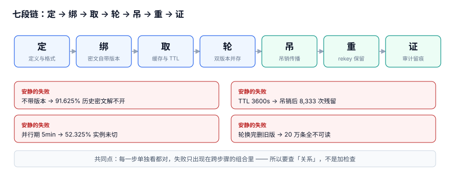

# 密钥与凭据管理工程

<p style="text-align:center;"></p>

密钥（Secret）与凭据（Credential）事故，大多不是「密码被猜到」，而是**同一个名字，在不同时刻指向了不同的东西**：轮换之后，缓存里还是旧密钥；吊销之后，进程还在用旧凭据；rekey 之后，历史密文再也解不开。这些失败几乎都不报错，页面能开、接口返回 200、监控一片绿。

本册讲的不是「怎么建 Vault、怎么配 CI OIDC、怎么定轮换制度」——那些是治理与工具层，库里已有专题。本册讲的是**运行时正确性**：一次加解密、一次凭据使用请求，系统凭什么绑定到具体版本，以及轮换与吊销发生时，正在跑的请求、缓存的旧密钥、历史密文分别会怎样。

::: info 本册的定位与版本
适用对象：需要在业务系统里落地密钥运行时（KMS / Vault / 云 Secrets Manager 均可）的后端与平台工程师。新内容面向当前主流实现，**不依赖某个厂商的特定大版本**；判据与读数来自本机 Python 3.13.12 标准库 + SQLite 3.50.4 的模拟压测（固定种子 `20261107`），**不是生产 KMS 基准**，脚本不入库，读者可照文档复现。
:::

## 一、为什么是「改层不改题」

轮换表第 268 行原题「密钥与凭据管理工程」，建议章节里包含密钥分层、轮换与版本、加密与信封、凭据分发、泄露应急。动手前按「邻页行数 + 未回答的问题」双判据核查，发现这几章在库内已有成建制内容：

| 邻页 | 行数 | 它回答什么 | 本册不重复什么 |
| --- | --- | --- | --- |
| [密钥与凭据治理](../../Ops/SecurityHardening/SecretGovernance/index.md) | 285 | 六阶段生命周期、Vault 与动态凭据、CI 里的 OIDC、泄漏响应流程、各类密钥的轮换周期 | 不再讲制度、工具选型、响应流程 |
| [开发环境密钥](../../Tools/DevEnvironment/Secrets/index.md) | 150 | `ps eww` 可读、四层注入、`op run`、提交前扫描 | 不再讲本机暴露面与注入姿势 |
| [应用凭据](../OpenPlatform/AppCredential/index.md) | 169 | 三类凭证、四个状态、签名串、验签五步、密钥怎么存 | 不再讲验签协议与凭据形态 |
| [认证安全](../Auth/Security/index.md) / [认证版本](../Auth/Version/index.md) | 91 / 87 | 认证链路的安全与版本演进 | 不再讲登录与会话 |
| [K8s ConfigMap 与 Secret](../../Ops/Kubernetes/ConfigMapSecret/index.md) | 151 | 集群里的 Secret 注入与同步 | 不再讲 K8s 对象怎么配 |

**空白在「层」不在「主题」**：以上五处都不回答下面这组问题——

> 一份半年前加密的数据，今天凭什么还能解开？点了「吊销」之后，还有多少请求在用旧凭据？两个进程同时点「轮换」，版本号会不会倒退？轮换完删掉旧版本，会丢多少条密文？

所以本册保留题名，把范围收窄到**运行时**：七段链「定 / 绑 / 取 / 轮 / 吊 / 重 / 证」，围绕三个「这把密钥」展开。

## 二、三个「这把密钥」

| 名字 | 英文 | 含义 | 混用时的表现 |
| --- | --- | --- | --- |
| 定义 | key definition | 这串字节是什么：算法、用途、归属、谁能取 | 把签名密钥拿去加密，验签全过但密文解不开 |
| 版本 | key version | 此刻哪一版在生效，历史版本还能不能只用來解密 | 轮换后历史密文 91.625% 解不开 |
| 使用点 | usage point | 谁在用它、缓存到几时、审计里有没有留痕 | 吊销后仍有 8,333 次请求用旧密钥 |

这三样东西在代码里常常共用一个变量 `KEY`，于是「换了一把密钥」到底换了哪一个，谁也说不清。

## 三、七段链与六个安静的失败



| 段 | 做什么 | 安静的失败 | 本册实测 |
| --- | --- | --- | --- |
| 定 | 定义 KEK / DEK 与密文格式 | 密文不带版本号，靠外部表映射 | 不带版本：20 万条只有 16,750 条可解，**失败 91.625%**；带版本：**0% 失败** |
| 绑 | 把 key_id / kek_version 写进密文头 | 用「当前版本」去解历史密文 | 同上；按版本索引查询快 **21.4×** |
| 取 | 运行时取密钥、进程内缓存 | 把 TTL 只当性能参数 | TTL 3600s：吊销后 **8,333 次（4.1665%）**请求仍用旧密钥 |
| 轮 | 新版本上线、旧版本并存 | 凭感觉给并行期 5 分钟 | 5 分钟仍有 **2,093 / 4,000（52.325%）**实例未切；p99 是 **36.1 分钟** |
| 吊 | 凭据吊销、密钥版本禁用 | 点完吊销就当生效 | 缓存 30s / 300s / 3600s 残留 **69 / 694 / 8,333** 次 |
| 重 | rekey 全部 DEK、保留旧版本 | 轮换完顺手删旧版本 | 删掉旧版本：**20 万条密文全部不可读**（其中 183,250 条属旧版本） |
| 证 | 审计留痕、界定影响面 | 审计行不记 key_version | 无索引全扫 11.514 ms → 索引 **0.5389 ms（21.4×）** |

## 四、两条贯穿全册的主张

1. **旧版本不是垃圾，是历史数据的钥匙。** 密钥可以轮换，密文比密钥活得久；`DECRYPT_ONLY` 这个状态不是过渡态，而是要一直保留到「引用它的密文为 0」才能删。
2. **TTL 与并行期都是安全参数，不是性能参数。** 把 `refreshInterval: 1h` 写成「一小时同步一次」看着人畜无害，实际上是「吊销后最长一小时仍可用旧凭据」；把并行期写成 5 分钟，52.325% 的实例还没切完就被禁用旧版本。

::: tip 一句话理解
治理层回答「密钥该怎么管」，运行时层回答「**换的那一刻，系统是不是还自洽**」。前者错了会被审计发现，后者错了往往要等半年后有人读一条老数据才发现。
:::

## 五、本册结构

- [总览：三个「这把密钥」与六个安静的失败](Overview/index.md) — `KYO`
- [密钥分层与信封加密：KEK、DEK 与密文格式](Layering/index.md) — `KYA`
- [版本绑定：密文必须自己说清用了哪把密钥](VersionBinding/index.md) — `KYB`
- [凭据分发与进程内缓存：TTL 是安全参数](Distribution/index.md) — `KYC`
- [轮换窗口：双版本并存期怎么定、怎么关](RotationWindow/index.md) — `KYD`
- [吊销传播：从「点了吊销」到「真的不能用」](Revocation/index.md) — `KYE`
- [重加密与旧版本保留：为什么密文比密钥活得久](Rekey/index.md) — `KYF`
- [泄露影响面：把「最小权限」算成一笔账](BlastRadius/index.md) — `KYG`
- [实战：十张表、四个触发器与十条断言](Practice/index.md) — `KYP`
- [常见问题与分诊](FAQ/index.md) — `KYQ`

共 10 章、10 族 80 条判据，前缀已实测全库 0 撞号。每条判据都必须能被一条命令、一条 SQL 或一次人工核对判定，不写「应当合理」这种话。

## 六、关于大版本目录（本轮补充要求）

**本册不建 `v1/` `v2/` 之类的版本目录**，也不覆盖库内任何旧版本文档。三条理由：

1. **换代的是产品与协议，不是判据。** 从自建 Vault 换成云 KMS、从 KV v1 换成 v2，变的是 API 与部署形态；「密文要自带版本」「并行期按 p99 定」「旧版本保留到引用归零」这三条一条都没变。硬拆版本目录会让 90% 的正文重复。
2. **并存的是同一把密钥的多个版本，不是同一份代码的两套写法。** 版本目录解决的是后者——读者打开 `Spring5` 和 `Spring6`，复制到的注解与配置不一样，必须分开给。
3. **真正需要版本目录的参照物在库里已有**：[Spring5](../Java/Frame/Spring/Spring5/index.md) 与 [Spring6](../Java/Frame/Spring/Spring6/index.md)、[Vue2](../../Frontend/Frame/Vue/Vue2/index.md) 与 [Vue3](../../Frontend/Frame/Vue/Vue3/index.md) 都是「同一份代码两套写法」，旧目录保留并标注维护状态。本轮未改动这些目录。

如果将来出现「同一套业务代码要同时兼容两代不可互通的密钥协议帧」（类似 [AI/AgentToolProtocol](../../AI/AgentToolProtocol/index.md) 里 MCP 两代帧格式不兼容的情形），再按「官方名 + 大版本号」新建版本目录，**旧目录保留、不覆盖**。

::: warning 与邻页的版本口径
[认证版本](../Auth/Version/index.md) 讲的是认证协议的大版本演进，与本册的「KEK 版本号」是两件事：前者是**协议代际**，后者是**同一把密钥的第几次轮换**。前者可能需要版本目录，后者只是一次 `version + 1`。
:::

## 七、验证方式

```shell
cd "$(git rev-parse --show-toplevel)"

# 1. 十章与配图齐全
ls docs/Backend/SecretRuntime
# 期望：Overview Layering VersionBinding Distribution RotationWindow Revocation Rekey BlastRadius Practice FAQ assets index.md
ls docs/Backend/SecretRuntime/assets | wc -l
# 期望：11（10 张 SVG + 1 张 Logo PNG）

# 2. 判据族前缀全库唯一（期望 0 命中为无撞号）
python3 - <<'PY'
import re, pathlib
pat = re.compile(r'(?<![A-Z])KY[A-Z]-[A-H]')
seen = {}
for p in list(pathlib.Path('docs').rglob('*.md')) + list(pathlib.Path('project').rglob('*.md')):
    for m in pat.finditer(p.read_text(errors='ignore')):
        seen.setdefault(m.group()[:3], set()).add(str(p))
print('prefixes=', len(seen))
PY
# 期望：prefixes=10，且每个前缀只落在一个章节里

# 3. 站点构建（写完文档后必须跑一次）
pnpm docs:build
# 期望：build complete / EXIT=0
```

## 参考资料

- [NIST SP 800-57 Part 1 Rev.5: Recommendation for Key Management](https://csrc.nist.gov/pubs/sp/800/57/pt1/r5/final) — 密钥状态与生命周期的权威定义
- [NIST SP 800-38D: GCM/GMAC](https://csrc.nist.gov/pubs/sp/800/38/d/final) — AEAD 与 nonce 复用风险
- [OWASP Secrets Management Cheat Sheet](https://cheatsheetseries.owasp.org/cheatsheets/Secrets_Management_Cheat_Sheet.html)
- [AWS KMS: Envelope encryption](https://docs.aws.amazon.com/kms/latest/developerguide/concepts.html#enveloping) — 信封加密与数据密钥缓存
- [HashiCorp Vault: Key rotation](https://developer.hashicorp.com/vault/docs/concepts/rotation) — 版本化密钥与轮换语义
