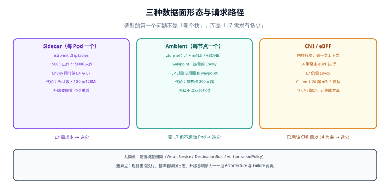

# 架构形态：Sidecar、Ambient 与 xDS 下发

「服务网格」这四个字背后至少有两种完全不同的数据面：一种是**每个 Pod 塞一个 Envoy**（Sidecar），一种是**每节点一个 ztunnel + 按需的 waypoint**（Ambient）。两者的配置模型相同、排障路径完全不同——同一份 `VirtualService` 在 Sidecar 下由 Envoy 执行，在 Ambient 下必须先有 waypoint，否则 L7 规则**静默不生效**。

本页把三种形态的拦截路径、控制面怎么下发配置、以及「注入/就绪/退出」这三个最容易出事的时序讲清楚。



本页判据族 `SMA-A` ~ `SMA-H`，共 8 条。定义表在第七节「本页判据」。

## 一、三种形态先分清

| 形态 | 数据面 | 谁做 L4（mTLS/授权） | 谁做 L7（路由/重试/HTTP 指标） | 典型代表 |
| --- | --- | --- | --- | --- |
| Sidecar | 每 Pod 一个 Envoy + `istio-init` | Pod 内的 Envoy | 同一个 Envoy | Istio（经典模式）、Kuma、Consul |
| Ambient | 每节点一个 ztunnel（Rust） + 每命名空间/服务可选 waypoint（Envoy） | ztunnel | waypoint | Istio 1.24+ |
| 内核 eBPF | CNI 直接在内核转发 | eBPF 程序（或 ztunnel，Cilium 1.20 起转向后者） | 仍需 Envoy（每节点或 Gateway） | Cilium |

选型的第一个问题不是「哪个快」，而是**你的 L7 需求有多少**：

| L7 需求 | Sidecar | Ambient |
| --- | --- | --- |
| 只有 mTLS + 四层授权 | 需要（每个 Pod 一份） | 不需要 waypoint，ztunnel 就够 |
| HTTP 重试/超时、头路由、灰度 | 需要 | 需要 waypoint（每个被治理的命名空间/服务一组） |
| 请求级指标（`istio_requests_total`） | 有 | 只在 waypoint 覆盖的流量上有 |
| 故障注入、流量镜像 | 有 | 需要 waypoint |
| 想不改 Pod 就升级数据面 | 做不到（注入的代理随 Pod 生命周期） | 可以（ztunnel 是 DaemonSet，滚动升级） |

## 二、Sidecar 的拦截路径

`istio-init` 这个 init 容器只干一件事：往 Pod 的网络命名空间里写 iptables 规则，把流量重定向到 Envoy。

| 端口 | 用途 | 排障时的意义 |
| --- | --- | --- |
| `15001` | 出向（outbound）重定向 | 应用发起的外部连接都从这里出去 |
| `15006` | 入向（inbound）重定向 | 到达本 Pod 的业务端口会被转到这里 |
| `15021` | 健康检查（`/healthz/ready`） | 就绪探针实际打的是它，不是业务端口 |
| `15020` | 合并后的指标/状态端口 | `istio-proxy` 的 `/stats/prometheus` 与 `/quitquitquit` |
| `15000` | Envoy 管理端口（admin） | `istioctl proxy-config` 最终读的就是它 |
| `15090` | Envoy 自身指标 | 与 15020 合并前的原始来源 |

::: warning `15006` 会「劫持」你的业务端口
入向重定向意味着**外部客户端连的还是业务端口**（如 8080），但实际处理连接的是 Envoy。所以「`curl pod-ip:8080` 超时」时，第一件事是确认 Envoy 是否就绪，而不是怀疑业务代码——业务代码可能压根没收到这个连接。
:::

## 三、Ambient 的两段：ztunnel 与 waypoint

Ambient 把「加密」和「治理」拆开：

- **ztunnel（每节点一个 DaemonSet）**：接管节点上所有入网 Pod 的流量，做 mTLS、身份校验、四层授权、TCP 指标。它用 **HBONE**（HTTP/2 CONNECT over mTLS，端口 `15008`）在对端之间建立隧道。
- **waypoint（按需的 Envoy 网关）**：只有需要 L7 的命名空间/服务才部署，用 Gateway API 的 `Gateway` 资源声明（`gatewayClassName: istio-waypoint`），监听 HBONE 端口。

请求路径因此变成 **源 ztunnel → waypoint → 目标 ztunnel**，比 Sidecar 多一跳。这一跳是有代价的：多一次转发、多一个需要扩容的 Deployment、多一处可能成为瓶颈的共享组件。

```yaml
# 给命名空间启用 ambient 数据面（不打 sidecar 注入标签）
apiVersion: v1
kind: Namespace
metadata:
  name: shop
  labels:
    istio.io/dataplane-mode: ambient
---
# 为命名空间挂一个 waypoint（只有需要 L7 时才建）
apiVersion: gateway.networking.k8s.io/v1
kind: Gateway
metadata:
  name: shop-waypoint
  namespace: shop
  labels:
    istio.io/waypoint-for: service
spec:
  gatewayClassName: istio-waypoint
  listeners:
    - name: mesh
      port: 15008
      protocol: HBONE
```

::: danger 最常见的「不生效」
`VirtualService` 写好了、`kubectl apply` 也成功了，但灰度一点没生效——因为在 ambient 模式下**该命名空间没有 waypoint**，L7 规则没有任何执行者。判据：`kubectl get gateway -n <ns>` 应当看到 waypoint，且 `istioctl waypoint list` 能列出它。
:::

## 四、控制面怎么下发：xDS 的四条流

控制面（Istio 是 `istiod`）不给数据面「执行命令」，而是持续下发**配置快照**。四条主流按 Envoy 的命名：

| 流 | 下发什么 | 你改的 YAML 落在哪 |
| --- | --- | --- |
| LDS（Listener） | 监听器、端口、TLS 上下文 | 服务端口、mTLS 模式 |
| RDS（Route） | 路由表（前缀/头匹配、权重、超时、重试） | `VirtualService` |
| CDS（Cluster） | 上游集群、负载均衡策略、熔断阈值 | `DestinationRule` 的 `connectionPool` / `outlierDetection` |
| EDS（Endpoint） | 集群里的具体实例（Pod IP） | Kubernetes `Endpoints` / `EndpointSlice` |
| SDS（Secret） | 证书与私钥 | 由 `istiod` 的 CA 自动签发，不需要人管 |

两个直接影响排障的性质：

1. **配置是「最终一致」的**：改完 `VirtualService` 后，数据面需要几百毫秒到几秒才全部同步。脚本里「apply 完立刻压测」会得到旧行为。判据是 `istioctl proxy-status` 里目标代理变成 `SYNCED`。
2. **配置错了通常不会报错**：`VirtualService` 引用了 `DestinationRule` 里不存在的 `subset`，`apply` 成功、数据面也没报错，只是流量**没有匹配到任何路由**（回落到默认路由或 404）。这类问题只能靠 `istioctl analyze` 与 `proxy-config route` 读实际下发的路由表来发现。

## 五、注入、就绪与退出：三个时序坑

| 时序 | Sidecar 模式 | Ambient 模式 | 坑 |
| --- | --- | --- | --- |
| 启动 | init 容器改 iptables → 主容器启动 → Envoy 启动 | ztunnel 在节点上已就绪，Pod 起来即被接管 | Sidecar 下主容器可能比 Envoy 先发包，导致首批请求失败 |
| 就绪 | `istio-proxy` 就绪早于应用时，流量会被过早导入 | 由 ztunnel 决定，与 Pod readiness 解耦 | 「假就绪」：探针过了但依赖没连上 |
| 退出 | Envoy 收到 `SIGTERM` 后 `preStop` 睡眠，继续处理存量连接 | ztunnel 不随 Pod 退出，连接由内核关闭 | 退出太快会丢正在处理的请求（502/503 尖峰） |

Sidecar 模式的正确写法（把「代理就绪」变成应用的启动前置）：

```yaml
spec:
  template:
    metadata:
      annotations:
        proxy.istio.io/config: |
          holdApplicationUntilProxyStarts: true
    spec:
      containers:
        - name: app
          # 应用自身的就绪探针必须是「真的能用」，不能只看端口
          readinessProbe:
            httpGet: { path: /health/ready, port: 8080 }
            periodSeconds: 5
```

::: tip 为什么 `holdApplicationUntilProxyStarts` 值得开
它让主容器等 Envoy 就绪后再启动。不开的话，应用启动阶段的第一个外部调用可能因为「iptables 已生效、Envoy 还没监听」而被拒——表现是**每次滚动发布都有少量启动失败**，而这条失败在应用日志里只是一行 `connection refused`。
:::

## 六、验证：三条命令看清「谁在执行我的规则」

```shell
# 1) 数据面形态：哪些命名空间是 ambient，哪些是 sidecar
kubectl get ns -L istio.io/dataplane-mode -L istio-injection

# 2) 实际下发的路由（不是 YAML 里写的，是 Envoy 里生效的）
istioctl proxy-config route deploy/order -n shop -o json | jq '.[].virtualHosts[].routes[].match'
# 期望：能看到你配的前缀/头匹配；看不到说明 VirtualService 没被选中

# 3) ambient 下确认 waypoint 存在且被引用
istioctl waypoint list -n shop
kubectl get gateway -n shop -o custom-columns=NAME:.metadata.name,CLASS:.spec.gatewayClassName
# 期望：waypoint 列表非空，CLASS=istio-waypoint
```

## 七、本页判据

| 编号 | 判据 | 看什么现象 | 不满足时改哪里 |
| --- | --- | --- | --- |
| `SMA-A` | 数据面形态已明确选定 | 文档写明 Sidecar 还是 Ambient，理由与 L7 需求对应 | 按第一节的 L7 表选型 |
| `SMA-B` | 能说清拦截端口 | 出向 `15001`、入向 `15006`、HBONE `15008` 有记录 | 补一张端口表 |
| `SMA-C` | ambient 下 L7 规则有执行者 | `istioctl waypoint list` 非空才用 `VirtualService` | 建 waypoint 或改用 L4 策略 |
| `SMA-D` | 规则以「实际下发」为准核对 | 用 `proxy-config route` 验证，而不是只看 apply 成功 | 改完必查 route 表 |
| `SMA-E` | 变更后等同步完成 | 压测/断言在 `SYNCED` 之后执行 | 脚本里加 `proxy-status` 轮询 |
| `SMA-F` | `subset` 引用有校验 | `istioctl analyze` 无 `subset not found` 类告警 | 先建 `DestinationRule` 再建路由 |
| `SMA-G` | 启动时序已处理 | Sidecar 模式开了 `holdApplicationUntilProxyStarts` | 补注解或改就绪探针 |
| `SMA-H` | 退出不丢请求 | `preStop` 有等待、`terminationGracePeriodSeconds` 大于最长请求 | 调整两个时间参数 |

## 参考资料

- Istio 官方：*Architecture*（控制面/数据面、xDS）、*Sidecar Injection*（`istio-init` 与 iptables）、*Ambient Mode*（ztunnel、HBONE、waypoint）
- Istio 官方：*Resource Annotations*（`proxy.istio.io/config`、`holdApplicationUntilProxyStarts`）
- Istio 1.31 发布说明：waypoint 金丝雀权重、`GatewayClass` 相关变化（2026-08）
- 本仓库：[概述](../Overview/index.md)（五档成熟度）、[网格自身故障](../Failure/index.md)（控制面不可用时的行为）
