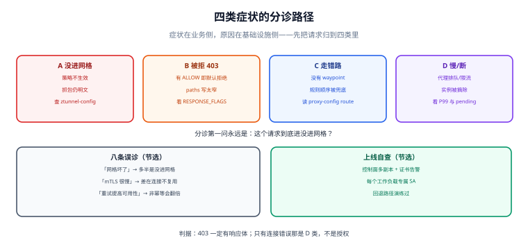

# 常见问题与分诊

服务网格的问题有一个共同特征：**症状在业务侧，原因在基础设施侧**。所以分诊的第一步永远不是「改配置」，而是回答一个二选一的问题——**这个请求到底进没进网格**。

本页把 14 个高频症状按「进网格前 / 进了但被拒 / 进了但走错 / 根本没进」四类归位，每个症状给一条**能当场执行的判据**。

本页判据族 `SMQ-A` ~ `SMQ-H`，共 8 条。定义表在第八节「本页判据」。

## 一、四类分诊：先定位，再动手

| 类别 | 典型症状 | 一条命令定位 |
| --- | --- | --- |
| A. 没进网格 | 调用「直连」成功但指标里没有记录；mTLS 策略「没生效」 | `istioctl ztunnel-config workloads \| grep <pod>` |
| B. 进了但被拒 | 403、`RBAC: access denied` | 访问日志 `response_flags=RBAC` |
| C. 进了但走错 | 灰度不生效、路由 404、重试没发生 | `istioctl proxy-config route` |
| D. 进了但变慢/断 | 延迟上升、偶发 503、连接被重置 | 代理 stats 与 `upstream_rq_pending` |

## 二、A 类：请求根本没进网格

| 症状 | 真因 | 判据 | 动作 |
| --- | --- | --- | --- |
| 配了 `PeerAuthentication: STRICT` 但明文调用照样成功 | 调用方或被调方不在网格里 | `ztunnel-config workloads` 两边都查 | 给缺失的一方打标签并重启 |
| 开了 mTLS 但抓包仍是明文 | Pod 用 `hostNetwork` | `kubectl get pod -o jsonpath='{.spec.hostNetwork}'` | 改架构（hostNetwork 不进网格） |
| 跨命名空间调用没有 mTLS | 目标命名空间未启用 | `kubectl get ns -L istio.io/dataplane-mode` | 启用并重启 |
| 从跳板机/宿主机 `curl` 能通 | 这条路径不经过网格 | 看调用方 IP 是否在集群内 | 这是预期行为，靠 NetworkPolicy 收紧 |

::: danger 「配了策略却没生效」先怀疑范围，不要怀疑策略
`PeerAuthentication`、`AuthorizationPolicy` 都是**作用域**的：命名空间写错、`selector` 没匹配上标签，都是「不报错但不生效」。判据是 `kubectl get <资源> -A` 看它到底落在哪个命名空间，而不是反复改 YAML 内容。
:::

## 三、B 类：被拒（403）

| 症状 | 真因 | 判据 | 动作 |
| --- | --- | --- | --- |
| 突然全部 403 | 加了 `ALLOW` 策略，默认变成拒绝 | `kubectl get authorizationpolicy -n <ns>` | 补齐放行规则或先删策略 |
| 只有某个路径 403 | `paths` 用了精确匹配，实际是子路径 | 对比 `operation.paths` 与真实 URI | 加通配（`/api/*`） |
| gRPC 全部 403 | 策略按 HTTP 方法写，gRPC 全是 POST | 看 `method` 字段 | 改用 `paths: ["/pkg.Svc/*"]` |
| 从网关进来的请求 403 | 网关的 SPIFFE 身份不在 `principals` 里 | `ztunnel-config workloads \| grep gateway` | 把网关 SA 加入策略 |

一条通用判据：**403 一定有响应体**（Envoy 返回 `RBAC: access denied`）。如果没有响应体、只有连接错误，那是 D 类（连接层），不是授权。

## 四、C 类：走错路

| 症状 | 真因 | 判据 | 动作 |
| --- | --- | --- | --- |
| 灰度权重不生效 | 没有 waypoint（ambient）/ 规则顺序被兜底吃掉 | `istioctl waypoint list`；`proxy-config route` 看顺序 | 建 waypoint；特殊规则前置 |
| 路由 404 | `hosts` 写的是短名，实际请求带 FQDN | `proxy-config route` 里的 `domains` | 用 FQDN 或加短名 |
| subset 引用无效 | `DestinationRule` 里没有该 subset | `istioctl analyze -n <ns>` | 补 subset 定义 |
| 重试没发生 | `retryOn` 条件与真实错误不匹配 | 代理 stats `upstream_rq_retry` 是否为 0 | 对齐 `retryOn` 与错误类型 |
| 超时不生效 | 路由上没设 `timeout`（当前版本默认不设） | `proxy-config route -o json` 的 `timeout` 字段 | 显式设置 |

## 五、D 类：通但慢/断

| 症状 | 真因 | 判据 | 动作 |
| --- | --- | --- | --- |
| 偶发 503，应用日志里没有记录 | 上游实例被摘除或连接被拒 | `outlier_detection.ejections_active` | 查被摘实例的健康状态 |
| P99 明显上升，P50 不变 | 代理排队或被 CPU 限流 | `upstream_rq_pending`、代理 CPU | 去掉代理 CPU limit 或调 `concurrency` |
| 滚动发布期间 502 尖峰 | 代理先于应用退出/应用先于代理启动 | `terminationGracePeriodSeconds`、`preStop` | 调整时序（见 [架构形态](../Architecture/index.md)） |
| 全节点网络中断 | ztunnel 被 OOM 或崩溃 | `kubectl get pod -n istio-system -o wide` | 去掉 ztunnel 内存 limit，`cordon` 节点 |
| 调用超时但下游说「没收到请求」 | 请求在源端 ztunnel 就被拦 | 源端访问日志 `UF` | 查 NetworkPolicy 与目标端口 |

## 六、八条误诊清单

1. **「网格坏了」** → 先确认请求进没进网格（A 类判据），80% 的「网格问题」是「压根没进网格」。
2. **「mTLS 影响性能」** → 关掉 mTLS 前后各测一次，增量通常在毫秒以下；真正的延迟来自连接不复用。
3. **「重试能提高可用性」** → 对非幂等写操作重试，只会把一次失败变成多次副作用。
4. **「熔断参数越大越安全」** → `maxEjectionPercent` 太小等于不熔断，太大等于自我 DDoS。
5. **「指标越多越好」** → 序列数爆炸是网格拖垮 Prometheus 的头号原因。
6. **「装上就自动加密」** → 只有进网格的工作负载之间才加密。
7. **「升级只是改版本号」** → 三条版本线（控制面 / 数据面 / waypoint）要各自灰度。
8. **「有网格就不用 NetworkPolicy」** → mTLS 证明身份，不限制可达性。

## 七、上线自查清单（勾完再上生产）

| 项 | 判据 | 不满足的后果 |
| --- | --- | --- |
| 控制面多副本跨区 | `replicaCount ≥ 2` + 反亲和 | 控制面挂 = 24 小时后全站 mTLS 失败 |
| 注入 webhook 有应急预案 | 文档写明改 `failurePolicy` 的步骤 | webhook 挂 = 所有 Pod 起不来 |
| 证书到期有告警 | 有剩余时间指标 | 证书过期无感知 |
| 每个工作负载有专属 SA | 不是清一色 `default` | 授权粒度退化为命名空间级 |
| `STRICT` 前清点过明文来源 | 三类漏网者有结论 | 切换当天大面积失败 |
| 指标序列数有上限 | `istio_*` 序列数在看板上 | Prometheus OOM |
| 回退路径演练过 | 有耗时记录 | 出事时不敢回退 |
| 值班手册含分诊表 | 本页四类能对上 | 排障从零开始 |

## 八、本页判据

| 编号 | 判据 | 看什么现象 | 不满足时改哪里 |
| --- | --- | --- | --- |
| `SMQ-A` | 分诊先判「进没进网格」 | 排障第一步是查 `ztunnel-config workloads` | 把这一步写进 runbook |
| `SMQ-B` | 403 与连接错误能区分 | 有响应体 vs 只有连接失败 | 补判据表 |
| `SMQ-C` | 策略作用域会核对 | 用 `get -A` 确认落在哪 | 修命名空间/selector |
| `SMQ-D` | L7 问题先查 waypoint | ambient 下先看 `waypoint list` | 建 waypoint |
| `SMQ-E` | 规则顺序与 `hosts` 会核对 | 用 `proxy-config route` 看实际表 | 调整 YAML |
| `SMQ-F` | 慢的问题看排队长尾 | 同时看 P99 与 `upstream_rq_pending` | 调代理资源 |
| `SMQ-G` | 八条误诊有对照 | 团队知道这八条 | 培训/文档 |
| `SMQ-H` | 上线清单逐项有结论 | 八项都有人签字 | 补齐后再上线 |

## 参考资料

- Istio 官方：*Common Problems*（Ingress/Gateway 与 sidecar 的常见症状）、*Traffic Management* 任务
- Istio 官方：*Security*（`AuthorizationPolicy` 语义与 `principals` 格式）、*Prepare for production deployments*
- Envoy 文档：`%RESPONSE_FLAGS%` 与 `upstream_rq_*` 计数器
- 本仓库：[概述](../Overview/index.md)（该不该上）、[网格自身故障](../Failure/index.md)（故障分类）、[实战](../Practice/index.md)（可复跑的验收链）
