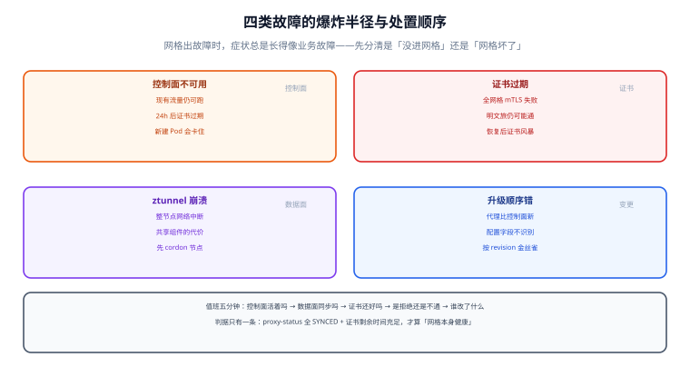

# 网格自身故障：控制面宕机、证书过期与升级事故

服务网格最反直觉的一点是：**它出故障时，症状往往看起来像业务故障**。Pod 起不来被当成镜像问题，服务间 503 被当成下游挂掉，全站请求失败被当成网络抖动——真正的原因可能是「注入 webhook 不可用」「工作负载证书过期」「ztunnel 被 OOM 杀掉」。

本页按「控制面 / 证书 / 数据面 / 变更」四类故障分开讲，每一类都给**症状 → 判据 → 动作**三步，以及一套可以提前做的演练。



本页判据族 `SMF-A` ~ `SMF-H`，共 8 条。定义表在第八节「本页判据」。

## 一、先记住两条「能撑多久」

| 问题 | 答案 | 依据 |
| --- | --- | --- |
| 控制面（istiod）全挂，现有流量还能跑多久？ | **只要证书没过期，就能一直跑** | 配置已下发到数据面内存，代理不依赖控制面转发 |
| 控制面挂多久会开始出事？ | **约等于工作负载证书 TTL（默认 24 小时）** | 证书过期后 mTLS 握手失败，全网格服务间调用开始报错 |

由此得到两条运营纪律：

1. **控制面必须多副本、跨可用区**（`replicaCount ≥ 2` + 反亲和），它不是「装一次就不管」的组件。
2. **证书 TTL 与根证书轮换要有告警**：TTL 到期前至少留出「发现→恢复控制面」的时间窗。

## 二、控制面故障：症状与判据

| 症状 | 可能原因 | 判据（怎么确认） | 动作 |
| --- | --- | --- | --- |
| 新建 Pod 一直 `ContainerCreating` | 注入 webhook 不可用（`failurePolicy: Fail` 时） | `kubectl get pod -o yaml` 里事件显示 `failed calling webhook` | 恢复 istiod；紧急时把 webhook 的 `failurePolicy` 临时改 `Ignore` |
| 改配置不生效 | 下发通道断（istiod 挂或网络策略挡了 `15012`） | `istioctl proxy-status` 显示 `STALE` / `NOT SENT` | 先看 istiod 副本与日志，再看 APIServer 连接 |
| 新 Pod 起来了但调用全 503 | 新 Pod 拿不到证书（istiod 不可用） | 代理日志里 `failed to fetch certs`、`SDS` 报错 | 恢复 istiod；短期扩容老副本扛流量 |
| 全网格大面积 `upstream connect error` | 证书过期或信任根变更 | `istioctl proxy-config secret` 显示证书 `EXPIRED` | 恢复控制面并强制重新签发 |

::: danger 注入 webhook 是最容易被忽略的单点
`failurePolicy: Fail` 意味着**webhook 不可用时所有 Pod 都创建不出来**——包括 istiod 自己、监控、以及你用来救火的工具 Pod。这条链一旦断，恢复手段只剩「直接改 webhook 配置」或「停用注入」。上线前必须验证这条恢复路径能走通（演练项，见第六节）。
:::

## 三、证书故障：三个时间点

| 时间点 | 现象 | 判据 |
| --- | --- | --- |
| 证书剩余 < 轮换窗口（寿命过半） | 一切正常（控制面会自动续） | `proxy-config secret` 的剩余时间在刷新 |
| 证书过期 | 服务间 mTLS 握手失败，**明文调用仍可能通**（取决于模式） | 代理日志 `TLS error: certificate expired` |
| 根证书/信任域变更未同步 | 部分服务能通、部分不通（信任包不一致） | 两侧 `proxy-config secret` 的 root 不一致 |

一条实用判据：**只要控制面不可用时间 > 证书 TTL 的一半，就必须假定「恢复后会有一次证书风暴」**——所有代理会同时来续签。恢复后要观察 istiod 的 CPU 与请求延迟，必要时分批重启数据面。

## 四、数据面故障：ztunnel 与 waypoint

| 组件 | 故障影响 | 为什么 | 处置 |
| --- | --- | --- | --- |
| ztunnel（每节点一个） | **该节点上所有入网 Pod 的网络中断** | 它是节点级共享组件，被 OOM 或崩溃即全节点不通 | 不设内存 limit；`maxUnavailable: 0` 滚动；出事优先 `cordon` 该节点 |
| waypoint（按命名空间/服务） | 经过它的 L7 流量全断，未启用 L7 的流量不受影响 | 它是普通 Deployment，可多副本 | 至少 2 副本 + PDB；明确「没有 waypoint 时降级为 L4」的预期 |
| Sidecar（每 Pod） | 单 Pod 不通 | 影响面最小 | 重启 Pod 即可 |

Ambient 的这条差异值得单独强调：**Sidecar 的故障是「一个 Pod 的事」，ztunnel 的故障是「一台节点的事」**。共享组件降低了资源成本，同时**放大了单点故障的爆炸半径**——这是选型时必须写进风险清单的一条。

## 五、变更事故：升级顺序与回退

| 形态 | 正确顺序 | 错误顺序的后果 |
| --- | --- | --- |
| Sidecar | 控制面（新 revision，金丝雀）→ 逐步把命名空间切到新 revision → 重启工作负载 → 删除旧 revision | 先重启数据面：代理版本比控制面新，部分配置字段不被识别 |
| Ambient | istiod → ztunnel（按节点分批，`maxUnavailable: 0`）→ waypoint | 先升级 waypoint：与控制面版本不匹配，L7 策略下发失败 |

Sidecar 的金丝雀升级靠 revision 实现：

```shell
# 1) 装一个新 revision（不动现有的）
istioctl install --set revision=1-31-1 -y

# 2) 把命名空间切到新 revision（新 Pod 用新代理，老 Pod 不变）
kubectl label ns shop istio-injection- istio.io/rev=1-31-1 --overwrite

# 3) 逐步重启工作负载，观察错误率与延迟
kubectl rollout restart deploy/order -n shop
kubectl rollout status deploy/order -n shop

# 4) 全部切换并观察一个发布窗口后，再删旧 revision
istioctl uninstall --revision default -y
```

回退的判据不是「感觉不对」，而是**三条硬指标**：错误率超过基线 2 倍、P99 超过预算、`proxy-status` 出现持续 `STALE`。任一条命中就停止推进（不是回滚整个集群，而是**停在那批**）。

## 六、演练：三个必须做的实验

| 演练 | 做法 | 期望 |
| --- | --- | --- |
| 控制面宕机 | 把 istiod 副本缩到 0，持续 30 分钟 | 现有流量不受影响；`proxy-status` 变为不可用；**新建 Pod 会卡住**（记录卡在哪一步） |
| 证书过期 | 预发把工作负载证书 TTL 调到 10 分钟，然后停控制面 20 分钟 | 观察 mTLS 何时开始失败、日志长什么样、恢复后是否有证书风暴 |
| ztunnel 崩溃 | 在测试节点上杀掉 ztunnel Pod | 该节点流量中断的时长、恢复时间、其他节点是否受影响 |

```shell
# 控制面宕机演练（预发环境）
kubectl scale deploy/istiod -n istio-system --replicas=0
# 观察：业务调用是否仍正常
kubectl exec -n shop deploy/sleeper -- curl -s -o /dev/null -w '%{http_code}\n' http://order.shop/api
# 期望：200（数据面用最后一份配置继续工作）
# 观察：新建 Pod 卡在哪
kubectl run probe --image=curlimages/curl -n shop -- sleep 3600
kubectl get pod probe -n shop -o wide
# 期望：ContainerCreating / 或缺少 sidecar（依注入策略而定）
# 恢复
kubectl scale deploy/istiod -n istio-system --replicas=2
```

## 七、值班手册：五分钟定位表

| 第一步 | 命令 | 判读 |
| --- | --- | --- |
| 控制面活着吗 | `kubectl get pod -n istio-system` | 全部 `Running` 且就绪 |
| 数据面同步吗 | `istioctl proxy-status` | 全 `SYNCED` |
| 证书还好吗 | `istioctl proxy-config secret deploy/x -n y` | `ACTIVE=true`，剩余时间充足 |
| 是拒绝还是不通 | 看访问日志 `RESPONSE_FLAGS` | `RBAC` = 策略；`UF` = 连接；`NR` = 路由 |
| 谁改了什么 | `kubectl get events -A --sort-by=.lastTimestamp \| tail -30` | 最近 30 条事件常直接指向根因 |

## 八、本页判据

| 编号 | 判据 | 看什么现象 | 不满足时改哪里 |
| --- | --- | --- | --- |
| `SMF-A` | 控制面多副本跨区 | istiod `replicaCount ≥ 2` + 反亲和 | 调副本与拓扑约束 |
| `SMF-B` | 证书 TTL 有到期告警 | 有「证书剩余时间」指标与告警 | 接入指标 |
| `SMF-C` | 注入 webhook 失败有预案 | 文档写明紧急改 `failurePolicy` 的步骤 | 补预案并演练 |
| `SMF-D` | ztunnel 无内存 limit | ztunnel 只有 CPU request | 去掉 limit |
| `SMF-E` | waypoint 多副本 + PDB | 副本 ≥ 2 且有 PDB | 补副本与 PDB |
| `SMF-F` | 升级按 revision 金丝雀 | 有「新 revision → 切 ns → 删旧」流程 | 改升级流程 |
| `SMF-G` | 回退判据是数值不是感觉 | 错误率/P99/同步状态三条阈值 | 写成明确阈值 |
| `SMF-H` | 三类演练做过并留档 | 有演练记录（含卡住的步骤与耗时） | 排期演练 |

## 参考资料

- Istio 官方：*Upgrade*（revision 金丝雀与双控制面）、*Certificate Management*（证书寿命与轮换）
- Istio 官方：*Sidecar Injection*（`failurePolicy` 与 webhook 行为）、*Prepare for production deployments*（ztunnel 高可用与滚动策略）
- Istio 官方：*Ambient Mode* 的 *Waypoint* 章节（副本与 PDB 建议）
- 本仓库：[架构形态](../Architecture/index.md)（三种形态的故障面差异）、[可观测性](../Observability/index.md)（`RESPONSE_FLAGS` 对照）、[网关深入](../../GatewayDeep/FAQ/index.md)（入口侧故障的另一半）
