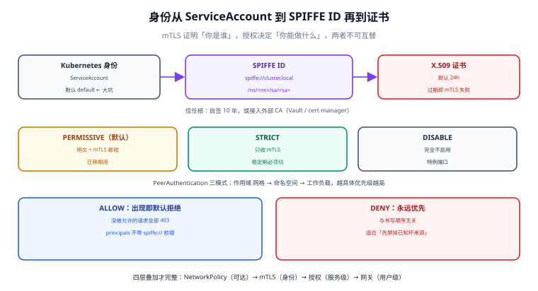

# 身份与 mTLS：SPIFFE、证书轮换与授权策略

「内网就是可信的」这个假设在容器环境里几乎一定不成立：任何能调度到同网段的 Pod 都能连你的数据库端口，任何拿到一份 ConfigMap 的人都能冒充一个调用方。网格给出的答案不是「更严的网络策略」，而是**给每个工作负载一个可验证的身份**——证书里写着「你是 `shop` 命名空间里的 `order` 这个 ServiceAccount」，而且这张证书**由控制面自动轮换**，不需要人插手。

本页讲三件事的机制与切换顺序：身份怎么构成、mTLS 从宽松到严格怎么切、授权策略怎么写才不会把自己锁在门外。



本页判据族 `SMI-A` ~ `SMI-H`，共 8 条。定义表在第七节「本页判据」。

## 一、身份是怎么构成的

| 层 | 内容 | 谁写 |
| --- | --- | --- |
| Kubernetes 身份 | `ServiceAccount`（默认 `default`） | 你（或 Helm chart） |
| SPIFFE ID | `spiffe://<trust domain>/ns/<namespace>/sa/<serviceaccount>` | 控制面按 Pod 的 SA 生成 |
| 证书 | X.509，`URISAN` 里放 SPIFFE ID，有效期默认 **24 小时** | `istiod` 内置 CA 签发 |
| 信任根 | 自签 root（默认 10 年）或接入外部 CA（Vault、cert-manager） | 安装时决定 |

默认 trust domain 是 `cluster.local`。它**不是**集群域名，只是一个字符串标识；多集群/多租户场景里改成组织级名字（如 `shop.example.com`）能让策略更可读，但**改这个名字等于换信任根**，已有策略里的 `principals` 全部要跟着改。

::: warning 默认 ServiceAccount 是最大的身份漏洞
同一个命名空间里所有没显式指定 SA 的 Pod 共享 `default` SA，因此**它们的 SPIFFE ID 完全相同**——按身份授权时，「谁能调我」实际上退化成了「哪个命名空间能调我」。上线前必须逐工作负载建 SA（`serviceAccountName`），否则整套身份模型只剩命名空间粒度。
:::

## 二、mTLS 三种模式与切换顺序

`PeerAuthentication` 决定「入向连接要不要求 mTLS」：

| 模式 | 行为 | 适用阶段 |
| --- | --- | --- |
| `PERMISSIVE`（默认） | 同时接受明文与 mTLS | 迁移期：老客户端还没接入网格 |
| `STRICT` | 只接受 mTLS，明文连接被拒 | 稳定期：全量接入之后 |
| `DISABLE` | 不启用 mTLS | 仅用于必须明文的特例（如外部探针直连） |

`PeerAuthentication` 是**作用域叠加**的：网格级（`root-namespace` 的 `default`）→ 命名空间级 → 工作负载级（`selector`）。越具体优先级越高，所以「全局 STRICT + 单个工作负载 PERMISSIVE」是可行且常见的过渡写法。

```yaml
# 1) 命名空间级：先宽松，观察一段时间
apiVersion: security.istio.io/v1
kind: PeerAuthentication
metadata:
  name: default
  namespace: shop
spec:
  mtls:
    mode: PERMISSIVE
---
# 2) 确认没有明文流量后，切 STRICT
apiVersion: security.istio.io/v1
kind: PeerAuthentication
metadata:
  name: default
  namespace: shop
spec:
  mtls:
    mode: STRICT
  # 只给健康检查端口开口子（kubelet 探针不走 mTLS）
  portLevelMtls:
    "8080":
      mode: PERMISSIVE
```

::: danger 切 STRICT 前必须回答的一个问题
**还有谁在明文调我？** 三类最常见的漏网者：① 没打网格标签的命名空间（含 `kube-system` 里的运维工具）；② 从宿主机或跳板机直接 `curl pod-ip` 的排障脚本；③ 用 `hostNetwork` 的 DaemonSet（日志采集、监控 agent）。切 STRICT 后这些调用会全部失败，而且失败点是**连接层**——被调方应用日志里什么都看不到。
:::

## 三、证书轮换：三个时间常数

| 时间常数 | 默认 | 影响 |
| --- | --- | --- |
| 工作负载证书 TTL | 24 小时 | 控制面不可用超过这个时间 → 证书过期 → 全网格 mTLS 失败 |
| 轮换提前量 | 证书寿命过半即触发续签 | 控制面短暂抖动不会立刻出事 |
| 根证书寿命 | 自签默认 10 年 | 根证书轮换要重启控制面并同步信任包，属于「大手术」 |

由此得到一条硬结论：**控制面不是「配好就不用管」的组件**。它挂了 24 小时内数据面照常工作（配置已在内存里、证书还没过期），超过 24 小时就开始大面积失败。演练方法见 [网格自身故障](../Failure/index.md)。

## 四、授权策略：默认拒绝与优先级

`AuthorizationPolicy` 的语义容易记反，记住三条就够：

1. **一个工作负载上只要出现任意一条 `ALLOW` 策略，就变成「默认拒绝」**——所有没被允许的请求都被拒（403）。
2. **`DENY` 永远优先于 `ALLOW`**，与书写顺序无关。
3. **没有 `ALLOW` 也没有 `DENY` 时，默认为允许**（此时只有 mTLS 在起作用）。

```yaml
apiVersion: security.istio.io/v1
kind: AuthorizationPolicy
metadata:
  name: order-api
  namespace: shop
spec:
  selector:
    matchLabels:
      app: order
  action: ALLOW
  rules:
    # 只允许 payment 与 api-gateway 两个身份调用 /api/v1/orders
    - from:
        - source:
            principals:
              - "cluster.local/ns/shop/sa/payment"
              - "cluster.local/ns/shop/sa/api-gateway"
      to:
        - operation:
            methods: ["GET", "POST"]
            paths: ["/api/v1/orders", "/api/v1/orders/*"]
```

注意 `principals` 里**不带 `spiffe://` 前缀**（Istio 的约定是 `trustDomain/ns/.../sa/...`），写错不会报错，只会**永远不匹配**——策略看上去生效了，实际谁都被拒或谁都被放。

| 想做的事 | 写法 | 常见错误 |
| --- | --- | --- |
| 按身份放行 | `from[].source.principals` | 加了 `spiffe://` 前缀 |
| 按命名空间放行 | `from[].source.namespaces` | 以为它校验身份（它只看 SA 所在命名空间） |
| 按 HTTP 方法/路径放行 | `to[].operation.methods/paths` | 在 L4 场景（无 waypoint）写 `paths`，静默不生效 |
| 显式拒绝某类请求 | 单独一条 `action: DENY` | 把 `DENY` 写在 `ALLOW` 后面以为会「覆盖」——优先级本就固定 |
| 先观察不拦截 | `action: AUDIT` | 以为 `AUDIT` 会记日志但忘了它需要额外的审计后端 |

## 五、验证：四步确认「身份真的在工作」

```shell
# 1) 工作负载的 SPIFFE 身份（ambient）
istioctl ztunnel-config workloads | grep -E "NAMESPACE|shop"
# 期望：目标 Pod 的 SERVICE ACCOUNT 是专属 SA，不是 default

# 2) 证书真的签出来了、剩余有效期合理（sidecar）
istioctl proxy-config secret deploy/order -n shop
# 期望：ACTIVE 列为 true，剩余时间在 24h 内（轮换正常）

# 3) mTLS 是否被强制执行
istioctl x describe pod deploy/order -n shop | grep -i mtls
# 期望：显示 STRICT；显示 PERMISSIVE 说明命名空间策略没覆盖到

# 4) 授权是否按预期拒绝（这一条最容易被跳过）
kubectl exec -n other deploy/sleeper -- \
  curl -s -o /dev/null -w '%{http_code}\n' http://order.shop.svc.cluster.local:8080/api/v1/orders
# 期望：403（RBAC: access denied）；返回 200 说明策略没生效
```

::: tip 403 与连接失败要分清
授权拒绝是 **HTTP 403**（有响应、被 Envoy 拒），mTLS 失败是**连接层错误**（`upstream connect error`、`EOF`、超时）。把两者混为一谈，会在「到底是证书问题还是策略问题」上耗掉半天。
:::

## 六、与相邻安全机制的边界

| 机制 | 管什么 | 不管什么 |
| --- | --- | --- |
| mTLS（本页） | 传输加密 + 对端身份 | 授权决策、网络可达性 |
| `AuthorizationPolicy`（本页） | 谁能调哪个路径 | 底层网络是否能通 |
| NetworkPolicy | 哪些 IP/端口可达 | 七层语义、身份 |
| 网关鉴权 | 终端用户身份（JWT/OAuth） | 服务间身份 |

正确姿势是**四层叠加**：NetworkPolicy 缩小可达面 → mTLS 加密并证明身份 → `AuthorizationPolicy` 做服务级最小权限 → 网关做用户级鉴权。四者缺一层都能被绕过，见 [容器编排安全](../../../Ops/ContainerOrchestration/Security/index.md)。

## 七、本页判据

| 编号 | 判据 | 看什么现象 | 不满足时改哪里 |
| --- | --- | --- | --- |
| `SMI-A` | 每个工作负载有专属 SA | `ztunnel-config workloads` 里不是清一色 `default` | 补 `serviceAccountName` |
| `SMI-B` | trust domain 已明确 | 策略里的 `principals` 与 trust domain 一致 | 统一前缀写法 |
| `SMI-C` | mTLS 切换有顺序记录 | 先 `PERMISSIVE` 观察，再 `STRICT` | 补切换记录与观察窗口 |
| `SMI-D` | 明文来源已清点 | 三类漏网者（无标签 ns、宿主机、hostNetwork）都有结论 | 逐个接入或加例外 |
| `SMI-E` | 探针端口有例外 | `portLevelMtls` 覆盖健康检查端口 | 补端口级配置 |
| `SMI-F` | 授权策略是「最小权限」 | 每条策略只放行必需的身份与路径 | 收窄 `principals` 与 `paths` |
| `SMI-G` | 存在反向验证用例 | 有一个「应该 403」的调用被真的测过 | 补越权用例，见 [实战](../Practice/index.md) |
| `SMI-H` | 证书轮换可观测 | 能读出证书剩余有效期，且有到期告警 | 接入指标与告警 |

## 参考资料

- Istio 官方：*Security*（身份模型、`PeerAuthentication` 三种模式、`AuthorizationPolicy` 优先级）、*Mutual TLS*（迁移顺序）
- Istio 官方：*SPIFFE*（`spiffe://<trust domain>/ns/<ns>/sa/<sa>` 格式）、*Certificate Management*（工作负载证书寿命与轮换）
- SPIFFE/SPIRE 规范：SPIFFE ID 与 SVID 定义
- 本仓库：[架构形态](../Architecture/index.md)（ztunnel 与 waypoint 的分工）、[容器编排安全](../../../Ops/ContainerOrchestration/Security/index.md)（四层策略叠加）、[证书生命周期](../../../Ops/CertificateLifecycle/index.md)（非网格场景的证书治理）
