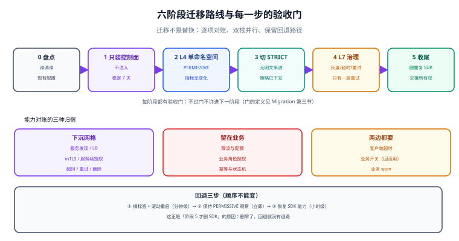

# 从 SDK 治理到网格：双栈迁移与回退

绝大多数团队的起点不是「一片空白」，而是**已经有一套 SDK 治理**：`spring-cloud-starter-loadbalancer`、`resilience4j`、`@Retryable`、Hystrix 时代的线程隔离、每个团队自己写的 trace 拦截器。这套东西能跑，问题是它**跟语言绑死、跟版本绑死**——升级一次框架，全公司排队发版。

迁移到网格最容易犯的错，是把它当成「替换」：把 SDK 的重试关掉、把网格的重试打开，然后指望行为不变。真实情况是**两者的语义不同**（重试条件、超时传播、熔断维度都不一样），必须逐项对账，并接受一段时间的**双栈并行**。



本页判据族 `SMG-A` ~ `SMG-H`，共 8 条。定义表在第八节「本页判据」。

## 一、能力对账表：谁该留下，谁该删

| 能力 | SDK 侧 | 网格侧 | 迁移结论 |
| --- | --- | --- | --- |
| 服务发现 | 注册中心 + 客户端 LB | 直接读 Kubernetes `EndpointSlice` | **删 SDK**（两套发现会导致流量绕过网格） |
| 负载均衡 | 客户端策略（轮询/权重/一致性哈希） | `DestinationRule.loadBalancer` | 删 SDK，策略在网格重配 |
| 超时 | 客户端超时（常缺失） | 路由超时 + `perTryTimeout` | 网格兜底，**业务必须保留自己的超时** |
| 重试 | `@Retryable` 等，条件自由 | 只对「未到达」类失败默认重试 | 网格接管，**非幂等接口关掉两边** |
| 熔断 | 按方法/异常类型计数 | 按实例 5xx 计数摘除 | 语义不同，二选一（推荐网格） |
| 限流 | 令牌桶（进程内） | 网格无内置限流，需网关/外部 | **留在业务或网关** |
| 服务间认证 | 共享 token / mTLS（少见） | SPIFFE + mTLS 自动轮换 | 网格接管 |
| 授权 | 代码里 `if (role != ...)` | `AuthorizationPolicy`（服务级） | **业务授权留在代码**，服务级下沉网格 |
| 埋点 | 各语言 SDK | 代理侧统一指标/链路 | 网格做网络层，业务 span 保留 |
| 灰度 | 配置中心开关 | 权重/头路由 | 网格接管路由，**业务开关仍要留**（回滚用） |

这张表最重要的两列是最后两列：**能下沉的只有「与业务语义无关」的那部分**。限流（要业务配额）、业务授权（要角色模型）、幂等（要业务键）都下沉不了。

::: danger 最容易搞坏的一次「替换」
把 SDK 的重试和网格的重试同时打开。表现是故障时下游被打两倍流量，且**错误率不降反升**——因为两层重试的条件不同，SDK 会重试 5xx，网格不会，于是「SDK 重试 → 网格不重试 → 又打回同一个坏实例」形成放大。迁移期必须明确**只有一个重试层**。
:::

## 二、双栈并行的三种形态

| 形态 | 做法 | 适用 | 风险 |
| --- | --- | --- | --- |
| 按命名空间并行 | 一个命名空间进网格，另一个不进 | 推荐起点 | 跨命名空间调用可能一侧明文、一侧加密 |
| 按服务并行 | 同一命名空间内部分服务进网格 | 大单体拆分期 | 网格内外互调需要 `PERMISSIVE` 兜着 |
| 按集群并行 | 新集群全量网格，老集群不动 | 蓝绿迁移 | 两套治理规则要有人对账 |

**按命名空间并行**是绝大多数团队的正确答案：边界清晰、回滚只需改一个标签、`PERMISSIVE` 模式能让明文与 mTLS 共存一段时间。

```shell
# 迁移一个命名空间（Sidecar 模式）
kubectl label ns shop istio-injection=enabled
kubectl rollout restart deploy -n shop
kubectl rollout status deploy -n shop

# 回退（同一个操作反向）
kubectl label ns shop istio-injection-
kubectl rollout restart deploy -n shop
# 注意：回退是「重启去掉 sidecar」，不是「立即生效」——滚动期间新旧并存
```

## 三、六个阶段与每阶段的验收门

| 阶段 | 做什么 | 验收门（不过不许进下一阶段） |
| --- | --- | --- |
| 0 现状盘点 | 导出「谁调谁」、现有超时/重试/熔断配置、语言分布 | 调用关系图 + 配置清单齐全；已知无监控的调用 ≤ 5% |
| 1 只装控制面 | 不注入任何工作负载 | 控制面稳定 7 天；`proxy-status` 无异常；资源占用在预算内 |
| 2 单命名空间 L4 | 该命名空间进网格，`PERMISSIVE` | mTLS 生效但明文仍可通；业务指标无变化 |
| 3 切 `STRICT` | 命名空间内全量 mTLS | 无明文来源（用 [可观测性](../Observability/index.md) 的 `connection_security_policy` 验证） |
| 4 L7 治理 | 灰度路由、超时、重试按对账表切换 | 灰度能按权重切；重试只有一层；错误率与延迟回到基线 |
| 5 收尾 | 删 SDK 的重复能力、更新 runbook、交接所有权 | SDK 依赖已移除；值班手册含网格排障路径 |

## 四、迁移期的四个「行为差异」清单

这些差异不是 bug，但每一条都会在迁移后第一天造成「怎么和以前不一样」的工单：

1. **重试条件不同**：SDK 常重试 5xx 与超时，网格默认只重试连接类失败。表现为「以前偶发失败会自愈，现在直接失败」。
2. **熔断维度不同**：SDK 按方法/异常计数，网格按实例连续 5xx 计数。表现为「以前某个接口熔断，现在整个实例被摘」。
3. **超时传播不同**：网格超时只管它那一跳，业务内部的等待（线程池、连接池）不受控。表现为「网格超时到了但请求还在跑」。
4. **身份粒度不同**：SDK 时代可能按 token 里的用户授权，网格按工作负载身份。表现为「策略从『谁能做什么』变成『哪个服务能调我』」。

## 五、回退：必须提前写好的三步

| 步 | 动作 | 耗时 | 判据 |
| --- | --- | --- | --- |
| 1 | 摘掉命名空间的注入/网格标签，滚动重启 | 分钟级（取决于副本数） | 新 Pod 无代理，调用仍通 |
| 2 | 把 `PERMISSIVE` 保持开着（别急着删策略） | 立即 | 明文与 mTLS 都能通 |
| 3 | 恢复 SDK 侧能力（如果已删） | **小时级** | 这正是「阶段 5 才删 SDK」的原因 |

::: warning 回退不是无代价的
滚动重启期间新旧 Pod 并存，**新旧两套治理逻辑同时生效**：老 Pod 走 SDK 重试，新 Pod 走网格重试。这个窗口里的指标不可用于判断「回退是否成功」——要看**回退完成之后**的一个完整采样窗口。
:::

## 六、组织侧：YAML 归谁管

| 资源 | 建议归属 | 理由 |
| --- | --- | --- |
| `PeerAuthentication`（网格/命名空间级） | 平台团队 | 安全基线，不能各团队自定 |
| `AuthorizationPolicy`（服务级） | **服务团队**，平台提供模板与校验 | 只有服务团队知道「谁能调我」 |
| `VirtualService` / `DestinationRule` | 服务团队（灰度期） | 与发布节奏绑定 |
| `Telemetry`（采样、日志） | 平台团队 | 成本与合规 |

判据很简单：**改错会导致全公司故障的归平台，改错只影响自己服务的归团队**。

## 七、验证：三条命令确认迁移真的完成

```shell
# 1) 命名空间内没有明文连接（connection_security_policy 只有 mutual_tls）
#    PromQL: sum(rate(istio_requests_total{connection_security_policy="unknown"}[5m])) > 0 应有告警
kubectl exec -n shop deploy/sleeper -- curl -s localhost:15020/stats/prometheus \
  | grep connection_security_policy | head -5
# 期望：全部 mutual_tls

# 2) 只有一个重试层（应用侧重试已关）
kubectl exec -n shop deploy/order -c istio-proxy -- \
  pilot-agent request GET stats | grep '^upstream_rq_retry:'
# 期望：非 0（网格在重试）；同时应用日志里没有 SDK 的重试记录

# 3) 回退路径可用（不实际执行，只校验前置条件）
kubectl get ns shop -o jsonpath='{.metadata.labels}'
# 期望：能看到 istio-injection 或 dataplane-mode 标签（回退时据此摘除）
```

## 八、本页判据

| 编号 | 判据 | 看什么现象 | 不满足时改哪里 |
| --- | --- | --- | --- |
| `SMG-A` | 能力对账表逐项有结论 | 十项能力都有「留/删」决定 | 按第一节补表 |
| `SMG-B` | 只有一层重试 | 应用与网格不同时重试 | 关掉一侧 |
| `SMG-C` | 限流与业务授权没下沉 | 代码里仍有配额与角色判断 | 保留，不要搬进 YAML |
| `SMG-D` | 迁移按命名空间推进 | 有明确的命名空间清单与顺序 | 改推进方式 |
| `SMG-E` | 阶段验收门可执行 | 每阶段有命令与期望，不是「感觉没问题」 | 补门禁 |
| `SMG-F` | 回退三步已演练 | 有演练记录与耗时 | 排期演练 |
| `SMG-G` | 明文连接有告警 | `connection_security_policy="unknown"` 触发告警 | 接告警 |
| `SMG-H` | 资源所有权清晰 | 四类资源各有负责人 | 补归属表 |

## 参考资料

- Istio 官方：*Traffic Management*（重试默认条件）、*Security*（`PERMISSIVE` 与迁移）
- Istio 官方：*Sidecar Injection*（按命名空间启停注入）
- 本仓库：[微服务](../Microservices/Overview/index.md)（框架内治理的能力清单）、[东西向流量治理](../Traffic/index.md)（重试放大）、[网格自身故障](../Failure/index.md)（回退与升级顺序）
