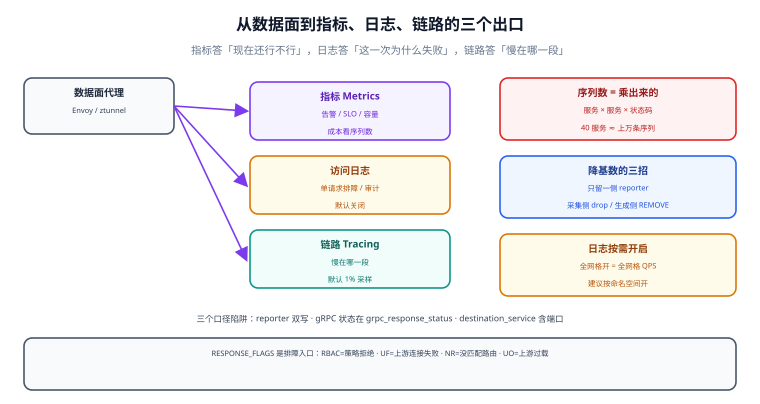

# 可观测性：指标基数、访问日志与链路

网格最被低估的产出不是路由能力，而是**同一套遥测**：42 个服务、5 种语言，指标名、标签名、日志格式完全一致。这让「按服务对比成功率」第一次变成一件不需要写代码的事。

但同一套遥测也是成本最高的产出。默认配置下，`istio_requests_total` 的标签组合会随「服务 × 服务 × 状态码 × 协议 × 安全策略」做乘法；一个 40 服务的集群，单这一条指标就能产生数万时间序列，把 Prometheus 的内存吃光。



本页判据族 `SMV-A` ~ `SMV-H`，共 8 条。定义表在第八节「本页判据」。

## 一、三个出口，三种用途

| 信号 | 主要用途 | 默认状态 | 成本主导因素 |
| --- | --- | --- | --- |
| 指标（Metrics） | 告警、SLO、容量 | 默认开启 | **时间序列数**（标签组合） |
| 访问日志（Access Log） | 单请求排障、审计 | **默认关闭** | 日志量（QPS × 字段数） |
| 链路（Tracing） | 跨服务调用路径 | 需接后端，采样率默认很低 | 采样率 × span 数 |

判断该开哪个，看你要回答的问题：**「现在还行不行」看指标，「这一次为什么失败」看日志，「慢在哪一段」看链路**。三者不可互替——拿指标查单个请求永远查不出来。

## 二、指标基数是乘出来的

`istio_requests_total` 的关键标签（节选）：

| 标签 | 取值量级 | 说明 |
| --- | --- | --- |
| `reporter` | 2 | `source` / `destination`——**同一次调用会被两侧各记一次** |
| `source_workload` | 服务数 | 调用方 |
| `destination_workload` | 服务数 | 被调方 |
| `destination_service` | 服务数 | 含端口，常用于聚合 |
| `response_code` | ~10 | 200/302/400/401/403/404/429/500/503… |
| `request_protocol` | 2~3 | http/grpc/tcp |
| `connection_security_policy` | 2 | mutual_tls / unknown |
| `grpc_response_status` | 0 或 ~5 | gRPC 专用 |

粗算（算例，非实测）：40 个服务、平均每个服务被 10 个服务调用，仅 `reporter=source` 一侧就有 `40 × 10 × 10（状态码）= 4,000` 条序列；两侧相加接近 8,000。再叠加 `destination_service` 的端口维度，很容易过万。**这就是「装了网格 Prometheus 就 OOM」的最常见原因**。

三条降基数的正确做法：

1. **只留一侧 reporter**：绝大多数告警用 `reporter="destination"` 就够（被调方视角的成功率）；需要区分「客户端看到的错误」时才留 `source`。
2. **在采集侧做聚合**：`metric_relabel_configs` 丢掉 `source_version`、`destination_version` 这类高基数标签，或直接 `drop` 掉不用的指标（`istio_tcp_*` 在纯 HTTP 集群里通常没人看）。
3. **用 Telemetry API 裁剪**：不用的标签在生成侧就关掉，比采集侧丢弃更省资源。

```yaml
# 只保留必要标签，其余在生成侧关闭（Istio Telemetry API）
apiVersion: telemetry.istio.io/v1
kind: Telemetry
metadata:
  name: mesh-default
  namespace: istio-system
spec:
  metrics:
    - providers:
        - name: prometheus
      overrides:
        - match:
            metric: REQUEST_COUNT
            mode: CLIENT_AND_SERVER
          tagOverrides:
            source_version: { operation: REMOVE }
            destination_version: { operation: REMOVE }
```

::: warning 删标签之前先查一遍看板与告警
按 `destination_version` 拆分的灰度看板会在标签被删后**静默空白**（不是报错，是查不到数据）。灰度期间恰恰最需要这个维度——所以常见做法是「灰度期间临时开启，稳定后关闭」，而不是一刀切删掉。
:::

## 三、访问日志：默认不开，开了要想清楚

Istio 默认**不输出访问日志**（Envoy 的 access log 是关闭的）。排查单个请求时没日志，是新手最常见的困惑。开启方式有两种，区别很大：

| 方式 | 粒度 | 代价 |
| --- | --- | --- |
| 安装时全局开启（`meshConfig.accessLogFile`） | 全网格 | 日志量 = 全网格 QPS，成本最高 |
| `Telemetry` 按命名空间/工作负载开启 | 局部 | 只对需要审计或排障的服务开 |

推荐的日志字段（Envoy 默认格式之外，至少要有这几项）：`%REQ(X-REQUEST-ID)%`、`%UPSTREAM_HOST%`、`%RESPONSE_FLAGS%`、`%RESPONSE_CODE_DETAILS%`、`%DURATION%`。

`RESPONSE_FLAGS` 是排障的关键字段，几个高频值：

| flag | 含义 | 对应处置 |
| --- | --- | --- |
| `UF` | 上游连接失败 | 目标没监听/被 mTLS 拒/端口错 |
| `UO` | 上游过载（熔断触发） | 调 `connectionPool` 或扩容 |
| `NR` | 没匹配到路由 | `VirtualService` 的 host/uri 写错 |
| `RBAC` | 授权拒绝 | `AuthorizationPolicy` 拦了 |
| `UC` | 上游断开 | 目标主动关闭（常见于超时后） |

## 四、链路：网格补的是「跨语言那一跳」

网格能把 trace 上下文在**不经业务代码**的情况下透传（`x-request-id`、`traceparent`），但有两个限制必须知道：

1. **span 的边界由代理决定**：一个网格 span 覆盖「A 的代理 → B 的代理」这段网络，业务内部的 span（DB 查询、缓存调用）仍要业务自己打。
2. **采样率默认极低**：Istio 默认采样率是 **1%** 量级。排查「偶发慢请求」时，1% 采样意味着你几乎永远抽不到那条坏请求——正确做法是按错误强制采样（`status.code = 5xx` 时 100%），而不是把全局采样率调到 100%（那会把后端打爆）。

```yaml
# 按错误强制采样：默认 1%，出错必采（依赖后端支持 tail-based sampling）
apiVersion: telemetry.istio.io/v1
kind: Telemetry
metadata:
  name: trace-policy
  namespace: shop
spec:
  tracing:
    - randomSamplingPercentage: 1.0
      customTags:
        tenant_id:
          fromLiteral: { value: "unknown" }
```

::: danger 别自己造 request-id
网格透传的 `x-request-id` 是**入口生成、全链路透传**的。如果业务代码也生成一个 `X-Request-Id` 且覆盖了它，日志与链路就会对不上——排障时表现是「trace 里有一段，日志里另一段」。统一走一个来源，别两边都生成。
:::

## 五、四个必看指标与三个口径陷阱

| 指标 | 查询要点 | 陷阱 |
| --- | --- | --- |
| 请求率 | `sum(rate(istio_requests_total{reporter="destination"}[5m]))` | 用 `source` 会漏掉「根本没发出去的请求」 |
| 错误率 | 分母是**该服务的总请求**，不是全网格 | 分母写错会把「流量下降」看成「错误率上升」 |
| 延迟 | 用 P50/P99，按 `destination_service` 聚合 | 只看平均值会被长尾掩盖 |
| 饱和度 | 连接数、并发请求、连接池等待 | `upstream_rq_pending` 增长才是真排队 |

三个口径陷阱：

1. **`reporter` 双写**：同一次失败在 `source` 与 `destination` 两侧各记一次，直接 `sum` 会把错误率算成两倍。
2. **gRPC 的状态码不在 `response_code`**：gRPC 请求的 HTTP 状态统一是 200，真实状态在 `grpc_response_status`。按 `response_code` 算 gRPC 错误率永远是 0。
3. **`destination_service` 含端口**：`order.shop.svc.cluster.local:8080` 与不带端口的名字是两条序列，聚合时要统一。

## 六、验证：四条查询证明「遥测真的可用」

```shell
# 1) 指标端口有数据（sidecar 模式合并端口 15020）
kubectl exec deploy/order -n shop -c istio-proxy -- \
  curl -s localhost:15020/stats/prometheus | grep -c '^istio_requests_total'
# 期望：> 0

# 2) 打开访问日志后能读到 RESPONSE_FLAGS
kubectl logs deploy/order -n shop -c istio-proxy --tail=5 | grep -o 'response_flags=[A-Z-]*'
# 期望：出现具体 flag（如 - 表示正常，UF/UO/RBAC 表示异常）

# 3) 序列数（判断基数是否失控）
curl -s 'http://prometheus:9090/api/v1/query' \
  --data-urlencode 'query=count(count by (__name__)({__name__=~"istio_.*"}))'
# 期望：istio_* 序列总数在可接受范围（经验阈值：单集群 < 20 万）

# 4) trace 真的带上了 mesh span
# 在 Jaeger/Tempo 里按 trace id 查，期望看到 service 名为 <workload>.<ns> 的 span
```

## 七、网格遥测与业务遥测怎么合并

| 层 | 谁产生 | 典型 span/指标 | 合并方式 |
| --- | --- | --- | --- |
| 网格 | 代理 | 服务间网络耗时、状态码 | 用 `traceparent` 透传，让它与业务 span 同一条 trace |
| 业务 | SDK | DB 查询、缓存、业务分支 | 统一用 OpenTelemetry SDK，别用两套 |
| 入口 | 网关 | 用户请求入口 | 网关也要透传同一个 `traceparent` |

原则：**只保留一套 SDK、一个 trace id、一套标签命名**。网格与业务各写一套埋点，最后得到的是两条互不关联的 trace。

## 八、本页判据

| 编号 | 判据 | 看什么现象 | 不满足时改哪里 |
| --- | --- | --- | --- |
| `SMV-A` | 三类信号各有明确用途 | 文档写清「告警用指标、排障用日志、慢查用链路」 | 补用途矩阵 |
| `SMV-B` | 序列数有上限与监控 | 有 `istio_*` 序列总数的看板/告警 | 按第二节降基数 |
| `SMV-C` | `reporter` 口径统一 | 所有看板/告警都用同一侧 reporter | 统一到 `destination` 为主 |
| `SMV-D` | gRPC 用 `grpc_response_status` | gRPC 错误率非恒 0 | 改查询 |
| `SMV-E` | 访问日志按需开启 | 只有需要审计的命名空间开 | 改 `Telemetry` 粒度 |
| `SMV-F` | 能读出 `RESPONSE_FLAGS` | 排障手册里有 flag 对照表 | 补对照表 |
| `SMV-G` | 采样策略含错误强制采样 | 5xx 请求 100% 被采 | 配 tail-based 或按状态采样 |
| `SMV-H` | trace 只有一套 SDK | 业务与网格共用 `traceparent` | 去掉自造 request-id |

## 参考资料

- Istio 官方：*Observability*（指标、日志、链路三节）、*Telemetry API*（`tagOverrides`、`randomSamplingPercentage`）
- Istio 官方：*Envoy Statistics*（`upstream_rq_pending`、`upstream_rq_retry` 等计数器含义）
- Envoy 文档：*Access log* 的 `%RESPONSE_FLAGS%` 取值表
- 本仓库：[性能](../Performance/index.md)（指标采集本身的资源成本）、[东西向流量治理](../Traffic/index.md)（重试与摘除的计数器）
